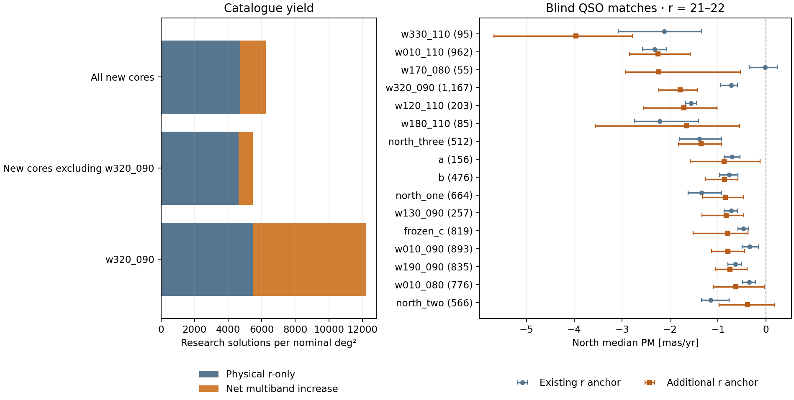

# 冻结 C0/W0 后的广域专项审核

基于 `ebe0cf1` 的已签名汇总。保留原目录、质量选择和观测组参考，按既定窗口和逐核心的公共统计核对增量。严格同源光谱 QSO 衡量同一批对象的精度，盲目录光谱匹配用于检验源类和零点。

## w320_090 的产出及其权重

这 83.594 名义平方度中，全波段共 1,022,792 解，物理 r 对照有 457,257 解。净增 565,535，其中全波段目录有 560,954 个追加 r 锚点解和 5,224 个非 r 锚点解。21,864 个解在至少一轴由单个物理观测组贡献至少 80% 的斜率信息，占 2.14%。少于三个 NSC 观测季的解有 109,641 个，占 10.72%。

| 已完成范围 | 名义平方度 | 全波段解 | 净增 | 每平方度净增 | 两档面积加权的局部 P68 改善 |
|---|---:|---:|---:|---:|---:|
| w320_090 | 83.594 | 1,022,792 | 565,535 | 6,765 | 27.64% / 32.88% |
| 新 748 核心 | 720.836 | 4,502,366 | 1,104,801 | 1,533 | 16.28% / 21.23% |
| 新核心去掉 w320_090 | 637.242 | 3,479,574 | 539,266 | 846 | 15.43% / 20.31% |
| 累计 | 1,047.672 | 6,071,123 | 1,419,861 | 1,355 | 14.45% / 20.91% |
| 累计去掉 w320_090 | 964.078 | 5,048,331 | 854,326 | 886 | 13.79% / 20.23% |

面积加权列先在每个具有至少五个共同 QSO 的核心计算相对 Xiao2025 的 P68 改善，再按核心面积取平均。两列对应 r=21–22 和 22–23。全范围对象合并 P68 相对 Xiao2025 改善 19.8% 和 26.4%。w320_090 占新核心净增量的 51.2%，去掉该窗口后，两档面积加权精度改善仍超过 15% 和 20%。

窗口内 2,257 和 1,304 个严格同源 QSO 的 NSC 夜数中位数分别为 17 和 15，联合观测时基中位数为 12.95 和 14.00 年。两档中有 2,240 和 1,285 个 QSO 的 NSC 时基达到两年。几乎所有共同对象使用 NSC g/r/z，i 出现在 1,643 和 1,001 个对象中，Y 出现在 781 和 70 个对象中。全波段 P68 为 6.11 和 8.32 mas/yr，Xiao2025 对应为 9.58 和 14.48 mas/yr。

Slurm `61627266` 用签名成员直接复算逐对象合并的 P68。新范围去掉该窗后，两档分别有 28,275 和 12,812 个共同 QSO。全波段 P68 为 **6.714 和 9.292 mas/yr**，Xiao2025 为 8.437 和 12.445 mas/yr，改善 **20.43% 和 25.34%**。累计范围去掉该窗后的两档改善为 18.94% 和 25.16%。这个窗口对净增源密度的影响远大于它对合并精度改善的影响。

逐源成员说明高产出主要来自既有 r 锚点中的边缘观测条件。560,954 个追加 r 锚点解中位有 **7 个 NSC 夜、3 个观测季、3.75 年 NSC 时基、9.83 年联合时基**。既有 r 锚点的对应值为 14 夜、5 季、4.89 年和 12.63 年。追加 r 锚点的任一轴单组杠杆达到 80% 的计数为 16,435（2.93%），各轴最大物理组杠杆中位数约 0.55。全波段增加了观测相对稀疏时仍可用的科研解。单个波段的因果贡献需固定源和观测子集的对照来判定。

## 恢复共同参考支持的 A 区

首批缓存目录无解、广域目录恢复的 12 个核心合计 11.970 名义平方度，产出 91,214 个全波段解和 85,277 个物理 r 对照解。核心汇总中的有效参考支持都落在共同东赤道图分量 0。共同图共保留 7,238 个物理组。上述核心有 15,603 个高杠杆解、2,047 个少于三个 NSC 季的解、828 个非 r 锚点解。

在这 12 个核心中，21–22、22–23 等的严格同源 QSO 分别有 717 和 332 个。合并全波段 P68 为 **5.001 和 7.922 mas/yr**，相对 Xiao2025 改善 13.92% 和 11.07%。两个档的北向零点分别为 −0.54 和 −0.84 mas/yr，东向形式 1σ 覆盖为 56.3% 和 50.0%。各核心有 49–114 个有支持的物理组。91,214 个科研解的两轴形式误差中位数为 1.84 和 2.47 mas/yr，联合时基中位数为 17.72 年。

在 16,309 个独立留出星系的跨巡天位置对照中，校准使东／北中位位置差由 **+14.34 / −20.09 mas** 变为 **−1.40 / −1.77 mas**。二维位置差 P68 从 216.56 降到 212.92 mas。跨 HEALPix 的分母为八个星系，核心间跨界分母为零。这里具有静止参考和科研测量支持，绝对自行零点、边界一致性和形式误差覆盖仍保留质量标志。

## 追加 r 锚点的北向零点

r=21–22 的 8,521 个盲目录光谱匹配对象，合并北向中位数为 −1.11 mas/yr。较大的负向窗口包括西赤道图 w320_090（1,167 个，−1.79）、西北图 w010_110（962 个，−2.26）和东北图 w120_110（203 个，−1.71）。西北图 w330_110 有 95 个对象，中位数为 −3.96 mas/yr。西赤道图中 w010_080 和 w010_090 的偏差分别为 −0.63 和 −0.79 mas/yr。

按冻结成员和真实观测夜复算后，西北图 1,057 个对象的北向中位数为 **−2.47 mas/yr**。单 run 和多 run 分别为 −2.85（631 个）和 −2.18（426 个）。西赤道图中，至多五个 NSC 夜的对象为 −1.82（459 个），较多夜的为 −1.00（3,196 个）。这些差异定位了正式发布前的重点区域。参考图、run 和观测夜条件重叠，优先按这些因素共同解释。目录继续采用冻结 C0/W0。

图中区间按每个源类分别做对象重采样。括号给出追加 r 锚点光谱样本量。窗口样本共享物理观测，跨核心空间零点资格仍需按独立参考图和物理组验证。

## 可读取的质量信息

以每个星等档至少五个严格同源 QSO 为描述性分母，两个档均达到该分母的核心有 775 个，覆盖 759.036 名义平方度、4,492,491 解。一个档达到分母的有 232 个核心、205.706 名义平方度、918,225 解。两档都稀疏的有 88 个核心、82.930 名义平方度、660,407 解。面积按登记核心计算，正式空间零点资格仍由相应独立检验决定。

用实际测量字段读取普通、短时基和高杠杆样本。少于三个 NSC 季、任一轴单组杠杆达到 80%、非 r 锚点、身份未确认及绝对零点未认证各自保留质量位。光谱抽样支持、源级观测支持及误差认证用途不同，筛选时同时读取。

[签名成员与留出星系统计](../results/summary/v17_member_followup_audit_summary.json) · [公开专项统计及输入 SHA](../results/summary/v17_production_followup_audit_summary.json) · [已完成目录的科学报告](../reports/experiment_A_v1.7_wide_production.md)
