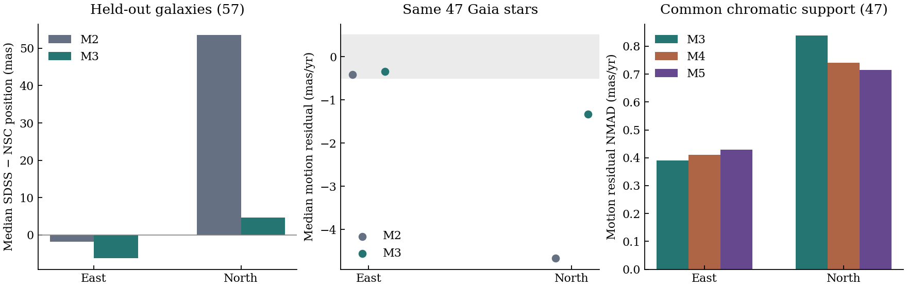
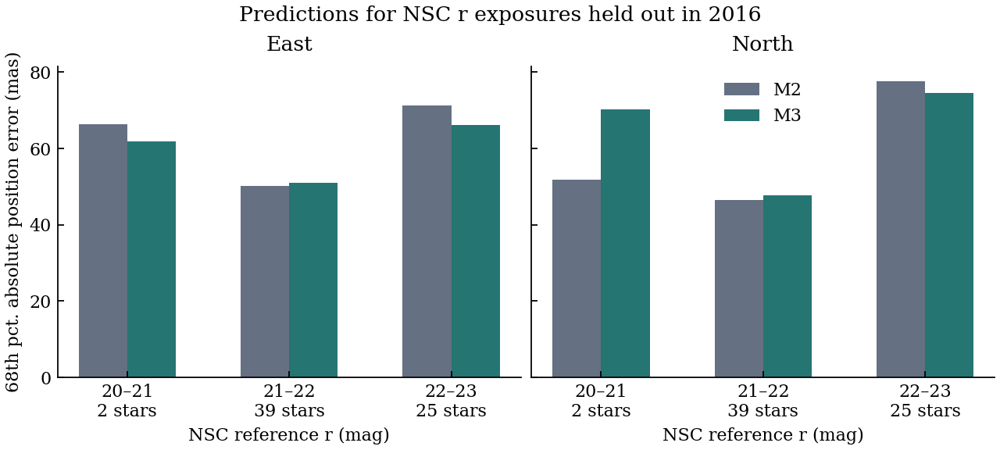

# 实验 A v0.3 · 普通源自行精度与目录级校准

本轮在 NERSC 计算节点用冻结的四区 SDSS、NSC DR2 单曝光检测，检验三件事。早期 SDSS 位置增加多少时间信息，重复扫描能否稳定提高精度，独立参考星系能否校正在赤道区达到数 mas/yr 的公共偏差。高自行关联的结论沿用 [v0.2 报告](experiment_A_v0.2.md)。

## 早期 SDSS 与重复扫描

四区 214 颗亮源在各自天区的四路比较使用相同对象。表中为相对 Gaia 的东、北分量残差 NMAD，单位 mas/yr。星的检测级关联按 Gaia 传播结果固定，拟合使用 SDSS 和 NSC 的目录位置。NSC 使用 Gaia DR2 标定，检验含有共用参考系的成分。亮端检测采用原生波段 20.5 等上限和 150 mas 形式位置误差上限；保留缺测星等。v0.2 的 A1 关联输入可到 22.5 等。 [单位与样本](../docs/selection_and_units.md) · [NOIRLab NSC](https://datalab.noirlab.edu/data/nsc)

| 区域 | 源数 | 官方 NSC | M0 NSC 重拟合 | M1 加最早一次 SDSS | M2 加全部 SDSS |
| --- | ---: | ---: | ---: | ---: | ---: |
| Pal 5 场 | 20 | 1.30 / 2.73 | 2.12 / 2.37 | 1.20 / 0.85 | 0.92 / 1.34 |
| 北天 | 50 | 8.82 / 11.73 | 8.12 / 12.51 | 1.76 / 1.08 | 1.82 / 1.08 |
| 拥挤区 | 96 | 1.43 / 2.00 | 2.03 / 1.93 | 1.52 / 1.00 | 1.34 / 1.03 |
| 赤道 | 48 | 1.10 / 1.47 | 1.00 / 1.62 | 0.95 / 0.83 | 0.36 / 0.57 |

早期 SDSS 使四区北向散布下降。赤道从 M0 到 M1 的中位时间跨度为 5.12 → 20.00 年，从 M1 到 M2 仍为 20.00 年。赤道 M0/M1/M2 的中位 SDSS run 数为 0/1/24，按 TT MJD 整数分箱的 SDSS 观测日数为 0/1/23，总观测日数为 37/38/60.5。东/北向形式时间杠杆，即斜率形式误差的倒数，分别为 0.327/0.320、0.477/0.473、1.214/1.208 yr/mas。赤道 M2 北向 NMAD 收紧至 0.57，北向偏差达到 −4.40 mas/yr。Pal 5 多加 SDSS 后，北向散布反而上升。把这一变化推广到全巡天需要更多独立天区和扫描组。

## 赤道零点与色项

以 SDSS run×camcol、NSC 曝光为组，用 133 个静止参考星系估计公共位置偏移，按参考对象重采样传播零点误差。最后通过参考数及零点不确定度门槛的有 22 个 SDSS 组和 115 个 NSC 组。60 个星系留出，其中 57 个有两巡天校正覆盖，SDSS − NSC 的北向位置差中位数从 +53.52 降到 +4.70 mas，东向从 −1.76 到 −6.21 mas。当前口径限于有校准支持的观测组。在当前相对坐标规范下，22 个 SDSS run×camcol 的北向估计偏移介于 −24.9 至 +79.8 mas，中位 +59.3 mas。绝对偏移零点依赖坐标规范，组间差异可直接比较。更细的 field/CCD 共模仍需单独验证。

| 赤道同一组检测、同 47 颗星 | 东向 M2 → M3 | 北向 M2 → M3 |
| --- | --- | --- |
| 偏差中位数，mas/yr | −0.42 → −0.34 | −4.66 → −1.33 |
| NMAD，mas/yr | 0.42 → 0.43 | 0.63 → 0.66 |
| 绝对误差 68 分位，mas/yr | 0.67 → 0.60 | 4.89 → 1.71 |
| 标准化残差 NMAD | 0.47 → 0.44 | 0.96 → 0.86 |
| 一倍形式误差以内 | 38/47 → 41/47 | 1/47 → 15/47 |
| 两倍形式误差以内 | 46/47 → 46/47 | 2/47 → 40/47 |
| 绝对残差超过 5 mas/yr | 0/47 → 0/47 | 10/47 → 0/47 |

M3 保留 48 颗亮星中的 47 颗，每星可用检测比例中位数 76%。北向绝对误差 68 分位改变量的对象配对 bootstrap 95% 区间为 −3.31 至 −3.05 mas/yr，条件为本场给定观测与参考星系。0/47 个超过 5 mas/yr 给出约 7.6% 的 Wilson 95% 上限。北向两倍误差覆盖 2/47 和 40/47 的 Wilson 95% 区间约为 1–14% 和 72–93%。零点解释了多数公共偏差，剩余 −1.33 mas/yr 超过预设的 0.5 mas/yr。

M4 加仪器/波段的残余颜色项，M5 再加沿天顶方向的几何 DCR 项。使用 NSC 172 个曝光的精确元数据核查气团和几何，色项拟合排除 29 个观测组。共同色项支持集覆盖 47 颗亮星、每星原检测中位 68%。该支持集上北向 NMAD 依次为 0.84、0.74、0.72 mas/yr，东向为 0.39、0.41、0.43。三模型北向偏差都在 −1.50 至 −1.53 mas/yr。37 个同时留出对象及色项训练观测组的星系，北向跨巡天 NMAD 从 M3 的 57.2 mas 增加到 M4 的 66.3 和 M5 的 67.9 mas。留出曝光的公共零点来自独立训练星系，留出约束针对颜色模型。按本轮目标保留 M3。 [几何 DCR 模型参考](https://arxiv.org/abs/1703.01679)

## 其他天区复核

在其余三场保持相同校准门槛并各自使用本场参考星系。北天 40/50 颗有共同校准支持，东向偏差从 +3.61 到 +0.51，北向偏差从 +2.13 到 +0.55 mas/yr；两轴绝对误差 68 分位的改善在固定样本的 bootstrap 95% 区间内维持同一方向。拥挤区 96/96 颗有支持，东/北偏差从 −0.71/+0.81 到 +0.10/−0.47 mas/yr；绝对误差 68 分位改变量的两轴区间均包含零。Pal 5 小区只有 18 个训练参考星系，现有组未通过零点不确定度要求。两个新增有效场支持继续检验公共零点，并显示参考覆盖与转移难度。

## 暗源与发表产品

2016 年的 NSC r 检测从恒星关联和拟合中整年留出。训练检测要求位置误差 ≤200 mas、估算 SNR≥5，并采用普通源固定位置关联。按训练期 NSC r 星等中位数分箱，利用 Gaia 邻近位置排除明显的 Gaia 对应体。给 M2 和 M3 使用共同、唯一的留出位置匹配，门槛基于 M2 预测，两方法共用 400 mas 位置门和 300 mas 竞争间隔。下表的重复检测共享恒星和曝光，评价范围限于能唯一取回的留出位置。

| 参考 r | 匹配轨迹 / 测试位置数 | 东向绝对残差 68 分位 M2 → M3，mas | 北向绝对残差 68 分位 M2 → M3，mas |
| --- | ---: | ---: | ---: |
| <20 | 0 / 0 | — | — |
| 20–21 | 2 / 7 | 66.3 → 61.9 | 51.7 → 70.3 |
| 21–22 | 39 / 111 | 50.2 → 51.1 | 46.6 → 47.8 |
| 22–23 | 25 / 52 | 71.2 → 66.2 | 77.6 → 74.4 |

覆盖 5 个实际测试曝光。按对象先计算各自的位置残差中位数，再配对重采样，21–22 与 22–23 两箱两轴绝对误差 68 分位变化的 95% 区间均跨零。22–23 等的 25 颗中，按目录 FWHM 中位数分组，较窄/较宽组的径向残差中位数约为 50/109 mas（12/13 颗）；21–22 等仅为 54/60 mas（19/20 颗）。各组仍共享少量曝光，FWHM 与 SNR、拥挤和芯片位置未同时控制。这一诊断尚不足以选择图像重处理曝光。

7 个独立光谱 QSO 候选中，6 个有 M2、M3 和官方 NSC 的共同覆盖，拟合时排除在参考框架训练外。6 颗的北向自行绝对误差 68 分位为 M2 5.01、M3 1.78、官方 NSC 2.99 mas/yr；对应中位偏差为 −4.80、−1.61、+0.29 mas/yr。(r=21)–23 只有 3 颗 QSO，整体统计无法验证暗端零点与 15% 的精度门槛。

对四区亮源已直接复现官方 NSC 自行对照。ScienceDB V3 的实际 `desipm.fits` 首部已读取，确认 `PM_SOURCE` 列与论文一致。共同暗源应只用地基的 `DESI` 行。旧 Scratch 没有完整副本，分布在全表的 9 个非零字节区间中 4 个成功读取，5 个超时。成功返回的 256 行提示表可能按 NSIDE=128 的 HEALPix RING 排序，其中 202 行标记 DESI，54 行标记 Gaia。赤道切片作业 `61406739` 所需 4 个像素均因读取超时未取得完整边界，作业退出且未写出目录切片。因此 Xiao2025 同源比较尚未完成。可用的突破口是 NERSC 上已验证的完整 `desipm.fits` 副本或稳定的官方切片源。未将 Gaia 行、旧论文总体误差或位置基准当作 Xiao2025 的暗源测量。 Pal 5 的 20 颗亮 Gaia 控制源没有独立的星团成员选择，暂缺暗星团成员验证。 [发表数据](https://doi.org/10.57760/sciencedb.07990) · [Xiao2025](https://arxiv.org/html/2405.04016v2)

## 路线判断

**继续实验 A 的参考框架校准，暂缓实验 B。** 已有目录在赤道实测中显著消除了公共北向偏差，而且清楚区分了早期 SDSS 的时间杠杆、重复扫描的散布收益与校准收益。暗端留出位置改善偏小，在 21–22 等没有绝对误差收益，且尚缺相同暗源对两个发表产品的改善区间。优先补齐地基目录同源对照、可独立选取的暗恒星样本及额外的参考星系。达到覆盖后，若剩余残差跨天区持续随 seeing、SNR、邻源距离或像面坐标改变，再选相应曝光对比自由 PSF 质心与目录质心。
