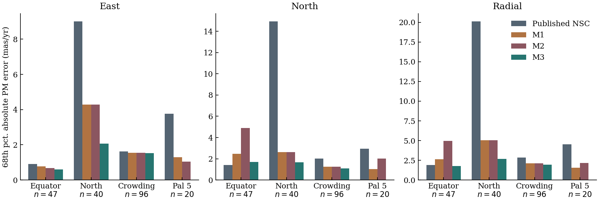
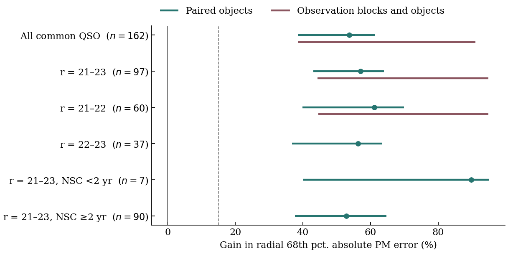

# 实验 A v0.4 · 普通源对官方 NSC DR2 的严格同源比较

本轮检验较早的 SDSS 位置和冻结的 M3 星系零点校准，能否改善相对于官方 NSC DR2 的普通源自行精度。主指标是两分量向量模长的第 68 百分位。暗端采用独立光谱 QSO，以 (21\le r<23) 的配对样本检验约 15% 的实用增益和 95% 区间。QSO 检验探测到的类星体的零自行，恒星端仍需要独立的暗星参照。 [官方 NSC](https://datalab.noirlab.edu/data/nsc) · [冻结计划](../docs/experiment_a_v04_plan.md)

## 亮星同源复核

四个原有控制区共有 214 颗亮星，三个天区中 183 颗获得 M3 共同检测支持。在这些对象上，M0 仅用共同 NSC 检测，M1 再加入该共同集中的最早 SDSS，M2 使用全部共同 SDSS，M3 对 M2 加冻结的星系零点。参考选取、每轴 50 mas 底噪和校准门槛沿用 v0.3，官方 NSC 的发表自行按同一对象重取。Pal 5 的 20 颗仅提供同源 NSC、M0、M1、M2 对照，其原场未达到 M3 校准门槛。

| 区域 | 共同星数 | 官方 NSC 二维 | M1 | M2 | M3 | 相对 NSC 的二维收益及对象配对 95% 区间 |
| --- | ---: | ---: | ---: | ---: | ---: | --- |
| 赤道 | 47 | 1.904 | 2.623 | 4.954 | 1.752 | M3 +8%，−20% 至 +24% |
| 北天 | 40 | 20.107 | 5.042 | 5.042 | 2.658 | M3 +87%，+81% 至 +91% |
| 拥挤区 | 96 | 2.848 | 2.111 | 2.111 | 1.946 | M3 +32%，+17% 至 +43% |
| Pal 5 | 20 | 4.548 | 1.567 | 2.181 | — | M1 +66%，+22% 至 +79% |

表中误差单位为 mas/yr。赤道东向第 68 百分位从官方 NSC 的 0.917 降到 M3 的 0.598，配对改善约 35%（95% 区间 +8% 至 +55%）。北向从 1.414 到 1.713，点估计恶化约 21%，收益区间 −63% 至 +7%。赤道 M3 的北向中位差为 −1.33 mas/yr，官方 NSC 为 +0.37。北天和拥挤区的主要改善已在 M1 出现，共同检测中 M2 增加的有效扫描有限。赤道 M2 至 M3 的二维误差下降约 65%，说明零点校准对重复扫描场的收益至关重要。

配对区间的条件是本区给定的对象和观测组。公开汇总另含每轴中位偏差、NMAD、归一化误差覆盖、超过 5 mas/yr 的尾数、对每类最大时间杠杆观测组的删组诊断和各阶段退出数。Gaia 用于这里的独立目标残差，NSC 测量的标定本身使用 Gaia DR2。 [亮星汇总](../results/summary) · [v0.3 方法](experiment_A_v0.3_precision.md)

## 新天区光谱 QSO

DESI DR1 Iron QSO 光谱识别，(0.5<z<6)、`ZWARN=0)，按 TARGETID 去重。以发布表内 Legacy Surveys 的正 r 通量和有限测光作为统一参考，(r=22.5-2.5\log_{10}(F_r))，其中通量单位为 nanomaggy。光谱和 r 星等定义验证样本；自行只使用 SDSS 与 NSC 单曝光检测。候选天区由 SDSS 和 NSC 的位置覆盖预查选择。非 Gaia 的暗星留出位置诊断在 v0.3 独立报告。 [DESI DR1 QSO 数据模型](https://desidatamodel.readthedocs.io/en/25.3/DESI_ROOT/survey/catalogs/RELEASE/QSO/SPECPROD/QSO_cat_cumulative.html) · [SDSS DR17 成像数据](https://www.sdss4.org/dr17/imaging/imaging_access/)

三个天区各覆盖约 0.43 平方度，总面积约 1.29 平方度。先锁定首批两场，在看到 QSO 自行误差前，按位置覆盖加入 Stripe 82 西段，用于复核高重复扫描条件。

| 新天区 | 光谱候选 | 有 SDSS/NSC 位置匹配 | 其中 `21≤r<23` | 区域 SDSS run 数 |
| --- | ---: | ---: | ---: | ---: |
| Stripe 82 东段 | 56 | 55 | 35 | 53 |
| 北银冠 A | 60 | 53 | 31 | 2 |
| Stripe 82 西段 | 100 | 97 | 55 | 39 |

覆盖计数检验位置附近是否有可读的探测及 NSC 对象。完整同源比较另要求单曝光时标、误差和信噪比合格，并通过唯一 NSC 发表对象与 M3 支持门槛。

| 天区 | 严格共同 QSO | 其中暗端 | 中位 NSC → 联合基线，年 | 暗端官方 NSC | M1 | M2 | M3 |
| --- | ---: | ---: | ---: | ---: | ---: | ---: | ---: |
| Stripe 82 东段 | 55 | 35 | 5.07 → 19.22 | 5.99 | 7.66 | 6.12 | 3.32 |
| 北银冠 A | 12 | 7 | 1.08 → 12.89 | 50.31 | 6.80 | 6.80 | 5.14 |
| Stripe 82 西段 | 95 | 55 | 5.86 → 18.92 | 7.86 | 7.54 | 4.95 | 3.40 |

三场共有 162 颗严格同源 QSO，其中 97 颗为 (21\le r<23)。表中自行误差为二维模长第 68 百分位，单位 mas/yr。三场所有严格共同源的 M3 保留率相对于有效发布匹配和跨巡天时间覆盖均为 100%。北银冠 A 的主要损失发生在拟合前，其 r 波段 NSC 采样较少；60 个光谱对象仅 12 个获得共同支持。位置预查覆盖和最终可比样本分别计数。

东段在加最早 SDSS 后误差仍大，重复扫描部分修复，主要收益由 M3 提供。西段的最早历元、重复扫描、星系零点依次带来收益。北银冠 A 的大部分收益在 M1 已出现，NSC 单曝光重拟合的暗端误差仍很高，与其短基线一致。两处重复扫描场，删掉最大时间杠杆的一组 SDSS 或 NSC 检测导致 M3 的中位位移为 0.26–0.46 mas/yr。北银冠 A 删除唯一 SDSS 组后无法求同一联合解。

## 暗端主检验与决策

| 方法 | 东向绝对误差第 68 百分位 | 北向绝对误差第 68 百分位 | 二维绝对误差第 68 百分位 | 东／北中位差 | 二维误差大于 5 mas/yr |
| --- | ---: | ---: | ---: | ---: | ---: |
| 官方 NSC | 4.59 | 5.50 | 8.23 | −0.10 / +1.30 | 51/97 |
| M0 | 6.43 | 5.80 | 10.26 | +1.58 / +0.87 | 66/97 |
| M1 | 3.99 | 4.62 | 7.64 | +1.11 / −0.95 | 53/97 |
| M2 | 3.50 | 3.86 | 5.50 | +2.27 / −1.27 | 38/97 |
| M3 | 2.22 | 2.59 | 3.53 | −0.24 / −0.67 | 14/97 |

误差单位为 mas/yr。相对于官方 NSC，M3 的二维误差改善 **57%**，对象配对 bootstrap 95% 区间为 **43–64%**。两轴分别改善 52% 和 53%。异常尾从 51/97 降到 14/97，相应 Wilson 95% 区间约为 43–62% 和 9–23%。M3 的暗端北向中位差仍约 −0.67 mas/yr，超过每轴 0.5 mas/yr 的初始目标。

跨场审核发现两处 Stripe 82 共享 17 个物理 SDSS 扫描，三个天区因此按保守口径归为两个观测块。观测块和对象两级 bootstrap 的二维收益区间为 44–95%，逐次删除一个天区的二维收益点估计为 50–60%。观测块只有两个，区间用于检查已观测场的相关性敏感度。单独看 NSC 基线约 5–6 年的两处 Stripe 82，暗端仍为 7.15 → 3.37 mas/yr，改善 53%，对象配对区间为 38–65%，因此短基线北银冠 A 的极端改善并非合并结果的主要来源。(r=22)–23 的 37 颗只来自 Stripe 82，跨观测块的复现仍待完成。

**建议扩大实验 A 的独立场验证，暂缓全巡天生产和图像级 PSF 对照。** 97 颗暗 QSO 的实测收益超过 15% 门槛，早期 SDSS、重复扫描和公共零点在该样本中都有贡献。下一批优先找不共用 SDSS 扫描、且有足够 22–23 等对象的天区，加入独立暗恒星参照，验证零点和覆盖能否推广。在本实验的短基线北银冠 A，联合解只覆盖 12/60 个光谱候选，适用范围仍受 r 波段观测数及时间长度约束。

## 运行记录

亮星 `61408894`，覆盖 `61408915`，QSO `61409648`、`61409649`、`61409725`，合并与观测组审核 `61410028`。覆盖预查在前三场取得数据后让出 debug 资源；共同样本来自 SDSS CAS 和 NSC DR2。SAS 镜像已核验文件索引与示例字段，并保留为备用入口。逐源结果和扫描配对留在 NERSC。 [公开汇总](../results/summary) · [项目主线](../PROJECT_CONTEXT.md)
