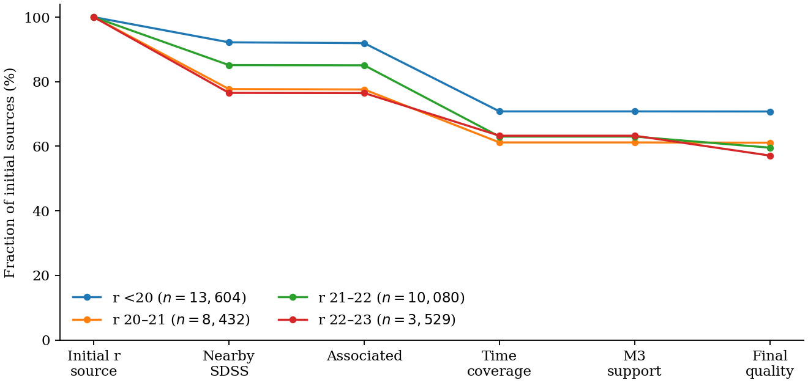
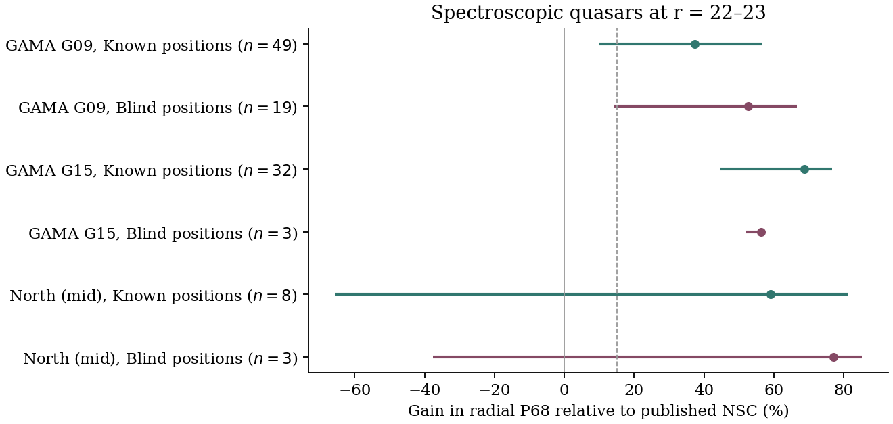

# 实验 A v0.5 · 代表性真实天区试生产

这一轮从 `c23506d` 出发，检验 v0.4 的暗端精度收益能否在 Stripe 82 以外复现，以及简单的普通源盲关联能留下多少可用源。冻结 M3 星系零点、稳健线性拟合及 50 mas 每轴单位置误差底限。基准为官方 NSC DR2 自行，比较量为零点、二维绝对残差第 68 百分位和异常尾。 [v0.4 报告](experiment_A_v0.4_nsc.md) · [v0.5 范围与门槛](../PLAN.md)

## 区域与分母

在查看自行数值前，以 SDSS/NSC 位置覆盖和 DESI DR1 光谱样本锁定 COSMOS、GAMA G15、EGS、北银冠短基线场和北银冠中纬场。每个几何核心约 1.21 平方度，另保留缓冲以处理边缘，按核心输出。COSMOS 全区取数因档案吞吐暂停，使用预先登记的 GAMA G09 备选。暂停时已取得约 8,000/122,836 个光学档案对象并保留缓存，未生成 COSMOS 自行。Gaia 和 DESI 光谱目标在关联结束后才进入验证；M3 用训练星系估计零点，并单列留出星系的位置残差。 [DESI DR1 发布说明](https://data.desi.lbl.gov/doc/releases/dr1/) · [官方 NSC](https://datalab.noirlab.edu/data/nsc)

试生产覆盖 NSC 发布对象中有 r 探测，且目录合成 r<24 或缺少有效 r 合成测光的范围。取回这些档案对象下所有已发布单曝光；原 NSC 对象标签只用于取数、冻结的星系参考和发布自行的同源审计。关联用 SNR≥5 的 r 检测和 1″ 固定位置半径，初始候选用独立 NSC 位置分组、中位 r 和点状形态定义。SDSS 位置机会、关联保留、拟合跨度、M3 覆盖与最终质量分别计数。档案未发布的图像源、无合格 r 测量对象及超出固定半径的位置变化影响分母。试验星表中的点状候选可包含 QSO。

正式解至少包含两个 NSC r 历元，NSC 跨度至少 0.6 年、联合跨度至少 5 年；施加 M3 后仍须达到这些条件，最终每轴形式自行误差不超过 10 mas/yr，且归一化位置残差第 68 百分位不超过 3。验证按光谱 QSO、Gaia 精度控制、较暗 Gaia 参照和独立的 2017 整年留出分别报告。Gaia 校验与 NSC 共享部分参考框架。暗恒星的外部检索找到 COSMOS 的 ACS–HSC 研究，但当前可核验的公共记录未提供可直接读入的完整逐源自行表；论文中少量经过太阳运动改正的示例不直接作为 ICRS 真值。 [ACS–HSC 研究](https://doi.org/10.3847/1538-4357/ac5a4f) · [机构存档](https://authors.library.caltech.edu/records/8qtqw-50k24)

## 五个真实核心的星表输出

| 天区 | 标准化合格天测行 | 最终试验源 | 22–23 等最终／初始 | 每平方度最终源 |
| --- | ---: | ---: | ---: | ---: |
| EGS | 196,055 | 3,084 | 0/21 | 2,554 |
| 北银冠短基线 | 85,343 | 876 | 0/16 | 725 |
| 北银冠中纬 | 278,296 | 4,390 | 434/1,147 | 3,635 |
| GAMA G15 | 571,515 | 5,974 | 604/994 | 4,947 |
| GAMA G09 | 1,231,329 | 8,478 | 978/1,351 | 7,020 |

初始点状候选由 NSC 独立位置组定义。质量流水线各阶段的数目见下表，星等使用各轨迹 NSC r 中位数。

| r 星等 | 初始 | 1″ 内有 SDSS | 盲关联 | 时间拟合合格 | 星系校准支持 | 最终质量合格 |
| --- | ---: | ---: | ---: | ---: | ---: | ---: |
| <20 | 13,604 | 12,542 | 12,507 | 9,632 | 9,632 | 9,628 |
| 20–21 | 8,432 | 6,553 | 6,542 | 5,160 | 5,160 | 5,153 |
| 21–22 | 10,080 | 8,582 | 8,576 | 6,351 | 6,351 | 6,005 |
| 22–23 | 3,529 | 2,701 | 2,699 | 2,233 | 2,233 | 2,016 |
| ≥23 | 154 | 1 | 1 | 0 | 0 | 0 |

总几何核心面积约 6.04 平方度。盲关联输出 22,802 个合格试验解，其中 2,016 个在 NSC r=22–23，占该档 3,529 个初始候选的 57%。EGS 和北银冠短基线场在此档没有达到时间门槛的解，三个较深场的档内保留率约为 38%、61% 和 72%。这些比率以可获得的 r 波段点状候选为分母，不能外推为天上所有恒星的完整率。

## 自动关联、星系零点和恒星验证

Gaia 精度验证的 12,109 个双巡天对象中，盲关联恢复 11,968 个，最终质量门槛后保留 9,063 个。9,074 条有 Gaia 标签的最终轨迹中检测到 1 条混入多个已知对象。已知标签检测共 50,083 条，其中 1 条属于次要对象；剩余未标记检测的污染率未知。星系留出中，五区校正后的两轴位置差中位数均小于约 3.7 mas。该统计检验星系参考框架，还需要 QSO 自行残差检验时间相关零点。

以 NSC r=21–22 的 Gaia 较暗子样本为例，全部有基础的五场都保留了比较对象。下表用同一目标和相同的 Gaia 真值对比发布 NSC 与盲 M3。

| 天区 | 共同 Gaia 源 | NSC → 盲 M3 二维 P68（mas/yr） | 配对改善 95% 区间 |
| --- | ---: | ---: | ---: |
| EGS | 73 | 40.10 → 7.70 | 78% 到 85% |
| 北银冠短基线 | 14 | 80.87 → 5.22 | 87% 到 96% |
| 北银冠中纬 | 56 | 8.89 → 6.61 | 6% 到 45% |
| GAMA G15 | 65 | 13.28 → 4.13 | 60% 到 74% |
| GAMA G09 | 143 | 9.07 → 3.33 | 58% 到 69% |

2017 整年留出在北银冠中纬场的最暗箱有 462 颗获唯一匹配，径向位置 P68 为 104.28 → 104.43 mas。G09 同箱 59 颗为 99.82 → 95.99 mas。其余三个核心此箱没有合格留出量。这些是同一留出位置的 M2、M3 预测比较，受共享曝光和观测时段影响。

五个预定 0.005 平方度小窗内，旧运动搜索均完成，无困难冲突分量。它提供小窗对照，整区生产的已知恢复率和实际性能来自固定位置法。

## 非 Stripe 82 的暗端复现

档案观测组审核显示五场与 v0.4 的 Stripe 82 东西场没有共享的 SDSS run 或 NSC 曝光。G09、G15 之间共享 3 个 SDSS run，因此合并为一个观测块。五区共有 567 个严格同源光谱 QSO。下表使用 DESI DR1 中的 Legacy Surveys r 星等，采用独立光谱位置对照。单位为 mas/yr。

| r 星等 | 样本 | 官方 NSC | M1 | M2 | M3 | M3 改善及对象配对 95% 区间 |
| --- | ---: | ---: | ---: | ---: | ---: | --- |
| 21–23 | 277 | 15.20 | 7.73 | 6.96 | 6.68 | 56%，50–62% |
| 21–22 | 188 | 14.54 | 6.55 | 6.26 | 5.63 | 61%，52–67% |
| 22–23 | 89 | 16.15 | 10.00 | 9.66 | 9.22 | 43%，24–62% |

对于 22–23 等，按两个观测块与对象两级重采样的二维收益区间为 16–69%。两个观测块提供独立复现，适用范围仍以本次实际覆盖为准。早期 SDSS 是本轮最大的增益来源，重复检测和 M3 继续降低部分绝对误差。22–23 等的 M3 东／北中位差为 −1.21 / +0.53 mas/yr，未达到每轴约 0.5 mas/yr 的目标。超过 5 mas/yr 的二维异常尾仍有 65/89，官方 NSC 为 77/89。在较短期、曝光不足的场，增加时间基线的价值和能获得的有效源数需要同时考量。

完整盲目录的同源复核在这 89 颗最暗 QSO 中保留了 25 颗。G09 有 19 颗，官方 NSC → 盲 M3 二维 P68 为 13.01 → 6.16 mas/yr，配对收益 53%（95% 区间 14–67%），但北向中位差仍约 +1.97 mas/yr。G15 和北银冠中纬场各有 3 颗，区间较宽。这个结果表明已知位置的暗端收益可在部分盲目录中保持，同时保留率与零点仍需要独立验证。

## 资源实测与下一步

| 场 | 取数、标准化用时（分钟） | 拟合及验证 CPU（秒） | 拟合及验证峰值（MiB） | 归档原表数据（MB） |
| --- | ---: | ---: | ---: | ---: |
| EGS | 1.31 | 107 | 1,061 | 65.6 |
| 北银冠短基线 | 1.20 | 43 | 421 | 26.9 |
| 北银冠中纬 | 2.85 | 114 | 934 | 65.6 |
| GAMA G15 | 3.87 | 200 | 1,196 | 129.7 |
| GAMA G09 | 4.57 | 329 | 2,209 | 261.4 |

整批作业最大 Slurm RSS 约 3.12 GiB，固定半径关联每场用时约 0.5–1.2 秒。五个已完成场的单位面积实测外推到 100–300 平方度，拟合及验证约需 **1.0–22.7 CPU 小时**、取数及标准化约需 **1.7–18.9 作业小时**，原表约 **2.2–64.9 GB**。这些范围以已完成场的最小、最大吞吐计算，排队、缓存副本和额外失败重试另计。COSMOS 工作量超出这一分布，扩面积前应先验证高密度区域的分片查询、断点续跑和服务端吞吐。

**继续实验 A 的定向验证，暂缓 100–300 平方度生产。** 独立暗 QSO 复现已达到实用增益门槛。生产门槛还差三项。需要扩充 22–23 等盲目录中可独立校验的普通暗恒星，核实本轮最暗箱只有 25 颗共同 QSO 的选择限制，才能量化暗星污染和精度。需要在更多独立观测条件下控制时间相关零点到约 0.5 mas/yr，并找到可复现的暗端覆盖指标。需要让档案取数在通常场和 COSMOS 等极端密度场都能稳定完成。优先补齐这些证据，固定位置关联继续作为普通样本基准，高自行优化和 PSF 重处理维持后续对照定位。

运行回执为预查 `61412060/61412061`，G09 备用预查 `61413531`，完整场生产 `61412448/61412451/61412452/61412453/61413627`，合并与资源审计 `61413687`。COSMOS `61412454` 为范围决策后的取消，部分查询缓存保留在 NERSC。 [去标识汇总](../results/summary) · [项目主线](../PROJECT_CONTEXT.md)
