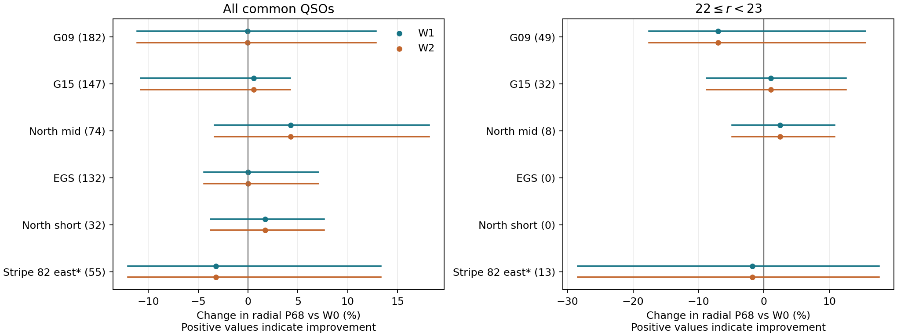
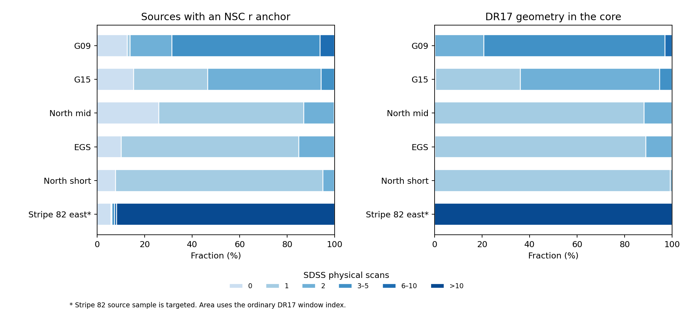
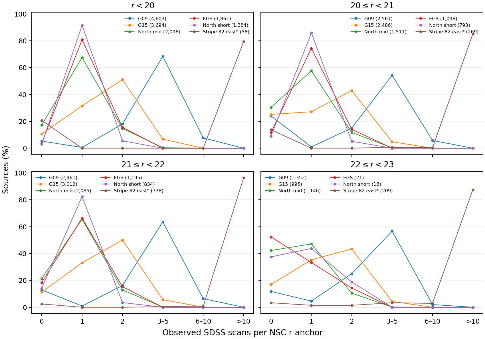
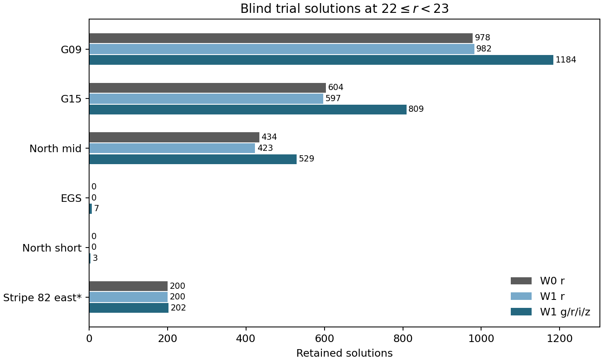

# 实验 A v0.6 · 观测权重、异常点、视差与有效历元

本轮在五个普通场和一个 Stripe 82 目标切片使用约 296.6 万条通过基础坐标、时间及位置误差筛选的目录检测。本轮检验在 v0.5 已获得的单曝光检测上，哪些天测处理能提高普通源的自行精度或有效覆盖。五个区域沿用 v0.5 核心与 1″ 普通源关联，另用 v0.4 的 Stripe 82 东段目标切片检查密集重复观测。所有权重对照冻结 M3 的位置改正，光谱 QSO 和 Gaia 保留到评估阶段。

W0 沿用目录误差与统一 50 mas 底噪。W1 用独立于评价对象的训练星系，对同仪器、同波段的跨夜或跨扫描观测差拟合误差尺度和底噪。W2 从 W1 边际方差中划出观测组共享分量。对同一对象与检测比较每轴绝对残差 P68、径向 P68、零点和按发表误差归一化的覆盖。W0、W1、W2 的形式协方差都传播 M3 校准重采样误差。样本内配对重采样保留对象间配对关系，G09 和 G15 共享三个 SDSS run，区域趋势需要结合这一点解读。 [冻结配置](../configs/astrometry-v06.toml) · [位置、时间和误差审计](../docs/astrometry_v06.md)

## 自行精度与权重

沿用 r 波段的严格光谱同源对照，最暗箱的三个场仍有 v0.5 的 89 颗 QSO。其中 25 颗也在 v0.5 盲目录共同样本中。下表以 22–23 等源的 DESI/Legacy Surveys r 星等分箱，自行单位均为 mas/yr。对同一组光谱对象比较二维绝对误差 P68，并给出调整观测权重的配对收益。

| 天区 | 共同 QSO | 官方 NSC | W0 | W1 | W1 相对 W0 改善及 95% 区间 |
| --- | ---: | ---: | ---: | ---: | --- |
| G09 | 49 | 12.17 | 7.63 | 8.16 | −7.0%（−17.5% 至 +15.5%） |
| G15 | 32 | 30.59 | 9.59 | 9.49 | +1.0%（−8.7% 至 +12.6%） |
| 北银冠中纬 | 8 | 27.55 | 11.31 | 11.03 | +2.5%（−4.9% 至 +10.7%） |

W1 比 50 mas 基准更能贴合部分独立星系位置差。G09 的 DECam r 留出星系的两轴标准化绝对位置差 P68 从约 0.46/0.45 变成 0.89/0.86。对应 QSO 的自行精度和零点未稳定改善。在 G09 的 19 颗共同盲解上，官方 NSC、W0、W1 的 P68 分别为 13.01、6.16、6.29，北向中位数分别为 +0.94、+1.97、+1.82。G15 的严格 QSO 东向中位数仍约 −2.1。采用实测误差尺度可以缩小形式误差，但自行准确度未随之等比例提高。覆盖率、误差散布和偏差应一并引用汇总。 [统计汇总](../results/summary)

Stripe 82 东段 55 颗共同 QSO 的 P68 为官方 NSC 5.43、W0 3.16、W1 3.26 mas/yr。最暗的 13 颗为 6.89、4.65、4.73 mas/yr，W1 相对 W0 与普通场结论一致，区间跨零。W2 所估共享分量在 r 波段大多为零，北银冠中纬场 SDSS 北向约 0.70 mas，W2 的自行与 W1 基本重合。现有静止参照加冻结 M3 后的估计器提供的信号较弱，独立观测组仍需验证相关误差。

## 有多少源得到重复 SDSS 观测

五个 v0.5 核心共 6.04 平方度。在 DR17 rerun 301 的实际扫描足迹中，每场均匀抽样 4,096 个点，多于一次物理扫描的面积约为 37.5%。五区 35,858 个盲轨迹中，17,083 个 NSC r 锚点对应两个或更多通过质量筛选且覆盖 M3 的 SDSS run，占 47.6%；在有至少一次 SDSS 检测的 30,360 个锚点中占 56.3%。r=22–23 为 1,734/3,530，其中有至少一次 SDSS 的有 2,701 个。重复观测能补充的时间信息主要看扫描间隔。G09 重复源的 SDSS 时间跨度中位约 7.99 年，G15 约 2 天，北银冠中纬约 7 天。

| 天区 | 多扫描面积 | NSC r 轨迹有 ≥2 次 SDSS | r=22–23 有 ≥2 次 SDSS |
| --- | ---: | ---: | ---: |
| G09 | 99.8% | 9,940 / 11,547 | 1,131 / 1,352 |
| G15 | 63.9% | 5,473 / 10,235 | 475 / 995 |
| 北银冠中纬 | 11.9% | 892 / 6,874 | 122 / 1,146 |
| EGS | 11.1% | 629 / 4,175 | 3 / 21 |
| 北银冠短基线 | 0.7% | 149 / 3,027 | 3 / 16 |

源统计按完整 r 盲轨迹的 NSC 部分取中心、亮度和形态。产出漏斗先用 NSC 单独构造锚点，再查其在完整轨迹的归属，空间边缘或分裂可使分母差一两个对象。面积百分比与源比例属于本轮预选的小区域。普通场总计各扫描档 `0/1/2/3–5/6–10/>10` 依次为 `5,498/13,277/8,581/7,786/716/0`。 [含样本量、比例区间、夜数和时间跨度的详细汇总](../results/summary)

Stripe 82 东段约 0.43 平方度，旧目标切片中 1,197/1,275 个 r 锚点有至少两次 SDSS，1,169 个有多于十次。重复源的 SDSS 时间跨度中位为 9.15 年。4,096 个 DR17 几何抽样点均有多于十次实际 run 的覆盖。档案切片受校准和光谱目标选择影响。

## 多波段联合增加了暗端覆盖

先冻结 r 盲轨迹，再允许通过质量和训练星系误差检验的 NSC g/i/z 测量补充历元。每曝光仅用唯一近邻，保留 r 星等和既有 SDSS 匹配。五场最暗箱给出同样的 3,529 个 NSC r 候选。W0 r、W1 r 和 W1 多波段分别保留 2,016、2,002、2,532 个。相同 W1 权重模型下，多波段增加 530 个（+26.5%），合格比例从 56.7% 增至 71.7%。三个样本较多区域的暗端共同解中，NSC 有效夜数中位增加 4–7 晚，时间跨度中位延长 2.1–3.9 年。

| 天区 | r 候选 | W0 r | W1 r | W1 多波段 |
| --- | ---: | ---: | ---: | ---: |
| G09 | 1,351 | 978 | 982 | 1,184 |
| G15 | 994 | 604 | 597 | 809 |
| 北银冠中纬 | 1,147 | 434 | 423 | 529 |
| EGS | 21 | 0 | 0 | 7 |
| 北银冠短基线 | 16 | 0 | 0 | 3 |
| 合计 | 3,529 | 2,016 | 2,002 | 2,532 |

同源暗端 QSO 在 G09 的二维 P68 从 8.16 降至 6.98 mas/yr，在 G15 从 9.49 降至 8.67 mas/yr，两组配对 95% 区间均跨零。北银冠中纬的 8 颗最暗 QSO 为 11.03→10.72 mas/yr，北向中位值由 −3.27 变成 −4.42 mas/yr。该场全部 74 颗共同 QSO 的 P68 从 6.58 增到 7.69。EGS 的 54 颗 r=21–22 共同 Gaia 源为 7.61→6.35 mas/yr，配对改善区间 8.0–29.9%。Gaia 的输入仅在评估阶段使用，部分参考架与 NSC 共用。新增暗源还需与独立暗恒星及新增历元零点对照。

## 异常点、扫描杠杆与视差

在五个普通场的 567 颗光谱 QSO 中，稳健权重低于 0.5 的检测 24/3,004，质量位另标记 14/3,004。有一颗经过质量位筛选后失去足够时间覆盖；可删组试验未发现需要整组剔除的 QSO。在每场最多 500 颗 Gaia 的异常诊断切片中，2,500 颗中有 10 颗因筛选失去合格拟合，标记了 75/12,142 条旗标检测，删组另移除 4 条。G09 最暗的 49 颗 QSO 增加 Q 质量筛选后，P68 从 W2 的 8.16 到 8.44 mas/yr。G15 和北银冠中纬的最暗切片未见精度改善。

单次早期 SDSS 的样本，最大单组斜率影响通常接近一半。G09 有多次 SDSS 的 671 个受检对象，最大组影响比例中位为 0.28，删可删高杠杆组后最大运动改变量的中位为 1.37 mas/yr。在 G09 仅有一个 SDSS run 的 11 个受检对象中，有 10 个没有可删且保持所需时间覆盖的组。位置拟合残差无法独立识别这类时间锚点的错误，保留其时间支持标志和可删组诊断。

Stripe 82 东段多于十次 SDSS 的 133 个受检源，最大单组影响比例中位 0.12，删组变化中位 0.36 mas/yr，未触发整组删除。

五个普通场合计 17 颗 Gaia 近星（视差 ≥10 mas）进入四参数拟合并满足固定 r 样本要求，仅两颗满足自由视差的时段与几何准则。远星（|视差|<2 mas）为 812/7,783。G09 有 524 颗可拟合的远星，加入自由视差后共同 P68 为 2.37→2.36 mas/yr，自行变动中位为 0.12 mas/yr，自由视差形式误差中位 14.7 mas。EGS 的远星比较为 4.37→4.49 mas/yr。余下对象的近星系统误差须另记，当前普通源仍用位置和线性自行四参数。Astropy 参考架数值试验和发布目录校核见误差审计。 [观测位置与时间定义](../docs/astrometry_v06.md)

## 取数对照与研究决策

两个 COSMOS 互不重叠小分片合计 0.00090 平方度，计数校验后取回 105 个档案对象、21,748 条检测，分片分别耗时 2.34、3.66 秒；校验和缓存复读各约 0.03 秒，测量 ID 集合完全一致。这个测试验证小分片、计数和缓存恢复的入口。度级高密度取数的稳定吞吐仍需中尺度检验。自然数据按区域分别计算，五个普通场各作业耗时 1:52 至 5:27，独立分配的最大程序 RSS 约 2.12 GiB。普通场回执 `61417791/61417792/61417794/61417795/61417796`，最后一项也执行 Stripe 82 和小分片。 [去标识回执与汇总](../results/summary)

**继续定向实验 A。** 默认普通源采用 W0、r 波段、M3 与稳健四参数拟合，随解报告时间支持、删组敏感度和质量位。SDSS 时间基线是已复现的主要收益。多波段增加了 22–23 等试验解的覆盖，G09、G15 和北银冠中纬适合首先检验新增暗源；EGS 与北银冠短基线保留作低覆盖对照。下一步应对同一批新增暗源验证位置预测和竞争关联，补足独立暗恒星真值，并跨观测块检验每轴约 0.5 mas/yr 的零点。只要这些强约束仍缺，100–300 平方度生产与图像级实验 B 暂缓。 [当前计划](../PLAN.md) · [项目主线](../PROJECT_CONTEXT.md)
