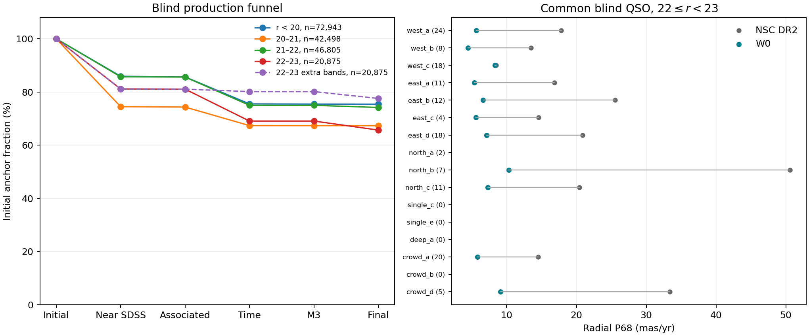
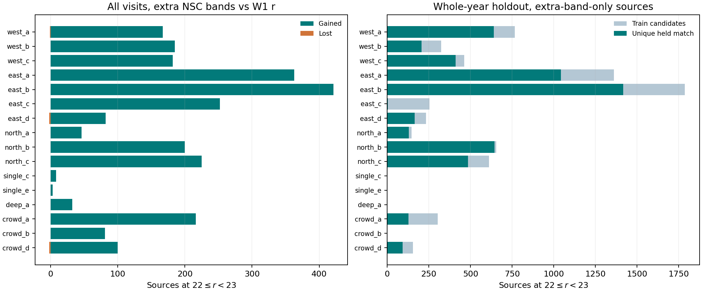
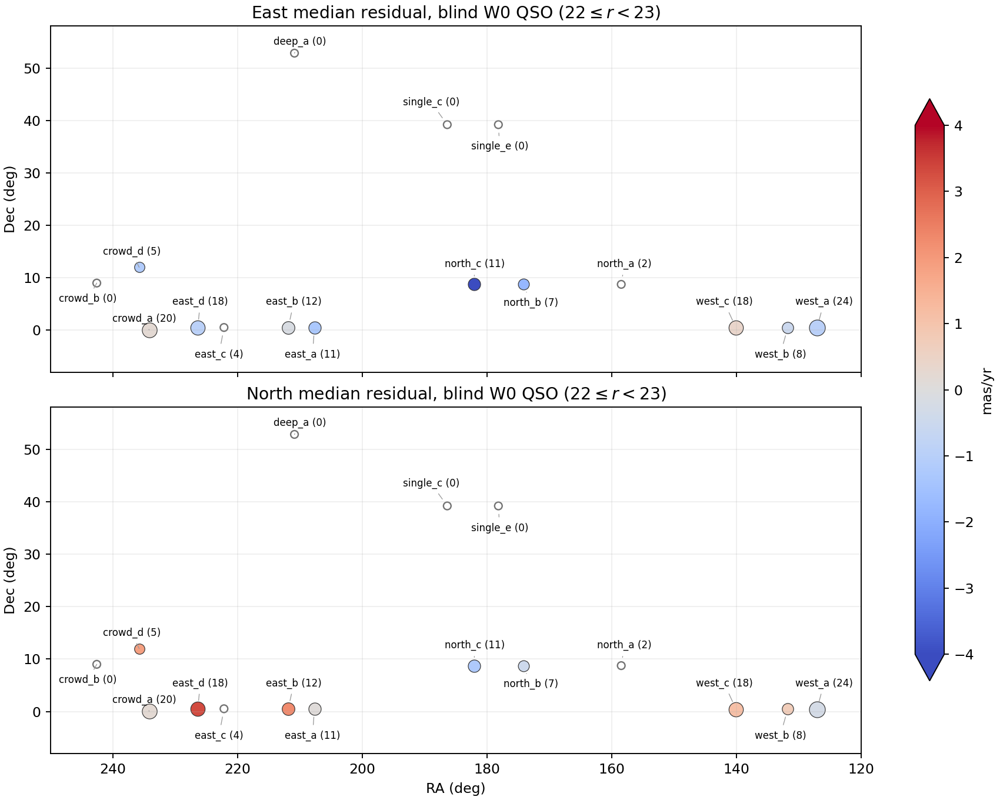

# 实验 A v0.7 · 首批分区验证

基于 v0.6 的方法对照，本轮将 W0 r 波段作为盲目录基准。它使用单检测目录误差和每轴 50 mas 位置底噪，联合 SDSS DR17、NSC DR2 与冻结 M3 静止星系校准，拟合稳健四参数自行。用相同 NSC r 锚点对照 W1 r 和 W1 加 NSC g/i/z。关联系统仅接触位置和常规观测质量。M3 保留已冻结的形态与位置筛选，Gaia 坐标只在关联后的参考星系筛选中用于恒星否决。目标的 Gaia 自行及 DESI 光谱 QSO 均保留到后置校验。

## 区域及选择

在查看任何新区域的自行前，根据 SDSS 实际扫描几何、NSC r 波段覆盖与跨度、DESI DR1 光谱位置及 NSC 档案对象计数锁定 16 个互不重叠的核心约 22.1 平方度。保留 SDSS 长间隔重复、短间隔重复、高纬单扫描、短和长 NSC 基线及适度拥挤对照。预查用每场 768 个均匀面积点，估计双巡天几何覆盖 22.06 平方度，双覆盖且 NSC r 跨度至少 0.6 年的面积 20.83 平方度。西段两个过量范围缩小后重新核验。旧 v0.5 的三个暗端 QSO 区域及额外的 COSMOS 档案吞吐区独立报告。 [冻结范围与备选](../docs/regional_v07_scope.md) · [生产配置](../configs/regional-v07.toml)

初始候选从 NSC r 的盲位置组中选择，形态中位值下限为 0.8。保留 SNR≥5 与每轴目录位置误差≤200 mas 的发布检测，SDSS 采用各实际 run 的 RUN_PRIMARY，1″ 关联在 M3 之前冻结。拟合要求 NSC 至少两次检测及 0.6 年跨度、联合至少 5 年，并要求校准后的同样时间支持。最终每轴自行形式误差上限 10 mas/yr，归一化二维残差 P68 上限 3。逐源输出保存每个源有效 SDSS run、夜和时间跨度及 NSC 独立夜，W0 还记录低稳健权重、状态位、最大组斜率影响和保持时间支持下的最大可删组检验。

严格 QSO 分母采用光谱位置、合格的两巡天 r 检测、足够 M3 支持和有效唯一的官方 NSC 自行。逐阶段追踪它们是否进入盲结果。通过验证的共同对象用于配对精度。测量重采样按共享物理 SDSS run 与 NSC 曝光跟踪观测块。逐场对象区间只反映固定观测的对象波动，合并区间另计块差异。使用容许更暗对象的 Gaia 参照描述可验证源与已知标签误配。无验证标签的检测保留在未知分母。

多波段的留出每场选 r 曝光数最多的一个中间历年，先剔除该年的所有 NSC 检测，再从头构造 r/multi 关联和拟合。光谱与 Gaia 比较用一组独立源标签，暗源位置预测用 500 mas 内具有竞争间隔的唯一检测，同一检测用于共同对象的配对。多波段独有对象的预测用于检查可重复观测，暗源自行精度的独立验证仍需外部参考。本轮核查的 HST SWEEPS 自行表位于银心方向，PS1 DR2 在本轮天区提供可用于另行拟合的检测，GPS1 已使用 SDSS 位置。当前选区未核实到可直接用于验证的独立 22–23 等恒星自行表。 [MAST Hubble Source Catalog](https://outerspace.stsci.edu/spaces/HSC/overview) · [PS1 DR2 检测档案](https://catalogs.mast.stsci.edu/panstarrs/) · [GPS1](https://arxiv.org/abs/1703.06278)

## 通过盲目录选择的普通源

16 个核心全部完成，实际核心面积 22.082 平方度。各核心共取得 12,343,550 条 NSC 与 1,521,511 条 SDSS 档案测量。W0 r、W1 r、多波段分别输出 132,045、132,114、148,193 个合格试验解。源计数只包含核心内符合形态门槛的普通点状候选，可能含 QSO。

22–23 等有 **20,875** 个共同 r 锚点。W0 r 保留 13,707 个，W1 r 保留 13,631 个，多波段保留 **16,189 个**。固定 W1，新增波段带来净增 2,558 个（18.8%），保留率从 65.3%（95% 64.6–65.9%）升至 77.6%（77.0–78.1%）。所列 Wilson 区间描述固定试验分母。同样 r 锚点约有 3,940 个在 1″ 内无合格 SDSS 检测，14 个因候选归属退出。加入新测量后，时间采样不足的数量从 2,504 个降至 191 个，收益主要来自达成覆盖门槛。高纬单扫描控制 `single_c` 与 `single_e` 的 W0 最暗箱均为 0/21，多波段分别取得 8 与 3 个解。

| NSC r | 初始 | 近邻 SDSS | 跨巡天关联 | 时间合格 | M3 支持 | 最终 W0 |
| --- | ---: | ---: | ---: | ---: | ---: | ---: |
| r<20 | 72,943 | 62,663 | 62,480 | 55,076 | 55,032 | 55,011 |
| 20–21 | 42,498 | 31,648 | 31,586 | 28,622 | 28,617 | 28,605 |
| 21–22 | 46,805 | 40,116 | 40,069 | 35,094 | 35,092 | 34,716 |
| 22–23 | 20,875 | 16,935 | 16,921 | 14,417 | 14,417 | 13,707 |

## 多波段独有源的验证

在整年留出可验证的区域，训练观测选出 7,058 个 (22\le r<23) 的多波段独有候选，5,363 个在留出年取得唯一 r 位置匹配（76.0%，固定分母 Wilson 95% 区间 75.0–77.0%）。这个分母是留出后仍通过多波段拟合标准的样本。匹配比例和 P68 均受实际曝光覆盖、500 mas 位置门及竞争对象影响。一些场有明显差别，例如 `north_b` 匹配 644/655，而 `east_c` 匹配 4/254，后者的可用历元组合和测试覆盖不足以支持同样的可靠性判断。

由 Gaia 可标记的轨迹中，W0 记到 3/78,556 条混有多个已知源，3/955,953 条已知检测属于轨迹内次要对象。多波段为 4/86,904 条及 4/2,952,709 条。W0 还有 367,989 条、多波段有 1,014,951 条未标记检测，未知标签的总体污染无法由上述比例确定。留出位置验证支持多波段确实恢复额外时间信息，暗端新源的独立自行验证仍是关键。详表保留竞争拒绝次数、唯一位置数和共同检测上的位置 P68。

## 自行精度与空间零点

16 个核心合并为五个共享观测块，最暗盲 QSO 覆盖三个。下表比较完全相同的盲 W0 光谱对象，P68 为相对于零自行的径向绝对误差，区间以共享观测块与对象两级重采样估计。

| 光谱 QSO 参考 r | 共同盲解 | 块数 | NSC DR2 P68（mas/yr） | W0 P68（mas/yr） | 改善 95% 区间 |
| --- | ---: | ---: | ---: | ---: | ---: |
| r<20 | 404 | 5 | 8.22 | 2.93 | 56–81% |
| 20–21 | 668 | 5 | 10.83 | 3.69 | 60–77% |
| 21–22 | 792 | 5 | 14.01 | 4.86 | 60–72% |
| 22–23 | 140 | 3 | 18.63 | 6.68 | 59–83% |

22–23 等 W0 的实测改善为 **64.2%**，二维误差大于 5 mas/yr 的源数从 123/140 降至 75/140。两轴形式 1σ 区间覆盖约 79% 和 83%。同一区间 507 个严格共同 QSO 中保留 140 个（27.6%，固定分母 95% 区间 23.9–31.7%），已细分退出中包括 107 个点源形态筛选和 7 个拟合质量退出，早期版本的区域日志把其他 253 个合并在锚点选择或竞争阶段。这个分母以 QSO 为总体。

固定这 140 个共同盲源，W0、W1 与多波段分别为 6.68、6.96、6.05 mas/yr。W1 相对 W0 的收益区间跨零。额外波段相对 W1 点估计再改善 13.1%，固定对象配对区间 1.9–21.1%。把共享观测按块处理后，改善区间为 −6.9% 至 +37.2%，跨越零。新增源数的增长在当前样本中已经实测，区域间能否重复得到额外精度收益仍待验证。

较暗 Gaia 恒星也提供了对照。在 $21\le r<22$，以 Gaia 自行为外部参照，`west_a` 的 267 颗为 12.78→3.39 mas/yr，`east_a` 的 99 颗为 11.68→4.12，`north_c` 的 85 颗为 10.64→4.75，`single_c` 的 89 颗为 47.20→7.71。这支持多个观测条件下的恒星精度收益，近极限的真值范围仍受到 Gaia 选择影响。Gaia 与 NSC 天测共用部分参考架。

最暗 W0 的汇总中位自行仍为 **−0.99 / +0.89 mas/yr**。观测块区间分别约 −4.86 至 +0.14、−1.73 至 +2.81 mas/yr。场间变化尤其明显，`east_d` 北向 +3.28，`north_c` 东向 −4.37。相反，`crowd_a` 两轴约 +0.21，20 颗对象的东、北向区间仍为 −1.01 至 +2.30 与 −2.71 至 +2.02 mas/yr。星系位置留出与 QSO 自行的年代间零点需要分别检验。按冻结的完整门槛，零个区域通过。单一观测块中的多个重叠扫描场不提供额外独立块数。

## 放大决定

继续 **定向区域 A**，W0 r 保留普通源基准。20–30 平方度的尺度已完成。NSC 官方发布自行的误差在四档星等都显著降低，空间零点、最暗星的独立真值和多波段新增暗源的可验证覆盖仍未通过扩大条件，因此暂缓累计 100 平方度及后续 300 平方度。优先用 `west_a` 和 `crowd_a` 的较充分暗端光谱样本追踪场零点，并以 `east_d`、`north_c` 的偏差方向做观测组对照。多波段保留作并行科学解，对新增源继续做独立测量确认。

各场取数阶段耗时中位约 4.7 分钟，拟合及验证约 3.8 分钟。西段 `west_b` 是重要吞吐尾部，59,474 个档案对象产生约 568 万条 NSC 测量，实取 21.4 分钟，分析阶段约 25.7 分钟。初次作业达到 debug 时限，保留并校验已完成的取数、盲 r 关联和曝光元数据，后续单场重跑成功。全场档案原表约 2.85 GB，取数阶段最高峰值约 10.1 GiB。资源规划应再按检测量及 M3 观测组数估算。 [计数校验、公开回执与聚合表](../results/summary)

## v0.5 最暗 QSO 的退出原因

使用同一批已取回检测重新构造 W0 关联和冻结 M3，对 89 个严格共同的光谱 QSO 逐条追踪实际退出。三场的合计为 25 个保留、62 个未达点源形态门槛、2 个未过最终拟合质量。25/89 为 28.1%，Wilson 95% 区间 19.8–38.2%。先前的 89 个对象本来就要求有合格两巡天位置及单独检查的 M3 时间跨度。形态由 NSC r 锚点的 `CLASS_STAR` 中位数决定，这组 QSO 的流失主要发生在光度形态选择。评估非 Gaia 普通恒星的关联完整度仍需相应的独立星样本。

| v0.5 天区 | 严格共同 QSO | 点源形态退出 | 最终质量退出 | 保留盲解 |
| --- | ---: | ---: | ---: | ---: |
| G09 | 49 | 29 | 1 | 19 |
| G15 | 32 | 28 | 1 | 3 |
| 北银冠中纬 | 8 | 5 | 0 | 3 |
| 合计 | 89 | 62 | 2 | 25 |

## COSMOS 档案恢复和吞吐

独立的 COSMOS 圆形范围覆盖 0.120 平方度。12 个不相交的赤纬分片采用同一个 r 档案包络，包含 10,895 个对象、2,113,412 条单曝光检测。各查询分块校验服务端计数和测量标识，分片间对象索引无重复。校验后的首分片由另一个进程复用，恢复阶段完成全区用时 439 秒，含分片完整性和压缩写出，峰值内存 326 MiB，压缩产物约 149 MB。本轮通过中等规模高密度取数测试。更大范围服务吞吐需在同样有上限的分片上记录。 [COSMOS 聚合回执](../results/summary/v07_cosmos_dense_dense_archive_v07_2bbf75574dd0_3fe6d37a366f_summary.json)
