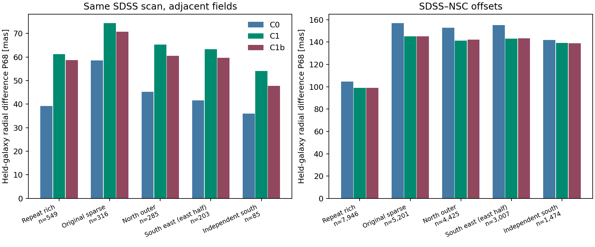
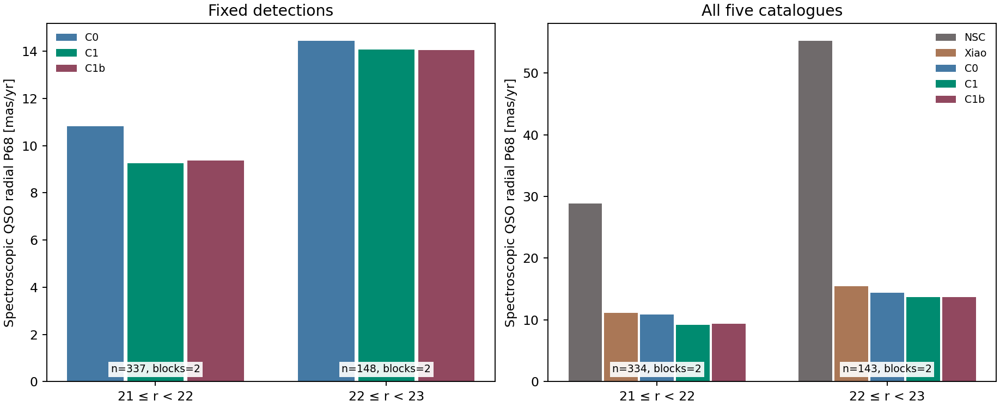

# 实验 A v1.1 · 相邻 SDSS field 的真实重叠约束

## 科学问题与冻结对照

v1.0 的 C1 细化 SDSS field 和 NSC CCD 的星系零点。它降低了跨巡天位置散布，也让四处相邻 SDSS field 的真实重复星系位置变得更不一致。v1.1 固定输入、权重、关联和质量条件，仅将同一次 SDSS 扫描相邻 field 对同一星系的复测位置差引入 C1 的参考图，检验能否兼得位置连续性与更精确的自行。 [v1.0 报告](experiment_A_v1.0_validation.md) · [冻结门槛](../PLAN.md)

C0 的 SDSS 零点按 run/camcol 给出，NSC 零点按 exposure 给出。C1 对细组使用至少 15 个参考源及 50 mas 父组约束。C1b 保留相同物理源划分、误差模型及参考系，给已支持的 SDSS 相邻细组加入稳健差分约束。差分按位置误差及 20 mas 地板加权，一个源在同一扫描中的重叠总权重至多为 1。位置与差分共用参考星系 bootstrap 权重。两条目录记录可能共用图像像素和主位置，完整像素协方差未知。星系差分只进入标定，恒星自行仍由去重的观测拟合。 [模型与取数](../docs/overlap_validation_v11.md) · [SDSS DR17 Resolve](https://www.sdss4.org/dr17/algorithms/resolve/)

NERSC 作业 61463655 用 v1.0 原提交和观测回执复现了 1,353 对留出星系的全部 C0/C1 边界 P68。四个旧区用于重复性检验。新增 south_17 子区按取数与光谱覆盖冻结在 RA 197.30°–198.30°、Dec +3.40°–+4.40°，取 0.06° 缓冲。该场复用 v0.8 完整 NSC/SDSS 圆形缓存，统一用 DR16Q 与 DESI DR1 光谱去重母表，地基比较从用户恢复的 Xiao2025 FITS 实读裁剪。

## 结果

### 留出位置与亮 Gaia

| 区域 | 重叠训练对 | 重叠留出对（物理 run 数） | C0 | C1 | C1b | C1b 相对 C0 |
|---|---:|---:|---:|---:|---:|---:|
| 重复丰富区 | 1,205 | 549（34） | 39.21 | 61.27 | 58.64 | +49.6% |
| 原稀疏区 | 741 | 316（5） | 58.49 | 74.40 | 70.73 | +20.9% |
| 北外侧 | 668 | 285（5） | 45.26 | 65.27 | 60.52 | +33.7% |
| 东南东半 | 502 | 203（5） | 41.59 | 63.27 | 59.68 | +43.5% |
| south_17 独立普通场 | 228 | 85（4） | 35.95 | 54.04 | 47.81 | +33.0% |

五场核心共 13.973 平方度，读取 11,222,884 条包含缓冲区的标准化检测。表中位置差为径向 P68，单位 mas。使用 3,344 对训练重叠，用另行划分的 1,438 对留出重叠评估。C1b 在五场都降低了 C1 的接缝散布，仍比 C0 高 21%–50%。三个普通场的 C1b/C0 损失区间上界远高于预注册的 10%。重复丰富区从约 3,900 个候选邻场中只读 160 个，结论限于审计过的接缝。

| 区域 | 跨巡天留出星系数 | 跨巡天位置 P68（C0 / C1 / C1b） | 亮 Gaia 共同数 | 亮星自行 P68（C0 / C1 / C1b） |
|---|---:|---:|---:|---:|
| 重复丰富区 | 7,946 | 104.56 / 99.10 / 99.02 | 6,499 | 2.44 / 1.49 / 1.49 |
| 原稀疏区 | 5,201 | 157.01 / 145.18 / 145.09 | 6,045 | 8.02 / 5.00 / 5.03 |
| 北外侧 | 4,425 | 152.67 / 141.43 / 142.18 | 5,025 | 7.51 / 4.51 / 4.49 |
| 东南东半 | 3,007 | 155.17 / 142.93 / 143.49 | 2,569 | 7.55 / 4.64 / 4.62 |
| south_17 独立普通场 | 1,474 | 141.89 / 139.07 / 138.80 | 1,264 | 3.14 / 2.27 / 2.24 |

位置单位 mas，自行单位 mas/yr。C1b 保留了所有普通场至少 80% 的 C1 跨巡天位置收益。严格亮星样本保留了 C1 相对 C0 的收益。三个普通场的 22–23 等盲目录中 C0、C1、C1b 有效解分别为 1,272、1,265、1,267 个。

### 普通场的严格同源自行比较

| 参考 r 星等 | 共同数 | 官方 NSC DR2 | Xiao2025 地基 | C0 | C1 | C1b |
|---|---:|---:|---:|---:|---:|---:|
| 21–22 | 334 | 28.81 | 11.18 | 10.87 | 9.19 | 9.36 |
| 22–23 | 143 | 55.25 | 15.48 | 14.40 | 13.73 | 13.67 |
| 21–23 | 477 | 37.20 | 12.48 | 11.86 | 10.49 | 10.51 |

表中单位为 mas/yr，Xiao2025 仅保留 PM_SOURCE=DESI 的地基自行。三个普通场 22–23 等有 148 颗严格同检测 QSO，其中 143 颗两套发布目录均可用。C0/C1/C1b 在 148 颗上的 P68 为 14.45/14.07/14.04 mas/yr。五路样本的 C1b 相对官方 NSC 和 Xiao2025 的点估计分别改善 75.3% 和 11.7%，相对 C1 改善 0.4%。联合 SDSS+NSC 的主要精度收益与此前一致，这次新增重叠项没有带来实质自行收益。

south_17 在 QSO 样本上与其余各场零共享 SDSS run、NSC exposure 或 NSC 观测日。三个普通场按 run／曝光得 3 块。北外侧与东南东半共享 5 个 NSC 观测日，保守分组剩 2 块。22–23 等三路比较的 C1b 相对 C1 提升率区间在仅按曝光分组时为 −2.1% 至 +3.1%。保守分组达不到生成验收区间的条件。148 颗最暗 QSO 的 C1b 中位零点约为东 −0.64、北 +0.03 mas/yr，东向点估计已超出 ±0.5 mas/yr 目标。

最暗端 148 颗中，径向自行绝对值超过 5 mas/yr 的 C0/C1/C1b 样本为 129/116/115 颗。C1b 的形式 1σ 覆盖率在三场的东轴为 80%–84%，北轴为 74%–85%。逐场、逐星等、参考组支持和回退率见公开汇总。

[五场配对汇总及验收回执](../results/summary/v11_overlap_blocks_summary.json)

### 暗源独立年份及颜色诊断

2017 年整年留出的轨迹从其余年份重建。north outer 的 30 个 22–23 等共同训练锚点有 13 个取得唯一测试位置，r-only 预测的径向 P68 为 C1 66.11、C1b 65.95 mas。south_17 的 122 个共同训练锚点有 118 个取得唯一测试位置，覆盖 206 个留出位置，P68 为 80.98 和 81.04 mas。这两处的年外位置重复性对加入差分近乎不变，光谱 QSO 仍用来约束静止零点。暗恒星的绝对自行精度缺少独立的同源长基线外部真值，因此保留整年预测和 QSO 零点为两种独立证据。所有 NSC r≥21 的目标 Gaia 自行退出评分和模型选择。亮星对照独立于目标自行输入，NSC 的原发布位置已有 Gaia DR2 定标。 [NSC DR2 数据说明](https://datalab.noirlab.edu/data/nsc)

在东南东半，留出蓝色星系的 C0/C1/C1b 位置 P68 为 217.7/202.0/203.9 mas（140 个），红色为 144.7/132.2/132.6 mas（1,805 个）。位置残差与颜色样本及 r 星等仍有关系。其他场的颜色响应方向不同，C1b 相对 C1 的变化很小。本轮保留空间、波段和 seeing 等诊断；颜色、DCR 和高阶空间系数未加入拟合。

## 方法选择与扩区

保留 C0 作为普通区域及未来连续 C 区主目录的基准。C1 的跨巡天位置及亮星自行收益适用于已经验证的条件，若要采用细组零点，还需就拟用区域独立量化真实 field 边界。C1b 在三个普通场均减少了由细组引入的接缝散布，仍高于 C0。本轮按预注册规则停止，冻结的连续 RA 345°–355°、Dec −5°–+5° 全面积生产不启动。

后续优先核验独立 run/曝光/夜与更多真实留出重叠测量，并用空间局部零点诊断定位同一扫描的接缝。若进行连续区复核，需要保留物理 run/camcol/field、NSC exposure/CCD/观测日、参考图连通与父组回退、独立星系及光谱验证、独立年份位置和边缘覆盖。质量分级按实测支持、接缝及零点证据判定。当前结果说明 SDSS+NSC 的目录级精度仍值得研究，剩余扫描标定可由目录定位，尚不足以把误差归因到 PSF 位置提取。

## 运行回执

四场主比较作业 61464013 使用四个 CPU 节点，耗时 18:36，峰值约 13.86 GiB。独立场作业 61464150 耗时 08:30，含本地 44 GB Xiao FITS 裁剪，峰值约 45.98 GiB。逐场相邻 field 审计由作业 61464151 复现，完成于 05:24。作业 61464352 合并观测块，使用公开汇总字段。四场与新增场的配置差异仅有新增几何核心，拟合参数和验收规则相同。
