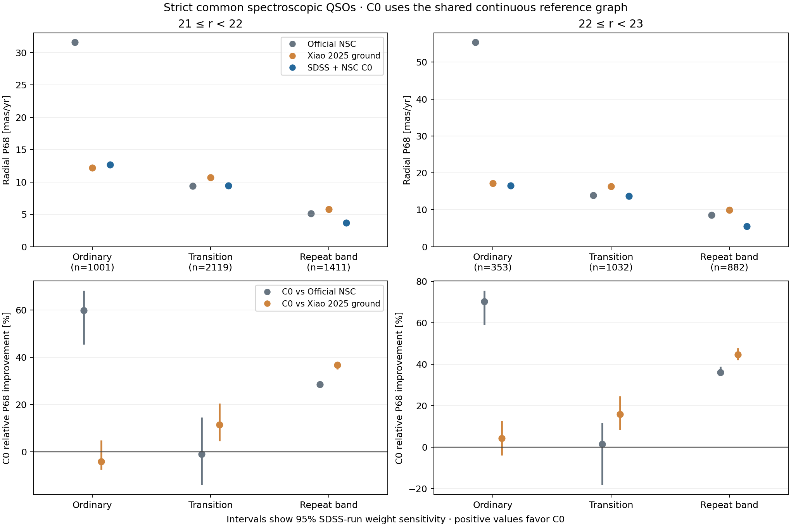
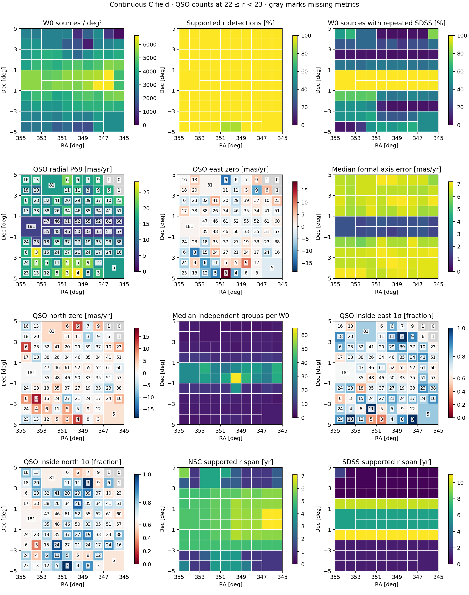
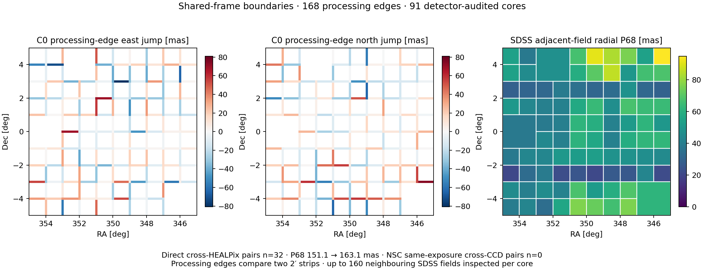
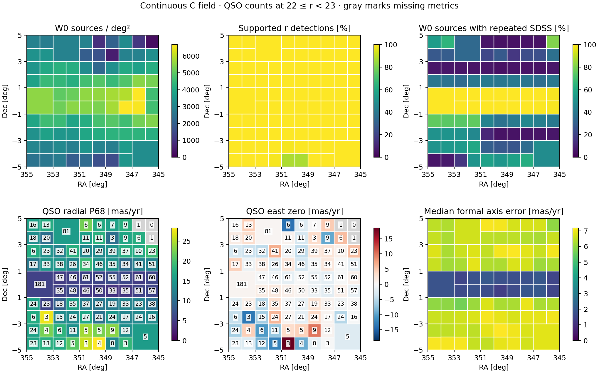

# 实验 A v1.2 · 连续 C 区的 C0 科学试运行

## 整区结果与路线判断

**本轮已完成冻结的连续 99.873 平方度。目录级主线有可测收益，收益明显依赖观测条件。** 在最暗的三路共同光谱 QSO 上，C0 相对 Xiao2025 地基自行的径向 P68 改善 20.7%。重复带改善 44.6%，普通扫描区为 4.2%，普通区的物理观测组区间跨零。普通区 21–22 等的点估计反而恶化 4.2%。后续价值集中在重复与时基条件、局部空间零点和误差模型的验证。 [可浏览统计](../results/summary/v12_full_science_overview_summary.json) · [完整统计](../results/summary/v12_full_continuous_summary.json.gz) · [完成回执](../results/summary/v12_full_completion_summary.json)

91 个处理核心完整铺满 100 个 1° 格，取得参考图支持并完成 W0 拟合，合计 **384,232** 个自行解，其中 NSC r=22–23 有 **39,590** 个。全部核心的取数、参考、拟合和共同图校验通过。最终参考图去重后使用 20,604,984 条参考检测，只有一个连通分量。统一参考历元几何审计的越界输出、精确重复位置及 0.2″ 内跨核心近邻计数均为零。这些计数检验输出组织与几何一致性。 [覆盖审计](../results/summary/v12_full_coverage_audit_summary.json) · [几何审计](../results/summary/v12_full_ownership_summary.json)

本轮冻结 RA 345°–355°、Dec −5°–+5°、NSIDE 128 RING、J2015.5、0.06° 输入缓冲、共享 C0 及 W0 r-only 稳健运动。高自行救援保留既有实验记录。v1.1 的 C1b 认证失败及正式发布门槛继续有效。 [执行计划](../PLAN.md) · [v1.1 结果](experiment_A_v1.1_overlap.md)

## 同一批对象上的精度收益

下表在每个扫描带与星等档固定同一批对象，单位均为 mas/yr，指标为绝对径向自行的第 68 百分位。Xiao2025 只使用 PM_SOURCE=DESI。QSO 的星等分档沿用冻结联合谱表的 reference_r，恒星产出分档使用 NSC r。SDSS DR16Q 与 DESI DR1 联合谱表的静止 QSO 提供暗端控制，NSC r≥21 的 Gaia 自行退出精度与模型评分。

| 扫描条件 | r 档 | 共同 QSO 数 | 官方 NSC | Xiao2025 地基 | C0 |
|---|---|---:|---:|---:|---:|
| 全区 | 21–22 | 4,531 | 10.26 | 9.23 | 8.43 |
| 全区 | 22–23 | 2,267 | 14.04 | 13.61 | 10.79 |
| 普通区 | 21–22 | 1,001 | 31.61 | 12.17 | 12.68 |
| 普通区 | 22–23 | 353 | 55.37 | 17.23 | 16.51 |
| 过渡区 | 21–22 | 2,119 | 9.37 | 10.69 | 9.47 |
| 过渡区 | 22–23 | 1,032 | 13.92 | 16.32 | 13.72 |
| 重复带 | 21–22 | 1,411 | 5.14 | 5.80 | 3.67 |
| 重复带 | 22–23 | 882 | 8.58 | 9.91 | 5.49 |

全区 22–23 等 C0 相对 Xiao 的配对改善为 20.7%，按 SDSS run 权重抽样的 95% 区间为 12.0%–35.6%，按 NSC 曝光和夜分别为 17.0%–24.1%、12.8%–26.2%。相对官方 NSC 的改善为 23.1%，run 权重区间为 14.7%–35.8%。 [完整统计及分层](../results/summary/v12_full_continuous_summary.json.gz)

重复带最暗档相对 Xiao 改善 44.6%，run 权重区间 42.1%–47.8%。普通区为 4.2%，run 区间 −3.9%–12.7%，曝光及夜区间也跨零。过渡区相对 Xiao 改善 15.9%，run 区间 8.4%–24.6%，相对官方 NSC 仅改善 1.5%，run 区间 −18.2%–11.8%。普通区 21–22 等相对 Xiao 恶化 4.2%，按夜权重区间为 −7.4% 至 −1.5%。

这些区间刻画共享观测组权重敏感性。全区最暗共同 QSO 按共享 run／曝光的传递闭包仍为一个保守块，普通区为两个块，共享夜闭包为一个块。53 个实际 SDSS run 的权重负荷信息指数约 17，空间独立重复的证据仍需后续天区。 [相依统计定义](../docs/continuous_c0_v12.md)

同一批 2,267 个最暗共同 QSO 的两分量诊断如下。偏差与 NMAD 单位为 mas/yr，尾部沿用冻结的径向 5 mas/yr 阈值。比例区间为描述性二项 Wilson 区间。

| 方法 | 偏差东／北 | NMAD 东／北 | 径向超过 5 mas/yr | 描述性 95% 区间 |
|---|---:|---:|---:|---:|
| 官方 NSC | −0.37 / +0.61 | 7.55 / 7.46 | 1,676 / 2,267 | 72.08%–75.70% |
| Xiao 地基 | −0.22 / +1.01 | 8.15 / 8.11 | 1,821 / 2,267 | 78.64%–81.91% |
| C0 | −0.24 / +0.05 | 5.90 / 5.72 | 1,446 / 2,267 | 61.78%–65.74% |



## 时间信息、暗恒星与不确定度

以下为已经通过 W0 门槛的 NSC r=22–23 恒星样本，各项给出中位数。它们描述选择后的有效产出和采样。

| 扫描条件 | W0 数 | SDSS 跨度／yr | NSC 跨度／yr | 联合跨度／yr | 独立组数 | 形式误差东／北，mas/yr |
|---|---:|---:|---:|---:|---:|---:|
| 普通区 | 1,912 | 0.063 | 1.13 | 9.87 | 5 | 9.10 / 9.06 |
| 过渡区 | 13,533 | 2.99 | 4.94 | 16.07 | 13 | 5.44 / 5.35 |
| 重复带 | 24,145 | 4.20 | 4.96 | 17.96 | 24 | 3.25 / 3.24 |

重复带 23,951/24,145 个合格暗源使用多个 SDSS run，描述性 Wilson 95% 区间为 99.08%–99.30%。普通区为 1,120/1,912，区间为 56.35%–60.77%。普通区多次 run 的时间跨度仍很短，单纯计数不足以刻画运动信息。其实际删除 SDSS run 的 1,764 次暗 QSO 试验中，693 次保留可拟合时间支持，自行变化中位数 5.46 mas/yr。重复带删除 run 的 39,078 次试验中 39,034 次可拟合，变化中位数 0.34 mas/yr。删组固定星系参考解。 [完整采样及删组统计](../results/summary/v12_full_continuous_summary.json.gz)

78 个核心完成整年遮挡，13 个普通区核心缺少足够的已校准 NSC 年份。每核心重新用训练年建立关联和拟合，然后预测留出年。最暗档共同训练源在独立年份至少一次唯一位置重现的计数如下。区间是描述性二项 Wilson 区间，物理观测相关性另由观测组诊断报告。

| 条件 | 训练源中有唯一留出位置 | 描述性 95% 区间 |
|---|---:|---:|
| 全区 | 29,023 / 36,932 | 78.16%–79.00% |
| 普通区 | 56 / 143 | 31.54%–47.34% |
| 过渡区 | 8,289 / 11,270 | 72.73%–74.36% |
| 重复带 | 20,678 / 25,519 | 80.54%–81.51% |

61 个能报告最暗档留出位置 P68 的核心，其中位核心 P68 为 82.84 mas。这是核心统计量的中位数。源的留出机会、足迹、竞争检测和质量筛选共同影响重现计数。年度输出沿用 common_w1_p68_mas 的历史字段名，本轮调用给两路传入相同 W0 误差，字段对应 r-only W0 训练预测。暗恒星的绝对自行仍需独立长基线真值。

严格亮 Gaia 控制含 151,464 个对象，结合参考误差后的 ±1σ 覆盖为东 100,673/151,464、北 103,449/151,464，描述性 Wilson 95% 区间分别为 66.23%–66.70%、68.06%–68.53%。各核心记录的两轴中位偏差区间同时位于 ±0.5 mas/yr 的有 3 个。暗 QSO 在至少 10 颗样本的 67 个核心中，63 个核心至少一轴的中位点估计超出 ±0.5 mas/yr。点估计用于定位空间问题，正式零点验收继续采用冻结的区间及相依标准。NSC 使用 Gaia DR2 定标，这套盲测的独立性限于目标 Gaia 运动未输入关联。 [空间天测图](../figures/v12_continuous_science_summary.png)

同一套结合参考误差的标准化残差中，67 个暗 QSO 核心的标准化 NMAD 跨核心中位为东 0.79、北 0.84，91 个亮 Gaia 核心为东 0.87、北 0.81。空间图与逐核心统计保留了局部偏差、覆盖率和散布，误差模型的下一轮检验需要同时处理这些量。



## 参考系、仪器与边界

共享图用 24,965,534 条输入参考检测，去重后为 20,604,984 条，支持 305 个 SDSS 组和 3,275 个 NSC 组，另有 205 个组无支持。3,489 个校准组被多个核心共用。126,268 项留出跨巡天比较的径向位置差 P68 为 145.96→138.96 mas，两轴中位差为 −9.53/−20.47→−0.77/−0.96 mas。 [参考图](../results/summary/v12_full_reference_summary.json)

| 边界证据 | 数量 | 实测结果 |
|---|---:|---|
| 真正跨处理核心的留出星系 | 22 对 | 径向 P68 247.74→257.18 mas |
| 真正跨 HEALPix 的留出星系 | 32 对 | 径向 P68 151.10→163.12 mas |
| 两侧各 2′ 的处理边界条带 | 168 条边 | C0 后两轴中位差绝对值的跨边中位数 15.26/14.69 mas，最大 80.97/73.59 mas |
| SDSS 相邻 field 重复 | 分核心计数合计 17,217 对 | 91 核心均至少 20 对，核心 P68 中位数 47.86 mas，范围 20.49–94.85 mas |
| NSC 同曝光跨 CCD | 0 对 | 当前门槛下缺少直接重复性证据 |

条带比较同时含有两侧不同星系样本和观测条件的变化。39 个核心达到最多读取 160 个候选相邻 SDSS field 的冻结上限，结果覆盖实际检查的重叠。全区连通图解决了共同基准的组织问题，边界的天测残差仍需定位。 [处理边界](../results/summary/v12_full_processing_seams_summary.json) · [物理边界](../results/summary/v12_full_detector_boundary_summary.json)



91 个核心的仪器元数据均通过来源回执验证。2,267 颗最暗共同 QSO 中，2,264 颗只用 DECam，3 颗混合 DECam 与 90Prime，普通区最暗共同样本全部为 DECam。全区增加了空间覆盖，暗端仪器比较仍受实际覆盖限制。 [仪器分层](../results/summary/v12_full_instrument_summary.json)

## C1/C1b 与六项科学判断

本轮独立子区的 C1/C1b 记录继续有效。重复带 C1b 对暗 QSO 的增量约 2.8%，边界相对 C0 的 run 区间上界为 +13.3%，过渡区边界 P68 从 C0 的 37.57 增至 C1b 的 47.65 mas。v1.1 的失败证据保持原样。色项、DCR 与细组位置修正需要按物理条件继续验证。

1. **连续参考系**。100 格在同一个连通图上完成，共享组只有一个解。剩余空间零点与边界残差已经在完整区域显现，正式均匀精度认证仍待解决。
2. **误差驱动**。时间跨度、真正长期重复、共享组杠杆与删组敏感性均随扫描带变化。暗端主要是 DECam，当前数据不足以分离仪器效应。区域间比较仍包含星等、颜色、采样与位置条件的共同变化。
3. **普通区相对 Xiao2025**。最暗档有约 4.2% 点估计改善，各种物理组区间跨零。21–22 等出现恶化。普通区的统一精度优势仍缺证据，重复带和过渡区已有条件性收益。
4. **暗恒星的用途**。联合时基、形式误差、删组敏感度与整年预测支持分级使用。缺少可靠 Gaia 自行的暗恒星可以得到运动解及位置预测证据，绝对自行真实性仍待独立样本验证。
5. **C1/C1b 的条件性**。目前保留为局部试验选项。重复带边界区间及过渡区代价仍需独立重复，现有记录支持继续以 C0 作为比较基准。
6. **更大批次**。可以按预先声明的时基与重复条件，在独立天区扩大目录级科学试验。优先复制条件性收益，并定位普通区及局部零点。全覆盖正式发布验收仍待空间系统误差、边界和独立暗星证据。实验 B 的曝光选择应由具体质心、混叠和位置残差瓶颈驱动。

## 八阶段完成记录与复现

| GPT Pro 阶段 | 本轮完成证据 |
|---|---|
| 1 冻结范围与假设 | 99.873 平方度、NSIDE 128、C0/W0 和原 v1.1 失败记录保留 |
| 2 相邻核心与资源 | 唯一参考检测、共用物理组、留出接缝及 16 核心资源试跑完成 |
| 3 连续区取数与拟合 | 91 核心、100 格全部完成，11 项首次取数失败／超时均恢复 |
| 4 覆盖、误差与边界 | 全区统计及四幅结果图完成，保留无支持组与缺少的跨 CCD 证据 |
| 5 三路与独立验证 | 6,798 个 21–23 等共同 QSO、严格亮 Gaia 与年度留出完成 |
| 6 独立 C1/C1b 子区 | 重复及过渡区比较与负结果保留 |
| 7 观测相关性 | 连通闭包、物理 run／曝光／夜权重和真实删组完成 |
| 8 科学判断与发布记录 | 六项问题已回答，项目记忆、图、统计、代码和持久归档核验 |

累计取数摘要为 111,500,502 条 NSC 测量、17,187,365 条 SDSS 测量，包含缓冲区和复用输入的重复读取。共享图 Slurm 耗时 14 分钟，峰值约 93.9 GiB。单核心 W0 程序耗时中位 377.7 秒，范围 69.8–2547.8 秒，程序报告最大峰值约 7.1 GiB。W0 最多 20 路、物理边界最多 8 路并行，最后 91+91 个作业均成功。 [Slurm 与文件校验](../results/summary/v12_full_completion_summary.json)

首次生产窗口查询后的参考提取曾因部署脚本漏传天区参数退出，修正后复用已完成取数。旧密集分片及服务端超时保留缓存与失败日志，再从同一配置续跑。完整窗口计数与旧路线的整格对照通过后才启用新路径。逐源数据和查询缓存继续保存在 NERSC，公开仓库发布完整压缩汇总、脱敏回执及图。 [窗口复核](../results/summary/v12_window_count_canary_summary.json) · [生产恢复](../results/summary/v12_window_count_production_summary.json)

计算版本及汇总 SHA-256 见完成回执。完整 JSON 的 gzip 采用无损压缩，重绘入口直接接受压缩文件。

关键结果已持久保存到 NERSC Home 的项目归档，包含 91 核心的逐源输出、QSO 配对、删组结果、共同参考解及查询／版本元数据，共 7,411 个成员，压缩后 55,775,573 字节，逐成员校验通过。2025 年 C 区参照子表单独压缩备份，解压后的 SHA-256 与冻结取数回执一致。公开仓库保存两份归档的校验摘要，数据文件保留在 NERSC。本地全套 92 项测试通过，四幅最终图已目视检查。 [结果持久化](../results/summary/v12_full_persistence_summary.json) · [2025 参照持久化](../results/summary/v12_full_legacy_persistence_summary.json)

```bash
export PYTHONPATH=src
export MPLBACKEND=Agg
python -m deep_pm.continuous_plots results/summary/v12_full_continuous_summary.json.gz figures --comparison
python -m deep_pm.continuous_plots results/summary/v12_full_continuous_summary.json.gz figures --detailed
python -m deep_pm.continuous_plots results/summary/v12_full_continuous_summary.json.gz figures --boundaries results/summary/v12_full_detector_boundary_summary.json results/summary/v12_full_processing_seams_summary.json
python -m deep_pm.continuous_overview results/summary/v12_full_continuous_summary.json.gz results/summary/v12_full_science_overview_summary.json
```

<details>
<summary>先导与扩展的历史记录</summary>


## 本次阶段结果

整区试运行范围已冻结为 RA 345°–355°、Dec −5°–+5°，目标几何面积 99.873 平方度。首批代表场的固定配对科学汇总覆盖 **13.975 平方度**。后续两处边界扩展完成后，已拟合总面积为 **15.971 平方度**。既有正式认证标准和 v1.1 的 C1b 失败继续保留。试运行用于测量覆盖、参考图和空间系统误差。 [验收计划](../PLAN.md) · [v1.1 留出试验](experiment_A_v1.1_overlap.md)

五个处理核心产出 **52,323** 个 W0 自行解。固定检测的严格亮 Gaia 对照有 20,137 个对象。最大连通分量第一次求解支持 649 个观测组；确认原样本共有三个独立参考图分量后，分别定锚并完成其余核心，按实际分量使用组零点。东南东半的南北相邻核心共享 **16** 个已经标定的物理组，去重 **5,651** 条重复参考检测，191 个留出参考星系可在两侧输入缓存中找到。同一目标的真实位置在两个核心内都有单独检测的例子为 0。本轮先验证物理组共享的数值路径，并报告实际接缝证据的支持范围。三个参考分量各有独立的整体位置基准，稀疏样本尚未证明区域整体参考系已连通。

接缝两侧各 2′ 的留出条带分别有 39 和 45 颗独立参考星系。以北侧减南侧，跨巡天位置残差的两轴中位数差，C0 前为 +31.99/+18.90 mas，C0 后为 +34.13/+19.25 mas。共享解消除了处理块任意选择的局部基准差，对这两组星系的天测残余差异未见改善。两侧使用不同参考星系，这项比较也包含局部天区和观测条件差异。 [接缝汇总](../results/summary/v12_south_seam_summary.json)

两个新增核心加入参考图后，支持图由三个分量变为两个。c_06_07 与北外侧共享 18 个校准组，c_08_00 与东南南块共享 256 个。新增 **6,772** 个 W0 解，当前七个核心共 **59,095** 个。新增两对真正跨核心的位置检测，样本只支持列为描述性证据。地图展示已完成的七个核心，各阶段 QSO 汇总保留各自参考解和样本。 [追加试运行汇总](../results/summary/v12_adjacent_extension_summary.json)

在扩展后的参考图中，相邻核心共有三条具备同分量支持的边界。两侧的留出星系分别为 20／38、39／45 和 37／50 颗。C0 后两侧残差的东向中位数差分别为 −29.08、+33.79 和 +36.19 mas。残差符号按边界坐标的正侧减负侧计算。三条边的差值说明共享图仍有待检查的区域残差，同时包含不同星系样本的局部差异。 [同参考图分量的接缝汇总](../results/summary/v12_processing_seams_pilot_summary.json)

整区求解器在当时已有参考回执的 16 个核心上做了扩展试跑，覆盖 24.950 平方度。输入 3,737,677 条参考检测，去重后 3,579,022 条。两个有双巡天支持的参考图分量共解得 1,763 个物理组零点，100 个组仍无支持。34,084 项留出跨巡天比较的径向位置差 P68 从 159.93 降至 147.41 mas。直接跨 HEALPix 和跨核心比较只有 5 项与 2 项。求解用时 92 秒，峰值内存约 12.2 GiB。这是参考图的技术及位置校准验证，整区 W0 尚待拟合。 [扩展参考图汇总](../results/summary/v12_graph_scale_rehearsal_summary.json)

用该扩展参考图验证两处新输入核心。c_02_00 和 c_05_00 共 1.994 平方度，分别产出 3,459 和 2,274 个 W0 解。两个进程分别耗时 44 秒和 165 秒，峰值内存约 0.79 和 1.46 GiB。c_05_00 完成 2017 年留出；c_02_00 的已校准 NSC 年份不足。两处最暗档仅有 1 和 3 个三路共同 QSO，因此其方法排序未报告。两个核心的输出与其扩展参考图绑定，整区仍将以最终共同图重新拟合。 [W0 新输入实测](../results/summary/v12_w0_new_input_rehearsal_summary.json)



[七核心天测诊断图](../figures/v12_pilot_science_summary.png) 同时展示独立观测组数、两巡天各自的时间跨度、东西及南北零点和各轴 ±1σ 的形式误差覆盖率。QSO 面板使用 22–23 等严格 C0 样本并标出各核心样本量。下表三路对照另要求同时有官方 NSC 和 Xiao2025 地基自行。

物理边界在 c_06_07 和 c_08_00 分别有 56、57 个真实 SDSS 相邻 field 重复星系，两场各涉及两个 run，径向位置差 P68 为 39.19、43.27 mas。同一 run/camcol 的 C0 零点在差分中抵消。两场未找到满足门槛的 NSC 同曝光跨 CCD 配对，NSC 探测器边界散布仍未约束。全区边界作业将使用整区共同参考图。 [物理边界试点](../results/summary/v12_detector_pilot_summary.json)

## 整区参考图的后续完成状态

全部输入及参考提取完成后，91 核心已覆盖冻结的 100 格。全区共同参考图由 24,965,534 条参考检测去重为 20,604,984 条，得到一个连通分量，支持 305 个 SDSS 组及 3,275 个 NSC 组，另有 205 个组无支持。3,489 个已校准组被多个核心共用。求解耗时 14 分钟，Slurm 峰值约 93.9 GiB。126,268 项留出跨巡天比较的径向位置 P68 从 145.96 降到 138.96 mas，两轴中位差从 −9.53／−20.47 降到 −0.77／−0.96 mas。直接跨核心和 HEALPix 配对分别只有 22 与 32 项，其 P68 分别为 247.74→257.18 和 151.10→163.12 mas。参考图连通性与整体位置零点已有整区证据，边界代价及自行质量继续由整区 W0 和独立边界试验检验。[整区参考图回执](../results/summary/v12_full_reference_summary.json)

整区物理边界的 91 核心全部完成，使用同一参考图且无缺失或失败。分核心 SDSS 相邻 field 配对计数合计 17,217，每核心均至少 20 对。核心内径向位置差 P68 为 20.49–94.85 mas，核心 P68 的中位数 47.86 mas。39 个核心达到最多读取 160 个候选相邻 field 的冻结上限，因此这些统计只描述已读取的重叠。全区仍没有满足门槛的 NSC 同曝光跨 CCD 配对，其重复性继续缺少直接约束。 [整区物理边界回执](../results/summary/v12_full_detector_boundary_summary.json)

## 固定同源对象的发布目录比较

下表保留代表场的已完成对照。

| 样本 | 光谱 QSO 数 | 官方 NSC | Xiao2025 地基 | 共用观测零点 C0 |
|---|---:|---:|---:|---:|
| 所有场 21–22 等 | 626 | 16.16 | 8.54 | 7.60 |
| 所有场 22–23 等 | 292 | 28.20 | 13.04 | 10.19 |
| 重复丰富场 22–23 等 | 164 | 9.17 | 10.67 | 4.85 |
| 普通扫描场 22–23 等 | 128 | 64.30 | 16.71 | 15.96 |

表中为绝对径向自行残差第 68 百分位，单位 mas/yr。Xiao2025 条件为 PM_SOURCE=DESI。QSO 采用去重的 SDSS DR16Q 和 DESI DR1，NSC r≥21 的目标 Gaia 自行不参加方法排序或精度认证。小样本最暗档显示重复丰富场相对 Xiao 有 54.5% 点估计收益，普通场约 4.5%。普通场两轴零点为东 −1.49、北 +1.38 mas/yr。误差、尾部、样本损失和边界统计随汇总保存。 [配对科学汇总](../results/summary/v12_continuous_pilot_summary.json)

对这批共同 QSO 重算配对 P68 区间。普通场相对 Xiao 的 4.47% 收益，按 SDSS run、NSC 曝光和 NSC 夜分别加权，区间为 −6.0% 至 +15.7%、−1.4% 至 +10.7%、−0.9% 至 +10.4%。重复丰富场相对 Xiao 的 54.50% 收益在三种加权方式下均保持，按 SDSS run 为 51.0%–56.4%。普通场 128 颗中 98 颗只用一个 SDSS run，重复丰富场 164 颗中 158 颗用了多个 run。区间描述观测组权重敏感性，先导样本的保守连通块结构和两区观测条件限制了推广。 [配对收益与实测扫描分层](../results/summary/v12_paired_precision_pilot_summary.json)

两类解释支持不同证据。长重复场 2016 年整年留出的最暗训练源中，5,202/5,438 在独立年份有唯一测试位置，r-only 位置预测径向 P68 为 76.80 mas。北外侧 2017 年留出为 13/30，表明留出年份检测机会随场明显变化，单靠形式误差无法解释暗端选择。暗恒星的绝对自行仍缺同源独立真值。

七核心的 346 颗最暗三路同源 QSO 中，345 颗的 NSC r 检测全部来自 DECam，另 1 颗含 90Prime。345 颗的 NSC／Xiao／C0 P68 为 28.23／13.57／11.36 mas/yr。21–22 等仍有 137 颗包含 DECam 与 90Prime，当前不同仪器样本的覆盖及时基不同，暗端不足以分离仪器效应。逐份回执复核后，普通及过渡区的最暗共同 QSO 分别有 141 和 41 颗，全用 DECam。含 90Prime 的一颗位于重复带。 [经核验的仪器与扫描带分层](../results/summary/v12_verified_instrument_pilot_summary.json)

## 观测相关性的影响

七核心中有 6,352 个合格 W0 解位于 22 ≤ r < 23，其中 5,827 个使用多个 SDSS run。普通扫描区的 657 个解和重复带的 5,468 个解，联合时基中位数分别为 9.91 年和 17.96 年，两轴形式误差中位数分别为 9.10／9.05 和 3.30／3.28 mas/yr。普通区单 run 的 293 个解中，单个观测组承担的最大斜率权重份额中位数约 50%；多个 run 的 364 个解约为 29%。这些是通过 W0 门槛的源，差异同时反映天区和采样。 [合格源时基与误差分层](../results/summary/v12_w0_sampling_pilot_summary.json)

五核心共同最暗 QSO 经共享观测夜的传递闭包后归为一个块。按不同物理组加权，普通场共有 10 个 SDSS run、38 个 NSC 曝光、16 个 NSC 夜，权重负荷信息指数分别为 7.59、15.23、7.91。它们描述不同的依赖机制。固定星系参考解，实际删去整个 SDSS run 后，559 次普通暗 QSO 测试只剩 238 次可拟合，其中自行变化中位 5.24 mas/yr；删曝光和删 NSC 夜的中位变化分别为 1.45 和 1.54 mas/yr。抽样单位、区间与旧传递闭包一同保留。普通场自行对单臂的早期 SDSS 位置较敏感。 [相依统计方法](../docs/continuous_c0_v12.md)

## 扩展中的取数与拟合

TAP 同步最小探针无响应，首批作业 61465194 失败。Data Lab 对象 ID 路线完整取回 c_08_00 的 31,864 个归档对象，无对象缺少对应单曝光测量。原生 SQL JOIN 的实测探针取回 83,168/83,168 行且检测 ID 唯一；实测允许将批量分片上限定为 80,000 行。61465641 的四格原生 SQL 全部成功，验证 13,587,609 条 NSC 测量，四节点并行作业 14:03。加上对象 ID 路线的 c_08_00，新取回 17,517,917 条 NSC 测量，所有归档对象均找回测量。现有输入相当于 19 个 1° 核心。后续 81 格进入逐格查重和断点续跑的 NERSC 数组 61466719，最多六路。首次数组 61465770 的共享节点启动因内存配额重新分配 CPU，和原 srun 参数产生冲突。改由共享节点的单任务批脚本直接执行，保留原回执及已取得的输入。整区参考图、W0 数组及结果汇总分别为 61466721、61466722 和 61466723。全区清单覆盖冻结的 100 格，由 91 个互不重叠的处理核心组成。复用两个经校验的接缝试验参考后，预查记录了 19 格输入和 16 格参考提取回执；全区共享图拟合仍在等待依赖。最终汇总会核对每个核心的回执和共享图校验和，并列出缺区或无基准的范围。 [覆盖预查](../results/summary/v12_coverage_preflight_summary.json) [NOIRLab NSC 数据入口](https://datalab.noirlab.edu/data/nsc) · [NERSC 队列](https://docs.nersc.gov/jobs/policy/)

取数数组随后增至八路。NSC 原生 SQL 的计数与数据读取合并，在 c_02_00 的整格复核中保留完全相同的标准化测量与参考检测。首两格生产输入的 30 个窗口核验共 1,354,422 条 NSC 测量。参考提取部署漏传天区参数，修正后 61471509／61471679 复用 c_09_02／c_08_02 的已核验输入，合计提取 220,734 条参考检测。 [生产回执](../results/summary/v12_window_count_production_summary.json)旧版取数摘要曾将原生 SQL JOIN 标签写成 `datalab_object_index`，实际路径由冻结配置 `native_join = true` 和查询回执核定。 [整格复核](../results/summary/v12_window_count_canary_summary.json)

## C1/C1b 的独立子区对照

| 核心 | 留出重叠对（SDSS run 数） | 边界 P68 C0 / C1 / C1b（mas） | 22–23 等 QSO 数 | 自行 P68 C0 / C1 / C1b（mas/yr） |
|---|---:|---:|---:|---:|
| c_04_04，重复带 | 348（25） | 60.62 / 62.45 / 60.20 | 50 | 5.15 / 5.03 / 5.00 |
| c_06_07，过渡区 | 62（2） | 37.57 / 50.72 / 47.65 | 41 | 14.98 / 14.04 / 14.15 |

相同输入和筛选的局部试验显示，重复带小区的 C1b 边界点估计恢复到 C0 水平，自行增量约 2.8%。该场按 run 重采样的 C1b 相对 C0 边界变化区间为 −12.5% 至 +13.3%，尚未达到 v1.1 的认证上界。过渡区再次出现 v1.1 的边界代价。两者支持按物理观测条件限定适用范围。C0 批量启动与局部 C1b 比较使用各自验收。 [重复带汇总](../results/summary/v11_c_04_04_overlap_pilot_v11_a7335727a131_1dfd2df88279_summary.json) · [过渡区汇总](../results/summary/v11_c_06_07_overlap_pilot_v11_a7335727a131_1dfd2df88279_summary.json)

</details>
