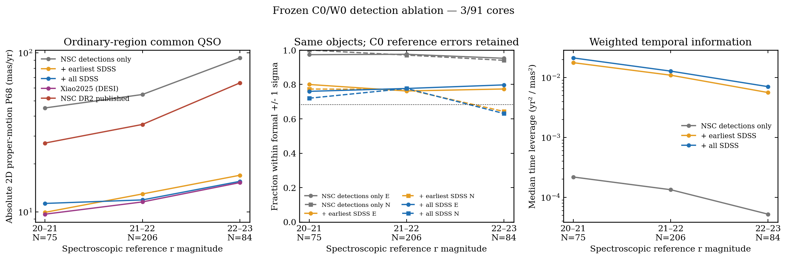

# 实验 A v1.3：普通扫描区的误差与时间信息

## 当前判断与证据范围

本轮从 `13d4e29` 冻结的99.873平方度出发。**普通区加入早期SDSS的主要收益来自时间基线，全部SDSS重复观测的进一步收益目前不足以保证优于Xiao2025。** 这是三处真实普通区先导的条件性证据，91核心整区消融仍在运行；还不能据此决定全覆盖生产或采用新误差模型。

v1.2原始回执、C0/W0参数、负结果和Home归档保持原样。[实际方法审计](../docs/method_audit_v13.md) 逐项记录参考源、连通图、物理组、底噪、bootstrap、实际启用的修正、时刻与拟合、关联门槛和坐标输出。C0没有启用颜色／DCR／CCD／field项。旧自行列属于共同切平面，新增ICRS和完整协方差实现尚待真实相邻区域认证。

## 固定QSO和检测的真实先导

先导为预登记普通区 `repeat_sparse`、`sparse_north_outer` 及小核心 `c_02_00`。合计440颗合格20–23等QSO；其中299颗21–23等的对象数量、星等、曝光集合及C0自行与v1.2逐项复核，自行差最大值为0。v1.2未保存QSO逐检测ID，检测身份复核依赖冻结输入回执和未改变的匹配器；本轮三臂另行保存嵌套检测身份。取数和逐源配对仅在NERSC。

下表严格固定每档共同的NSC／Xiao DESI／C0对象，所有臂使用相同C0参考系、50mas底噪和稳健拟合。NSC-only指目标只用NSC测量，参考零点仍为冻结的联合星系图；不等于重现NSC官方处理。星等使用谱表reference_r，单位mas/yr，指标是相对于光谱QSO零运动的二维绝对误差P68。

| r档 | 共同QSO数 | NSC-only重拟合 | +最早SDSS | +全部SDSS | 原位置全部检测 | NSC DR2 | Xiao DESI |
|---|---:|---:|---:|---:|---:|---:|---:|
| 20–21 | 75 | 45.077 | 9.924 | 11.291 | 12.407 | 27.093 | 9.664 |
| 21–22 | 206 | 54.770 | 12.955 | 11.880 | 13.888 | 35.485 | 11.540 |
| 22–23 | 84 | 93.069 | 16.983 | 15.550 | 17.776 | 64.763 | 15.269 |

[三核心核验与完整诊断](../results/summary/v13_canary_conditions_summary.json) · [原字段统计](../results/summary/v13_sparse_north_outer_conditions_summary.json)

21–22等加入最早SDSS使P68明显降低，全部SDSS再改善约8.3%，C0组常量校正也有约14.5%的点估计收益。然而全部SDSS仍比Xiao约差2.9%，run权重95%敏感性区间为相对收益−13.7%至+11.0%；22–23等约差1.8%，run区间−17.1%至+7.3%。普通区对Xiao尚无统一优势，不能只展示相对很差的NSC-only结果。20–21等重复观测还出现反向变化，需核验时间权重、位置条件和残余零点。

NSC-only在这个短时基样本的±1σ覆盖接近1，自行误差模型和实际散布不简单相等。不能只缩形式误差来制造更高精度。所有尾部、两轴偏差、NMAD、覆盖、独立组和时间杠杆见完整统计；对象bootstrap只作描述性区间，run／曝光／夜权重敏感性与闭包另外保留。

## 最小误差、多波段及独立验证

两处预登记普通区的试验已提交计算节点。误差学习只用原C0留出星系的一半，再按物理身份隔离另一半；QSO不参与误差学习。巡天／仪器／波段的两轴scale和floor仅在至少50对不同组／夜的训练参考对时拟合，配对方差显式保留同步参考bootstrap的已知公共项。比较W0 r、试验误差r、W0多波段与试验误差多波段。

普通暗星的模型对比先冻结W0训练对象、共同r检测和同一独立年r位置，整个留出年的检测不进入任何训练关联。预测误差包括训练—测试之间的公共零点相关性。额外多波段源的留出重现与分母独立保存。未取得独立QSO、星系及年份的可复现共同收益前，试验模型不采用。

## 独立新增区域

首次候选为A、B及两处北天，完全按真实SDSS和NSC芯片几何、时基及光谱QSO位置预查，未读取任何新区自行。保守排除旧研究足迹及缓冲后，55个2°候选格仅有196.407平方度通过几何条件：A31.957、B47.934、北窗57.795和58.720平方度。北窗实际含DECam、90Prime和Mosaic元数据。[几何汇总](../results/summary/v13_independent_geometry_summary.json)

这不是已新增或已认证面积，星系图支持仍待首批取数核验。因为不足200平方度，在不改变门槛、不读取新自行结果的条件下，候选池增加相邻北窗RA188°–198°、Dec28°–38°，再做同样预查。最终按实际支持选约200–300平方度，逐批真实运行、科学与资源核验后继续。

## 八阶段状态

1. 指定文档和实际源码审计完成；原99.873平方度冻结，归档存在，重新核验校验和待收齐。
2. 三核心固定源消融及C0数值复现完成，91核心整区八路运行中。
3. 最小误差／多波段和独立年份实现完成，两处真实试验中；没有采用新增模型。
4. 完整参考协方差与训练—测试相关传播已实现；真实全区空间、组重采样与删组认证未完成。
5. ICRS解析速度与全状态Jacobian及协方差已通过独立球面传播等测试；真实相邻区一致性未完成。
6. 四窗几何候选预查完成但不足目标，新增北窗待查；还未宣布新增200–300平方度处理完成。
7. 新区域三／四路严格共同源和暗星独立验证尚未运行。
8. 全覆盖生产决策待独立新区证据，当前保留C0基准。

目前本地全部106项测试通过，真实先导图已目视核验。科学结论以真实Slurm回执和后续整区结果更新，代码完成不代替验收。[当前计划](../PLAN.md) · [预登记](../docs/conditions_protocol_v13.md)
