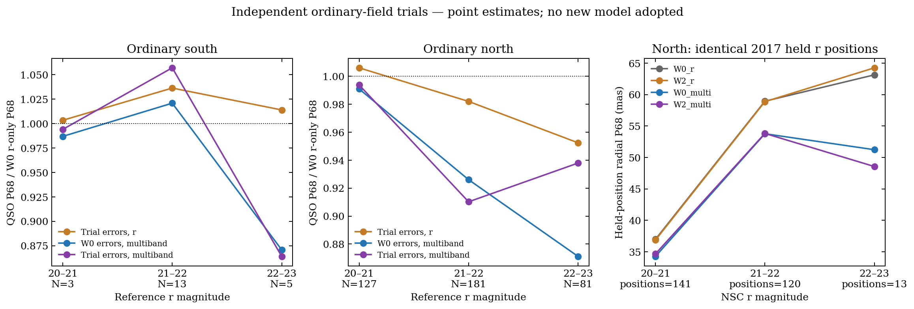

# 实验 A v1.3：普通扫描区的误差与时间信息

## 当前科学判断

**连续100平方度已完成固定QSO与检测的三臂消融，C0相对Xiao2025的收益具有明确的观测条件依赖。** 普通区21–22等的NSC-only／一次早期SDSS／全部SDSS二维P68为61.23／13.40／12.68mas/yr，Xiao为12.17；重复带为7.61／6.98／3.67，Xiao为5.80。普通区的长基线收益很大，重复SDSS的增量只有约5%；重复带的增量约47%。不能把相对短时基NSC-only的改善等同于已经超过Xiao。

两处普通区的最小误差试验没有取得跨区稳定的自行精度收益，新权重未采用。NSC多波段在最暗档有改善信号，独立年份及新增源的质量证据仍有限。下一步保持C0为基准，在未查看新区自行的前提下，按真实观测条件和参考支持分批研究新增天区。当前尚未决定全覆盖正式生产。

## 冻结、审计与运行范围

基准为 `13d4e29` 的99.873平方度，C0/M3、W0 r-only、稳健四参数、J2015.5均保持。完成全部指定文档与五个实际源码的审计，追踪标准化、选择、关联和验证调用。[实际方法](../docs/method_audit_v13.md)

原7411成员的逐源／参考解归档及2025年参照压缩表在Home的SHA-256重新核验，与冻结回执完全一致。[归档复核](../results/summary/v13_frozen_archive_check_summary.json) 原C1/C1b失败不改变；没有启用颜色、星等、DCR、CCD、field位置修正。

本轮91核心全部完成，有10,438颗合格20–23等光谱QSO。7,071条原21–23等C0控制轨迹逐项复现，最大自行差为0，全部原共同样本数也一致。原v1.2未保存QSO逐检测ID；复现依赖冻结输入回执、未改变的匹配器、对象／星等／曝光集合和数值结果。本轮三臂另外保存嵌套检测身份，全部留在NERSC。

所有计算在Slurm节点运行。三核心先导为61512120；整区八路为61512240；两普通区及相邻区最终诊断为61514306，后者用时7分10秒，步骤峰值约3.54GiB。逐源结果及验证缓存不进入GitHub。[完整去标识统计](../results/summary/v13_full_conditions_summary.json)

## 固定对象和检测的时间基线贡献

各格固定同一批NSC、Xiao DESI和C0共同QSO。NSC检测集合不变，只改变加入的SDSS集合；没有分别按模型形式误差挑对象。NSC-only仍使用冻结C0联合星系参考图，不是重现NSC官方算法。各档星等取联合光谱表reference_r，单位mas/yr，指标为相对于静止QSO的绝对二维自行P68。

| 条件 | r档 | 共同QSO数 | NSC-only | +最早SDSS | +全部SDSS | 原位置全部检测 | NSC DR2 | Xiao DESI |
|---|---|---:|---:|---:|---:|---:|---:|---:|
| 普通区 | 20–21 | 407 | 44.75 | 9.68 | 9.69 | 11.01 | 22.57 | 8.83 |
| 普通区 | 21–22 | 1001 | 61.23 | 13.40 | 12.68 | 13.70 | 31.61 | 12.17 |
| 普通区 | 22–23 | 353 | 103.06 | 17.49 | 16.51 | 18.05 | 55.37 | 17.23 |
| 重复带 | 20–21 | 492 | 5.80 | 5.11 | 3.46 | 4.21 | 4.03 | 4.45 |
| 重复带 | 21–22 | 1411 | 7.61 | 6.98 | 3.67 | 4.38 | 5.14 | 5.80 |
| 重复带 | 22–23 | 882 | 12.95 | 10.31 | 5.49 | 5.85 | 8.58 | 9.91 |

普通区21–22等“全部相对一次SDSS”的P68改善5.31%，按run权重95%敏感性区间1.94%–9.11%；重复带为47.42%，46.88%–47.62%。普通区22–23等增量5.65%，1.68%–10.89%；重复带46.71%，44.97%–49.61%。它们刻画共享观测组的权重敏感性，不能当作空间独立复制的置信区间。

普通区21–22等相对Xiao仍差4.19%，run区间−7.68%至+4.86%；夜权重下的收益区间为−7.41%至−1.46%。最暗档相对Xiao改善4.18%，run区间−3.93%至+12.65%，未给出统一优势。原位置与C0比较的普通21–22等改善7.43%，run区间3.82%–12.89%，表明组常量校正有效，但不足以消除精度差距。

普通21–22等C0两轴中位偏差约+0.07/+0.03mas/yr，NMAD7.91/8.57；Xiao为−0.16/+0.32和7.82/7.49。一个全区常量偏移不能解释主要散布差别；局部、观测组和颜色相关零点仍待检验。

来源选择敏感性也有限：普通21–22等的全部合格QSO为1022颗，C0 P68为12.70；严格共同1001颗为12.68。22–23等为370颗16.66与共同353颗16.51。当前普通区负结果不由某模型单独严格删样本产生。

图和完整统计同时保留两轴偏差、NMAD、尾部、形式误差覆盖和时间杠杆。普通21–22等全部SDSS的校准组数中位4、按斜率信息的有效组约2、最大组信息份额约68%；重复带分别为34、约18.8和11%。这些是**校准组**及检测权重指标，仍可能同夜相关。历史字段 `effective_weighted_epochs` 是检测Kish数量，不能解释为独立观测年或季。形式误差覆盖在普通区偏保守、重复带较差，不能使用统一缩放来替代相关误差检验。

## 普通区最小误差与多波段试验

预先固定南侧 `repeat_sparse` 与北侧 `sparse_north_outer`，没有按性能选择。误差学习只用原C0留出星系的一半，再按物理源身份隔离另一半；QSO不参与误差学习。已知的同步参考抽样方差显式加入配对方差模型。须至少50对且50个实际贡献配对的物理参考源才拟合。

南／北的NSC r验证星系有3745／2231对，W0独立误差标准化NMAD约0.46–0.48，试验后约0.85–0.90。SDSS比例约1.1–1.2、底噪40–48mas；NSC DECam比例约0.5、底噪24–33mas。误差条更接近重复性，并不保证自行点估计更准。发表星表原误差包含何种共模分量仍需进一步分解。

固定同一批对象和r检测，并在多波段臂仅追加可用且受支持的NSC g/i/z，QSO绝对二维P68如下；W2是误差试验标签，未成为采用模型。

| 普通区 | r档 | QSO数 | W0 r | W2 r | W0多波段 | W2多波段 |
|---|---|---:|---:|---:|---:|---:|
| 南 | 21–22 | 13 | 8.49 | 8.80 | 8.66 | 8.97 |
| 南 | 22–23 | 5 | 15.59 | 15.80 | 13.57 | 13.47 |
| 北 | 21–22 | 181 | 11.88 | 11.67 | 11.00 | 10.81 |
| 北 | 22–23 | 81 | 15.54 | 14.80 | 13.54 | 14.57 |

这是各自的全部合格QSO，未要求同时有NSC／Xiao发布值，不能把表中数值与上一个共同样本表直接相减。北侧W0多波段的对象bootstrap改善区间为21–22等0.9%–15.5%、22–23等0.9%–21.8%；物理观测相关性和独立地区仍待复核。W2没有跨区稳定精度收益，保持W0。

北侧2017年整年留出，固定W0训练对象、共同r检测和同一测试位置。21–22等120个位置的W0 r／W0多波段P68为58.94／53.76mas；22–23等只有13个，为63.13／51.23。后者来自31个训练源中的13个，13/31的描述性Wilson95%为26.4%–59.2%。南侧 r-only 只有两个有效NSC观测年，不能完成同样的 r-only 三年留出；其他波段有额外年份，尚未据此重新定义留出检验。

W2多波段新增22–23等训练源的独立年位置重现为613/737，描述性Wilson95%为80.3%–85.7%，1062个唯一位置P68为83.67mas。该分母尚未按完整留出足迹认证；零点、星系污染和独立暗星真值也未充分约束。它是新增源可用性的线索，不是图像或星表完备性、正确率。重新核对实际参考贡献者计数时，学习参数及既有负结果保留。

## 空间、公共误差与相邻输出

两普通区已分别生成21／389颗QSO、246／3963个整组留出位置残差。比较目标时排除其整个物理组，用共同r位置预测；按波段、颜色、seeing、气团、年份、run/camcol、曝光、CCD及field输出计数与残差。NSC气团／CCD位置元数据存在，部分SDSS气团缺测，当前没有应用DCR修正。[南侧残差](../results/summary/v13_repeat_sparse_residual_summary.json) · [北侧残差](../results/summary/v13_sparse_north_outer_residual_summary.json)

源级协方差分列独立位置拟合与同步参考抽样；空间均值的公共项不按源数开平方缩小。模型区间仅为线性传播诊断，仍缺完整物理组和空间变化认证，不能据此宣布局部达到每轴0.5mas/yr。

新增C区外RA355°–356°、Dec3°–4°真实输入，并在两侧各自缓存的共同窄条带计算377个同源解。统一C0图、标准ICRS自行及完整4×4传播后，位置与自行差均为0，共享检测中位4个。[相邻回执](../results/summary/v13_adjacent_consistency_summary.json) 这批对象重用了相同物理测量，零差验证的是区域组织、坐标和协方差处理一致性，不能当成独立天测精度或零点认证。跨大区与高赤纬的真实检验随新增区域继续。

## 新增区域与后续决策

在不读取新区自行结果的条件下，A、B和三个北窗依据真实SDSS／NSC几何、时间及光谱QSO位置预选。排除旧研究足迹及缓冲后为**226.963平方度、64个2°候选格**，其中A31.957、B47.934、北窗57.795／58.720／30.556平方度。[扩展几何](../results/summary/v13_expanded_geometry_summary.json)

这是候选格几何面积，不是已完成新增测量或已认证有效覆盖。首批还须核对实际共享run、星系图支持、仪器、数据量和真值数量。保持C0为共同基准，每批真实运行和验证后继续，未通过独立验证的误差模型不进入采用方案。

当前八阶段：冻结／审计完成；100平方度同源消融完成；两区最小试验完成但不满足新增模型采用条件；空间、跨大区和额外暗源质量继续；226.963平方度预查完成、取数／正式共同源研究待推进；最终全覆盖决策待新区域证据。未进入图像PSF重处理，也未整理正文。 [计划](../PLAN.md) · [预登记与命令](../docs/conditions_protocol_v13.md)

## 独立区首批：标准 ICRS 共同光谱 QSO

61516489在两节点完成五窗首批18.092平方度、20个1°核心，取数7分8秒、参考提取2分24秒、共享图1分41秒、拟合6分50秒。north_two的4核心仍密封，未读取任何自行、产出或残差指标。其余四窗面积14.984平方度、78,688个W0解；61516858复核输入回执后计算标准ICRS汇总。

| 窗口 | r21–22共同数 | NSC / Xiao / C0 P68 | r22–23共同数 | NSC / Xiao / C0 P68 |
|---|---:|---|---:|---|
| A | 248 | 9.638 / 6.122 / 5.812 | 113 | 14.367 / 8.883 / 8.726 |
| B | 239 | 13.895 / 6.071 / 6.052 | 127 | 24.105 / 8.498 / 8.777 |
| 北一 | 75 | 26.752 / 7.417 / 6.140 | 29 | 39.152 / 10.382 / 11.335 |
| 北三 | 31 | 44.045 / 8.968 / 9.127 | 1 | 不作精度统计 |

P68为二维绝对自行误差，单位mas/yr；Xiao仅DESI，QSO已知位置同源控制，不能当作最终盲目录精度。四窗共同池21–22等593颗：C0/Xiao=6.186/6.517，相对改善5.07%，对象bootstrap95%为−0.34%到10.59%；22–23等270颗为8.825/8.933，改善1.21%，95%为−7.20%到11.99%。共同池存在共享物理观测组，另报告实际SDSS run、NSC exposure和18UTC观测夜的权重敏感性，不能称独立空间置信区间。

实际单SDSS run最暗189颗：C0/Xiao=9.693/8.750；多run的81颗为8.241/9.947。与100平方度负结果一致：相对NSC的显著改善不自动意味着优于Xiao。C0的轴向1σ覆盖在共同池约76%–80%，目前仍偏保守，并且不代表公共空间误差已认证。四窗图均为一个连通分量；大多数合格r测量有支持，仅北三一核心有283条未支持NSC r测量。B的892个不支持组大部分不进入合格r拟合，应继续审查其波段和质量，不能用总组数直接估计r样本损失。逐曝光星系支持和弱组情况均留存。

源码审计同时修正新增私有QSO发布目录向量的ICRS恢复方向：应正向乘逆gnomonic Jacobian；原冻结切平面数据不变。汇总从原切平面值重建并检查C0标准值一致，忽略早期错误私有字段。高赤纬原生运动及密封区无结果访问回归测试通过。

本批支持继续预登记的独立面积研究，不支持全覆盖正式生产。后续每窗扩展统一参考图，并重新拟合以前核心，保留各阶段零点变化用于跨大区审计；取数缓存以原回执、投影和几何核验后只读复用。

[首批汇总](../results/summary/v13_batch01_unsealed_summary.json) · [首批统计图](../figures/v13_batch01_comparison_summary.png)
