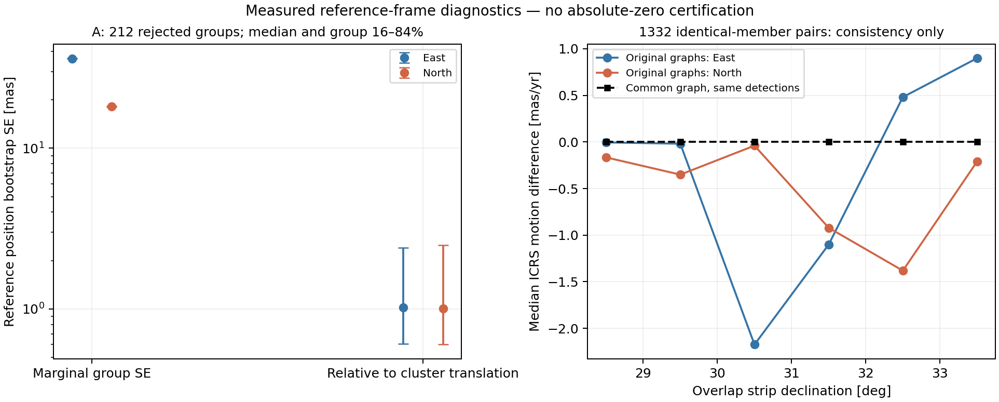

# 实验 A v1.4：全波段天测与共同参考系研究

状态：真实数据核查已完成首轮；共同参考与科学消融尚在执行。任何尚未验证的多波段试验都不是采用目录。

## 科学问题与冻结参照

最终目标是多波段、多历元自行星表。当前检验普通单 SDSS run 区的暗端精度与可信源数能否增加，同时控制波段／观测条件偏差与跨大区参考系。冻结参照仍是 `5fba219` 的 C0/W0 r-only、四参数稳健拟合、J2015.5；v1.2 的 99.873 平方度及 v1.3 全部回执不覆盖。暗端 Gaia 自行不参与模型选择。

v1.3 的普通单 run 相对 Xiao2025 负结果、独立图同检测的局部 1–2 mas/yr 自行差、A 区 12 个核心无最终参考支持，以及新增源的 B 最暗东向 −3.61／北一 21–22 北向 −4.06 mas/yr，均保留为本轮待解释事实。不能把“单曝光”本身作为精度更优的证据。

## 第一轮实测：有哪些可以研究的测量？

61554827 在 NERSC 计算节点完成六个已缓存核心的逐仪器、波段、误差、SNR、标志、年份、夜数与原参考支持统计。下表是核心内检测，不是独立源数；候选数只表示原生两轴误差有限且在 (0,200] mas、时间合法、SNR≥5、NSC 致命 SExtractor 标志清除，并不证明天测合格。去混叠、WCS、残余零点和共享误差需另外检验。

| 核心 | NSC 波段 | NSC 检测数 | 初筛候选 | 原 C0 支持的候选 |
|---|---|---:|---:|---:|
| a_09_00 | g, i, r, u, z | 968,558 | 870,642 | 0 |
| b_16_00 | VR, g, i, r, z | 321,526 | 290,028 | 290,028 |
| north_one_00_00 | g, r, z | 185,137 | 160,720 | 160,720 |
| north_three_00_00 | g, r, z | 152,245 | 132,044 | 132,044 |
| repeat_sparse | g, i, r, z | 943,911 | 816,781 | 816,781 |
| sparse_north_outer | g, i, r, z | 659,865 | 565,250 | 565,250 |

A 核心有 u，B 核心有 VR；它们在旧 g/i/z 追加逻辑之外。六个核心没有 Y，不能外推整个已下载区域没有 Y。候选入口不按滤光片名称设白名单，未知标签同样需要实际质量检验。A 的原 C0 支持为零是参考筛除问题，不能解释为没有测量。

官方 NSC 目录支持 u/g/r/i/z/Y/VR：[Data Lab NSC](https://datalab.noirlab.edu/data/nsc)。现有取数仍使用 object 空间索引并有 r 条件，其对非 r 锚点发现的选择影响尚未通过曝光路线消除；当前库存只代表成功取回的检测。

## SDSS 独立位置是否真实存在？

实际读取 B、北一各两个物理 field 的 photoObj 与 photoField，取得 OFFSETRA/OFFSETDEC、五维 ROWC/ROWCERR/COLC/COLCERR 和逐源 TAI，以及场级 MUERR/NUERR 和 WCS 数组。原 r 坐标最大重现差在 10⁻¹³ 度量级，TT MJD 最大差约 2.2×10⁻¹¹ 天。相对 r，i/u/z/g 的实际时间依次约 +71.72/+143.44/+215.12/+286.88 秒。它们增加短时质心信息，不是五个独立长期历元。

这些字段的存在不等于已获得五套独立、可信的位置误差。下一步须验证 offset 的东向定义、实际 WCS Jacobian、逐 band 质心与场级标定误差的分离及共享协方差；不能把 r 的标量 RAERR/DECERR 复制五次使用。SDSS 官方说明 r 为参考波段，其他波段具有相关的标定信息：[DR17 astrometry](https://www.sdss4.org/dr17/algorithms/astrometry/)。在上述验证完成前，SDSS 其他 band 不进入采用方案。

## 共同参考系与公平比较

61555065 使用两个计算节点，保留 N1/N3 原参考检测、参考源、训练／留出身份，统一投影求一次物理组 C0；并重新运行原 A 图，另存最小支持、剪枝、连通、bootstrap SE 门槛前后的退出链。诊断开关不得改变原 A 保留解。共同图下同检测零差只是可复现一致性，外部质量仍需留出星系和独立 QSO 检验。

新增固定 QSO 入口先重现冻结 r 自行，再对完全相同检测替换参考解。多波段依次比较冻结 r、共同图 r、质量筛选 r、相同质量 r 加所有实际合格候选 NSC band；质量筛选与加 band 的收益分别计量。原 NSC object ID 不作为正确关联答案。此时尚未运行该科学比较，不能声称获得精度收益。

每个 NSC 曝光已有自由 C0 零点，再追加同波段常数会与该波段的曝光零点退化。后续修正必须有可辨识的独立残差信号；验收 QSO 不能用于拟合零点或调系数。

## 相同留出对象的共同参考实测

N1/N3共同图保留1436物理校准组，仍有两个规范1224／212组。精确追溯证明北一原本就有730／212两个规范，分别映射到共同图0／1；北三622组并入0。全部原受支持组保留，无参考身份冲突及同曝光多记录退出。

在相同原留出物理检测上比较，北一主分量70633源的跨巡天位置P68由147.944变为148.121mas；独立分量5154源117.469→117.473；北三40534源151.194→152.174。尚无位置精度改善。总体原始位置152.870→共同C0 148.087mas不属于旧C0对新图的比较。参考图可以使共享组解一致，但不能用这个机械一致性代替独立空间零点认证。

[相同留出对象实测](../results/summary/v14_common_reference_audit_summary.json)、[共同参考图](../results/summary/v14_joint_reference_summary.json)。

## 全窗库存与固定 QSO 已完成

184核心库存全部完成，共109,297,678条核心内检测；实际 NSC band 为 u/g/r/i/z/Y/VR，含 DECam、Mosaic3、90Prime。Y实际164,827条，不能用六核心未见Y来删除该band。库存仍只覆盖原object索引获取的检测，非图像或非r源完备性。

104核心固定QSO参考替换全部通过冻结r重现，北一21–22（1442源）P68 7.954→8.049、22–23（142源）12.429→12.059；北三分别1111源8.585→8.729、164源12.391→12.170mas/yr，没有一致的精度收益。

原1332对相同检测的跨窗源在共同参考下标准ICRS自行差逐值为零，只是处理一致性。A原解1726组位置与抽样逐值重现；212被SE拒绝组有40926训练参考源，组内训练支持中位3541.5。其bootstrap主要是36.18／18.14mas共同平移；扣除该模式后内部SE中位1.02／1.01mas。连接到其余图的509个训练参考源已计数，尚未区分物理连接、模型残差与数值求解对该模式的贡献。这个诊断不构成直接删去公共位置误差的理由；下一步敏感性试验保留全部抽样和完整4×4协方差。

## 初步多波段精度：没有统一改善

| 核心 | r段 | 固定共同源数 | 质量r P68 | 全NSC候选band W0 P68 |
|---|---|---:|---:|---:|
| B | 21–22 | 57 | 5.890 | 5.454 |
| B | 22–23 | 24 | 11.025 | 11.839 |
| 北一 | 21–22 | 37 | 7.172 | 8.694 |
| 北一 | 22–23 | 17 | 12.784 | 11.203 |

单位mas/yr；四组配对对象bootstrap区间均跨零，不构成空间认证。两核心固定r质量筛选未改变该QSO子样本，故这里的变化来自追加检测。北一21–22的r-only北向中位−3.303，multi−3.435，原r测量/参考条件也必须追踪。这是既有r控制源，不是此前产生−4.06偏差的额外源，不能代替额外源复现。B对应最暗控制源也不等于此前−3.61额外源。

SDSS四场WCS重建已实际运行，r对发布offset的P68残差约6–23mas、g约24–48mas；逐band质心、坐标参考、颜色与场级误差定义仍需定位，不能因为数组存在就把D投入拟合。

## 独立星系误差分解和逐波段删组

两核心误差试验及删除各band/NSC整年均已实际完成。只用原C0留出星系的固定一半训练，另一半检验；同夜与跨夜各至少20对、至少50物理参考和4夜才分解原生scale、独立floor及夜公共项。B的r/z、北一g/r/z得到条件试验参数；SDSS、B的g/i/VR缺可辨识支持，保持W0，而非套用旧W2。参考bootstrap在配对方差及源4×4协方差中单独传播；不同band同夜相关性的两端假设仅作敏感性，不能称已测得。

| 核心 | r段 | 共同QSO | 全band W0 P68 | 条件分层误差 P68 |
|---|---|---:|---:|---:|
| B | 21–22 | 57 | 5.454 | 5.024 |
| B | 22–23 | 24 | 11.839 | 11.822 |
| 北一 | 21–22 | 37 | 8.694 | 9.394 |
| 北一 | 22–23 | 17 | 11.203 | 10.484 |

北一21–22北向中位从−3.435变为−4.297，1σ覆盖从0.541降到0.459，不能因为星系重复对支持更小误差就认为目标更可靠；当前不采用新权重。该分解参数学习不确定度、跨轴/跨band相关性仍有未建模项。

固定QSO逐band删除显示，北一21–22有g支持的36源去g后P68由8.837变7.316，北向中位−3.624→−2.411；但22–23的16源去g后11.581→13.096，方向相反，不能据此按g名称统一删掉。B的z实际增加约4–6年NSC基线，i主要是同夜质心信息，两种贡献必须分开。上述均为已有r控制源，旧额外源−3.61/−4.06仍需原W2/原检测精确复现后归因。

[真实误差与band/年删组汇总](../results/summary/v14_multiband_error_diagnostics_summary.json)。

## 年度盲候选与真实取数选择

61556295完成B／北一全部测试年NSC band先隔离的盲训练。B按元数据选2017，北一选2018，不能与旧2017结果直接当同条件比较。以下是候选与至少一次独立年份位置重现数，不是已认证暗星数量：

| 核心／类别 | 21–22候选／重现 | 22–23候选／重现 |
|---|---:|---:|
| B 追加band支持的r锚点 | 1782／1757 | 1164／1151 |
| B 无合格NSCr锚点 | 414／414 | 221／220 |
| 北一追加band支持的r锚点 | 507／504 | 330／327 |
| 北一无合格NSCr锚点 | 65／65 | 77／77 |

无NSCr锚点类别的r星等来自实际SDSS r，另一类别来自NSC r，不能静默混同其星等选择。重现比例的Wilson区间及足迹／位移负对照在汇总中。高重现率主要说明已取回目录中的训练轨迹能预测另一年的近邻位置，不能替代绝对自行和混叠/身份验证。B最暗r新增的18颗QSO仍东向−3.418mas/yr，与旧额外源偏差接近但方法不同，后续分别精确重放及成员审计。

固定中央0.05度小单元的曝光/CCD路线确实找到r对象索引之外的测量。B的g/z分别缺7／9条原生质量与参考支持均合格的检测，北一分别缺4／6条；均对应原索引未含的对象，缺失对象中分别12／10个没有r检测。它证明原`ndetr>0`的发现选择是真实瓶颈，不能把缓存上非r锚点数量当全band发现完备性。

A实验参考支持复制已通过原1726组逐值保持和完整抽样保留，但known-QSO控制因接口错误`KeyError C0`失败，后续A年度步骤未执行。错误是控制入口给空盲产品字典而公共函数要求C0标签，已用显式空C0目录修复，并用实际拟合/记录调用测试确认不会伪造盲恢复。原失败回执保留，新输出目录续跑。

[年度候选、曝光路线、辅助波段和SDSS实测回执](../results/summary/v14_allband_source_support_summary.json)。

## 当前判断与下一步

目前已证明取回数据中有旧试验未利用的真实波段、且 SDSS 发布产品包含逐 band 质心与时间信息；尚未证明这些额外数据能改善普通暗源自行，更未达到全覆盖生产条件。先解决共同参考与 A 失支持，再做独立星系误差／相关性学习、共同 QSO 科学消融和全年度隔离的盲新增源验证。仅在独立验证支持科学收益及新增源身份、零点、误差质量时，进入共同参考的约 10°×10° 完整多波段试验及独立迁移。

## 可追溯产物

- [六核心逐 band 实测汇总](../results/summary/v14_initial_band_inventory_summary.json)
- [四个 SDSS field 模式与实测汇总](../results/summary/v14_sdss_band_probe_summary.json)
- [八阶段计划](../PLAN.md)、[预登记方法与判断](../docs/allband_protocol_v14.md)

原始、逐检测、逐源、参考和私人对照全部在 NERSC PScratch；本地与公开 GitHub 只保存代码、研究文档、图和去标识汇总。
