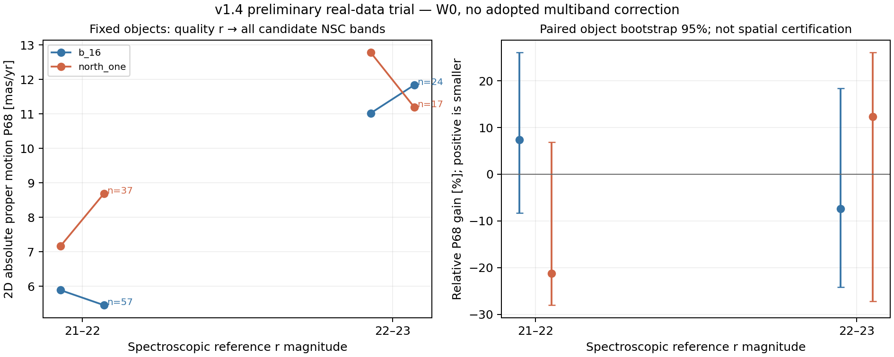
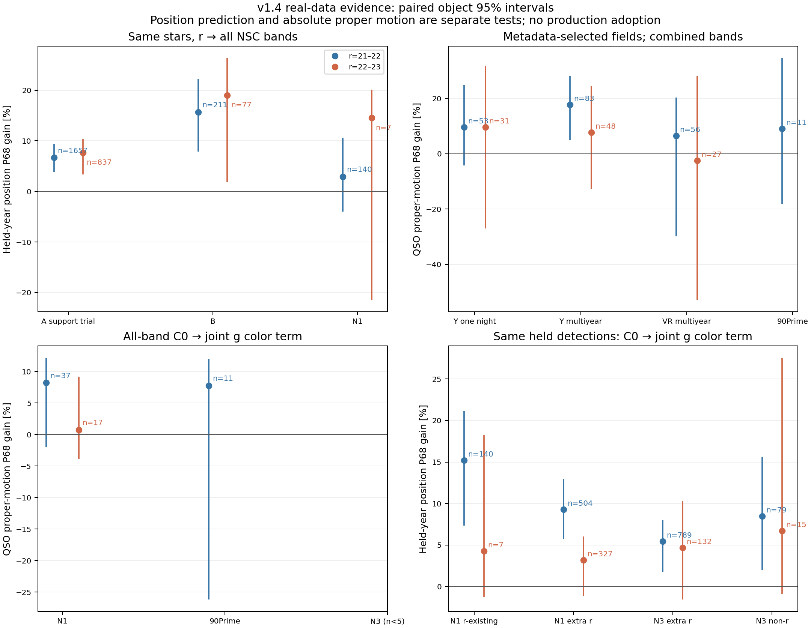

# 实验 A v1.4：全波段天测与共同参考系研究

状态：本轮已完成真实全波段库存、共同参考、固定源消融、误差试验、盲新增源年度与成员审计，并实际联合求解一个最小颜色项。多波段有可测信息收益，最终全波段方法仍未通过冻结条件；不启动约100平方度完整多波段目录或全覆盖生产。详见末节的已证实收益和剩余门槛。

## 科学问题与冻结参照

最终目标是多波段、多历元自行星表。当前检验普通单 SDSS run 区的暗端精度与可信源数能否增加，同时控制波段／观测条件偏差与跨大区参考系。冻结参照仍是 `5fba219` 的 C0/W0 r-only、四参数稳健拟合、J2015.5；v1.2 的 99.873 平方度及 v1.3 全部回执不覆盖。暗端 Gaia 自行不参与模型选择。

v1.3 的普通单 run 相对 Xiao2025 负结果、独立图同检测的局部 1–2 mas/yr 自行差、A 区 12 个核心无最终参考支持，以及新增源的 B 最暗东向 −3.61／北一 21–22 北向 −4.06 mas/yr，均保留为本轮待解释事实。不能把“单曝光”本身作为精度更优的证据。

## 第一轮实测：有哪些可以研究的测量？

61554827 在 NERSC 计算节点完成六个已缓存核心的逐仪器、波段、误差、SNR、标志、年份、夜数与原参考支持统计。下表是核心内检测，不是独立源数；候选数只表示原生两轴误差有限且在 (0,200] mas、时间合法、SNR≥5、NSC 致命 SExtractor 标志清除，并不证明天测合格。去混叠、WCS、残余零点和共享误差需另外检验。

| 核心 | NSC 波段 | NSC 检测数 | 初筛候选 | 原 C0 支持的候选 |
|---|---|---:|---:|---:|
| a_09_00 | g, i, r, u, z | 968,558 | 870,642 | 0 |
| b_16_00 | VR, g, i, r, z | 321,526 | 290,028 | 290,028 |
| north_one_00_00 | g, r, z | 185,137 | 160,720 | 160,720 |
| north_three_00_00 | g, r, z | 152,245 | 132,044 | 132,044 |
| repeat_sparse | g, i, r, z | 943,911 | 816,781 | 816,781 |
| sparse_north_outer | g, i, r, z | 659,865 | 565,250 | 565,250 |

A 核心有 u，B 核心有 VR；它们在旧 g/i/z 追加逻辑之外。六个核心没有 Y，不能外推整个已下载区域没有 Y。候选入口不按滤光片名称设白名单，未知标签同样需要实际质量检验。A 的原 C0 支持为零是参考筛除问题，不能解释为没有测量。

官方 NSC 目录支持 u/g/r/i/z/Y/VR：[Data Lab NSC](https://datalab.noirlab.edu/data/nsc)。现有取数仍使用 object 空间索引并有 r 条件，其对非 r 锚点发现的选择影响尚未通过曝光路线消除；当前库存只代表成功取回的检测。

## SDSS 独立位置是否真实存在？

实际读取 B、北一各两个物理 field 的 photoObj 与 photoField，取得 OFFSETRA/OFFSETDEC、五维 ROWC/ROWCERR/COLC/COLCERR 和逐源 TAI，以及场级 MUERR/NUERR 和 WCS 数组。原 r 坐标最大重现差在 10⁻¹³ 度量级，TT MJD 最大差约 2.2×10⁻¹¹ 天。相对 r，i/u/z/g 的实际时间依次约 +71.72/+143.44/+215.12/+286.88 秒。它们增加短时质心信息，不是五个独立长期历元。

这些字段的存在不等于已获得五套独立、可信的位置误差。下一步须验证 offset 的东向定义、实际 WCS Jacobian、逐 band 质心与场级标定误差的分离及共享协方差；不能把 r 的标量 RAERR/DECERR 复制五次使用。SDSS 官方说明 r 为参考波段，其他波段具有相关的标定信息：[DR17 astrometry](https://www.sdss4.org/dr17/algorithms/astrometry/)。在上述验证完成前，SDSS 其他 band 不进入采用方案。

## 共同参考系与公平比较

61555065 使用两个计算节点，保留 N1/N3 原参考检测、参考源、训练／留出身份，统一投影求一次物理组 C0；并重新运行原 A 图，另存最小支持、剪枝、连通、bootstrap SE 门槛前后的退出链。诊断开关不得改变原 A 保留解。共同图下同检测零差只是可复现一致性，外部质量仍需留出星系和独立 QSO 检验。

新增固定 QSO 入口先重现冻结 r 自行，再对完全相同检测替换参考解。多波段依次比较冻结 r、共同图 r、质量筛选 r、相同质量 r 加所有实际合格候选 NSC band；质量筛选与加 band 的收益分别计量。原 NSC object ID 不作为正确关联答案。该入口随后完成下述104核心参考替换和小区多波段消融；此处描述比较设计，不是尚未执行的当前状态。

每个 NSC 曝光已有自由 C0 零点，再追加同波段常数会与该波段的曝光零点退化。后续修正必须有可辨识的独立残差信号；验收 QSO 不能用于拟合零点或调系数。

## 相同留出对象的共同参考实测

N1/N3共同图保留1436物理校准组，仍有两个规范1224／212组。精确追溯证明北一原本就有730／212两个规范，分别映射到共同图0／1；北三622组并入0。全部原受支持组保留，无参考身份冲突及同曝光多记录退出。

在相同原留出物理检测上比较，北一主分量70633源的跨巡天位置P68由147.944变为148.121mas；独立分量5154源117.469→117.473；北三40534源151.194→152.174。尚无位置精度改善。总体原始位置152.870→共同C0 148.087mas不属于旧C0对新图的比较。参考图可以使共享组解一致，但不能用这个机械一致性代替独立空间零点认证。

[相同留出对象实测](../results/summary/v14_common_reference_audit_summary.json)、[共同参考图](../results/summary/v14_joint_reference_summary.json)。

## 全窗库存与固定 QSO 已完成

184核心库存全部完成，共109,297,678条核心内检测；实际 NSC band 为 u/g/r/i/z/Y/VR，含 DECam、Mosaic3、90Prime。Y实际164,827条，不能用六核心未见Y来删除该band。库存仍只覆盖原object索引获取的检测，非图像或非r源完备性。

104核心固定QSO参考替换全部通过冻结r重现，北一21–22（1442源）P68 7.954→8.049、22–23（142源）12.429→12.059；北三分别1111源8.585→8.729、164源12.391→12.170mas/yr，没有一致的精度收益。

原1332对相同检测的跨窗源在共同参考下标准ICRS自行差逐值为零，只是处理一致性。A原解1726组位置与抽样逐值重现；212被SE拒绝组有40926训练参考源，组内训练支持中位3541.5。其bootstrap主要是36.18／18.14mas共同平移；扣除该模式后内部SE中位1.02／1.01mas。连接到其余图的509个训练参考源已计数，尚未区分物理连接、模型残差与数值求解对该模式的贡献。这个诊断不构成直接删去公共位置误差的理由；下一步敏感性试验保留全部抽样和完整4×4协方差。

## 初步多波段精度：没有统一改善

| 核心 | r段 | 固定共同源数 | 质量r P68 | 全NSC候选band W0 P68 |
|---|---|---:|---:|---:|
| B | 21–22 | 57 | 5.890 | 5.454 |
| B | 22–23 | 24 | 11.025 | 11.839 |
| 北一 | 21–22 | 37 | 7.172 | 8.694 |
| 北一 | 22–23 | 17 | 12.784 | 11.203 |

单位mas/yr；四组配对对象bootstrap区间均跨零，不构成空间认证。两核心固定r质量筛选未改变该QSO子样本，故这里的变化来自追加检测。北一21–22的r-only北向中位−3.303，multi−3.435，原r测量/参考条件也必须追踪。这是既有r控制源，不是此前产生−4.06偏差的额外源，不能代替额外源复现。B对应最暗控制源也不等于此前−3.61额外源。

SDSS四场WCS重建已实际运行，r对发布offset的P68残差约6–23mas、g约24–48mas；逐band质心、坐标参考、颜色与场级误差定义仍需定位，不能因为数组存在就把D投入拟合。

## 独立星系误差分解和逐波段删组

两核心误差试验及删除各band/NSC整年均已实际完成。只用原C0留出星系的固定一半训练，另一半检验；同夜与跨夜各至少20对、至少50物理参考和4夜才分解原生scale、独立floor及夜公共项。B的r/z、北一g/r/z得到条件试验参数；SDSS、B的g/i/VR缺可辨识支持，保持W0，而非套用旧W2。参考bootstrap在配对方差及源4×4协方差中单独传播；不同band同夜相关性的两端假设仅作敏感性，不能称已测得。

| 核心 | r段 | 共同QSO | 全band W0 P68 | 条件分层误差 P68 |
|---|---|---:|---:|---:|
| B | 21–22 | 57 | 5.454 | 5.024 |
| B | 22–23 | 24 | 11.839 | 11.822 |
| 北一 | 21–22 | 37 | 8.694 | 9.394 |
| 北一 | 22–23 | 17 | 11.203 | 10.484 |

北一21–22北向中位从−3.435变为−4.297，1σ覆盖从0.541降到0.459，不能因为星系重复对支持更小误差就认为目标更可靠；当前不采用新权重。该分解参数学习不确定度、跨轴/跨band相关性仍有未建模项。

固定QSO逐band删除显示，北一21–22有g支持的36源去g后P68由8.837变7.316，北向中位−3.624→−2.411；但22–23的16源去g后11.581→13.096，方向相反，不能据此按g名称统一删掉。B的z实际增加约4–6年NSC基线，i主要是同夜质心信息，两种贡献必须分开。上述均为已有r控制源，旧额外源−3.61/−4.06仍需原W2/原检测精确复现后归因。

[真实误差与band/年删组汇总](../results/summary/v14_multiband_error_diagnostics_summary.json)。

## 年度盲候选与真实取数选择

61556295完成B／北一全部测试年NSC band先隔离的盲训练。B按元数据选2017，北一选2018，不能与旧2017结果直接当同条件比较。以下是候选与至少一次独立年份位置重现数，不是已认证暗星数量：

| 核心／类别 | 21–22候选／重现 | 22–23候选／重现 |
|---|---:|---:|
| B 追加band支持的r锚点 | 1782／1757 | 1164／1151 |
| B 无合格NSCr锚点 | 414／414 | 221／220 |
| 北一追加band支持的r锚点 | 507／504 | 330／327 |
| 北一无合格NSCr锚点 | 65／65 | 77／77 |

无NSCr锚点类别的r星等来自实际SDSS r，另一类别来自NSC r，不能静默混同其星等选择。重现比例的Wilson区间及足迹／位移负对照在汇总中。高重现率主要说明已取回目录中的训练轨迹能预测另一年的近邻位置，不能替代绝对自行和混叠/身份验证。B最暗r新增的18颗QSO仍东向−3.418mas/yr，与旧额外源偏差接近但方法不同，后续分别精确重放及成员审计。

固定中央0.05度小单元的曝光/CCD路线确实找到r对象索引之外的测量。B的g/z分别缺7／9条原生质量与参考支持均合格的检测，北一分别缺4／6条；均对应原索引未含的对象，缺失对象中分别12／10个没有r检测。它证明原`ndetr>0`的发现选择是真实瓶颈，不能把缓存上非r锚点数量当全band发现完备性。

A首次known-QSO控制因接口`KeyError C0`失败，保留61556295原失败回执。修复后61556674完成A年度、曝光和成员审计；61557949又以显式相同验证身份完成A配对控制。修复不伪造任何盲恢复。原1726组和全部pre-SE公共抽样保留，A解仍仅是参考支持敏感性研究，不是采用C0。

[年度候选、曝光路线、辅助波段和SDSS实测回执](../results/summary/v14_allband_source_support_summary.json)。

## 多波段究竟增加了什么？

固定原r成员和相同测试年物理检测后，比较训练r-only与全部合格NSC波段。统计量是**每源测试位置径向误差中位数的P68**，避免同夜几十次检测成为几十颗独立恒星。区间按物理源重采样，仍不包含未建模的跨源空间系统项。

| 区域 | r段 | 相同源数 | r-only → 多band，mas | 相对改善及95%对象区间 |
|---|---|---:|---:|---:|
| A支持敏感性 | 21–22 | 1657 | 47.51 → 44.34 | 6.68%，3.89–9.36% |
| A支持敏感性 | 22–23 | 837 | 63.90 → 59.00 | 7.67%，3.33–10.35% |
| B | 21–22 | 211 | 66.17 → 55.80 | 15.67%，7.91–22.25% |
| B | 22–23 | 77 | 81.77 → 66.21 | 19.03%，1.80–26.33% |
| 北一 | 21–22 | 140 | 70.44 → 68.38 | 2.92%，−4.00–10.66% |
| 北一 | 22–23 | 7 | 109.70 → 93.74 | 14.55%，−21.39–20.09% |

因此多波段确实可增加预测位置的信息，尤其B暗端；它不是单纯放宽误差筛选产生的源数变化。但这是1角秒门限内、共同竞争集合中的位置预测，不是暗星真实自行的直接误差测量。

按库存预登记而不是按自行挑选的四辅助区域也完成了固定QSO比较：

| 元数据选区标签 | 21–22共同QSO／r→multi P68 | 22–23共同QSO／r→multi P68 |
|---|---|---|
| Y单夜 | 53／5.264→4.758 | 31／12.193→11.034 |
| Y多年 | 83／5.345→4.396 | 48／8.488→7.839 |
| VR多年 | 56／8.525→7.973 | 27／9.589→9.823 |
| 90Prime混合 | 11／6.265→5.696 | 3，统计不足，不给精度结论 |

P68单位mas/yr。Y多年标签区域21–22二维改善17.75%，对象区间4.91–28.17%；其余二维区间跨零。该Y多年区域拆为单SDSS run 60颗，r→multi为5.661→4.935；多run 23颗4.331→3.953，不能把83颗总体区间当单run独立区间。**区域标签不是单波段因果归因**：Y只有极少共同QSO实际支持，不能把该区域总收益归给Y。VR逐band删除在49／25颗各自共同源上，all→删VR为8.092→7.962／7.417→8.033，贡献随星等／时间组合变化。u有真实检测，但当前参考支持或合格源不足，不能强行投入拟合；也不按名字永久排除。

A严格同源三目录控制另报：21–22共同68颗，NSC／Xiao／r-only／multi为8.596／6.105／5.846／5.933；22–23共同40颗为12.279／11.057／10.153／9.564。不能用两个输入各自不同的成功源集合得出改善；A结果也不能绕过参考支持研究状态。

[固定暗星与SDSS检验](../results/summary/v14_paired_sdss_summary.json)、[辅助波段及年度原始汇总](../results/summary/v14_allband_source_support_summary.json)、[A严格配对及修复后的年度验证](../results/summary/v14_color_resume_summary.json)。

## 旧新增源偏差已经精确重现，不能归咎于关联一项

保存的旧W2、原参考图、原检测次序及误差参数重放，B117／北一42个光谱对象的自行和误差逐值相同。原B最暗18颗东／北中位−3.6118／+1.0157，北一21–22的26颗+0.4938／−4.0615 mas/yr得到精确恢复。

固定稳健影响系数后，原位置项与C0校正项按band／年分解能够线性闭合；可加的是均值贡献，不能把band中位数相加。北一该组的北向均值中，SDSS r贡献−3.545（原位置−3.840、C0 +0.295），g贡献−0.679（原位置−0.095、C0 −0.585）。移除g的25颗共同源P68 8.086→7.347、北向中位−4.376→−1.987，仍有残余。B最暗去z的15颗共同源，东向中位−2.953→−1.556，而P68 10.312→10.360。删band同时改了时间杠杆，不能据此宣布找到单一DCR原因或统一删掉g/z。

对新冻结年度样本进行逐成员位置审计：B最暗新增18颗光谱源137个成员无已知竞争标签，其错误比例Wilson上界仍约2.73%，并非严格零污染；北一21–22新增24颗、162成员对应上界约2.32%。B／北一分别1/18、2/24源有近邻或去混叠提示，不能据目录标签排除图像混叠。A及非r锚点有未知成员或极少光谱样本，未确证身份的暗星不计作正确。

结合B新增源东向−3.418仍在，高年度重现与基本成员一致不能解决绝对运动零点。这也说明尚不能给出“新增可信暗星”数量；上表年度候选和有限光谱审计是当前证据范围。

[旧解精确重放、band/年影响及成员审计](../results/summary/v14_replay_members_chromatic_summary.json)。

## 一个有独立信号支持的最小颜色项：有预测收益，未获正式采用

北一1494个原留出星系的g跨巡天残差中，颜色模型相对常数改善4.16%，对象区间1.36–6.09%；B区不稳定。依据这一训练外残差信号，冻结[唯一试验协议](../docs/chromatic_joint_trial_v14.md)，没有按QSO均值挑系数。

在N1/N3共同主分量中，270243个训练参考联合求原物理组零点、静止位置和DECam g的二维`(g-i−1.2)`系数；另一分量原C0冻结。相同参考检测／训练留出hash保留，1436组无支持损失。系数东／北为−0.604／+44.719 mas/mag，参考对象bootstrap SE约0.199／0.205。组偏移与颜色参数使用同一次抽样，应用到源上先相加再传播，不当独立平方和。该SE不是颜色物理解释或空间系统精度。

同一98846个留出星系的g–SDSS位置P68 172.881→169.562 mas；全部跨巡天115585源148.087→147.862。独立固定QSO显示：

| 核心 | r段／共同QSO | C0 all → 颜色all P68，mas/yr | 北向中位变化，mas/yr |
|---|---|---:|---:|
| 北一 | 21–22／37 | 8.694 → 7.979 | −3.435 → −2.837 |
| 北一 | 22–23／17 | 11.203 → 11.120 | −0.776 → +0.737 |
| 90Prime混合 | 21–22／11 | 5.696 → 5.254 | −2.454 → −0.854 |
| 北三 | 21–22／3 | 样本不足 | 不作正式零点判断 |

二维改善对象区间均跨零，北一21–22仍比同源r-only 7.172差。不能仅以星系训练系数显著或QSO点估计方向较好就采用。

冻结相同训练身份、相同测试年检测，校准同时应用训练与留出位置并保留其公共协方差。北一21–22 r既有140颗的每源位置P68 68.384→57.990 mas，改善区间7.35–21.12%；新增r锚点504颗79.416→72.035，区间5.73–13.00%；北三新增r锚点789颗69.199→65.444，区间1.78–8.00%。这是独立目标年份的可复现位置收益。最暗22–23样本的对应区间仍跨零；目标颜色误差、星系颜色梯度与恒星／QSO色代理差异未资格化。

在原冻结盲目录的全部身份（包含未获测试年重现者）上，仅重新应用相同颜色模型，之后才用光谱位置唯一标记及审计成员。北一新增21–22的24颗QSO，C0→颜色P68 7.230→7.149，东／北中位−1.113／−2.167→−1.112／−2.189 mas/yr；北三新增21–22的5颗P68 6.354→6.483、北向+2.056→+2.105。**位置预测改善没有相应消除新增源自行零点。** 最暗4颗或非r锚点少量光谱对象不用于采用判断。[冻结盲源色项零点实测](../results/summary/v14_blind_color_zero_summary.json)（61558069，无失败）。

**该项是经验剩余颜色项，尚未识别为几何DCR。** 已检查seeing、airmass、年份等残余协变量，但尚无足够独立、按天顶方向和物理观测组认证的DCR改进；没有把SDSS已包含的DCR再叠加，也没有追加无独立证据的CCD、field或像面修正。下一轮应检验带观测几何的剩余项及其跨源迁移，而不是按待验收QSO调零点。

61557533原两年度验证因投影中心tuple/list接口误判退出，回执保留；61557949在新源码目录续验成功，没有重做参考解或修改目标身份。

[联合颜色模型和固定QSO](../results/summary/v14_joint_color_validation_summary.json)、[年度预测和A配对](../results/summary/v14_color_resume_summary.json)。

## SDSS误差定义已得到实物验证，D仍未资格化

四真实field中，把r原生ROWCERR/COLCERR按实际畸变／仿射和大圆到ICRS Jacobian传播后，得到的每轴质心误差与发布RAERR/DECERR比值中位约0.9998–1.0002。实测支持发布r误差为质心误差；photoField MUERR/NUERR是另一个场级标定项。加上后总误差对发布值约1.19–1.29，亮端差异更大。此结果也符合[SDSS官方个体误差说明](https://www.sdss4.org/dr17/algorithms/astrometry/)对质心与场级误差的区分；不应直接把场级项按每颗源或每个band重复独立相加。

A/D仿射系数实际为5E，其半ULP最大约27.47mas；r绝对重建6–23mas主要近常数，去场中位后残差P68仅0.57–0.93mas。因此不能把绝对系数舍入当成逐band质心不可用的证据，发布offset应单独保留精度。实际五band时刻和每band原生二维误差已恢复，但非r质心的坏标志、独立目标残差验证、同scan／跨band标定协方差及颜色误差仍未通过。D按预登记条件暂不投入科学拟合；W0不悄悄改成双计场级误差的新版本。

## 科学判断与采用决定

1. **工作有意义，多波段不是没有信息。** 固定暗星年度位置和一个独立元数据选区的QSO已给出真实收益；主要新增信息既有较晚／较早的时间杠杆，也有同夜质心信息，二者不能混算长期独立历元。
2. **还不能冻结最终多波段自行方法。** 普通核心QSO精度不一致，新误差权重北一变坏，旧与新新增源零点仍偏；颜色项改善位置预测但未给出可靠的全区绝对自行增益。保留C0/W0 r-only共同基准，不将W2、颜色项或A恢复支持自动采用。
3. **新增可信源数量和有效天区尚未可认证。** 有大量候选和年度重现，但多数暗星无成员真值；非r对象检索被旧r索引实际漏掉。不能给出可靠星表数量或将登记面积称完整有效覆盖。
4. **共同参考有可复现方案，绝对质量认证仍未完成。** N1/N3共享物理组可一次求解并消除机械接缝，仍有独立规范和A公共模式；零点公共误差不随源数除根号。已有相同检测零差不等于0.5mas/yr空间认证。
5. **第8步采用／100平方度生产门槛未触发。** 本轮不启动完整多band连续区目录或全覆盖生产。最有价值的后续是：以相同物理成员验证颜色／真实DCR几何及SDSS多band共享误差，修复并对照非r曝光取数，再认证新增源的绝对零点和误差。目录级还有已证实且未利用的信息，不因此自动转入大规模图像级PSF。

## 复现与数据边界

本轮程序从5fba219派生的`experiment-a-v1.4-allband-astrometry`运行。关键计算回执：61554827库存／SDSS初探，61555065共同图／A追溯，61555295全窗库存及104核心QSO，61556295年度与取数审计（保留一次A失败），61556674重放／成员／A续跑，61556892固定暗星与SDSS误差，61557533共同色项（保留两年度接口失败），61557949修复后年度与A配对。不同版本输出目录不覆盖；61558069完成冻结盲源的颜色模型零点对照（无失败）。

源码入口和参数约束见[方法协议](../docs/allband_protocol_v14.md)、[计划](../PLAN.md)；公开汇总保存输入和源码校验信息。原始、逐检测、逐源、参考星系、私人对照及失败日志全部在NERSC用户PScratch，本地/GitHub仅代码、文档、图与去标识汇总。v1.2连续99.873平方度、v1.3冻结负结果和全部回执不改。原生误差到切平面的近似和未认证的夜／跨band共模仍是本轮适用限制。
