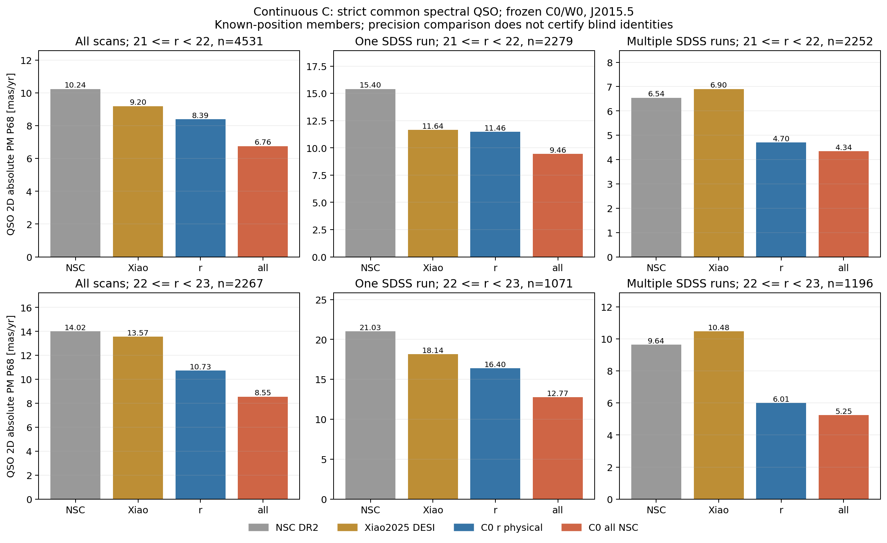
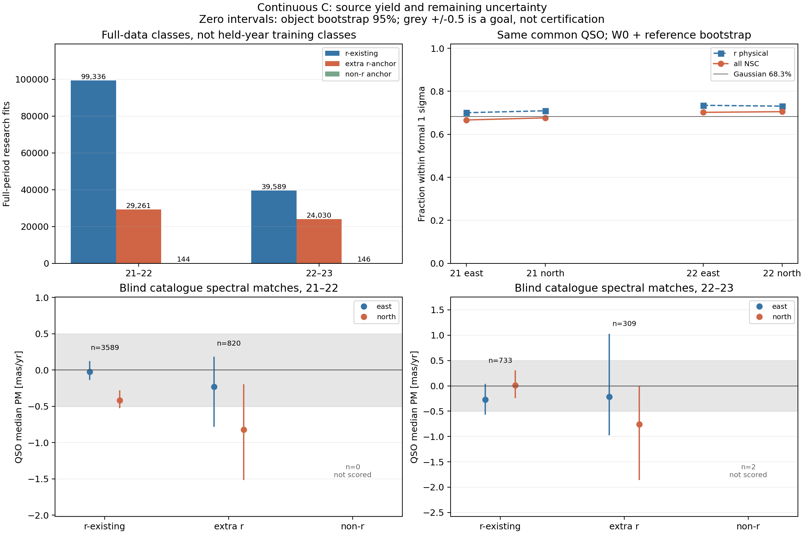
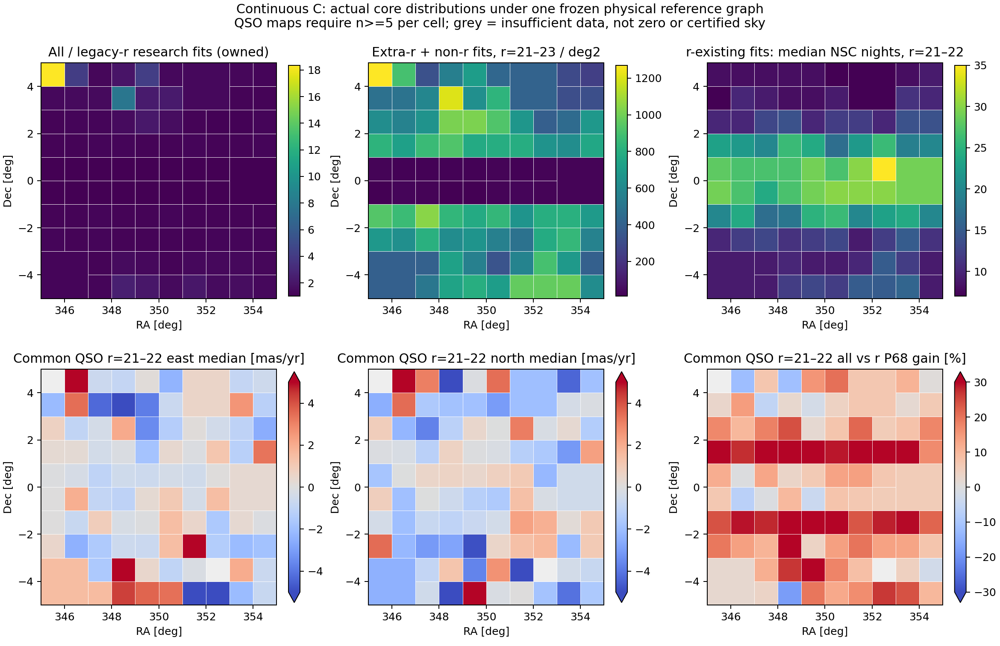
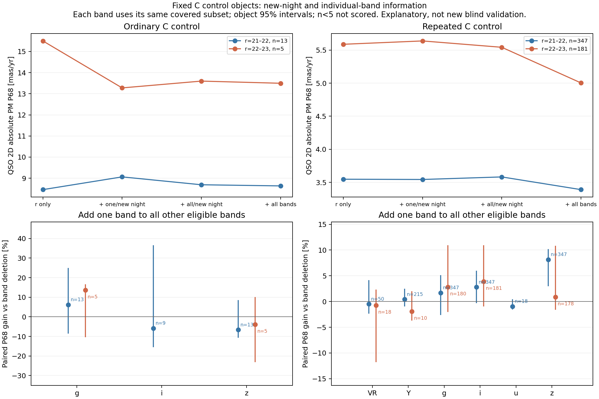
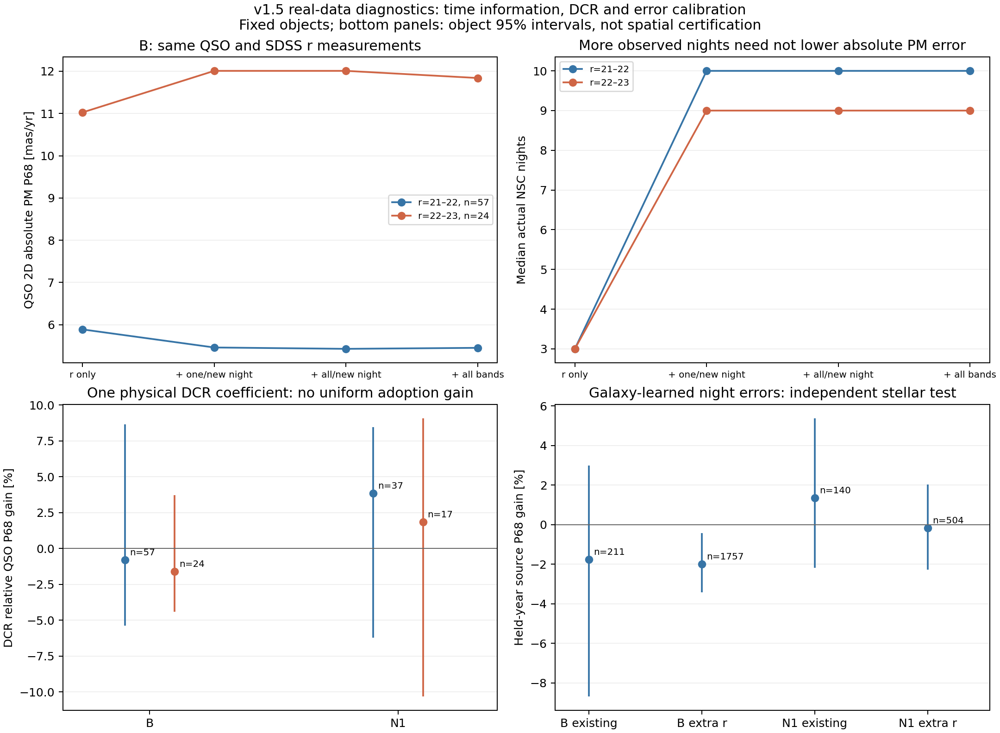
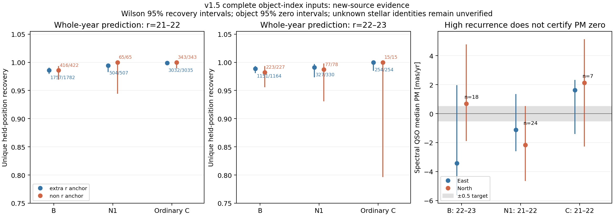

# 实验 A v1.5：NSC全波段时间信息、连续区产出与暗源零点

本轮从 `b23f8ef` 建立 `experiment-a-v1.5-nsc-time-dcr`。**真实完成连续 C 区 99.873124 平方度、91/91 核心，在原统一 C0 图下产出 481,945 个全NSC科研合格解。** SDSS每次真实run只用发布r位置，NSC所有实际通过质量和参考支持的band均有机会进入，没有SDSS五band位置拟合。

**本轮已回答“多band主线是否有科学价值”：有，而且连续C中的单SDSS run区有真实的精度及源数收益。** 2279／1071个严格共同QSO，21–22／22–23的r-only→全NSC P68为11.462→9.458／16.401→12.771mas/yr，相对r改善17.5%／22.1%，相对Xiao改善18.7%／29.6%。但“只有一次SDSS”不等于NSC普遍稀疏；C的实际多夜／多band条件不能外推到所有普通广域。沿用v1.2原地理普通区，21–22相对Xiao仅约5%改善且run重权区间跨零，22–23约13.6%；这与“单run”是不同样本，旧瓶颈没有被换定义抹去。B主核心负结果亦保留。保留最小C0/W0全NSC为可重复的**科研版本**，不宣称最终暗恒星方法已认证，不启动全SDSS–NSC正式生产。原因是实际独立验证的条件依赖、未建模夜／空间公共误差和新增暗星身份／绝对零点证据缺口，而不是单凭每轴0.5mas/yr目标未过。

## 1. 实际方法和公平比较

C0使用静止背景星系、SDSS run/camcol和NSC exposure物理组共同求零点；沿用原C图参考身份、规范、支持和同步bootstrap，不按core独立重校。NSIDE=128只组织和诊断。每轴有效方差为发布位置误差平方加(50mas)²，实际TT观测时刻转Julian年，J2015.5四参数稳健直线。异常点降权不靠不断删除；完整ICRS位置、自行、4×4协方差及独立／参考分量、真实成员／band／仪器／夜全部保留。

新输入取消r对象索引条件，保留原SDSS r数值及所有物理run。源发现采用冻结1角秒常规关联，本轮不处理高自行尾。r锚点追加合格band；无合格NSCr锚点另建轨迹，不能借已占用检测；object ID仅检索和官方NSC外部标签，不能当关联真值。源先冻结，之后才做光谱位置匹配。暗Gaia自行未进入评分或模型选择。NSC原发布位置以Gaia DR2标定，目标Gaia自行未输入不等于与Gaia参考系完全独立；本轮暗端验收使用光谱QSO及独立年份位置。

比较分三层：①七核心固定对象／固定r和SDSS成员ABC/B1，隔离纯新增信息；②连续新输入相同QSO的原质量r、物理质量r、全NSC，单列质量规则变化；③盲输出再与光谱对象位置唯一配对。Xiao只采用PM_SOURCE=DESI；NSC外部结果为官方DR2。已知位置同源精度不等于最终盲目录的全部质量。

## 2. 连续区的同源精度：真实个体向量合并

下表单位mas/yr；五列P68依次为**官方NSC / Xiao地基 / 原质量r / 物理质量r / 全NSC**。同一行每种方法严格同源；不是平均各core的P68。末列是全NSC相对物理r的二维P68改善率及对象配对95%区间。

| 星等／条件 | 共同QSO数 | 五路二维绝对自行P68 | 全NSC相对物理r |
|---|---:|---|---|
| 21–22 / 全C | 4,531 | 10.242 / 9.196 / 8.395 / 8.395 / 6.759 | +19.5% [+17.4, +21.8] |
| 21–22 / 单SDSS run | 2,279 | 15.404 / 11.638 / 11.462 / 11.462 / 9.458 | +17.5% [+15.2, +19.7] |
| 21–22 / 多SDSS run | 2,252 | 6.544 / 6.903 / 4.701 / 4.701 / 4.340 | +7.7% [+5.3, +9.9] |
| 21–22 / 单run点状QSO | 2,161 | 14.862 / 11.481 / 11.295 / 11.295 / 9.304 | +17.6% [+15.1, +19.5] |
| 22–23 / 全C | 2,267 | 14.015 / 13.565 / 10.727 / 10.727 / 8.552 | +20.3% [+17.8, +23.0] |
| 22–23 / 单SDSS run | 1,071 | 21.030 / 18.137 / 16.401 / 16.401 / 12.771 | +22.1% [+19.5, +25.8] |
| 22–23 / 多SDSS run | 1,196 | 9.637 / 10.477 / 6.005 / 6.005 / 5.251 | +12.6% [+9.9, +15.6] |
| 22–23 / 单run点状QSO | 581 | 14.853 / 17.911 / 15.621 / 15.621 / 11.404 | +27.0% [+22.6, +30.8] |

点状QSO按v1.3预先冻结的NSC r形态0.8分层，完整形态混合／未知及时间跨度分层仍在[完整汇总](../results/summary/v15_continuous_science_summary.json)，没有根据本轮精度挑选有利对象。普通源科学收益须与源形态和真实观测条件一起解释，不能把全区重复带收益外推到所有单run区。

对象bootstrap区间只是有限源抽样。共同run、曝光和夜的连通块、按实际观测组重权的敏感性分别保留；当连通块只有一个时，不伪造多个独立场。公共零点不按QSO数量开平方缩小。完整两轴偏差、NMAD、尾部、观测组区间见同一JSON。单run相对Xiao改善率的SDSS run重权95%敏感性区间，两档分别10.6–26.5%／23.2–36.2%；这保留了积极证据，同时全C按物理组连通仍只有一个块，不能把4531／2267颗QSO当同等数量的独立天区。

### 与v1.2原地理普通区直接对照

单／多SDSS run是每源的实际扫描次数；**v1.2的“普通区／过渡区／重复带”是另一份固定地理分区**，两者不能换标签当成同一结果。61571700原样复用`geographic_sets`：Dec外侧[-5,-3)及[3,5)为普通，[-1,1)为重复带，其余过渡。只读当前同源QSO；合并后的全区N及所有方法P68与主汇总逐值相同，未重新拟合或改样本。

| 原地理分层／r | 共同QSO | Xiao / 物理r / 全NSC P68 mas/yr | 全NSC相对Xiao[run重权95%敏感性] |
|---|---:|---|---|
| 原地理普通区 / 21–22 | 1001 | 12.099 / 12.627 / 11.497 | +5.0% [-3.8, +15.9] |
| 原地理普通区 / 22–23 | 353 | 17.119 / 16.421 / 14.787 | +13.6% [+5.4, +23.3] |
| 原过渡区 / 21–22 | 2119 | 10.665 / 9.431 / 7.170 | +32.8% [+26.3, +39.4] |
| 原过渡区 / 22–23 | 1032 | 16.245 / 13.693 / 10.416 | +35.9% [+29.2, +43.4] |
| 原重复带 / 21–22 | 1411 | 5.782 / 3.668 / 3.462 | +40.1% [+38.5, +41.8] |
| 原重复带 / 22–23 | 882 | 9.898 / 5.466 / 4.834 | +51.2% [+48.9, +53.0] |

因此，**原地理普通区21–22相对Xiao只有约5%的点估计改善，run重权区间仍跨零；不能说这一旧瓶颈已可靠解决。** 22–23改善约13.6%，相同组权敏感性区间为5.4–23.3%。相对本次物理r基准，原普通区两档P68改善约8.9%／9.9%，但这不等于相对Xiao的同幅收益。该区固定已知位置QSO的21–22北向中位仍约−0.977mas/yr，说明方向偏差不能都归咎于“新发现源关联错误”。单run正结果和原地理普通区限制同时保留。[冻结地理对照](../results/summary/v15_geographic_readout_summary.json)。

## 3. 源数增长与面积：不把机会当完备性

同一完整输入、同一图下，原r质量控制 **384,234**、物理质量r控制漏斗 **384,219**、全NSC **481,945**。全NSC相对物理r的净科研解增量 **97,726（25.43%）**；相对原r质量的差额不能全部归因给新增band。数量是有限发布检测上的科研质量结果，不是纯度认证的恒星数。

| 全历元比较r星等 | r既有成员源 | 追加r锚点合格解 | 无合格NSCr锚点解 | 全NSC合计 |
|---|---:|---:|---:|---:|
| 21–22 | 99,336 | 29,261 | 144 | 128,741 |
| 22–23 | 39,589 | 24,030 | 146 | 63,765 |

三类按**完整全历元**定义；`r_existing`由实际成员重叠识别，原r对象在新关联后可能改变，不能把追加类简单当严格净增量。原r控制384234比全NSC中r_existing383962多272：按当前成员重叠定义这些旧合格条目没有归入r_existing，不能声称所有原r源均保留，也不能仅凭这个差额归因具体质量退出；逐成员失败审计仍是后续产品工作。r星等来自真实NSCr或SDSSr，来源不同明确保留；全年训练分类不替代此表。

实际全历元时间支持的中位数如下。物理组最大杠杆是条件于W0对角权重的斜率信息份额，不是已经标定的独立约束数；完整P16/P84与两轴信息在汇总保留。

| 类别／r | NSC夜 | NSC季 | NSC跨度yr | 联合跨度yr | 东／北最大组信息份额 |
|---|---:|---:|---:|---:|---|
| r_existing / 21–22 | 18.0 | 5.0 | 5.02 | 10.03 | 0.321 / 0.327 |
| extra_r_anchor / 21–22 | 9.0 | 4.0 | 3.25 | 9.90 | 0.597 / 0.599 |
| non_r_anchor / 21–22 | 5.0 | 3.0 | 4.08 | 13.10 | 0.566 / 0.561 |
| r_existing / 22–23 | 21.0 | 6.0 | 5.06 | 17.81 | 0.139 / 0.139 |
| extra_r_anchor / 22–23 | 13.0 | 5.0 | 4.95 | 9.88 | 0.391 / 0.399 |
| non_r_anchor / 22–23 | 7.5 | 4.0 | 4.67 | 14.05 | 0.544 / 0.561 |

按实际测量位置半开core归属计数，输入SDSS r 13,521,860、NSC 105,877,672。各core下载带halo总量及新增量另在汇总保存，不能当唯一全天检测量。源级跨core重复占用检测 **0**、统一历元归属越界 **0**、精确坐标重复行 **0**；0.05／0.2角秒跨core近邻另列，不擅自当误配删除。

连续C实际通过物理质量与原图支持的测量及采用源的band统计如下。每源可同时贡献多个band，故采用源列不能相加当独立源数；各区域的七band库存也不等于这片C区每个band均进入拟合。

| NSC band | 测量位置core归属的合格支持检测 | 实际采用该band的全NSC科研源 |
|---|---:|---:|
| VR | 28,097,910 | 61,057 |
| Y | 3,990,786 | 247,695 |
| g | 10,879,411 | 470,570 |
| i | 15,497,138 | 370,542 |
| r | 17,834,134 | 478,671 |
| u | 174,586 | 12,592 |
| z | 15,821,735 | 474,935 |

实际CCD与SDSS native扫描足迹、原C0支持、≥2次NSC曝光、NSC≥0.60年、联合≥5年的几何时间机会，r-only **89.560**→全NSC **99.816平方度**，增加10.256；粗网格89.626／99.818，双field-center余量一致。不是逐源SNR、源提取／关联完备性或已认证零点面积。实际band支持、源密度、时间信息与零点地图分开。

## 4. 多band究竟增加了什么信息

七核心ABC固定同源／r／SDSS成员逐值重放。A=SDSSr+NSCr；B加原r夜之外的实际其他band；C再加原r夜的其他band；B1每新增夜只保留最早一次物理曝光，分离新夜自身的重复质心。

B主核心21–22的57颗QSO，A/B/C/B1二维P68 **5.890/5.430/5.454/5.462**；22–23的24颗 **11.025/12.008/11.839/12.008**。NSC夜中位3→10／9，NSC跨度约0.98→6.11／6.09年。时间杠杆真实增加，最暗自行却未改善。对角W0时间信息和最大组杠杆是条件信息，不是独立长期约束数。

B的i覆盖QSO实际通常只有一条、一个相对所有其他NSC band均独有的夜，**不是预想的同夜i质心对照**。同夜信息按真实夜标签由C/B1等处理。固定覆盖同源删band：B21–22加入z 5.370→5.454，加入i 5.963→5.988；最暗z 11.844→11.910、i 11.757→11.750。北一最暗17颗加入z 12.226→11.203，真实条件差异保留。不能把某个band名字列黑名单，也不能将测量数量本身当收益。

早期SDSS价值很大：B21–22固定57颗，NSCr-only／NSC全band单独重拟合／再加最早SDSS／全部SDSS的P68 **77.60/16.47/5.49/5.45**；最暗24颗 **93.96/24.36/11.19/11.84**。这些NSC-only是同输入重拟合，不能称官方DR2。它证明长基线价值，尚不能单凭此对各巡天的真实误差作因果分配。

### 连续C两个原控制：新夜和同夜的真实贡献

61570774在原普通／重复C控制冻结18／528个QSO；同一物理r／SDSS／全NSC成员的运动及误差逐值重放最大差均0，再执行原ABC/B1和逐band删除。它们是既有数据的解释诊断，不是新盲区，也不替换B负结果或根据新PM重选源。

| 原控制／r | 固定QSO | P68 A / B1 / B / C（mas/yr） | NSC夜中位A→C |
|---|---:|---|---:|
| 原普通C控制 / 21–22 | 13 | 8.459 / 9.062 / 8.689 / 8.635 | 3→9 |
| 原普通C控制 / 22–23 | 5 | 15.502 / 13.277 / 13.599 / 13.497 | 3→5 |
| 原重复C控制 / 21–22 | 347 | 3.547 / 3.543 / 3.582 / 3.390 | 11→28 |
| 原重复C控制 / 22–23 | 181 | 5.588 / 5.638 / 5.542 / 5.003 | 10→20 |

普通控制只有13／5颗，两档方向不同，不代表全部普通天区。重复控制增加很多新夜后，B的P68相对A几乎不变，主要点估计收益发生在B→C，即增加原r观测夜的合格其他band质心：21–22为3.582→3.390，22–23为5.542→5.003mas/yr。**多band收益既可来自新增时间，也可来自已有夜的质心信息；不能把所有改善都解释成更多独立年份。** 同夜相关误差仍未资格化。

对每个band，比较其实际覆盖的相同源，将该band加入其余已合格band。各行的源可不同，不能跨行把不同源的P68排序当band优劣。

| 原控制／r／band | 同覆盖QSO | 不含该band→全band P68 | 相对改善[对象95%] |
|---|---:|---|---|
| 原普通C控制 / 21–22 / g | 13 | 9.206→8.635 | +6.2% [-8.6, +24.9] |
| 原普通C控制 / 21–22 / i | 9 | 7.048→7.460 | -5.9% [-15.6, +36.6] |
| 原普通C控制 / 21–22 / z | 13 | 8.098→8.635 | -6.6% [-10.7, +8.5] |
| 原普通C控制 / 22–23 / g | 5 | 15.632→13.497 | +13.7% [-10.4, +16.5] |
| 原普通C控制 / 22–23 / i | 1 | 样本不足，不评分 | — |
| 原普通C控制 / 22–23 / z | 5 | 12.995→13.497 | -3.9% [-23.1, +10.0] |
| 原重复C控制 / 21–22 / VR | 50 | 2.826→2.839 | -0.5% [-2.4, +4.2] |
| 原重复C控制 / 21–22 / Y | 215 | 3.276→3.262 | +0.4% [-1.0, +2.5] |
| 原重复C控制 / 21–22 / g | 347 | 3.448→3.390 | +1.7% [-2.6, +5.1] |
| 原重复C控制 / 21–22 / i | 347 | 3.487→3.390 | +2.8% [-0.3, +6.0] |
| 原重复C控制 / 21–22 / u | 18 | 2.646→2.670 | -0.9% [-1.6, +0.4] |
| 原重复C控制 / 21–22 / z | 347 | 3.691→3.390 | +8.2% [+3.0, +10.2] |
| 原重复C控制 / 22–23 / VR | 18 | 3.992→4.020 | -0.7% [-11.8, +2.4] |
| 原重复C控制 / 22–23 / Y | 10 | 4.380→4.464 | -1.9% [-3.7, +2.0] |
| 原重复C控制 / 22–23 / g | 180 | 5.133→4.988 | +2.8% [-2.0, +10.9] |
| 原重复C控制 / 22–23 / i | 181 | 5.207→5.003 | +3.9% [-1.0, +10.9] |
| 原重复C控制 / 22–23 / u | 3 | 样本不足，不评分 | — |
| 原重复C控制 / 22–23 / z | 178 | 4.971→4.926 | +0.9% [-1.6, +10.8] |

重复区z在21–22有明确条件性增益，而u／Y／VR的这些子样本未显示统一精度收益；不能由此把band列白／黑名单，亦不能把采用源数当作独立精度贡献。Y／VR／u保留实际支持、源数／时间机会及负结果，未知暗星和其他观测条件仍须独立验证。[完整C时间／band汇总](../results/summary/v15_C_information_summary.json)。

## 5. 完整曝光审计与真正新增源

五中心小区均取所有相交CCD和实际曝光，双metadata边界一致，每曝光COUNT／返回行数／检测ID核对，无TOP截断。原r索引之外的质量及参考支持合格检测：B g13/z79，北一g11/z31，B辅助i7/z60，VR区VR50，A研究支持u3/i89等。Y几何足迹另查：B1352曝光14154检测含全部七band，旧r索引之外合格支持Y17/i76/z97；A49曝光1409检测另有Y5。它们是检测，不是新星；A pre-SE支持未采用。

B无r索引输入增加55725条NSC，保留48967条SDSSr；独立曝光小区757/757全部收回。北一增加24680，497/497收回。相同测试年下训练候选却只 **B5489→5507（+18）、北一1777→1778（+1）**。原冻结SDSS及NSC成员完全相同的ICRS自行最大差约2.1×10⁻⁸mas/yr；少数成员新增单列，不按PM相近选同源。**取数完整性缺口真实，但主要多band源数收益来自使用原已取回的额外band，不能把几万条新增检测当几万颗新星。**

B固定2017、北一固定2018、普通C代表区元数据选2017；全部band测试年先隔离再关联。追加r锚点21–22／22–23唯一留出位置重现：B1757/1782、1151/1164；北一504/507、327/330；普通C3032/3035、254/254。各分母和Wilson95%、真实足迹／参考／SNR机会与位移负对照见[完整年度验证](../results/summary/v15_complete_dark_validation_summary.json)。高重现率仅是条件位置证据，不等于绝对自行零点或全星表纯度。全年“非r锚点”仅指训练年，不能当成全历元无r星数。

冻结问题对象的绝对零点仍未认证：B最暗追加18颗QSO东向 **−3.418**，对象95% **[−5.647,+1.971]**；北一21–22追加24颗北向 **−2.167 [−4.650,+0.526]**。区间宽且跨零，不能声称显著非零，也不能认证小零点。B18/18光谱源成员未见已知错配，按源Wilson95%下界仅82.4%；137相关检测零已知错误不能当137独立星。未知暗恒星身份仍缺直接真值。

当前仍不能给新增源偏差唯一的物理归因：同成员补齐取数后µ不变、已有已知位置控制也有偏差，均不支持将其一概归为索引漏测或新增关联错误；单一DCR／旧误差模型没有解决，局部与全图变化则显示参考样本／校准条件敏感。颜色／形态迁移、具体band／年份与公共位置误差、混叠仍须分离验证，不能把线索当作已经证实的原因。

连续全历元盲输出的光谱位置匹配如下；零点为东／北中位及对象95%，末列二维P68（mas/yr）。不是在验收QSO上重新选择系数或对象。

| 全历元类别／r | QSO数 | 东／北中位[对象95%] | P68 |
|---|---:|---|---:|
| r_existing / 21–22 | 3589 | -0.025 [-0.139, +0.125] / -0.420 [-0.526, -0.280] | 5.657 |
| r_existing / 22–23 | 733 | -0.270 [-0.568, +0.038] / +0.010 [-0.242, +0.307] | 5.058 |
| extra_r_anchor / 21–22 | 820 | -0.231 [-0.780, +0.184] / -0.821 [-1.514, -0.198] | 10.416 |
| extra_r_anchor / 22–23 | 309 | -0.213 [-0.978, +1.030] / -0.755 [-1.857, -6.19e-5] | 9.893 |
| non_r_anchor / 21–22 | 0 | 样本不足，未发布分布 | — |
| non_r_anchor / 22–23 | 2 | 样本不足，未发布分布 | — |

这些盲类别与前述已知位置控制的对象／形态／形式误差选择不同，不能把较小P68解读为盲关联优于已知关联；公平方法比较使用同一行固定对象。这里的零点区间仍是条件对象抽样；最暗追加源北向区间上界贴近零，不能靠数值末位认定强显著性或认证小系统误差。

## 6. 最小DCR和误差模型：保留负结果，不采用

唯一DECam-g几何残余项是SDSS g-i乘实际tan(z)天顶方向；实际台址／时间、发布WCS校正边界及色误差传播见[预登记协议](../docs/dcr_protocol_v15.md)。D0/D1严格同局部参考图，原全区域C0为第三控制；星系训练、留出星系、QSO和暗星年度用途隔离。只研究剩余误差，不完整重复叠加大气折射／光行差。

B3825训练参考57组、北一3621参考43组，系数−28.32±1.61／−23.39±1.02 mas/(mag tan z)；留出星系1748／1620的去源均值位置P68仅74.586→74.315／84.649→84.035mas。B固定QSO21–22 D0→D1 5.298→5.341，最暗9.871→10.031；北一新增24颗北向+1.002→+1.068。无统一精度及零点收益，**停止扩展这一DCR模型**，不解释为DCR不存在。测得颜色误差已传播，SED代理、星系色梯度、光度公共项与测量误差自变量衰减仍有限制。v1.4经验g颜色项及负结果继续保留。

原C0本来逐参考居中。同一局部参考上原求解器与D0最大偏移差仅B7.03×10⁻⁷mas、北一5.92×10⁻⁷mas，保留组完全相同。因此全图→局部图较大的自行变化来自参考样本／图及空间校准条件，**不是新数值居中或DCR收益**；不独立采用局部参考系。

星系学习误差／夜相关模型也未通过独立检验：B21–22追加1757暗星的独立年位置P68 **60.43→61.63mas**，对象区间为恶化−3.42%至−0.43%；北一既有140源北向1σ覆盖 **0.905→0.546**。旧QSO参数B改善而北一变坏，不采用。W0不因它失败就变成已校准总误差；同夜跨band相关性仍按未知边界保留。

连续区全NSC同源QSO的形式误差表现：

| r | N | 东／北NMAD mas/yr | 东／北1σ覆盖 | 东／北2σ覆盖 | 二维误差>5mas/yr |
|---|---:|---|---|---|---:|
| 21–22 | 4,531 | 3.862 / 3.698 | 0.667 / 0.677 | 0.915 / 0.926 | 2072/4531 |
| 22–23 | 2,267 | 5.046 / 4.913 | 0.702 / 0.705 | 0.944 / 0.953 | 1280/2267 |

完整标准化残差、尾部、两轴偏差与每种控制也在汇总。覆盖与尾部的样本数／Wilson95区间另列于[误差覆盖统计](../results/summary/v15_continuous_error_coverage_summary.json)；这些是对象独立近似的描述区间，不能替代共同观测误差或空间认证。全区1σ覆盖接近名义值会掩盖条件差异：21–22单run东／北为0.785／0.766，多run却为0.548／0.586；22–23对应0.784／0.770和0.629／0.647。不能用一个全局系数同时处理两者。形式误差覆盖须同时对照独立年位置，不能仅为让QSO覆盖达到68%调整权重，再把点估计变化当独立精度收益。

## 7. 共同参考、空间质量与复现边界

N1/N3继续使用一次共同物理组参考解，1436组保留两个规范1224／212；1332个相同检测跨窗ICRS差为零是共同图一致性，不是独立绝对精度。A212拒绝组共同平移SE约36.18／18.14mas、内部约1mas；尚未完全解释该公共模式，不因内部支持多就恢复采用。原12核心无最终支持记录保留。连续C此次全91core引用**同一个原C0 SHA** `0904c22185df903670e30ee72b962b67bbd8ed3a20a3cd864cd2b0c42709e030`，没有新增按core独立框架。

每源4×4包括条件独立项及同步参考bootstrap；不能从很多源的形式误差推断公共观测组／参考零点已缩小。连续图中的灰格是QSO不足5而未发布局部统计，不代表无源或零偏差。原地理普通区与单run的定义分别冻结，不能根据更有利的分层替换原结论。每轴0.5mas/yr是高精度目标，不作为取消科研试验的机械门槛。需要足够独立扫描／曝光／夜／空间支持的统计认证，当前没有给未知暗星普遍出具这样的证据。

冻结旧结果全部保留。旧v1.2档案QSO共7,071条缺位置／逐成员／ICRS误差；唯一精确参考r星等+实际曝光集合仅能配对7,071条做原切平面标量输出QA，歧义0、无对应0，最大差1.39e-09mas/yr。它不使用PM挑配对，但**也不是检测级身份、独立真值或完整误差复现**。不能补造旧字段。严格固定成员的七核心A/C重放和年度成员审计另有明确证据；连续新科学精度使用当前显式光谱索引与完整ICRS。

## 8. 科学决定与下一步

1. **继续全NSC多波段主线，冻结本轮科研版本及全部负结果。** 多band带来真实新夜、时基、几何机会和合格解数量，不能退回只做r；收益必须按普通／多run、时基和源类说明。
2. **不采用新的g DCR或星系学习误差，不冻结最终暗星生产方法。** 独立QSO和暗星位置没有共同稳定收益；新增源零点与未知夜／空间公共误差仍未充分资格化。
3. **下一研究优先是能解释C正结果与B／北一负结果差异的实际时间采样、公共位置误差与新增源身份／零点。** 保留本轮全部对象及检测，针对SDSS run/camcol、NSC exposure/night、真实band/年份组合和独立留出星系开展可辨识的最小误差／参考对照；不用QSO反调系数，不再扩展已经失败的一项DCR。
4. **转移性与生产分区仍需独立观测条件验证。** 原C是已读取过的科研区域，不称新盲区。现有N1/N3共同图和旧独立区负结果不能由C全区平均抹平；正式产品应有源级4×4及误差来源、公共观测组／参考分量、band／仪器／夜、身份歧义和区域零点支持。未知区域不能统一标为高精度。
5. **不启动全覆盖正式计算、大规模DR11 PSF或论文正文。** 本轮已完成约100平方度科学目录，下一项应由这份结果定位的误差／零点问题驱动。若后续固定独立条件下同时支持可信精度或源数收益及新增源身份／零点质量，再采用分层质量生产；不能把单一区域的高重现或更多测量当作证据替代。

## 运行与交付

主连续Slurm **61565637**四节点、每节点两路、外部查询至多四路，耗时1:23:01。91核心取数全部完成；5个在天测完成后因光谱reference_r缺测NaN序列化失败，**不是拟合失败**。61567212在新目录修复成功，原严格字节检查又捕获有效信息组数求和的机器舍入；61568425逐项科学审计确认所有天测／完整协方差／检测成员／r与QSO控制完全相同，仅两个有效组诊断数组允许1e−12舍入，最大实际约1.14e−13。91个最终科学分片全部可恢复。61568941最终汇总因矩形范围仍用ra/dec键触发公开字段保护，修正为声明的core边界字段后另行续汇总；逐源坐标保护未放松。61569158检查出5个全band解的原任务目录不是J2015.5核心；61570439全91核心审计连同2个r控制均仍在区域内。以不可变原记录的private ownership overlay转移到实际91核心计划中的唯一归属，不删除或重拟合，不将配置中的未启用子区／试验别名当owner。原61570700别名范围拒绝保留，新增实际计划过滤后续验。61570772在并发准备同一快照期间首个import失败，无科学数据写入；源快照就绪后以新ready目录61571012成功，后续checkout须串行或锁定就绪。所有全区源数及个体QSO指标保持不变，实际空间源统计按新归属重算。原失败回执均保留。

原完整统计 **61569158**，分析源码`5d4dc60`；公共历元归属续验 **61571012**，源码`4694de4`；主拟合源码`d24f91c4fbef3a3575a4b4d1520da6393f991924`，续跑`0e98073`，合并重放`9dff77e`。图和中文结论由公开汇总生成，未重新拟合以选择有利结果。另有61570774两节点完成C解释消融，61571217将重复C的时间诊断改成仅索引实际成员，所有科学字段（除job ID）与原慢版逐值相同，未改变拟合／权重／选择；计算步骤实测11:21→0:59，峰值RSS约7.39→6.81GiB。这只是运行效率改进。[实际重放](../results/summary/v15_information_runtime_replay_summary.json)。最终私有目录API在Slurm 61571491实际读取全部9个受影响核心及一个普通控制，两类源计数和公共历元位置均逐一通过，[读取实测](../results/summary/v15_owned_reader_smoke_summary.json)。196项测试在线程限额下通过；无须Home大数据／HPSS，新的Git元数据也在PScratch，旧Home历史只读。

[精简审阅统计](../results/summary/v15_science_overview_summary.json) · [完整连续科学汇总](../results/summary/v15_continuous_science_summary.json) · [91核心完成与科学重放](../results/summary/v15_validated_completion_summary.json) · [公共历元归属](../results/summary/v15_ownership_resolution_summary.json) · [实际方法](../docs/method_status_v15.md) · [私人科研目录格式](../docs/catalogue_layout_v15.md) · [复现入口](../docs/running_v15.md) · [几何时间机会](../results/summary/v15_geometric_opportunity_area_summary.json) · [冻结成员审计](../results/summary/v15_frozen_member_replay_summary.json) · [同图C0求解器](../results/summary/v15_local_C0_solver_replay_summary.json)。

原始、逐检测、逐源、参考星系、私人对照、回执和缓存仅在个人NERSC PScratch；本地／GitHub只有代码、科研记录、图和去标识统计。完整目录为91分片及合并索引，不把公开JSON误当逐源星表。
