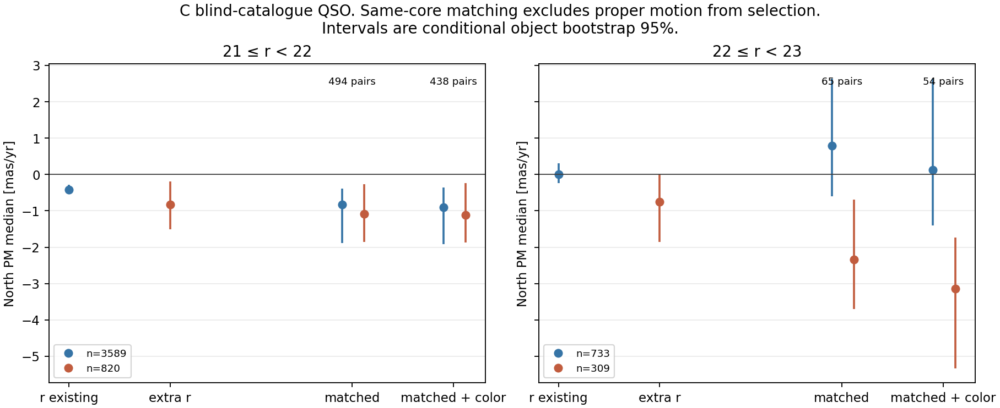
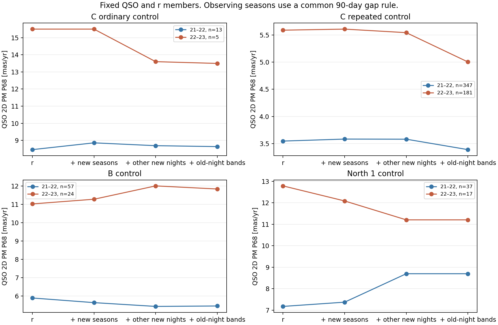
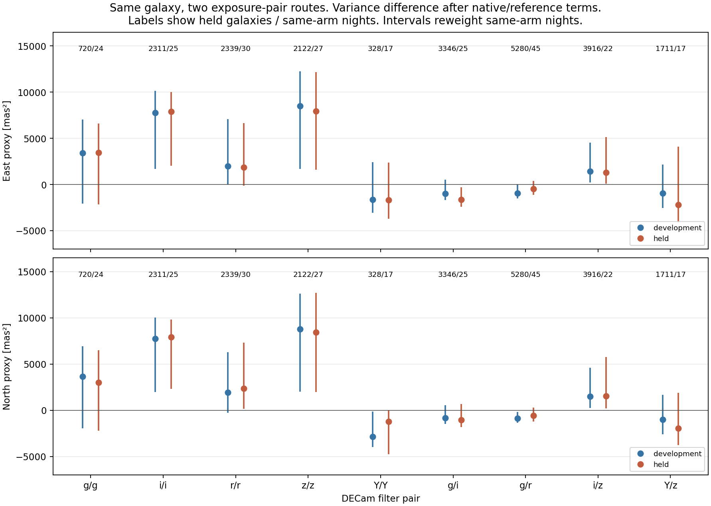
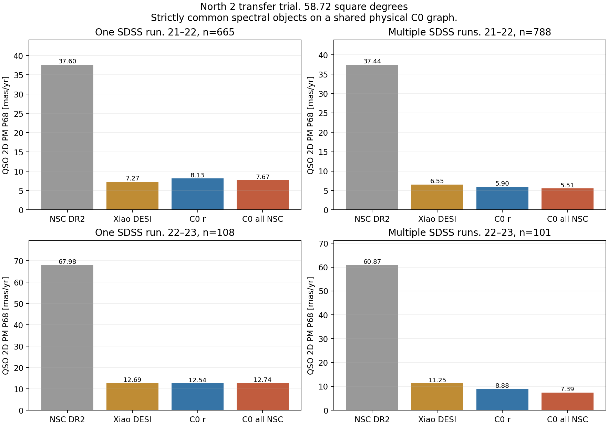

# 实验 A v1.6 · 多波段零点、同夜误差与独立天区迁移

v1.5 证明使用合格 NSC 多波段能增加真实时间和位置约束。C 区 99.873 平方度的 481,945 个科研解比物理质量 r 对照增加 97,726，按实际单 SDSS run 划分的两暗档 QSO P68 改善 17.5% 和 22.1%。原地理普通区最大的限制仍在 21–22 等，相对 Xiao2025 的点估计改善约 5%，按 SDSS run 重权的区间跨零。v1.6 检验这些收益的条件、误差覆盖和新星身份。

基准冻结于 `71e41f8`。每物理 SDSS run 继续使用发布 r，NSC 采用质量和参考支持合格的实际单曝光。保留 J2015.5 ICRS、完整条件 4×4、观测组和源成员。v1.5 几何 DCR 与旧经验误差的负结果保持冻结。

## 冻结核验和成员重放

Slurm 61574709 对 91 个科学核心完整读回并核验拟合回执、共同图 SHA、协方差、物理成员组和公共历元归属。汇总数复现为 481,945 个全波段解与 384,234 个旧质量 r 控制。三类全历元解分别是 r_existing 383,962、extra_r_anchor 94,739、non_r_anchor 3,244。后两类全部星等的数量与 21–23 等的数量分别报告。C 旧新区的 DCR、误差及冻结 QSO 汇总不重拟合。

物理成员规则逐值识别出 272 个没有被 r_existing 认领的旧 r 控制，其中 271 个与全波段输出没有成员重叠，1 个在原输入核心与一个全波段源部分重叠。没有重复旧身份认领。逻辑归属转移以原成员哈希复核。选择漏斗在 79 个涉及核心中按物理成员重放全部 272 条控制。271 条已通过时间与参考支持、在最终拟合质量步骤退出。该联合门槛使用形式误差、数值有限性和位置残差，本次追踪未把三项分别计数。余下一条有最终解，但共享成员未达冻结同源阈值。仅一条出现旧 NSC 成员被物理质量掩码移除，未发现同一旧源的成员落入多个竞争轨迹。归属已单独复核。 [冻结审计](../results/summary/v16_frozen_C_summary.json) · [成员与漏斗重放](../results/summary/v16_control_exits_summary.json)

## 新增源零点与样本选择

C 区原 r 既有在 21–22／22–23 的光谱样本为 3,589／733，追加 r 锚点为 820／309。最暗非 r 锚点仅 2 颗光谱 QSO。两暗档北向中位依次为 r 既有 −0.420／+0.010，追加 −0.821／−0.755 mas/yr。追加组 21–22 的 NSC 夜中位由既有组的 21 降为 9，联合跨度 10.72→9.88 年，最大物理组杠杆 0.261→0.646。最暗档联合跨度中位 17.96→9.87 年，最大杠杆 0.135→0.461。样本的时间质量差异足以影响同一空间零点的比较。

在同核心、相近天空、r、颜色、形态、时基、最大组杠杆和扫描次数类别内，以位置与观测信息匹配。21–22 有 438 对，北向中位差从原始两群的 −0.401 变为 −0.222 mas/yr，对象配对 95% 区间 [−1.08,+0.98]。最暗档仅 54 对有共同支持，追加／既有北向中位 −3.143／+0.123，差 −3.266 [−6.27,−1.29] mas/yr。不限制颜色时为 65 对，差 −3.133 [−5.54,−0.98]。最暗子集仍显示空间和采样条件下的偏差，受共同观测组与配对覆盖限制，不能外推到全部 309 颗，也不能从匹配结果确定某一物理波段的偏移。

固定同一追加 QSO 的实际成员做 r 子集反事实，820／309 均可数学拟合。达到旧质量标准仍需要跨巡天时间支持及足够小的形式误差。两暗档 r 子集的时间退出分别为 369／28，形式误差退出 554／300，退出可重叠。加入其他波段后同源 P68 降低 19.6%／26.4%。最暗组北向中位从 r 子集的 −0.790 到全波段的 −0.755，近似不变，亮一档则从 −0.400 到 −0.821，配对北向差区间跨零。相对于已知光谱的绝对散布收益和样本间零点偏差需要分别计量。亮一档的总体差异有样本选择证据，最暗档的偏差在加入波段以前已可见。剩余物理来源仍可能包括局部参考、组合时间杠杆及未标记混叠。 [匹配与 r 子集汇总](../results/summary/v16_source_zero_summary.json)

## 新季、原季新夜与同夜质心

对原冻结 ABC/B1 增加 S，NSC 季节由全成员 90 天间隔定义。A 为 r 对照，S 加原 r 未覆盖的新季，B 再加原季内的新夜，C 再加原 r 夜的其他波段。固定原 SDSS 与 r 真实成员，各 band 对照只使用该 band 实际覆盖的相同源。

| 控制区域（22–23 等） | QSO 数 | A | S | B | C |
|---|---:|---:|---:|---:|---:|
| 重复 C | 181 | 5.588 | 5.607 | 5.542 | 5.003 |
| 普通 C | 5 | 15.502 | 15.502 | 13.599 | 13.497 |
| B 主控制 | 24 | 11.025 | 11.281 | 12.008 | 11.839 |
| 北一主控制 | 17 | 12.784 | 12.083 | 11.203 | 11.203 |

表中为二维自行 P68，单位 mas/yr。重复 C 的绝对自行改善主要在 C 相对 B。同夜聚合提供真实质心信息，其共享误差仍要用观测数据检验。B 的暗 QSO 绝对自行没有随时基增长改善，但 B 的 211／77 个 21–22／22–23 等既有暗星在原独立测试年的位置 P68 从 S 获益 14.8%／15.8%。年度位置和绝对 QSO 自行回答不同问题。最暗普通 C 控制只有 5 颗 QSO。逐 band 的冻结对照继续使用此前实际 g/i/z/Y/VR/u 有覆盖子集。 [季节消融汇总](../results/summary/v16_season_summary.json) · [同覆盖逐波段结果](../results/summary/v15_C_information_summary.json)

## 同星系差分对夜协方差的约束

在 C 区六个冻结参考分片中，使用原 C0 留出星系及实测曝光和 UTC 夜。每一滤光片组合要求在同一颗星系上可取得同夜不同曝光和 30 天内的跨夜曝光。以同步参考抽样的差值传播位置零点误差，质心发布方差单列。对两个星系分割分别估计差分的稳健离散，表中为留出分割的跨夜减同夜额外方差的一半。若两臂存在不同的边际误差或曝光条件，该统计不能单独辨识同夜公共项。

| DECam 组合 | 留出星系 | 同夜侧独立夜数 | 东／北方差差分代理 mas² |
|---|---:|---:|---:|
| i/i | 2,311 | 25 | +7,891 / +7,903 |
| z/z | 2,122 | 27 | +7,947 / +8,443 |
| i/z | 3,916 | 22 | +1,276 / +1,534 |
| g/i | 3,346 | 25 | −1,621 / −1,044 |
| g/r | 5,280 | 45 | −485 / −580 |
| Y/Y | 328 | 17 | −1,675 / −1,222 |

i/i、z/z 在两个分割都呈正值，g/i、g/r、Y/Y 在两个分割均为负值。以发布误差为固定基项时，i/i 和 z/z 的同夜差分给出的附加独立方差代理亦为负值。方差异质、原生尺度与同夜相关性混杂，仅凭配对统计无法把这些正值解释为可迁移的同夜协方差；强制保留发布误差再加正公共项会掩盖这一失败。缺乏可辨识的仪器通用项，停止该参数路线，W0 作为科研对照保留，源级未校准同夜相关质量标志继续输出。旧学习误差模型的独立年份负结果仍适用。 [同星系差分](../results/summary/v16_night_paired_summary.json)

### 单与多 SDSS run 的覆盖差异主要出现在哪些条件

严格共同 QSO 使用相同星等范围和相同比较样本。21–22 等单 run 的两轴形式误差中位 7.09／7.07 mas/yr，实测 NMAD 5.65／5.71，1σ 覆盖 78.5%／76.6%。多 run 的形式误差降至 1.79／1.78，实测 NMAD 仍为 2.88／2.54，覆盖仅 54.8%／58.6%。形式误差缩小约四倍，而相同两轴的实测散布只缩小约两倍。

多 run 中联合跨度不足 12 年的 452 颗，1σ 覆盖 73.0%／71.2%，接近同跨度条件下的 2,275 颗单 run 的 78.5%／76.7%。多 run 长基线的 1,800 颗则只有 50.2%／55.4%，其中位跨度 19.9 年。22–23 等同样有短／长多 run 的区别，东／北覆盖约 75.7%／72.8% 与 61.2%／63.7%。原“扫描次数差异”同时混入时基、夜数和空间采样。当前证据把主要不足定位到长基线、形式误差最小的子集。数据仍不足以把欠覆盖唯一归因于 NSC 同夜关系或某个 SDSS run。完整 1σ、2σ、归一化 NMAD、P68、实际夜和区间已存。 [固定同源覆盖](../results/summary/v16_c_coverage_summary.json)

## 年度留出和独立区几何

北二区采用 v1.3 既有元数据登记的 72 核心，名义面积 58.72004 平方度。该区历史 r-only 已解封，本次全波段是独立于 C 的区域迁移，并在读取新自行前确定全部核心。原图一个连通分量，SDSS run/camcol 125 组、NSC exposure 1,221 组，另有 26 个组无合格支持。四个先导通过物理输入、取数回执和公共图验证后，Slurm 61574735 在四节点在 19 分 12 秒内完成 72/72 核心，取数和拟合均有完成回执。 [计算回执](../results/summary/v16_transfer_completion_summary.json)

全区域几何机会限定为有共同 C0 支持、至少一次 SDSS run 和两次 NSC 曝光、NSC 跨度 ≥0.60 年、联合跨度 ≥5 年。在同一 0.025 度网格，r-only 为 51.647 平方度，全 NSC 为 57.843 平方度，增加 6.196 平方度。0.05 度网格分别为 51.762 和 57.808。该面积只衡量 CCD/扫描几何与时间机会。暗源检测深度、成员质量和认证面积另外检验。 [实际足迹](../results/summary/v16_transfer_footprint_summary.json)

在北二区四先导及重复 C，61574788 将选定 NSC 全年从所有 band 的关联前排除，再预测实际有合格曝光机会的位置。四先导的追加 r 锚点 21–22／22–23 等分别唯一重现 1,189/1,193 与 234/235。两档无 r 锚点训练候选合计 82/82。重复 C 测试年为 2016，无 r 锚点训练源两档只重现 13/17 与 14/18，位置 P68 分别约 614 与 103 mas。位置扰动负对照、CCD 分母及光谱一致/竞争/未知成员另列。年度训练源类与全历元源类不同。光谱成员同一性和暗星混叠仍受已知源支持限制。 [年度留出与成员](../results/summary/v16_held_year_summary.json)

将全历元非 r 解用唯一完整 SDSS 成员加至少一条真实 NSC 训练成员追溯到原隔离年关联。北二区四先导纳入 29 个全历元非 r 暗源，11 个找到固定身份的训练轨迹及唯一留出位置，其中 10 个重现全历元中的同一物理测试检测。C 普通／重复控制共纳入 39 个，31 个可连接训练轨迹，23 个重现，21 个重现相同物理检测。北二区和 C 控制的测试年和暴露不同，相关比例须保留各自分母。这个回顾性核验直接表明，高训练候选位置重现率与全历元非 r 源的可验证率差别很大。 [源级成员追溯的聚合统计](../results/summary/v16_identity_summary.json)

## 北二区迁移结果

北二区完成 **183,204** 个全波段科研解，物理质量 r 对照 **147,206**，净增 **35,998（24.45%）**。输入在实测位置半开核心内计数，SDSS r 2,744,282 条、NSC 10,373,777 条。合格且有共同参考支持的 NSC 测量实际来自 g、r、z，并覆盖 c4d、k4m、ksb 的多个组合。C 区含其他波段的收益需要在有支持的其他独立区域验证。21–23 等共有 14,513 个追加 r 锚点解和 4,661 个非 r 锚点解。两个全波段解和两个旧 r 控制的拟合公共历元位置跨入相邻登记核心。61575187 复核后用只读归属索引转移，运动、完整 4×4 和检测成员逐值保持。最终无跨核共享检测、坐标重复或 0.2 角秒内的跨核近邻重复。 [全区统计](../results/summary/v16_transfer_science_summary.json) · [归属回执](../results/summary/v16_transfer_ownership_summary.json) · [归属读取复核](../results/summary/v16_transfer_reader_summary.json)

下表固定同一批光谱 QSO。Xiao 仅取 `PM_SOURCE=DESI`。原质量 r 与物理质量 r 的 P68 在这些样本逐值相同，表中合列。单位 mas/yr。

| r | SDSS 条件 | 共同 QSO | 官方 NSC DR2 | Xiao2025 | C0 r | C0 全波段 |
|---|---|---:|---:|---:|---:|---:|
| 21–22 | 全区 | 1,453 | 37.448 | 6.894 | 6.955 | 6.365 |
| 21–22 | 单 run | 665 | 37.603 | 7.275 | 8.129 | 7.672 |
| 21–22 | 多 run | 788 | 37.437 | 6.554 | 5.902 | 5.509 |
| 22–23 | 全区 | 209 | 63.108 | 11.645 | 10.938 | 10.154 |
| 22–23 | 单 run | 108 | 67.982 | 12.690 | 12.535 | 12.738 |
| 22–23 | 多 run | 101 | 60.866 | 11.248 | 8.883 | 7.385 |

相对 Xiao 的全区改善 **7.7%／12.8%**，按 SDSS run 重权敏感性区间 **3.7–10.3%／4.9–24.9%**。多 run 两档改善 **15.9%／34.3%**。单 run 的 21–22 等比物理 r 改善 **5.6%**，仍比 Xiao 差 **5.5%**，按 run 重权的改善区间 **−9.7% 至 −1.4%**。最暗单 run 相对 r 和 Xiao 的区间均跨零。C 的单 run 收益不能直接迁移。全区两暗档按检测物理组连通分别只有 1、2 个块，组重权用于敏感性检验。另按 NSC 实际 <2 年、≥2 年、≤5 夜、更多夜和仪器／滤光片组合报告。北二区 21–22 等多 run 的 1σ 覆盖 75.5%／77.3%，未复现 C 多 run 的 54.8%／58.6%。 [北二区覆盖](../results/summary/v16_north_coverage_summary.json)

盲目录与已知位置比较分开。北二区 21–22 的 r 既有／追加 r／非 r 光谱样本为 1305／566／133，北向中位分别 **−1.104／−0.371／+1.272 mas/yr**。非 r 对象区间 **[+0.56,+2.57]**，展示了独立天区特有的偏差。22–23 等三类光谱样本 54／35／25，北向 **−1.616／−0.524／−1.475**，后两类区间较宽。不能把 C 的“追加 r 比既有 r 北向更负”当成跨天区统一校正量，也不能把全区的非 r 科研增量直接计为已验证恒星。

## 模型与生产判断

**继续用 C0/W0 全波段作为冻结科研版本，正式全覆盖仍暂缓。** 独立区域复现了科研解产出和整体同源精度收益，多 SDSS run 有最稳定的相对优势。普通单 run 的 21–22 等仍未超过 Xiao，22–23 等的比较区间跨零。C 的长基线欠覆盖未统一迁移到北二区，北二区盲非 r 组同时出现新的北向偏差。任何单一的夜误差缩放或整体零点平移都会掩盖条件差异。

实际质量等级建议沿证据区分。多 run、有长时基、物理组支持清楚且有可核验零点的区域优先进入后续资格验证。普通单 run 保留研究解与外部比较质量标志。无 NSC r 锚点应单列身份、观测季、测试年重现和未认证零点，现有 4,661 个暗端科研解不能用四个先导位置重现外推为可信暗星数。进一步资格验证需要相互独立的扫描与天区，才能给出可信的正式面积。

下一项最有区分力的工作是固定当前 54 对最暗高杠杆对象、B／北一原问题样本及北二区反向零点对照，比较独立参考群、同物理观测组删组和源邻域。优先分离空间参考与有效时基的影响，再在另一有足够独立观测组的普通区域验证改进。公开保留负结果和几何机会；逐源、原始观测、参考星系与回执留在 NERSC PScratch。

## 计算回执与复现

| Slurm | 使用代码 | 结果 |
|---|---|---|
| 61574709 | `249ccbb` | 冻结 C 目录与光谱重放通过。保留初步非成对星系差分 |
| 61574735 | `71e41f8` | 北二区冻结模型取数、共同图及 72 核心拟合全部完成 |
| 61574764 | `914aee1` | 四组 QSO 与三组年度季节消融成功。零点子任务因序列化的物理组列表不能接受数组索引而失败 |
| 61574788 | `8406c59` | 四个北二区先导及重复 C 的整年隔离、真实曝光和光谱成员验证完成 |
| 61574986 | `5ad8f2d` | 用已修正索引完成 C 光谱零点、成对星系差分、北二区面积及 272 个旧控制重放 |
| 61575102 | `fcefa27` | 实际生成条件覆盖、成员身份及全区科学汇总。原始归属检查发现跨核状态并返回失败 |
| 61575187 | `fcefa27` | 公共历元归属修正完成，全部数值、成员与汇总对照保持 |
| 61575494、61575545 | `9c99960` | 刷新归属说明和源码版本字段。首次外层比较将更新后的回执字段也要求字节相同，返回失败。续验逐值通过所有科学统计，并从最终索引完整读回受影响的三个核心 |

软件全套 197 项本地测试通过。去标识统计保留实际覆盖、样本分母、失败记录和参考敏感性。 [复现和冻结协议](../docs/verification_v16.md)
