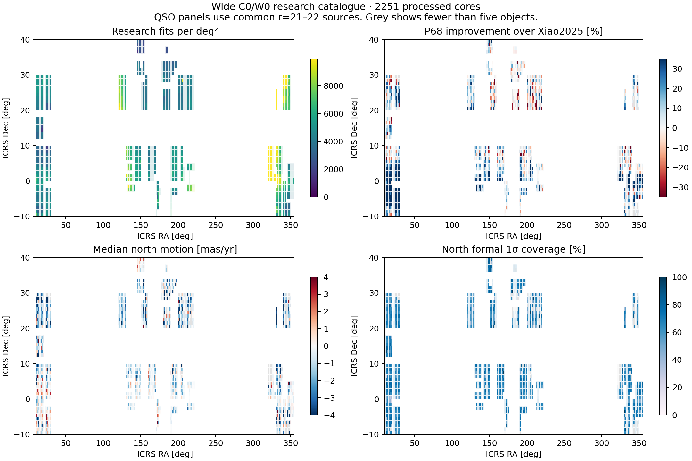
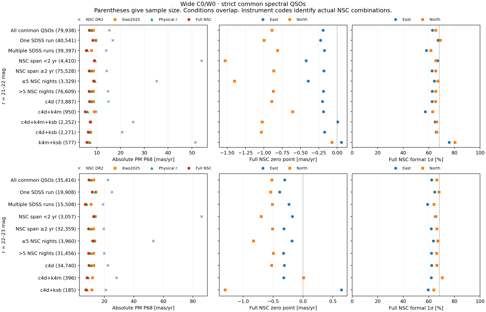
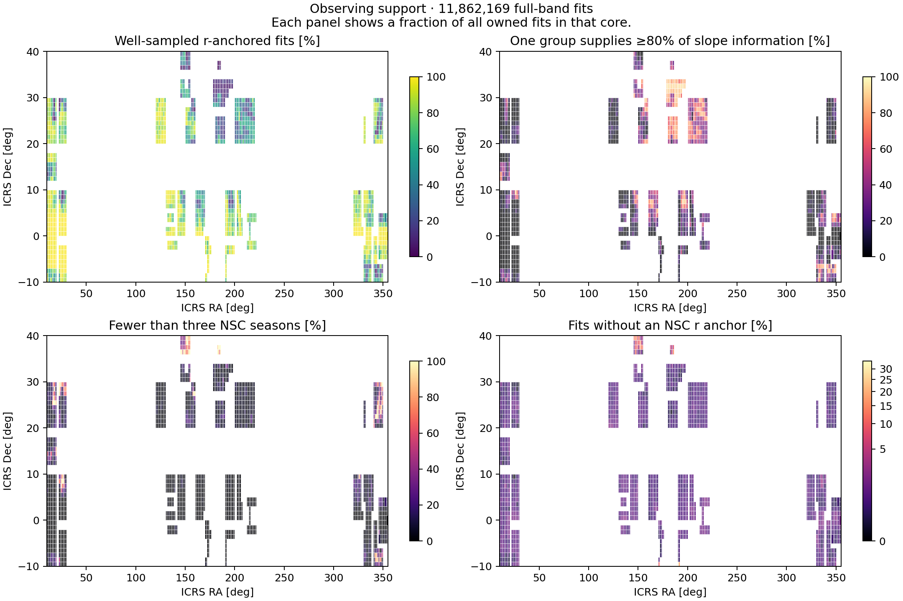

# 实验 A v1.7 · 累计 2,154 平方度的多波段科研目录

本批新增 **804.097 名义平方度**，其中 **794.344 平方度**具备共同参考和合格观测时基，共 **4,279,522 个全波段科研自行解**，较物理质量 r-only 净增 **1,283,269（42.8%）**。累计达到 **2,154.184 名义平方度、2,132.865 平方度有参考及时基几何支持、11,862,169 个全波段解**。在累计 79,938 和 35,416 颗严格共同光谱 QSO 上，21–22 和 22–23 等的二维自行绝对误差 P68 相对 Xiao2025 分别降低 **19.5% 和 25.3%**。

结果支持继续使用冻结 C0/W0 生产广域科研目录。收益随实际时间结构变化。短 NSC 时基的 21–22 等基本持平，部分北天窗口比 Xiao2025 差。局部北向零点、长基线形式误差欠覆盖及非 r 锚点源身份继续保留质量标志。

## 实际覆盖、来源和参考系

| 范围 | 核心 | 名义面积（deg²） | 共同参考及时基机会（deg²） | 物理 r-only | 全波段 | 净增 |
|---|---:|---:|---:|---:|---:|---:|
| 西部六个新窗 | 468 | 447.551 | 438.419 | 1,734,116 | 2,765,813 | 1,031,697 |
| 北东四个新窗 | 384 | 356.546 | 355.925 | 1,262,137 | 1,513,709 | 251,572 |
| 新批 | 852 | 804.097 | 794.344 | 2,996,253 | 4,279,522 | 1,283,269 |
| 累计 | 2,251 | 2,154.184 | 2,132.865 | 8,845,816 | 11,862,169 | 3,016,353 |

四节点 61627813 核验全部 852 个新增核心的输入与星系参考回执，含 halo 重复覆盖共 419,424,538 条标准化检测。有效面积由原生 SDSS 单扫描足迹、NSC 曝光 CCD 足迹、星系参考支持和观测时基的交集在 0.025° 网格估计，要求至少一次 SDSS、两次 NSC、NSC 时基至少 0.60 年及联合时基至少 5 年。该指标衡量观测机会。全部 2,251 个核心均有科研解。 [取数回执](../results/summary/v17_2154_intake_summary.json) · [覆盖和分窗统计](../results/summary/v17_2154_science_summary.json)

真实组共享把既有和新增范围连成三套参考图。西、北、东分别保留 20,760、5,552、15,049 个物理组，合计 **41,361 个**，三图的保留组两两无交集。每图区内联合求零点，图之间保留各自的参考分量和版本。1,274,137 个西部留出星系的跨巡天位置中位差由东／北 +0.84／−25.83 mas 降至 −0.32／−1.03 mas。首版西部求解达到 445 GiB 节点内存限制。低内存和带签名断点的实现复用 1,099 个重投影回执。61710358 写入 39 次抽样，61718833 补齐 48 次并通过留出核验。参数、权重和随机种子均按原方法冻结。 [参考计划](../results/summary/v17_2154_reference_plan_summary.json) · [参考回执](../results/summary/v17_2154_reference_summary.json)

两次八节点拟合处理全体核心，包括受共同图更新影响的原 1,399 个核心。每个 SDSS 物理 run 使用发布 r 位置，NSC 使用所有通过冻结质量判据及参考支持的单曝光位置。采用 W0 每轴 50 mas 底噪、48 次同步参考抽样和 J2015.5 四参数稳健解。每源保留标准 ICRS 状态、完整 4×4 条件协方差、检测身份、物理组、观测夜、波段和参考图 SHA。既有区域重算后保留 7,582,647 个全波段解，较原目录少 2,575 个。原目录和对应参考图独立归档。 [北东拟合](../results/summary/v17_2154_north_east_fit_summary.json) · [西部拟合](../results/summary/v17_2154_west_fit_summary.json)

三图在 J2015.5 重分配 131 个全波段解和 87 个 r 对照解。位于已登记核心并集之外的 14 个全波段解和 7 个 r 对照解保存在原拟合档案。图内跨核心共享检测、精确重复位置及未解决归属均为零。61731451 合并科学结果，建立包含 11,852 个有源像素的私有 NSIDE=128 RING 索引。61689055 生成 10 项去标识汇总及校验清单。 [归属总账](../results/summary/v17_2154_ownership_summary.json) · [发布校验](../results/summary/v17_2154_publication_summary.json)

## 严格共同光谱 QSO 的精度与观测条件

每行的四种方法使用相同光谱对象。Xiao2025 只采用 PM_SOURCE=DESI 的地基自行，NSC 采用官方 DR2。二维绝对自行 P68 的单位为 mas/yr。源目录冻结后匹配 QSO；暗端 Gaia 自行退出精度验收。

| 范围 | r（等） | 观测条件 | 共同 QSO | NSC DR2 | Xiao2025 | 物理 r-only | 全波段 |
|---|---|---|---:|---:|---:|---:|---:|
| 新批 | 21–22 | 全部 | 23,388 | 18.855 | 8.995 | 8.350 | **7.461** |
| 新批 | 21–22 | 单 SDSS run | 12,493 | 19.783 | 9.658 | 9.937 | **8.606** |
| 新批 | 21–22 | 多 SDSS run | 10,895 | 17.710 | 8.338 | 6.683 | **6.290** |
| 新批 | 21–22 | NSC 时基 <2 年 | 1,510 | 51.188 | **8.273** | 8.578 | 8.489 |
| 新批 | 21–22 | NSC 时基 ≥2 年 | 21,878 | 17.393 | 9.055 | 8.334 | **7.413** |
| 新批 | 22–23 | 全部 | 10,210 | 28.581 | 13.514 | 12.063 | **10.593** |
| 新批 | 22–23 | 单 SDSS run | 6,407 | 30.838 | 14.541 | 14.217 | **12.213** |
| 新批 | 22–23 | 多 SDSS run | 3,803 | 25.069 | 11.775 | 8.882 | **8.030** |
| 新批 | 22–23 | NSC 时基 <2 年 | 1,212 | 86.869 | 13.259 | 12.847 | **12.018** |
| 新批 | 22–23 | NSC 时基 ≥2 年 | 8,998 | 24.182 | 13.529 | 11.985 | **10.414** |
| 累计 | 21–22 | 全部 | 79,938 | 15.316 | 8.552 | 7.786 | **6.882** |
| 累计 | 22–23 | 全部 | 35,416 | 22.418 | 12.857 | 11.173 | **9.602** |

新批相对 Xiao2025 的 P68 降低 17.1%／21.6%，相对物理 r 降低 10.6%／12.2%。单 run 相对 Xiao2025 的收益为 10.9%／16.0%，多 run 为 24.6%／31.8%。新批的 21–22 等且 NSC 时基不足两年时，P68 比 Xiao2025 高 2.6%；累计同条件下为 8.956 对 8.971 mas/yr。新批五夜以内的同档高 1.6%（1,488 颗）。北东四窗 21–22 等单 run 的 P68 高 5.0%，多 run 低 16.8%。 [新批共同对象统计](../results/summary/v17_2154_new_spectral_summary.json) · [北东独立分区读出](../results/summary/v17_future_north_east_new_readout_summary.json)

新批共同样本主要由 DECam 支持，两档单独使用该仪器的分母为 22,937／10,152。联合时基中位均约 14.0 年，NSC 观测夜中位为 10／9 夜。新批联合时基不足 12 年时，两档 P68 为 10.131／13.824 mas/yr（8,053／3,669 颗）；至少 12 年时为 6.338／8.937（15,335／6,541 颗）。联合作业按真实观测支持分层，SDSS run 数、NSC 夜数与联合跨度同时变化。固定检测的 v1.5 重复 C 区实验独立显示，同夜补入其他波段可将两档 P68 从 3.582／5.542 降至 3.390／5.003 mas/yr。 [联合跨度和观测夜分层](../results/summary/v17_2154_new_spectral_summary.json) · [固定检测同夜消融](experiment_A_v1.5_nsc_information.md)

| 样本 | r（等） | 东／北中位（mas/yr） | 东／北 NMAD（mas/yr） | 二维误差 >5 mas/yr | 东／北 1σ 覆盖 | 东／北 2σ 覆盖 |
|---|---|---:|---:|---:|---:|---:|
| 新批 | 21–22 | −0.20／−1.18 | 4.55／4.65 | 12,941 / 23,388 | 65.2%／65.8% | 93.1%／93.6% |
| 新批 | 22–23 | −0.25／−0.72 | 6.56／6.42 | 7,252 / 10,210 | 64.3%／67.6% | 93.0%／94.8% |
| 累计 | 21–22 | −0.19／−0.89 | 4.19／4.21 | 40,043 / 79,938 | 62.8%／65.4% | 90.8%／93.0% |
| 累计 | 22–23 | −0.31／−0.52 | 5.85／5.74 | 23,425 / 35,416 | 62.2%／66.2% | 90.8%／93.8% |

累计 21–22 等联合时基至少 12 年的 56,073 个 QSO，东／北 1σ 覆盖为 59.8%／63.6%；短于 12 年的 23,865 个为 69.7%／69.5%。长时基散布更小，形式误差仍偏乐观。累计 P68 收益的对象配对 95% 区间为 19.0%–20.1%／24.5%–26.0%。按 SDSS run 重加权的敏感度区间为 16.7%–22.4%／22.9%–28.0%，按 NSC 观测夜为 18.2%–21.0%／23.8%–26.9%。纳入共享夜关系后，两档各连为单一观测分量。这些区间反映当前观测结构下的敏感度。 [尾部、覆盖及相关性](../results/summary/v17_2154_science_summary.json)

## 盲目录产出、空间零点和质量等级

| 源类 | 新批科研解 | 累计科研解 | 新批 21–22 等唯一光谱匹配 | 新批 22–23 等唯一光谱匹配 |
|---|---:|---:|---:|---:|
| 原有 r 自行 r_existing | 2,992,168 | 8,831,540 | 19,420 | 2,975 |
| 追加 r 锚点 extra_r_anchor | 1,262,058 | 2,943,661 | 6,903 | 1,538 |
| 非 r 锚点 non_r_anchor | 25,296 | 86,968 | 15 | 15 |

累计净增 3,016,353 个（34.1%），按两种冻结选择的目录总数差计算。w340_110 净增 452,227 解，占新批净增的 35.2%，其中 449,841 个为追加 r 锚点。该窗的 21–22 等 P68 改善约 6.2%，北向中位约 −2.46 mas/yr。此前三个专项审核继续沿用原成员证据。排除 w320_090 后，v1.7 首批其余新核心仍净增 539,266 解，二维 P68 相对 Xiao2025 下降 20.43%／25.34%。原 A 区 12 核心的参考恢复和留出星系验证独立保留。 [分区产出和光谱聚合](../results/summary/v17_2154_science_summary.json) · [三个专项审核](../docs/wide_followup_v17.md)

新批 21–22 等追加 r 锚点的北向中位为 −1.77 mas/yr（6,903），已有 r 解为 −1.15 mas/yr（19,420）。累计分别为 −1.36 mas/yr（17,884）和 −0.88 mas/yr（67,390）。w020_110 和 w340_110 的同档严格共同 QSO 北向约 −2.45／−2.46 mas/yr，w150_110、w200_110、w210_110 约 −2.15、−2.14、−2.00 mas/yr。后三个北天窗的 21–22 等 P68 分别比 Xiao2025 高 7.4%、9.8%、4.2%。源类之间存在天空、星等、波段和斜率杠杆的选择差异，不能凭中位数差归因到单个波段。

新批 22–23 等非 r 锚点的东／北中位约 +2.49／−4.21 mas/yr（15 颗）；累计同档约 +1.14／−0.42 mas/yr（69 颗）。光谱支持稀少，零点随区域改变。独立年份位置重现与成员身份验证分别沿用原试验的适用范围。当前数据给出科研产出分母和零点证据，暗恒星身份仍需独立核验。 [盲源光谱统计](../results/summary/v17_2154_new_spectral_summary.json) · [三类源观测支持](../results/summary/v17_2154_class_conditions_summary.json) · [独立年份验证](../docs/verification_v16.md)

| 观测支持 | 新批解数 | 累计解数 | 累计含该类解的核心面积（deg²） |
|---|---:|---:|---:|
| r 锚点，观测抽样充分 | 2,798,423 | 8,723,231 | 2,145.375 |
| r 锚点，观测抽样受限 | 1,455,803 | 3,051,970 | 2,135.249 |
| 非 r 锚点 | 25,296 | 86,968 | 2,144.996 |

抽样受限表示少于三个 NSC 观测季，或任一轴至少 80% 的条件斜率信息来自同一物理组。累计 2,241,451 解有高杠杆标志，1,125,536 解有少季节标志，两组可重叠。同一核心可含多类源。两档分别有 1,943.231／1,502.259 平方度的核心至少包含五个共同 QSO，其中 P68 点估计优于 Xiao2025 的面积为 **1,406.392／1,204.185 平方度**，对应 62,986／29,278 个共同对象。新批相应优势面积为 453.405／356.171 平方度。绝对空间零点、跨源公共误差和暗星身份继续按实际验证支持标记。 [空间统计及分母](../results/summary/v17_2154_science_summary.json)

## 广域生产判断

本批同时增加了科研解产出和严格共同 QSO 精度，支持以冻结 C0/W0 继续生产。优先使用联合时基长、NSC 多季且具有 r 锚点的普通解。短 NSC 时基、参考弱连接、高杠杆和非 r 锚点保留各自质量标志。下一批按实际扫描、CCD 和物理参考连接登记，复用可信输入和签名重投影。北向偏差、长基线误差欠覆盖和非 r 成员身份是正式发布前优先核验的问题。

原始检测、逐源状态、成员、参考文件、失败日志和验证样本保存在 NERSC 个人 PScratch。公开分支只保存代码、文档、可核验的聚合结果与图。线程受限配置下全部 200 项本地测试通过。 [运行及检查记录](../docs/running_v17.md) · [工作日志](../WORKLOG.md)
