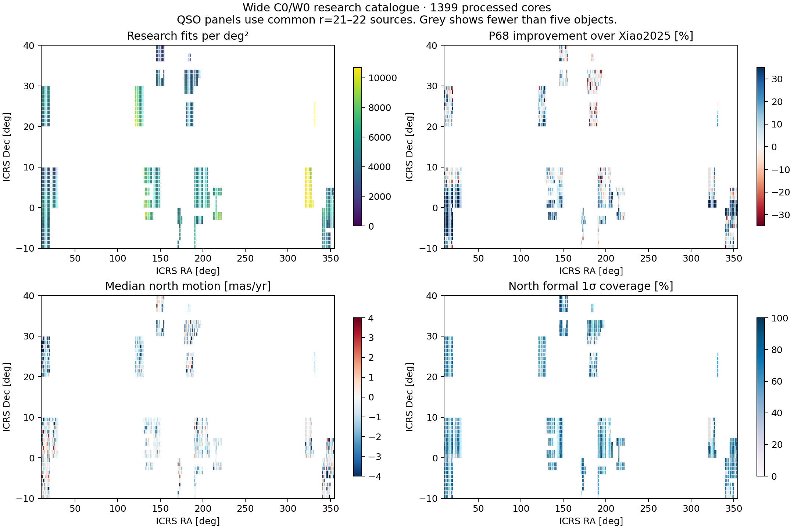
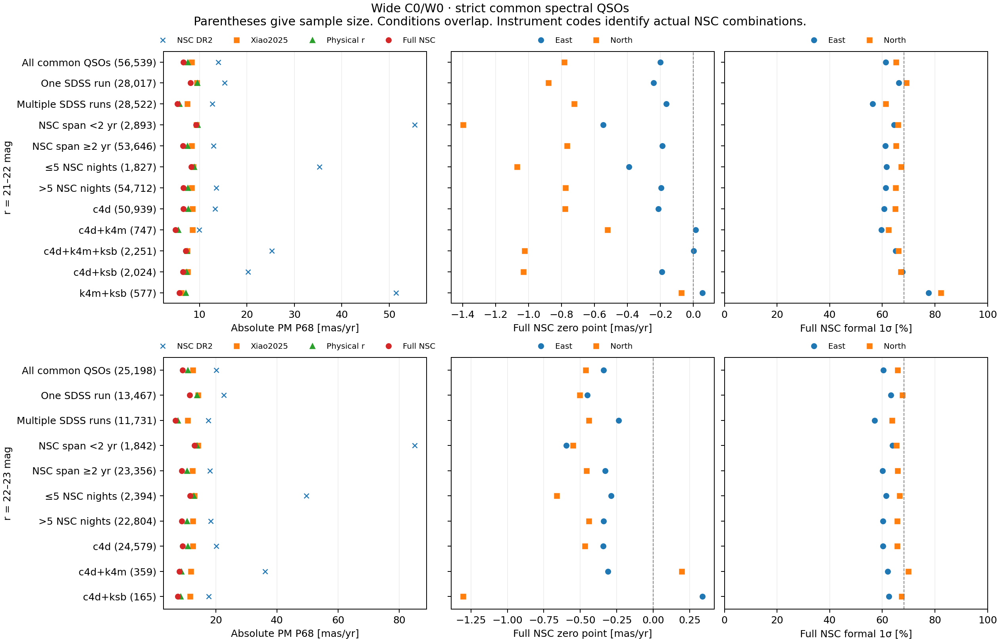

# 实验 A v1.7 · 302 平方度续跑的科学结果

新增五窗完成 **302.415 名义平方度**，其中 **297.364 平方度**具有共同参考和合格观测时基。最终获得 **1,514,096 个全 NSC 波段科研自行解**，较物理质量 r-only 的 1,198,587 解净增 **315,509（26.3%）**。在严格共同光谱 QSO 中，21–22 和 22–23 等的二维自行绝对误差 P68 相对 Xiao2025 分别降低 **24.0% 和 28.8%**。批次结果支持 C0/W0 继续广域科研生产。短 NSC 时基的精度增量较小，追加 r 锚点的北向零点依然需要按区域读取。

## 实际完成范围与参考系

| 窗口 | 名义面积 deg² | 参考及观测时基几何机会 deg² | 物理 r 科研对照 | 全 NSC 科研解 | 净增 |
|---|---:|---:|---:|---:|---:|
| w020_090 | 79.594 | 78.406 | 273,167 | 322,761 | 49,594 |
| w140_090 | 79.594 | 79.531 | 387,299 | 431,716 | 44,417 |
| w190_080 | 31.877 | 29.574 | 135,733 | 175,365 | 39,632 |
| w200_090 | 47.791 | 47.806 | 165,638 | 276,847 | 111,209 |
| w340_080 | 63.559 | 62.046 | 236,750 | 307,407 | 70,657 |
| 新范围合计 | 302.415 | 297.364 | 1,198,587 | 1,514,096 | 315,509 |

304 个新核心均有科研解。304 份输入回执合计 285,016,145 条标准化检测，含各块 halo 的重复覆盖。原取数完成 297 核心，七个 Data Lab 查询失败的分片经两次定点补跑闭合。几何机会使用实际星系支持、原生 SDSS 扫描和 NSC CCD，按 0.025° 网格计算，要求至少一次 SDSS、两次 NSC、NSC 时基至少 0.60 年及联合时基至少 5 年。网格边界抽样使 w200_090 的积分较解析核心面积高 0.016 deg²，保留两种面积的实测口径。 [输入闭合](../results/summary/v17_continuation_intake_summary.json) · [实际足迹与计数](../results/summary/v17_continuation_science_summary.json)

实际共享组涉及东西赤道两图。参考过程保留旧切平面中心和星系训练／留出身份，将新 304 核心及既有 647 核心纳入重算。西图保留 15,058 个物理观测组，东图保留 12,580 个。三个未受影响的共同图及 448 个拟合核心由原签名回执复用。完整五图保留 **32,443 个物理组**，图间两两交集为零。东图 586,338 个留出星系跨巡天位置中位差由 −6.26／−15.64 mas 变为 +0.17／−1.00 mas，西图 642,542 个由 −3.53／−23.19 mas 变为 −0.55／−0.71 mas。绝对自行零点采用独立 QSO 评价。 [参考范围和回执](../results/summary/v17_continuation_reference_summary.json)

拟合仍使用每个 SDSS 物理 run 的发布 r 位置、全部质量合格的 NSC 单曝光、共同 C0 星系零点、W0 每轴 50 mas 底噪、同步参考抽样和 J2015.5 四参数稳健拟合。输出每源标准 ICRS 状态、完整 4×4 条件协方差、检测身份、物理组、波段、曝光和参考图 SHA。拟合由六节点 61627443 完成，科学归属由两节点 61642603 完成。

两张更新图中，52 个全波段解和 34 个 r 对照解按 J2015.5 位置移入相邻核心。另有 2 个全波段解在已登记核心的并集之外，保存在原拟合且从区域读出归档。五张图的跨核心共享检测、精确重复位置和未解决归属均为零。累计 1399 个核心、**1350.087 名义平方度**，其中 **1338.550 平方度**具有参考及时基几何机会。最终 **7,585,222 个全波段解**索引至 7,500 个 NSIDE=128 像素，物理 r 对照 5,850,220 解，净增 **1,735,002（29.7%）**。重算既有范围的全波段计数比原冻结目录多 3 解，面积按并集只计一次。 [拟合与归属回执](../results/summary/v17_continuation_ownership_summary.json) · [复现顺序](../docs/running_v17.md)

## 严格共同光谱 QSO

同一行使用相同 QSO。Xiao2025 仅采用 `PM_SOURCE=DESI`，外部 NSC 使用官方 DR2。四路二维绝对自行 P68 单位 mas/yr。暗端 Gaia 自行退出精度验收。已知光谱位置定义严格同源的固定控制，光谱匹配也用于冻结盲目录的独立评价。窗口和仪器的质量分层保留实际分母。

| 样本 | r | 观测条件 | 共同 QSO | NSC DR2 | Xiao2025 | 物理 r | 全 NSC |
|---|---|---|---:|---:|---:|---:|---:|
| 新批 | 21–22 | 全部 | 13,077 | 13.070 | 8.648 | 7.585 | **6.570** |
| 新批 | 21–22 | 单 SDSS run | 6,119 | 13.197 | 9.555 | 9.468 | **7.966** |
| 新批 | 21–22 | 多 SDSS run | 6,958 | 12.951 | 7.917 | 6.091 | **5.486** |
| 新批 | 21–22 | NSC 时基 <2 年 | 855 | 53.771 | 10.307 | 10.358 | **10.129** |
| 新批 | 21–22 | NSC 时基 ≥2 年 | 12,222 | 11.918 | 8.553 | 7.418 | **6.385** |
| 新批 | 22–23 | 全部 | 6,244 | 20.283 | 12.844 | 11.047 | **9.149** |
| 新批 | 22–23 | 单 SDSS run | 3,343 | 20.878 | 14.158 | 13.919 | **11.554** |
| 新批 | 22–23 | 多 SDSS run | 2,901 | 19.570 | 11.319 | 7.978 | **7.019** |
| 新批 | 22–23 | NSC 时基 <2 年 | 478 | 87.352 | 14.650 | 14.365 | **13.498** |
| 新批 | 22–23 | NSC 时基 ≥2 年 | 5,766 | 18.409 | 12.679 | 10.757 | **8.899** |
| 累计 | 21–22 | 全部 | 56,539 | 13.934 | 8.377 | 7.542 | **6.636** |
| 累计 | 22–23 | 全部 | 25,198 | 20.221 | 12.554 | 10.803 | **9.175** |

新窗口的全波段相对物理 r P68 分别降低 **13.4% 和 17.2%**。相对 Xiao2025，多 run 的收益为 30.7%／38.0%，单 run 为 16.6%／18.4%，NSC 时基不足两年时为 1.7%／7.9%。累计范围相对 Xiao2025 分别降低 20.8%／26.9%。新批的共同样本两档分别有 12,986／6,227 颗仅由 DECam 的 NSC 观测支持，跨仪器证据主要来自累计目录。按实际联合跨度、夜数和仪器分别保留统计。新批联合时基中位数为 16.91／16.88 年，NSC 观测夜中位数 13／11。 [新批同源聚合与分层](../results/summary/v17_continuation_new_spectral_summary.json)

新增可用年份延长时间基线，多 SDSS run 也能分散早端位置的斜率杠杆。当前广域分层同时受覆盖、亮度、源形态和观测选择影响。已冻结的 v1.5 重复 C 区固定检测消融说明，同夜补入其他波段也能提供质心信息，其两档 P68 由 3.582／5.542 降至 3.390／5.003 mas/yr。广域结果与两类信息并存相符，同夜共享误差仍保留质量标志。 [固定同源的同夜消融](experiment_A_v1.5_nsc_information.md)

新批两档全波段东／北零点分别为 **−0.20／−0.68** 和 **−0.26／−0.41** mas/yr，NMAD 为 4.00／3.96 和 5.67／5.47 mas/yr。二维误差超过 5 mas/yr 的比例为 6,166/13,077 和 4,033/6,244。两轴形式 1σ 覆盖为 58.2%／64.4% 和 57.8%／65.1%，2σ 为 87.3%／92.5% 和 87.4%／93.2%。对象配对 95% 区间给出相对 Xiao2025 的二维增益 22.7%–25.4% 和 27.1%–30.2%。由共享物理观测连起的三个分量给出敏感度区间 12.7%–26.6% 和 15.1%–32.0%，将共享夜也连入后只有一个分量。绝对空间和跨源误差认证需继续按独立观测支持作判断。

## 源类、观测支持与空间质量

| 源类 | 新批科研解 | 累计科研解 | 新批 21–22 等唯一光谱匹配 | 新批 22–23 等唯一光谱匹配 |
|---|---:|---:|---:|---:|
| 保有 r-only 解 `r_existing` | 1,196,905 | 5,840,827 | 10,973 | 2,168 |
| 追加 r 锚点 `extra_r_anchor` | 302,409 | 1,683,592 | 2,459 | 713 |
| 非 r 锚点 `non_r_anchor` | 14,782 | 60,803 | 2 | 13 |

全波段与物理 r 比较按原冻结选择各自计数，净增为两目录总数差。新批追加 r 锚点的北向中位为 −1.27／−1.03 mas/yr，两档保有 r 解为 −0.66／−0.12 mas/yr。累计追加 r 锚点的 21–22 等北向中位 −1.14 mas/yr（10,981 个唯一光谱匹配），与 v1.7 初批的约 −1.11 mas/yr 一致。此前查得该信号在西北图较强。样本条件差异、参考图和时基继续分别记录。非 r 锚点在新批 21–22 等只有两颗光谱位置匹配，公开结果保留计数。22–23 等 13 颗的东／北中位为 +1.55／−0.04 mas/yr。位置唯一性、独立年份位置预测、空间零点和暗星成员身份各自保留证据。 [盲源条件光谱验证](../results/summary/v17_continuation_new_spectral_summary.json) · [追加 r 锚点专项审计](../docs/wide_followup_v17.md)

| 观测支持 | 新批解数 | 累计解数 | 累计核心占据面积 deg² |
|---|---:|---:|---:|
| r 锚点且观测抽样充分 | 1,183,866 | 5,928,209 | 1343.088 |
| r 锚点且观测抽样受限 | 315,448 | 1,596,210 | 1342.112 |
| 非 r 锚点 | 14,782 | 60,803 | 1345.547 |

抽样受限沿用原有标志，即少于三个 NSC 观测季，或任一轴至少 80% 的条件斜率信息来自一个物理组。占据面积统计至少出现一个该类科研解的核心，同一核心可包含多个类别。新批单物理组高杠杆 252,621 解，少于三个观测季 116,022 解，两组有交集。全目录保留绝对空间零点、同夜公共误差和独立身份的认证状态，抽样充分标签可用于选取时间支持条件较好的对象。 [三类源的夜／季、杠杆与形式误差](../results/summary/v17_continuation_class_conditions_summary.json)

在至少五个共同 QSO 的核心中，累计点估计 P68 优于 Xiao2025 的面积为 **961.762／849.939 名义平方度**，对应 46,492／21,659 个共同对象。两档达到分母下限的面积为 1234.454／1018.849 平方度。新批对应优势面积 231.053／225.071 平方度。该尺度用于展示科学收益空间分布，绝对零点仍需按有效独立观测组认证。地图的灰色表示少于五个共同 QSO。当前数据覆盖了多个时基和仪器组合，未处理天区及稀疏分层的表现仍待实测。

## 继续广域生产

新批增加的源数、单 run 对照和两档严格同源精度支持维持冻结 C0/W0 全 NSC 波段。联合时基短、观测杠杆集中的源保留科研解和相应质量标志。参考零点和协方差按物理观测组维护。局部偏差和新增暗星身份进入正式发布前的质量分析。

科学归属通过后，61627753 按原生扫描和 CCD 登记了 **804.097 名义平方度、852 核心**，参考前几何机会 799.563 平方度。下一批四节点取数 61627813 已启动，十个真实先导全部通过，含各块 halo 共 3,270,368 条标准化检测。累计面积达到 2154.184 平方度有待这一批完成拟合、归属和科学核验。原始检测、签名逐源目录、星系和真值缓存留在 NERSC PScratch，公开仓库包含去标识统计、图和复现记录。 [下一批登记范围](../results/summary/v17_future_registration_summary.json) · [发布校验和](../results/summary/v17_continuation_publication_summary.json)
