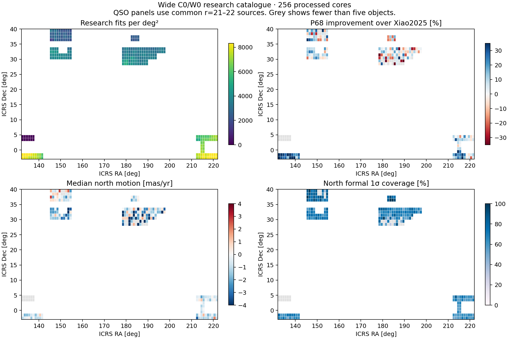
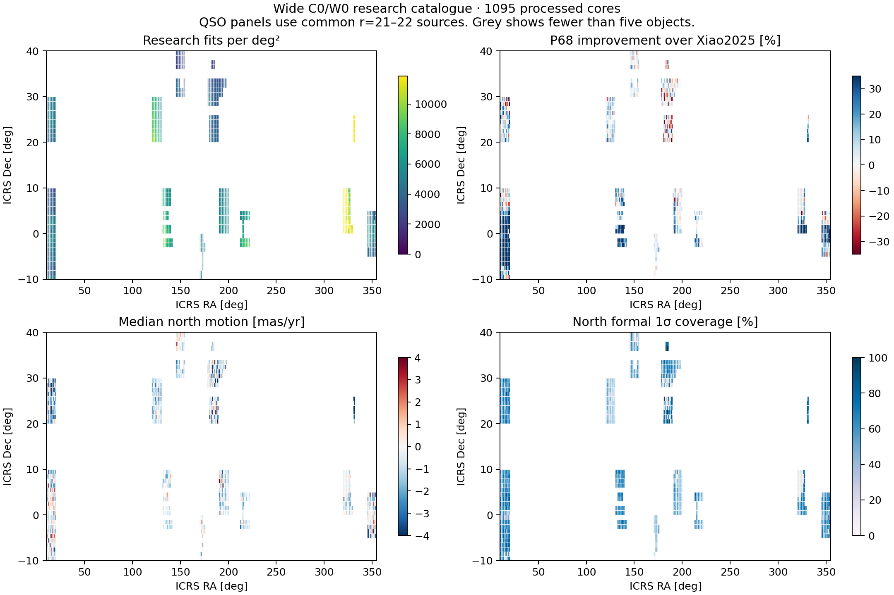
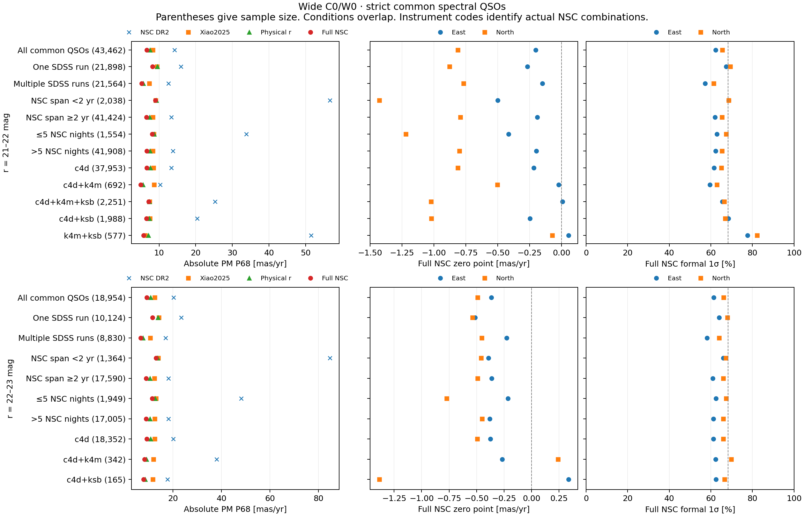

# 实验 A v1.7 · 广域 C0/W0 科研目录

**科学结论。** 冻结的 C0/W0 全波段已完成 **1047.672 名义平方度**，其中 **1041.187 平方度**具备共同参考和合格几何时基。共 **6,071,123 个科研自行解**，较物理 r 对照净增 **1,419,861 个（30.5%）**。严格共同光谱 QSO 相对 Xiao2025 的二维自行 P68 在 21–22、22–23 等分别降低 **19.8%**、**26.4%**。实测增量支持继续分批生产。归属、测量支持、空间零点和独立暗星身份使用可追溯的质量标志。

## 首批实际完成的缓存区

首批完成 v1.3 余下 **184 核心、168.243 名义平方度**。其中带共同参考支持的全 NSC 波段 CCD／时基几何机会为 **155.207 平方度**，物理 r 路线为 136.661。至少有一个科学解的核心覆盖 156.273 平方度。几何值来自实际测得 CCD 和原生 SDSS 扫描，使用 0.025° 等面积积分、至少两次 NSC 曝光、NSC 跨度至少 0.60 年及联合跨度至少 5 年。逐源有效检测与绝对零点质量需要分别核验。

新区域测量位置半开核心归属中共 **6,428,882** 条 SDSS r、**112,373,503** 条 NSC 检测。保留每源标准 ICRS、J2015.5、完整 4×4 条件协方差、真实物理成员、采用图、波段、仪器及夜。共同 C0/W0 下物理质量 r 对照为 **638,163**，全波段有效科研解 **812,481**，净增 **174,318（27.3%）**。对照按原发现核心统计，正式读取按拟合位置归属。

| 窗口 | 名义面积 | 共同参考后的全波段几何机会 | 物理 r 科研对照 | 全 NSC 科研解 |
|---|---:|---:|---:|---:|
| A | 31.957 | 19.352 | 136,888 | 157,201 |
| B | 47.934 | 47.873 | 284,090 | 345,264 |
| 北一 | 57.795 | 57.497 | 142,632 | 205,881 |
| 北三 | 30.556 | 30.485 | 74,553 | 104,135 |
| 北二（同范围重放） | 58.720 | 57.843 | 146,907 | 183,130 |

北二重放使用包含北一、北三的共同参考图，旧 v1.6 输出继续冻结。含原 C 区和此次北二重放，首批累计覆盖 **326.836 名义平方度、1,477,556 个科研解**。北二区面积只计一次。

## 同源光谱比较

仅比较共同光谱 QSO，同一行用相同对象。Xiao2025 仅限 `PM_SOURCE=DESI`。二维自行绝对误差 P68 单位 mas/yr，表格只含新 184 核心。误差、源选择和绝对空间零点是独立判断。

| r | SDSS 物理 run | 共同 QSO | NSC DR2 | Xiao2025 | 物理 r | 全 NSC |
|---|---|---:|---:|---:|---:|---:|
| 21–22 | 全部 | 6,229 | 18.613 | 7.400 | 7.110 | 6.682 |
| 21–22 | 单 run | 4,385 | 21.153 | 7.524 | 7.998 | 7.493 |
| 21–22 | 多 run | 1,844 | 14.007 | 7.198 | 5.470 | 5.053 |
| 22–23 | 全部 | 2,030 | 24.950 | 10.947 | 10.392 | 9.390 |
| 22–23 | 单 run | 1,363 | 26.520 | 11.285 | 11.672 | 10.461 |
| 22–23 | 多 run | 667 | 22.397 | 10.248 | 7.615 | 7.050 |

**主要收益集中在多 run。** 相对物理 r，21–22 和 22–23 等全样本的 P68 分别降低 6.0% 和 9.6%。相对 Xiao2025 分别降低 9.7% 和 14.2%。21–22 等单 run 在合并样本中与 Xiao 持平，北一、北三同档单 run 的点估计分别比 Xiao 高 5.8% 和 7.0%。这两个北区的全波段仍改善了各自的 r 对照。22–23 等单 run 合并样本相对 Xiao 的 P68 降低 7.3%，即使在单 run 区也有进一步验证的价值。

全 NSC 两档的东／北中位零点为 +0.03/−0.90、−0.37/−0.67 mas/yr，NMAD 为 4.17/4.09、5.74/5.60 mas/yr。形式 1σ 覆盖分别为 58.1%/64.6% 和 50.4%/61.6%，两档的二维自行大于 5 mas/yr 的尾部为 3,068/6,229 和 1,352/2,030。每档仅有两个由共享物理观测连成的独立区域分量。对象配对区间可描述当前样本内改进，空间零点及观测组相关误差仍须保留独立质量标志。

## 科研源类、空间零点与参考系

新 184 核心的三类科研解为既有 r 锚点 **636,778**、追加 r 锚点 **168,333**、非 r 锚点 **7,370**。按窗口和星等保存光谱零点和误差覆盖、观测夜／季及杠杆条件。暗端 Gaia 自行退出验收。与光谱位置唯一对应和独立年份预测分别提供成员与条件位置证据，尚未认证的暗恒星保持相应质量标志。328,940 个解在至少一轴由一个观测组提供至少 80% 的条件斜率信息。北一 22–23 等非 r 锚点光谱样本仅 8 个，北向中位约 +3.05 mas/yr。A 区 12 个空核心保留，其中的实际测量和参考支持状态不计为缺失作业。

两共同参考图使用原星系身份及同步抽样。北图 2766 个保留物理组，赤道图 2870 个，彼此及与冻结 C 无重复物理组。同范围拟合保留原始输入回执。归属审计已转移 **8** 个全波段源至其实际相邻核心，另把 **2** 个拟合位置落在登记并集外的行保存在原始签名拟合，由区域读取排除。调整归属时位置、自行、完整协方差和物理成员逐值保持。NSIDE128 私有索引链接原行，图和公开汇总按最终区域归属读取。

[实际质量汇总](../results/summary/v17_cached_production_science_summary.json) · [新 184 核心配对精度](../results/summary/v17_new_cached_spectral_summary.json) · [共同参考回执](../results/summary/v17_cached_shared_reference_summary.json) · [生产复现方法](../docs/running_v17.md)

## 广域范围的预登记

按原生 SDSS 扫描与 NSC CCD 预先选定 187 个父片、748 个核心，新增名义 **720.836 平方度**。包含南天、赤道和北天。加上既有范围共登记 **1047.672 名义平方度**。三个真实取数及星系参考先导通过后，在 Slurm 按取数、共同参考、拟合、归属及质量顺序运行。

[登记范围](../results/summary/v17_wide_selection_summary.json) · [真实输入先导](../results/summary/v17_wide_input_canary_summary.json)

## 广域批次的东部和北部

四套无共享物理组的东部和北部共同图已完成 720 核心，其中 **438.256 名义平方度**为新天区，**434.526 平方度**具备共同参考、实际 CCD 与合格观测时基。新天区有 **2,616,774** 个全波段科研解，较 **2,243,392** 个物理 r 对照净增 **373,382（16.6%）**。完整四图纳入旧区参考重放后共 3,703,584 个科研解。拟合位置、检测身份和参考组通过归属和唯一性审计。

| 新天区 r | SDSS 物理 run | 共同 QSO | NSC DR2 | Xiao2025 | 物理 r | 全 NSC |
|---|---|---:|---:|---:|---:|---:|
| 21–22 | 全部 | 18,148 | 15.813 | 7.429 | 6.878 | 6.512 |
| 21–22 | 单 run | 8,069 | 16.659 | 7.935 | 8.446 | 7.935 |
| 21–22 | 多 run | 10,079 | 14.971 | 7.076 | 5.850 | 5.549 |
| 22–23 | 全部 | 7,889 | 24.439 | 11.005 | 10.040 | 9.059 |
| 22–23 | 单 run | 4,310 | 26.676 | 11.861 | 12.092 | 10.853 |
| 22–23 | 多 run | 3,579 | 21.973 | 10.092 | 8.072 | 7.246 |

二维绝对自行 P68 单位 mas/yr。上述严格同源表仅纳入这四图的新天区，西赤道另作核验。

[东部与北部实测统计](../results/summary/v17_wide_ready_summary.json) · [五图物理组一致性](../results/summary/v17_wide_reference_production_summary.json)

## 广域批次实际完成

按预先登记的实际扫描和曝光分块。此批新运行 748 核心，范围 **720.836 名义平方度**。带共同参考的几何联合机会为 **716.337 平方度**，至少有一个科研解的核心合计 720.836 平方度。SDSS/NSC 几何积分与首批一致。r-only 与全 NSC 使用冻结 C0/W0、同批输入和共同物理组参考。

新范围共 **4,502,366 个全 NSC 科研解**、**3,397,565 个物理 r 对照解**，净增 1,104,801 个（32.5%）。为统一实际共享的参考组，在新版本重放已经登记的 347 个旧核心。按区域并集计，当前广域产品涵盖 **1047.672 名义平方度、1041.187 平方度参考后几何机会、6,071,123 个全 NSC 科研解**，物理 r 对照 4,651,262 个。原有签名数据独立保存。

| 区域 | 名义平方度 | 全波段几何机会 | 物理 r 科研解 | 全波段科研解 |
|---|---:|---:|---:|---:|
| w010_080 | 99.493 | 99.055 | 358,879 | 451,672 |
| w010_090 | 99.493 | 99.451 | 338,037 | 411,128 |
| w010_110 | 90.516 | 89.294 | 332,587 | 435,813 |
| w120_110 | 90.516 | 90.488 | 624,724 | 672,130 |
| w130_090 | 59.599 | 59.436 | 388,521 | 429,593 |
| w170_080 | 31.886 | 29.769 | 150,134 | 166,289 |
| w180_110 | 55.205 | 55.030 | 178,223 | 212,435 |
| w190_090 | 99.493 | 99.486 | 450,088 | 547,122 |
| w320_090 | 83.594 | 83.305 | 457,257 | 1,022,792 |
| w330_110 | 11.041 | 11.024 | 119,115 | 153,392 |

`w320_090` 净增 565,535 个科研解，占新 748 核心净增的 51.2%。扩区的产出预估需按实际时基、曝光、参考支持和天区分别计算。

### 共同光谱源精度和观测条件

以下为所有广域生产核心的严格共同 QSO。四种方法在每行用同一批对象，Xiao2025 限 PM_SOURCE=DESI。二维 P68 单位 mas/yr。按 SDSS run 与时基分层，各行之间可重叠。

| r | 条件 | 共同 QSO | NSC DR2 | Xiao2025 | 物理 r | 全 NSC |
|---|---|---:|---:|---:|---:|---:|
| 21–22 | 全部 | 43,462 | 14.233 | 8.298 | 7.516 | 6.656 |
| 21–22 | 单 run | 21,898 | 15.927 | 9.383 | 9.536 | 8.175 |
| 21–22 | 多 run | 21,564 | 12.573 | 7.344 | 5.707 | 5.280 |
| 21–22 | NSC 时基 <2 年 | 2,038 | 56.609 | 9.103 | 9.269 | 9.012 |
| 21–22 | NSC 时基 ≥2 年 | 41,424 | 13.338 | 8.258 | 7.423 | 6.547 |
| 22–23 | 全部 | 18,954 | 20.184 | 12.463 | 10.740 | 9.177 |
| 22–23 | 单 run | 10,124 | 23.326 | 14.184 | 13.711 | 11.475 |
| 22–23 | 多 run | 8,830 | 16.964 | 10.632 | 7.540 | 6.714 |
| 22–23 | NSC 时基 <2 年 | 1,364 | 84.677 | 13.940 | 13.689 | 12.974 |
| 22–23 | NSC 时基 ≥2 年 | 17,590 | 18.101 | 12.345 | 10.505 | 8.881 |

- **21–22 等，43,462 个共同 QSO。** 全波段相对物理 r、Xiao2025、NSC 的 P68 改善依次为 +11.4%、+19.8%、+53.2%。东／北零点 -0.20/-0.81 mas/yr，NMAD 4.03/4.06 mas/yr，形式 1σ 覆盖 62.3%/65.5%。二维误差超过 5 mas/yr 的对象 20,833 个，物理观测独立分量 5 个。
- **22–23 等，18,954 个共同 QSO。** 全波段相对物理 r、Xiao2025、NSC 的 P68 改善依次为 +14.5%、+26.4%、+54.5%。东／北零点 -0.36/-0.49 mas/yr，NMAD 5.51/5.48 mas/yr，形式 1σ 覆盖 61.3%/66.1%。二维误差超过 5 mas/yr 的对象 12,085 个，物理观测独立分量 6 个。

多 run 和较长 NSC 时基对应最大的相对精度增量。广域 21–22 等单 run 的合并样本已有改善。条件差异仍然明显，例如东部与北部的新单 run 子样本同档与 Xiao2025 持平，NSC 时基不足两年时全区同档仅改善约 1.0%。这些分层沿用冻结质量和源身份，观察到的差异还涉及仪器、天空位置与源选择。

### 科研解的质量和身份

全区三类源为已有 r 锚点 **4,643,554**、追加 r 锚点 **1,381,539**、非 r 锚点 **46,030**。有 **978,653** 个源在至少一轴高度依赖一个实际观测组。全部状态保存标准 ICRS、自行及条件 4×4 协方差，对应物理检测成员和参考图分量。绝对空间零点、共享夜误差及暗星身份的资格标志可按源读取。

[广域聚合统计](../results/summary/v17_wide_production_science_summary.json)

### 全范围数据与归属核验

输入按测得位置分配至半开核心，合计 **72,237,739 条 SDSS r**、**660,149,851 条 NSC** 标准化检测。实际通过物理质量和参考组支持的 NSC 测量按 band 分列于回执，共 577,494,093 条。全部 1,095 个核心各有科研解，合计 1047.672 名义平方度。缓存批次中无科研解的 12 个 A 区核心，在扩大实际共同参考图后获得支持并产出 91,214 个科研解，涉及 11.970 名义平方度。原参考不足与原目录继续冻结。

五套参考图的两两物理组交集为零。全波段内部归属变更 56 行，登记并集外归档 6 行，区域计数按最终 J2015.5 位置。保留原拟合状态、4×4 条件协方差和检测成员。物理 r 对照内部归属变更 43 行，边界外归档 2 行。用于科学净增的物理 r 分母沿用冻结的发现漏斗。所有五图的跨核心共享检测、精确重复位置和未解决归属计数均为零。以 NSIDE=128 RING 建立 5,799 个存有科研解的像素索引。

[规范化检测及所有权回执](../results/summary/v17_wide_summary_receipt_summary.json) · [拟合闭合回执](../results/summary/v17_wide_fit_completion_summary.json) · [共同参考组回执](../results/summary/v17_wide_reference_production_summary.json)

### 新 748 核心的可迁移性

以下仅含新天区，同一行严格共同 QSO，二维自行 P68 单位为 mas/yr。完整汇总还按实际波段、仪器、夜数和多种观测条件分组。时基分层与 run 分层样本重叠。

| r | 观测条件 | 共同 QSO | NSC DR2 | Xiao2025 | 物理 r | 全波段 |
|---|---|---:|---:|---:|---:|---:|
| 21–22 | 全部 | 30,532 | 13.287 | 8.516 | 7.600 | 6.675 |
| 21–22 | 单 run | 14,280 | 14.209 | 9.859 | 9.857 | 8.248 |
| 21–22 | 多 run | 16,252 | 12.548 | 7.509 | 5.865 | 5.442 |
| 21–22 | NSC 时基 <2 年 | 1,075 | 58.682 | 10.071 | 9.826 | 9.639 |
| 21–22 | NSC 时基 ≥2 年 | 29,457 | 12.670 | 8.458 | 7.510 | 6.581 |
| 22–23 | 全部 | 14,116 | 20.118 | 12.636 | 10.819 | 9.233 |
| 22–23 | 单 run | 7,365 | 22.535 | 14.437 | 13.859 | 11.569 |
| 22–23 | 多 run | 6,751 | 17.534 | 10.740 | 7.808 | 6.922 |
| 22–23 | NSC 时基 <2 年 | 955 | 85.871 | 14.233 | 13.842 | 13.188 |
| 22–23 | NSC 时基 ≥2 年 | 13,161 | 18.177 | 12.517 | 10.621 | 8.964 |

- **21–22 等。** 新天区相对 Xiao2025 的 P68 改善 +21.6%，对象配对 95% 区间 +20.7% 至 +22.3%。单 run 为 +16.3%，多 run 为 +27.5%。两轴中位零点 -0.27 / -0.84 mas/yr，形式 1σ 覆盖 62.3% / 65.1%。物理观测组连成 5 个分量，把共享夜也连起来后为 1 个。
- **22–23 等。** 新天区相对 Xiao2025 的 P68 改善 +26.9%，对象配对 95% 区间 +25.9% 至 +28.2%。单 run 为 +19.9%，多 run 为 +35.5%。两轴中位零点 -0.40 / -0.49 mas/yr，形式 1σ 覆盖 61.6% / 66.1%。物理观测组连成 5 个分量，把共享夜也连起来后为 1 个。

- 21–22 等达到作图分母下限的 1,006 个核心覆盖 963.743 名义平方度。其中 758 个核心、733.708 名义平方度的 P68 点估计低于 Xiao2025，这些核心含 35,082 个共同 QSO。
- 22–23 等达到作图分母下限的 776 个核心覆盖 760.034 名义平方度。其中 637 个核心、626.835 名义平方度的 P68 点估计低于 Xiao2025，这些核心含 16,089 个共同 QSO。

核心分母下限沿用绘图的五个共同 QSO。上述面积度量已取样核心上的条件点估计，受共享组、天区选择与稀疏 QSO 影响。对象置信区间也只描述配对样本内变动。参考图分量、观测组连通及共享夜敏感性应共同读取。

[新 748 核心严格同源与观测组统计](../results/summary/v17_wide_new_spectral_summary.json)

### 三类源与盲成员的验证程度

独立光谱位置提供盲科研解的条件成员核验，各源类的分母和零点单列。下表的轴向量为东／北，二维 P68 和零点单位为 mas/yr。

| 盲解来源 | r | 光谱位置唯一匹配 | 二维 P68 | 两轴零点 | 两轴形式 1σ |
|---|---|---:|---:|---:|---:|
| 既有 r | 21–22 | 36,989 | 6.178 | -0.15 / -0.82 | 61.9% / 65.1% |
| 既有 r | 22–23 | 6,106 | 6.864 | -0.25 / -0.44 | 58.8% / 64.4% |
| 追加 r 锚点 | 21–22 | 8,521 | 8.748 | -0.41 / -1.11 | 66.3% / 68.7% |
| 追加 r 锚点 | 22–23 | 2,493 | 10.040 | -0.47 / -0.62 | 64.9% / 69.4% |
| 非 r 锚点 | 21–22 | 200 | 7.583 | +0.16 / +0.71 | 76.0% / 79.0% |
| 非 r 锚点 | 22–23 | 41 | 10.160 | +0.88 / +0.02 | 73.2% / 65.9% |

按实际参考图保存三类源在各星等档的独立 NSC 夜、季、联合时基和观测组杠杆。公开条件汇总另保留每核心各源类的形式误差分位数。6,071,123 个科研解保留绝对空间零点未认证标志，6,071,123 个保留同夜相关误差未认证标志。新增暗星的观测条件、成员与误差可以追查到单曝光。其独立年份位置证据适用范围沿用冻结试验，广域尚缺逐源独立身份认证。NSC r≥21 的 Gaia 自行不计入这些结果。

净增按两个科研目录的计数差计算。物理 r 对照比全波段的既有 r 锚点类多 7,708 解，两个模型各自通过冻结选择和成员归属。追加 r 锚点光谱样本的北向零点需继续分区读取，21–22 等合并样本约为 −1.11 mas/yr。非 r 锚点的光谱分母在两档只有 200 和 41，整体 46,030 个非 r 解保留身份验证标志。 [v1.6 独立年份和成员核验](experiment_A_v1.6_error_transfer.md)

[源类与真实夜／季及形式误差统计](../results/summary/v17_wide_class_conditions_summary.json)

### 生产决策与复现

继续按 C0/W0 全波段分批科研生产。优先保留有长 NSC 时基和多 SDSS run 的覆盖，同时保留单 run 以及空间零点欠约束的科研解及相应质量说明。科研阶段维持条件 4×4 协方差及同步参考传播。正式发布仍需要按可支持的空间尺度验证绝对零点、观测相关误差和新增暗星身份。弱空间质量单独标记，广域精度收益仍可用共同光谱样本核验。

保留 Data Lab 元数据间歇查询失败、西图低内存求解失败以及冻结 v1.2 摘要缺投影字段的原回执。更高内存节点运行相同西图解，投影回退核对了旧存档位置，后续只续取缺失片段。复现中使用归属版本 `3e14adc` 和西图准备修复 `329c4f8`，科研方法及主拟合仍固定 `1baee96`。公开粒度小于五个对象的观测组数值统一收敛到计数。原结果和哈希保留于 NERSC PScratch。[公开统计导出回执](../results/summary/v17_wide_publication_summary.json)

### 下一批已经启动

预先按原生 SDSS/NSC 几何、真实时间和旧覆盖并集登记五个窗口，共 302.415 名义平方度、304 核心，参考前联合几何机会 299.123 平方度。真实下阶段取数作业为 Slurm `61625135`，五个窗口先导均已验收，含 halo 的标准化检测 2,673,974 条。后续分片继续取数和参考提取，进入拟合前按实际训练星系和物理组核对与既有五图的连通关系。新增批次面积待科研目录完成后结算。

[前瞻覆盖登记](../results/summary/v17_next_wide_selection_summary.json) · [实际输入与参考先导回执](../results/summary/v17_next_intake_canary_summary.json)
