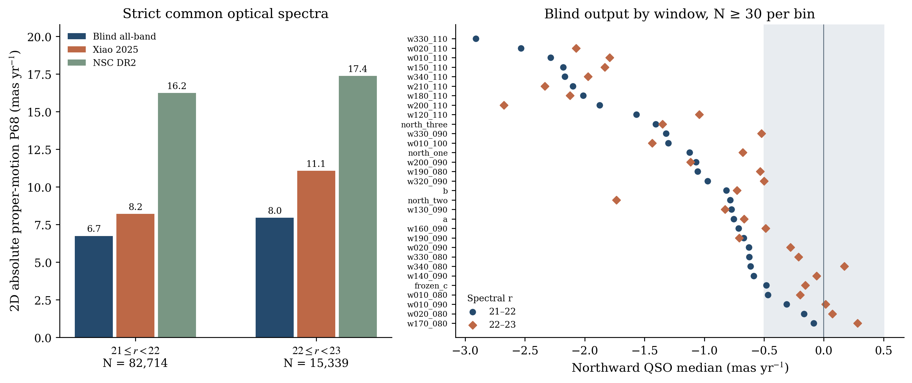

# 实验 A v1.8 · 盲目录质量与计算成本

科学目录冻结于 `2e4a04a`，覆盖 2,154.184 名义平方度，保留 11,862,169 个全波段科研自行。原已知位置控制中，21–22、22–23 等共同 QSO 的二维绝对自行 P68 相对 Xiao2025 降低 19.53%、25.32%。本轮沿用 C0/W0、J2015.5、48 次同步抽样和 ICRS 4×4 条件协方差，用实际盲输出重新检验精度与零点。组会图件继续保留。 [原科学报告](experiment_A_v1.7_2154.md) · [组会图注](meeting_2e4a04a_figures.md)

## 实际盲目录的精度与适用范围

NERSC 61910115 读取 2,251 个冻结核心，复现 219,455 个原本在核心内唯一的光谱对应。315,414 个光谱坐标落在原输入核心内。原盲匹配中 1 个解被最终归属规则登记在覆盖外。其余匹配中 101,551 个处于有效的 21–23 星等档，跨核心光谱身份重复为零。老分片没有统一的 DESI target ID，使用冻结光谱并表发布坐标和来源作一致身份键，并复现原位置匹配及其竞争门槛。 [详细分层统计](../results/summary/v17_blind_catalogue_quality_summary.json)

| 光谱 r | 全部盲 QSO | 严格三路共同 N | 盲全波段 P68 | Xiao2025 P68 | NSC DR2 P68 | 相对 Xiao2025 | 相对 NSC |
|---|---:|---:|---:|---:|---:|---:|---:|
| 21–22 | 85,492 | 82,714 | 6.748 | 8.210 | 16.246 | +17.8% | +58.5% |
| 22–23 | 16,059 | 15,339 | 7.951 | 11.068 | 17.373 | +28.2% | +54.2% |

表中的 P68 是二维自行模第 68 百分位，单位 mas/yr。严格三路共同的盲输出两轴中位为 −0.223／−0.952 和 −0.281／−0.524 mas/yr，NMAD 为 4.16／4.15 和 5.01／4.83 mas/yr。二维模超过 5 mas/yr 的分别为 41,053／82,714 和 8,982／15,339。外部 NSC 数值使用冻结的已知光谱位置对应。缺少 Xiao 对应的盲 QSO 分别有 2,775 和 720 个，缺少 NSC 的有 71 和 50 个，缺失类别可重叠。

- 在 85,424／16,009 个同时有已知位置全波段解的 QSO 上，盲输出的 P68 只高 0.008／0.023 mas/yr。五路都齐全的 69,704／13,275 个 QSO 上，盲全波段相对已知位置的物理质量 r 控制降低 11.1%／13.6%。已知位置原主样本与盲三路样本在星等、形态和质量选择不同，跨表的 P68 因此关联收益用各自严格共同样本评价。
- 对实际盲输出，21–22 等严格共同的单／多 SDSS run 相对 Xiao2025 改善 9.5%／25.6%，22–23 等为 20.2%／36.0%。21–22 等 NSC 时基不足四年的 31,624 个共同对象仅改善 3.2%，四年以上的 51,090 个改善 26.0%。按 SDSS run 重权，两档相对 Xiao2025 的 95% 敏感区间为 15.0%–20.9%、24.9%–31.4%。这些区间反映共享观测权重的敏感度。逐窗口剔除后，相对 Xiao2025 的改善仍为 16.2%–18.4%、26.5%–29.4%。
- 21–22 等 67,390 个 `r_existing` 和 17,884 个 `extra_r_anchor` 的北向中位为 −0.876 与 −1.356 mas/yr。两组受星等与时空采样选择影响。非 r 锚点两档仅 218／69 个光谱对应，最暗档东向中位 +1.14 mas/yr，继续单独报告。部分北部窗口的北向中位为 −2 至 −3 mas/yr，前表的散布收益与这一系统误差并存。
- 21–22 等单 run 的两轴 1σ 覆盖为 67.3%／69.0%，多 run 为 59.2%／62.3%。多 run 移除本组中位后只有 59.2%／63.8%。22–23 等多 run 的两轴从 57.8%／64.0% 变成 57.8%／64.0%。去除分组中位后的欠覆盖仍存在。长时基、多 run 及高杠杆划分继续用于科学选择，暗端精度使用光谱 QSO。

## 计算成本与数值一致性

NERSC 61909983 比较三个参考域的六个真实核心，输入合计 2,644,400 条检测（含核心间 halo 重复），产出 30,589 个全波段解。原版和优化版分别和历史签名产物逐值核对，全部通过。比较覆盖有序检测成员、保留源和归属坐标、稳健权重、两轴自行、独立与公共参考协方差、完整 ICRS 4×4、两种 QSO 表以及筛选计数。复用同一参考图和 48 次同步抽样。 [六核心回执](../results/summary/v17_catalogue_performance_summary.json)

| 指标 | 原版 | 复用同一核心的已拟合轨迹 | 变化 |
|---|---:|---:|---:|
| 稳健求解次数 | 149,819 | 64,082 | −57.2% |
| 稳健求解计时合计 | 121.75 s | 53.29 s | −56.2% |
| 每核心流水线计时合计 | 456.13 s | 386.53 s | −15.3% |
| 含签名读取的每核心计时合计 | 461.60 s | 392.14 s | −15.0% |
| 每百万输入检测的计时合计 | 174.56 s | 148.29 s | −15.0% |
| 单 worker 最高 RSS | 1,325.85 MiB | 1,333.84 MiB | +0.6% |

两版在同一分配作业内并发，原版与试验版顺序在相邻核心间对调。表内合计为各核心实测秒数，其比值可比较本次固定任务的单位源成本。整节点实际消耗另用 Slurm 父作业账本计算。六个核心均缩短流水线时间。采用核心内有界缓存作为同一科学模型的实现优化，后续大批量仍需要结合吞吐和内存实测选择进程数。 [资源账本](../docs/resource_plan_v18.md)

## 局部北向偏差

在查看本次重放结果前，以已公开的北向偏差及观测条件登记 `w150_110`、`w020_110`、`w130_090` 和 `north_three`，每窗随机选 4 个核心。所有窗口此前均已进入公开质量统计。本次用原检测、原 C0 参考图和原配置复现 14.651 平方度内的 932 个光谱 QSO，另外读取 17,428 份核心内留出星系的跨巡天位置对照。约束 SDSS 与 NSC 发布位置差使用共享星系，同一组内按参考源聚合。 [试验与分母](../results/summary/v17_catalogue_bias_probe_summary.json)

- **相同检测集合复现了这四窗的拟合结果。** 653 个能够从已知位置控制回接到原盲拟合的 QSO 中，639 个使用完全相同的物理检测集合，14 个成员改变。15 个成员顺序也相同的解两轴完全一致。仅输入顺序不同的组，分窗二维差异 P68 不超过 5.5 × 10⁻⁹ mas/yr。279 个没有原盲匹配的对象仍计入已知位置分母。
- **早期 SDSS 相对 NSC 的局部常量只解释部分子样本。** 把留出星系的组内位置差经固定 QSO 斜率影响系数传播后，在 21–22 等四窗中，扣除预测的北向偏差都没有降低实测的北向绝对中位数。偏差较大的 `w020_110` 从 −2.476 变为 −2.621 mas/yr，P68 由 8.859 上升至 9.334 mas/yr。22–23 等 `w150_110` 的北向绝对中位明显变小，同时 `north_three` 的 P68 上升 4.4%，`w020_110` 北向变差。这个计算是固定权重的条件诊断。
- **早期观测具有不可替代的信息。** 例如 `north_three` 的 21–22 等，去掉最早 SDSS run 后 231 个 QSO 仍有至少一年位置跨度，只有 15/235 继续满足冻结跨巡天时基。共同可重拟合子集的 P68 从 8.43 增至 35.77 mas/yr，剩余跨度中位为 3.02 年。去掉最早组同时改变了时基与观测组成，结果量化对该组的依赖。
- **场内结构值得进一步测量。** 在每个 core × SDSS run/camcol 内，按 FIELD_ID 的中位数划分扫描场序号前后两段，北向跨巡天残差差值中位分别为 +15.3、−18.3、+10.3、−15.6 mas。这个顺序对应上面登记的四窗。两半参考星系位置、NSC 测量和检测条件也有变化，现有结果支持按物理组和 field 做较细残差定位。下一试验优先用同一星系作重复扫描差分，并将 NSC 内部的 CCD 结构单独核验。

维持 C0/W0。当前试验没有同时满足预定的北向零点改善约 30%、P68 相对非劣 5% 和不同区域方向一致。下一批只在留出星系显示可重复场内结构后，试同一物理组内零均值的一项沿扫描残差。评估用新登记窗口及留出星系和独立 QSO。原组零点、输入选择、原空间/颜色/DCR 负结果以及拟合产品保留。

## 后续目标与资源

现有覆盖内 NGC 5466 周围 9 核心可用于首个小范围星团外围或星流展示，冻结已知位置两档附近有 238 和 94 个共同 QSO。先按位置、CMD、光谱支持及拥挤条件固定目标与背景，再比较共同可用源数和系统平均运动。公共参考抽样须对多个成员共同传播，局部 QSO 零点不确定度单列。 [目标几何与下一批预算](../docs/resource_plan_v18.md)
