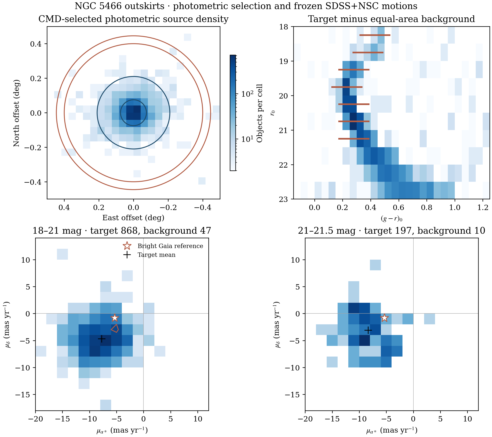
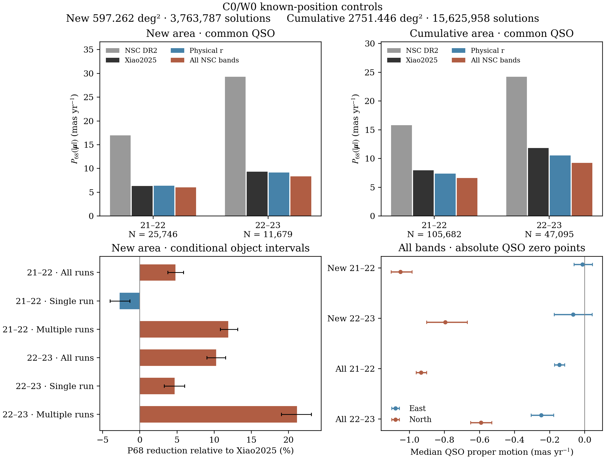

# 实验 A v1.9 · 下一批生产、NGC 5466 与沿扫描残差

以 `a8938ea` 审阅为起点。科学生产继续用经过六核心逐值验证的优化版 C0/W0。SDSS 保留独立物理 run 的 r 位置，NSC 使用全部合格波段。位置和自行统一报告在 ICRS J2015.5，每轴 50 mas 底噪，保留完整 4×4 条件协方差、原检测成员和 48 次同步参考抽样。 [盲目录基线](experiment_A_v1.8_catalogue_quality.md)

## NGC 5466 的科研能力

在冻结目录的 9 核心和 7.908 名义平方度内，用实际 Legacy Surveys DR9 south 的 PSF 光度独立选择。先把 0.025°–0.070° 的内环用于亮度分段 CMD 条带，冻结条带后读取自行。目标环为 0.075°–0.210°，背景环从 0.400° 开始，面积与目标环相同。沿用实际 (g,r) 的信噪比、系统掩膜和银河消光。文献亮端整体自行作为图中的独立位置标记。 [DR9 范围与分支](https://www.legacysurvey.org/dr9/description/) · [NGC 5466 亮端运动](https://people.smp.uq.edu.au/HolgerBaumgardt/globular/newdata/orbits.html)

| 区域及亮度 | PSF 光度源 | CMD 候选 | 有 C0/W0 自行 | 唯一位置对应 Xiao2025 |
|---|---:|---:|---:|---:|
| 目标 18–21 | 1,181 | 988 | 868 | 188 |
| 背景 18–21 | 217 | 47 | 47 | 10 |
| 目标 21–23 | 1,527 | 204 | 197 | 196 |
| 背景 21–23 | 395 | 13 | 10 | 10 |

暗端可用 CMD 条带只延伸到 `r₀ = 21.5`。在目前固定选择内，暗端目标自行数约为等面积背景的 19.7 倍，197 个目标中 196 个与 Xiao2025 有双向唯一的本地区域位置对应。实际暗端新增的证据目前限于一个未对应的光度候选。21.5–23 的光度 CMD 仍显示可能的序列，独立内环模板在登记颜色范围和掩膜下没有足够支持。在深处增加成员需要独立的选择证据。比较核验 Xiao2025 地基目录在 J2015.5 的传播索引 SHA，半径 1″，同时检查该本地区域内正反两侧的唯一性。 [科学统计](../results/summary/v19_ngc5466_summary.json)

图左上蓝、棕两环分别是目标及等面积背景。右上短线是冻结 CMD 条带。下方色块表示目标减背景的自行计数，棕色轮廓是达到计数阈值的背景，星号是亮端独立整体运动，十字是原 C0/W0 目标候选均值。暗端图显示实际被选择的 `21 ≤ r₀ < 21.5` 候选。

目标暗端的逆方差平均自行是 (−8.372, −3.100) mas/yr，亮端为 (−7.748, −4.664)，全部候选 (−7.831, −4.455)。在 196 个严格对应暗端候选上，两目录差的中位为 (−1.910, −2.499) mas/yr，方向为本目录减 Xiao2025。独立亮端簇整体运动约 (−5.336, −0.809) mas/yr。加暗源使条件独立测量方差两轴各下降约 13%，但目标平均值的偏差远大于这一精度尺度。

在相同 196 个暗端候选上，等权平均自行的两轴 C0/W0 为 (−8.27, −3.09) mas/yr，Xiao2025 为 (−6.50, −0.53) mas/yr。Xiao2025 的候选均值更接近独立亮端整体运动。每源报告误差的两轴中位为 C0/W0 4.07／4.76，Xiao2025 4.95／5.35 mas/yr。两种目录的误差定义、共有 SDSS 位置和残余零点影响绝对准确度。按对象配对重权，均值差条件区间为东向 −2.14 至 −1.37、北向 −2.95 至 −2.08 mas/yr。该区间描述固定成员选择下的抽样变化，局部零点另见下段。

半径 1.15° 内 336 个盲光谱 QSO 的两轴中位为 (+0.194,-2.007) mas/yr。5 个 SDSS run 重权给北向区间 −2.53 至 −1.82 mas/yr，24 个 NSC 夜重权为 −2.21 至 −1.91 mas/yr。两类重权记录同一参考域内的敏感性。全部目标的独立测量误差约 0.103／0.120 mas/yr，48 次跨目标同步参考抽样给公共项 0.036／0.046 mas/yr，候选对象重权变化另列。星系参考抽样没有包含局部 QSO 自行零点的全部不确定度。此次报告保留原目标均值和背景分布，暗端收益限于可测性和条件信息量。正式成员数和全局运动仍受零点、拥挤和候选污染制约。

初次 DR9 north 范围返回空目标。按 DR9 的发布覆盖核对后改用实际 DEC 28.5° 的 south 条目。首次按 SDSS ID 对应 Xiao 的空结果也保留在运行记录，随后使用已签名的共同历元位置索引完成对照。分母和 CMD 规则在南条目两次运行中保持一致。

## 沿扫描残差试验

本轮将旧报告的 field-half 定义校订为单个 core × run/camcol 内，按 **FIELD_ID 中位数**划分的两段跨巡天位置残差。该量描述沿扫描的场序号变化。

独立的重复测量试验由 NERSC 61910639 完成。选 `w150_110`、`w020_110` 各四核心。同一星系在两个真实 SDSS r 物理组间做差。训练星系固定原 C0，在各组试一项训练权重均值为零的线性 FIELD_ID 项。两窗相对设计矩阵满秩，条件数约 18.7 和 17.2。星系的重复差分作为一个重权单元。 [试验统计](../results/summary/v19_scan_residual_summary.json)

| 窗口 | 留出星系对 | 原 P68 (mas) | 条件试验 P68 (mas) | 改善 |
|---|---:|---:|---:|---:|
| w150_110 | 3,835 | 164.45 | 162.16 | 1.39% |
| w020_110 | 1,392 | 224.12 | 224.01 | 0.05% |

两窗均低于拟合前登记的 3% 留出位置筛查阈值，位置重权区间重叠。按停止条件结束这项场序号线性修正。QSO 的 30% 零点改善与 5% P68 非劣门槛仍保留给有重复位置证据的候选。原 C0/W0 继续用于主生产。

## 登记与运行经过

已登记八窗、624 个新核心及 597.262 名义平方度。登记前几何机会为 596.023 平方度，整批预测 47.61 CPU 节点小时，包括两个旧参考域的重放。首段 16 核心在 Slurm 61910861 通过取数和参考星系提取，包含 halo 的标准化检测共 10,130,666 条，随后按实际取数吞吐在四节点 61911163 复用回执继续整批。首段八窗均核实与相应旧参考域共享真实训练星系观测组。范围、回执、预测成本与 Slurm 状态见 [生产记录](../docs/running_v19.md)。首段外推作为规划记录保留。新批最终结果见下节，以完成的共同参考、最终归属和科学回执为准。

2026-11-25 核查进度。全部 624 个新核心完成取数与参考提取，共 416,054,468 条含 halo 标准化检测。两套共同参考图及 1,776 个新旧核心拟合已完成，新增核心归属审核前有 3,763,792 个全波段解。首次最终汇总在 90 分钟时限退出。交互恢复 61957238 完成原科学统计回执，后续 61962941 仅补齐盲读出，61963365 完成重放对照；排队候补均已取消。原超时和断点保留。

## 广域批次的完成结果

最终归属核验后，新批保留 597.262 名义平方度、595.694 平方度具备合格共同参考及几何时基机会、3,763,787 个全波段科研解。物理 r 对照为 3,138,318 个解，全波段净增 625,469，增加 19.9%。累计 2,875 核心、2,751.446 名义平方度、2,728.590 平方度参考及时基机会、15,625,958 个全波段解，较当前物理 r 对照净增 3,643,129。 [签名汇总](../results/summary/v19_wide_completion_summary.json)

| 已知位置严格共同 QSO | N | NSC P68 | Xiao2025 P68 | 物理 r P68 | 全波段 P68 | 相对 Xiao 改善 |
|---|---:|---:|---:|---:|---:|---:|
| 新批 21–22 | 25,746 | 16.98 | 6.31 | 6.39 | 6.01 | 4.8% |
| 新批 22–23 | 11,679 | 29.31 | 9.31 | 9.14 | 8.36 | 10.3% |
| 累计 21–22 | 105,682 | 15.79 | 7.94 | 7.37 | 6.64 | 16.4% |
| 累计 22–23 | 47,095 | 24.25 | 11.83 | 10.55 | 9.24 | 21.9% |

图中上排与下排采用各自固定的共同光谱分母。误差条为固定对象的配对或零点抽样区间，空间公共项和相关误差继续单列。

P68 单位为 mas/yr。以上每行采用相同光谱对象和原已知位置控制，保持与最终盲目录的独立统计对应。新批相对 Xiao 的对象配对改善区间为 3.75–5.87% 和 9.02–11.53%，描述固定观测条件下的对象抽样。共享组和空间变化另列。

新区域仍显示观测条件依赖。单 SDSS run 的 12,754 个 21–22 等 QSO，其全波段 P68 比 Xiao2025 高 2.7%；多 run 的 12,992 个源改善 11.9%。22–23 等的 7,277 个单 run 源改善 4.7%，4,402 个多 run 源改善 21.1%。因此，新增区域具有可复现的整体精度和有效源数增量，普通单扫描亮档仍有局部负结果。

新批全波段两档东／北中位零点为 −0.012／−1.051 和 −0.066／−0.795 mas/yr。两轴 1σ 覆盖约 47.2／56.0% 和 47.6／57.1%，低于高斯标称 68.3%。累计两档北向零点为 −0.934 和 −0.592 mas/yr。每轴 0.5 mas/yr 的高精度目标需要进一步的空间与相关误差认证。源级科研解及各项质量标志均保留。

累计三类源为 r_existing 11,944,634、extra_r_anchor 3,551,162、non_r_anchor 130,162。源数及共同 QSO 精度的增量支持继续采用冻结多波段方法开展科研产品分析。新增源的身份、局部零点和形式误差仍应依据实际分区与观测支持选择用途。

## 最终盲科研目录的独立评价

目录和成员冻结后，用光谱 QSO 评价。以下每行只取本目录、Xiao2025 地基和官方 NSC 三者严格共同的源；同源精度表与上一节已知位置控制具有不同选择分母。

| 最终盲目录共同 QSO | N | NSC P68 | Xiao2025 P68 | 本目录 P68 | 相对 Xiao 改善 |
|---|---:|---:|---:|---:|---:|
| 新批 21–22 | 26,578 | 17.45 | 6.20 | 5.97 | 3.7% |
| 新批 22–23 | 4,545 | 24.02 | 8.43 | 7.64 | 9.4% |
| 累计 21–22 | 109,293 | 16.58 | 7.66 | 6.53 | 14.7% |
| 累计 22–23 | 19,884 | 19.02 | 10.39 | 7.86 | 24.3% |

P68 单位 mas/yr。累计两档相对 NSC 的改善为 60.6%／58.7%。按实际 SDSS run 做信息权重敏感度重采样，相对 Xiao 的 95% 区间为 12.4–17.5%／21.1–27.7%；按 NSC 曝光、夜以及去掉各窗的结果均保存在汇总中。这些是当前观测组内的敏感度，不能当作所有空间系统项已被覆盖。 [盲目录统计](../results/summary/v19_blind_quality_summary.json)

累计盲样本两档东／北零点为 −0.162／−0.980 和 −0.220／−0.581 mas/yr；NMAD 为 4.04／4.08 和 4.95／4.85 mas/yr。1σ 覆盖仅为 59.4／63.3% 和 58.2／64.4%。最终盲目录的精度增益成立，形式误差和绝对零点仍有局限，不能将这些科研解统一标成已认证高精度暗恒星。

共同图扩展在旧域保留 49,391 个共同光谱身份，退出 1、进入 2。严格相同的 40,686／6,992 个旧 QSO 上，重放前后 P68 为 6.169789→6.175296 和 8.044597→8.043278 mas/yr。变化很小，第一档略差；共同图扩展的意义是共享物理组参考一致及支持新增面积，不能宣称旧区精度全面提升。 [重放与机会审计](../results/summary/v19_production_replay_quality_summary.json)

## 光谱观测机会与身份统计核验

| 新批光谱位置 | 核心内位置 | 有参考及几何时基机会 | 在机会内被盲目录恢复 | 机会外恢复 |
|---|---:|---:|---:|---:|
| 21–22 | 32,966 | 32,887 | 27,549 | 21 |
| 22–23 | 23,723 | 23,644 | 4,856 | 2 |

机会内恢复数占几何机会约 83.8%／20.5%。分母只描述实际 SDSS 扫描、NSC CCD、可用参考组及登记时间跨度；逐源提取、SNR、形态、关联和拟合的选择仍影响回收。不能将该比例直接当作图像级完备率或暗恒星正确率。机会外的 21／2 个实测恢复保留在独立栏中，说明几何机会标准与最终实测拟合并不完全等价。

最终复核发现，光谱联合表及其 CSV 子表重新读取后，发布坐标浮点末位可能不同；原精确浮点连接仅认出 29,669 个身份。按光谱来源及极小数值容差做双向唯一连接后，32,428 个真实身份全部对应，无歧义、无重复认领、无未对应，修正 2,759 个漏计。最大实际坐标差仅 3.76×10⁻⁷ mas。此修复只影响机会统计的身份连接，全部精度样本、目录输入 SHA 和旧区进入／退出数逐值相同；原读出留在远端。不得把这项软件修复当作新增科研源或方法精度改善。

## 科学判断与未决项

本批在不新增校准自由度的条件下，增加 597.262 平方度和 376.4 万科研解；较物理质量一致的 r 控制净增 62.5 万。新增区盲 QSO 相对 Xiao 的精度收益低于原区，但两档整体均为正。观测条件影响仍明显，普通单 run 的 21–22 等负结果继续保留，不能以累计平均掩盖。

NGC 5466 的星团演示说明：更多暗端测量和较小条件误差不等于更准确的整体运动。局部北向系统差是目前限制之一。沿扫描线性场序项没有取得足够独立位置收益，按停止条件结束。下一轮最有价值的是按冻结基准、真实观测支持及质量标志规划后续广域产品；尚不能将全部面积和解数解释为经认证的暗恒星面积与数量。

原始、逐检测、逐源、星系及私有验证资料继续留在 NERSC 个人 PScratch。公开同步仅包含代码、报告、图和去标识汇总。科研计算版本为 `2fb0e63dcec9b9cc684875789012db5ab9c78daa`；本次统计恢复和身份连接核验另记实现 SHA，不改变已完成目录状态、成员、协方差和自行点估计。

## 计算、复现与公开产物

本批包括失败、超时、取消及最终身份核验在内的已登记分配，按实际 Slurm billing TRES／256 × 运行时长折算为 **33.106 CPU 节点小时**，低于 50 小时总规划。该值是 Slurm 口径估算，未独立核对最终项目账务。PScratch 全用户末次快照约 10.82／20 TiB，约 440.9 万 inode；项目峰值增量没有连续采样，不能用该快照认证峰值。 [资源账本](../results/summary/v19_resource_usage_summary.json)

归属、重复、共享组、ICRS 状态和完整科学回执均已闭合。两次汇总时限和恢复日志保留，最后仅补缺失盲读出；没有重跑已完成取数、参考和恒星拟合。公开统计均经过聚合字段检查、文件 SHA 核验与私人路径扫描。新增身份连接测试与原恢复回归测试通过，按既有单线程数值库设置执行全套 **204 项测试通过**，运行脚本语法检查通过，汇总图已目视检查。图中采用已知位置的共同对象控制，盲目录统计另表报告。

[公开文件允许列表及校验和](../results/summary/v19_completion_publication_summary.json)记录本次五件聚合、统计图及诊断实现的精确版本。
