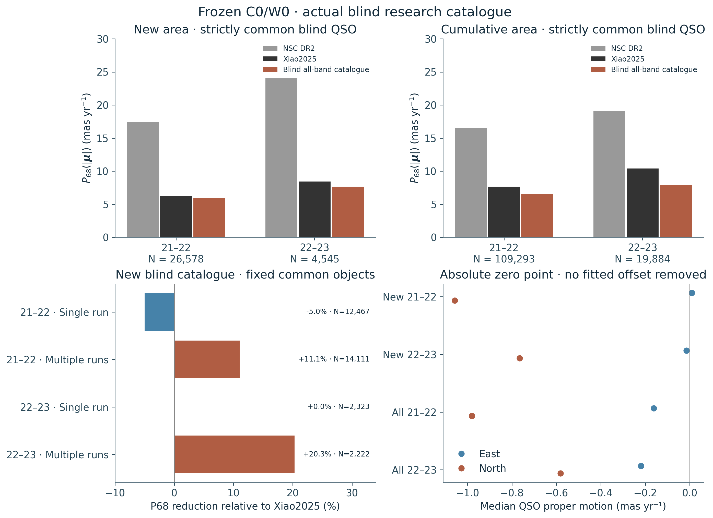
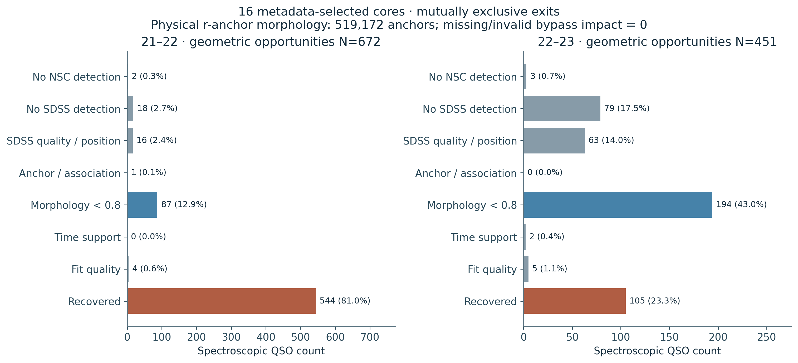
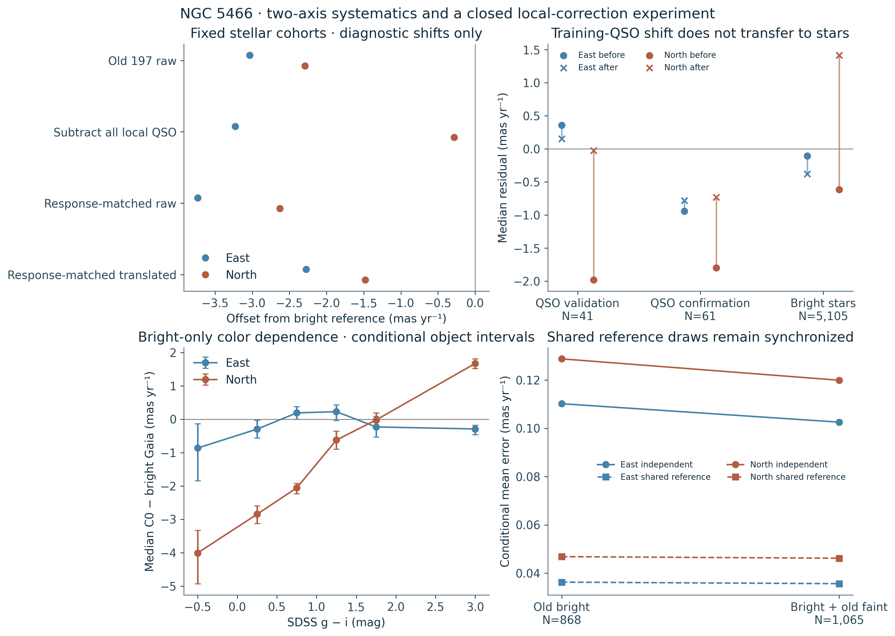
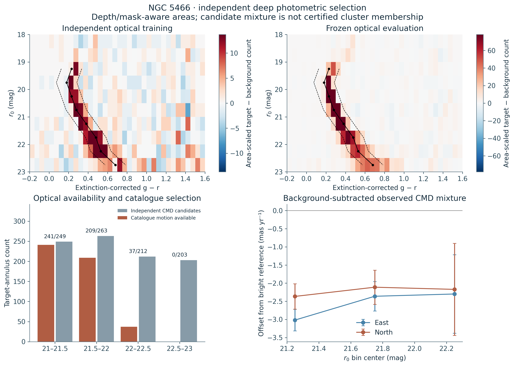
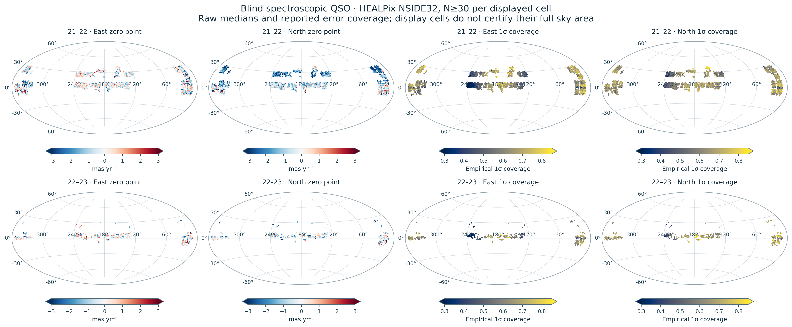

# v2.0：暗端选择、恒星系统差与科研可用性

2026-11-25。基线 `0568500`，科研拟合内核 `2fb0e63`，本轮分支 `experiment-a-v2.0-science-usability`。完整阅读本轮 GPT Pro 审阅及用户任务书后，按 [A–H 预登记](../docs/science_usability_v20.md) 执行。没有扩大天区、覆盖旧生产解或新增天测校准参数。源码、输入 SHA、任务及失败回执分别保存。

**现有目录具有统计研究价值，但暗恒星绝对零点与逐源误差尚不能用 QSO 整体精度替代认证。** 本轮把三个问题分开了：暗端首先大量损失在形态和 SDSS 测量支持；NGC 5466 的恒星系统差不能由局部 QSO 平移可靠解决；QSO 经验误差倍率也没有稳定迁移到不同观测条件。它们都不是继续放大样本数就会自动消失的误差。

原有科研产出保持 **2,751.446 名义平方度、2,728.590 平方度共同参考及时基几何机会、15,625,958 个全波段科研解**。这些是科研拟合数和几何机会，均不是已认证暗恒星数或恒星纯度面积。

## 1. 主比较使用最终盲目录

所有源先盲关联、冻结成员及拟合，再连接独立光谱 QSO。采用严格共同 Xiao2025 地基 `PM_SOURCE=DESI`、NSC DR2、本项目对象，两个光谱星等档分别比较。P68 定义为静止 QSO 的二维绝对自行模第 68 百分位，不减去中位零点。

| 范围／光谱 reference_r | 共同 QSO | 全波段 P68 | Xiao P68 | NSC P68 | 相对 Xiao 改善 |
|---|---:|---:|---:|---:|---:|
| 累计 21–22 | 109,293 | 6.533 | 7.662 | 16.578 | 14.7% |
| 累计 22–23 | 19,884 | 7.863 | 10.389 | 19.022 | 24.3% |
| 新区 21–22 | 26,578 | 5.967 | 6.196 | 17.452 | 3.7% |
| 新区 22–23 | 4,545 | 7.637 | 8.432 | 24.018 | 9.4% |

单位均为 mas/yr；原始精确数和对象／物理组敏感度区间见 [最终盲比较](../results/summary/v19_production_replay_quality_summary.json) 及 [累计盲质量](../results/summary/v19_blind_quality_summary.json)。百分比是 `1−P68_ours/P68_reference`；旧已知位置控制保持独立用途。

新区盲目录单 SDSS run 在两档的改善是 **−5.0%／约 0.0%**，分母分别 12,467／2,323；多 run 为 **+11.1%／+20.3%**，分母 14,111／2,222。过去 −2.7% 属于已知位置控制，不能用来描述此处盲目录。多 run 也不自动等于多个独立年份，仍须查看真实时间。

图1：共同对象上的绝对 P68、单／多 run 收益及未移除的 QSO 两轴零点。上方两图共用纵轴。条形不代表恒星身份或零点已认证；详细区间保留在原统计中。

## 2. 暗端主要在哪一步退出？

先沿用实际 SDSS 扫描、NSC CCD、参考支持和时基的几何机会分母，在原八新窗复现：21–22 为 **27,549/32,887=83.77%**，22–23 为 **4,856/23,644=20.54%**。另有 21／2 个恢复位置位于注册几何机会外，单独记账，不塞进分子。

对应条件95% Wilson区间分别 83.37–84.16%／20.03–21.06%，不含跨对象公共误差。

这些分母代表已发布检测处理中的几何机会，不含图像提取、目标实际 SNR 或全部漏检完备性。历史 object 索引取数的选择也未由此消除。[逐窗分母及身份审计](../results/summary/v19_production_replay_quality_summary.json)

八窗各按输入行数第25／75百分位预选两个核心，合计16核心、7,605,114行规范输入（含halo重叠，不当作唯一天体或独立曝光数），不按自行结果挑区。重新运行原选择与拟合，**91,181 源的物理成员、完整退出计数和共同 QSO 自行逐值一致**，QSO 最大差为零。

| 互斥阶段 | 21–22，几何分母672 | 22–23，几何分母451 |
|---|---:|---:|
| 最终恢复 | 544 | 105 |
| 点源形态 | 87 | 194 |
| 无 SDSS 检测 | 18 | 79 |
| SDSS 质量／位置支持 | 16 | 63 |
| 无 NSC 检测 | 2 | 3 |
| 锚点／关联 | 1 | 0 |
| 时间支持 | 0 | 2 |
| 最终拟合质量 | 4 | 5 |

每列互斥计数之和恰好等于分母。重叠标志另存，不能把多种失败原因重复计数。完整结果见 [16核心退出](../results/summary/v20_selection_summary.json)。

**NaN 语义确实需要审计，但不是这16核心暗端损失的解释。** 原 r 锚点使用 `median(shape)<0.8` 拒绝，NaN 比较为假而可能通过；非 r 使用合法值判断。逐项统计合法、混合缺失、全缺失及范围外后，519,172 个物理 r 锚点中缺失／范围外均为零，原 NaN 绕过在该范围影响为零。不能将这个零外推到全天。原冻结筛选未静默改变。

旧光谱归档的浮点辅助 target 标签不称原生 ID。后续入库已保留字符串原生 ID／原表行号；本轮另存私有 CSV 原行映射，源位置身份仍沿用已核验的唯一极小容差，不按最终自行认定同源。

图2：同一几何分母上的互斥退出与形态实际影响。它显示形态及 SDSS 支持两类瓶颈；只修形态不会恢复无早期位置的目标。

### 唯一选择候选

> 2026-11-26 v2.1补充：以下为v20当时的执行状态，不是已测得恒星纯度失败。全集留年竞争、CCD/depth及外部处理形态已在[v2.1](experiment_A_v2.1_coordinate_consistency.md)补齐；原结果继续保留。

依据上述退出证据，在查看候选自行前登记一次候选：仅对 all-r 锚点允许 `0.6≤合法NSC形态中位数<0.8` 且存在唯一的 SDSS STAR 源。不同真实 SDSS run 先归成源，避免把同一恒星的重复扫描误当竞争近邻；半径500 mas，竞争间隔300 mas。非 r 路径、未知形态语义和原误差／时基门槛不变。光谱潜在池为53／65，不是承诺恢复量。[登记](../results/summary/v20_selection_candidate_registration_summary.json)

实测原91,181组物理成员全部保留，候选总数98,660，增加7,479（8.20%，全星等拟合候选，不是已认证暗星）。冻结源成员后，再以J2015.5位置对**原目录和新增目录共同检查光谱竞争身份**，仅计独立新增QSO；第一次只检查新增集合的诊断回执保留，最终独立核验计数与数值均一致。

| 新增光谱 reference_r | 独立新增QSO | 原始两轴中位 | 两轴NMAD | 二维P68 | 1σ覆盖 |
|---|---:|---|---|---:|---|
|21–22|52|−1.340／+0.407|4.293／4.780|7.308|44.23／50.00%|
|22–23|60|−0.214／−0.623|4.883／6.070|8.496|48.33／58.33%|

单位mas/yr。两轴零点95%对象条件区间分别为21–22的[−3.288,+0.874]／[−1.069,+2.144]，22–23的[−2.140,+1.385]／[−1.805,+2.181]；样本不足以认证亚mas/yr稳定零点。新增对象与原对象不同，不能直接把两者P68之差归因为形态阈值改善。新增QSO计数的分母是候选谱匹配，未混入原几何恢复率，也不把光谱QSO当成普通恒星纯度真值。

末年目标在所有NSC波段进入关联前切除。训练阶段多出7,254候选，2,707个有唯一留出位置重现，条件比例37.32%（Wilson95% 36.21%–38.44%）；四个30／10角秒位移负对照分别[15, 9, 8, 13]。该一对一检查在**新增候选集合内部**执行，未穷尽与全部原训练源的留出竞争；还没有独立CCD／SNR机会分母及扩展源／混叠纯度真值，因此不能当作恒星正确率或完整性。低重现也不能不分曝光机会就全部解释成错配。

**本轮关闭该候选的生产采用，不调第二个阈值。** 保留恢复潜力和全部失败／不确定证据；原C0/W0星表不变。若以后恢复这条路线，先补独立身份、全候选竞争和实际曝光机会，而不是按本批QSO均值重新选源。[完整试验](../results/summary/v20_selection_candidate_summary.json) · [最终身份核验读出](../results/summary/v20_selection_candidate_quality_summary.json)

## 3. NGC 5466：星团暗候选并未获得可信的整体自行

原197对象由原光度模板选定，实际均在 **21≤r0<21.5**，不是覆盖21–23的恒星验证。按原旧图和原成员精确复现均值 **(−8.372,−3.100)**；亮端外部参考为 **(−5.336,−0.809)**，采用[已冻结外部星团表](https://people.smp.uq.edu.au/HolgerBaumgardt/globular/newdata/orbits.html)。东／北差 **(−3.036,−2.291)** mas/yr。196个 Xiao 同源的等权均值分别为本项目 (−8.270,−3.089)、Xiao (−6.501,−0.533)。Xiao 共用 SDSS 输入，这是一致性对照，不是完全独立真值。[固定样本](../results/summary/v20_ngc_motion_summary.json)

局部336 QSO 中位为 **(+0.194,−2.007)**。直接相减后暗候选为 **(−8.566,−1.093)**，北向接近参考，但东向差仍 **−3.230**，因此不能称作共同双轴零点修正。

另核验了最新扩展参考图：同197对象都找到唯一物理对应，197组检测成员全部相同；最新图均值为 **(−8.548,−2.939)**，逐源图变化中位 **(−0.149,+0.205)**，最大绝对变化 **(0.474,0.602)**。这没有解决恒星系统差，也说明原197复现与当前图结果必须分版本列出。[跨图核验](../results/summary/v20_ngc_graph_transfer_summary.json)

### 实际斜率响应，而非只按天空距离扣 QSO

由原稳健权重、真实观测时刻和4参数协方差构建每条位置对标准ICRS两轴斜率的响应，按物理观测组累加：`Δμ_i = Σ_g K_ig Δx_g`。同源保留完整输入与48次同步星系参考抽样；矩阵传播结果与已保存参考协方差逐值核验。公共组先同步合成再计算平均协方差，不能按对象数开平方缩小。

按真实组响应相似度≥0.8、幅度比0.7–1.3、至少8／最多10个训练QSO，试验一次局部预测平移。210个训练QSO不参与验收。身份验证41对象的P68 8.037→7.556；独立确认61对象7.517→7.074，但东向偏差 −0.939→−0.780 未达到已登记30%改善。**确认未通过，且恒星转移失败，关闭该候选。**

在5,105个响应支持充分的可信亮恒星上，同一平移使北向残差 **−0.616→+1.419**，P68 **4.903→5.090**。不能因为QSO北向改善就采用到恒星。原197中只有101个有同条件训练支持；对应平移虽降低两轴偏差，仍残留 (−2.277,−1.479)，不能替代确认失败或补齐其他96个的外推证据。

亮端控制只在位置唯一连接后评价，要求NSC r<21、G<20、两轴Gaia自行误差<0.5、visibility≥9、RUWE<1.4及冻结质量规则。NSC本身采用Gaia参考标定，这不是与Gaia完全独立的天测检验；暗Gaia未参与选择模型或精度排名。

6,471个严格亮Gaia控制的整体残差中位 (−0.094,−0.775)，P68 5.000。按 SDSS g−i 分层，北向从蓝端负偏差到红端正偏差；同星等／单多run层仍存在：例如15≤r<19单run的蓝端 g−i<0.5，N414，中位−2.706；g−i≥2，N569，中位+1.374。亮控制未再用Gaia视差构造新的删样本或拟合模型，未建模视差也可能参与观测条件混杂。它支持继续调查颜色、源类及观测条件的共同影响，尚不能归因于一个DCR系数或直接推广到暗星。[分层证据](../results/summary/v20_ngc_color_condition_summary.json)

固定197的167个可拟合r成员对照，r−全波段中位差 (−0.171,+0.558)，并未消除东向系统差。197个NSC-only的自行散布很大，不是一个高精度独立恒星真值。独立留出星系的早期位置残差经真实K响应预测，暗候选中位 (−1.197,+0.714)，与恒星两轴剩余偏差方向／大小不完全相同，也不支持一个共同平移包办全部误差。

原868亮候选加入197暗候选后，条件独立平均方差两轴降低 **13.37%／13.28%**，对应标准差只降低 **6.93%／6.88%**。同步参考公共标准误约0.036／0.046 mas/yr，未当独立检测缩小；实际数mas/yr系统差远大于这些条件误差。亮候选也含前背景，不能作为认证成员均值。

图3：固定旧暗候选及响应支持子集、未采用平移的独立确认、亮恒星颜色残差、同步公共误差。平移点仅为诊断，不含训练零点估计的不确定度；不能将它们的形式误差解释为校准后精度。颜色图的区间为对象条件区间，不包含未测公共空间模式。

## 4. 真正独立的深端光度分母

用已发布 DR9 south 目录和 maskbits／nexp／PSF depth 图构建空间互斥的训练环、训练背景、目标环、评价背景；模板在读取目标自行前冻结。采用经验序列，不拟合年龄、金属丰度或距离。使用[LS DR9发布文件定义](https://www.legacysurvey.org/dr9/files/)核验maskbits、曝光数和PSF逆方差深度，g/r SNR≥5、PSF与原掩膜；统一像素消光改正深度 g≥23.8、r≥23.2。面积用0.002度网格及区域中位消光计算，逐源颜色仍按各自消光，临界深度面积近似保留。

目标和评价背景实际面积 **0.117891／0.114415 deg²**，不是假定等有效面积。21.5–22、22–22.5、22.5–23训练过量分别55.71、58.71、28.96，均达预登记支持门槛，经验 g−r 中心0.48、0.53、0.68。原模板没有深端对象的问题已经与原目录自行选择分开。

| r0 | 目标CMD候选 | 有冻结自行 | 条件可用比例 | 目标−面积缩放背景的光度过量 | 有自行过量 |
|---|---:|---:|---:|---:|---:|
|21–21.5|249|241|96.79%|231.48|226.57|
|21.5–22|263|209|79.47%|249.60|197.67|
|22–22.5|212|37|17.45%|192.42|34.94|
|22.5–23|203|0|0%|169.00|0|

相应目标条件比例的95% Wilson区间为 241/249：93.79–98.36%、209/263：74.18–83.91%、37/212：12.94–23.13%、0/203：0.00–1.86%；它们是条件二项描述，不包含共同空间／选择误差。

这些是光度混合候选及已发布目录中的条件自行可用率，**没有用最终自行挑成员，也不是恒星正确率**。目标和背景的自行可用率不同，例如22–22.5为17.45%／10.53%，所以背景扣除均值仍有选择限制。前三档背景混合残余东／北约 (−3.02,−2.37)、(−2.36,−2.11)、(−2.30,−2.17)。最后一档不能生成自行均值或精度结论。面积、原分母、背景及匹配数均保留。[光度登记和像素覆盖](../results/summary/v20_ngc_photometry_summary.json)

图4：不使用自行的训练／评价颜色星等过量；新模板及固定条带；光度候选与真实有自行数；保留共同参考项的条件混合均值误差。两张CMD按各自真实过量使用独立colorbar，蓝色为背景过量、红色为目标过量。没有把前景污染或未知成员记成成功恒星。

## 5. 误差覆盖：未得到可采用的普适经验倍率

累计 **133,980 个21–23盲QSO**独立读出；按光谱星等、单／多run、NSC时基4年及物理组杠杆0.8划分16种条件。原误差已经包含条件拟合和48次参考抽样，不能将欠覆盖简单解释为忘了传播参考误差。

| 全部盲QSO | N | 两轴NMAD | 原1σ覆盖 | 减各自中位数后的1σ覆盖 | 原2σ覆盖 |
|---|---:|---|---|---|---|
|21–22|113,063|4.048／4.077|59.18／63.12%|59.19／64.58%|87.07／91.37%|
|22–23|20,917|4.992／4.882|57.55／63.95%|57.59／64.07%|86.30／91.94%|

这里分母是所有最终盲QSO，与图1严格三目录共同对象不同。原误差通常欠覆盖；减掉零点只带来有限变化，不能单靠平均偏移解释。21–22多run的散布低于单run，但1σ东向覆盖反而55.40%对63.20%，说明“随机精度更好”和“报告误差更可信”不是同一结论。

训练仅使用旧天空的固定光谱身份60%，其余20%验证／20%确认，八新窗只作空间转移检验。历史区域已经看过，不能称前瞻未见天空。每层至少60训练、20评价；尺度采用中心化标准化残差绝对中位／0.67449，原状态与协方差不改。门槛在查看本轮效果前固定：1σ距68.27%≤5个百分点、2σ距95.45%≤3个百分点，并须同时通过旧验证、旧确认和新窗迁移。

**16层中没有模型同时通过全部要求；不采用普适倍率，也不把 QSO 倍率称暗恒星误差校准。** v2.1口径细分为4层缺训练支持、12层可训练、5层旧验证及确认通过、新区0/12通过；缺支持不叫科学失败。以相同训练中心作未缩放/缩放比较后结论不变，见[v2.1信息对称对照](../results/summary/v21_scale_symmetry_summary.json)。 高杠杆稀少层保持缺支持，不追调更多参数。[全部参数、区间和失败](../results/summary/v20_quality_calibration_summary.json)

## 6. 交付附加质量产品与用途

原每源4×4条件协方差、独立／参考组成、成员、物理组、波段、夜、图SHA和quality_flags继续保存。新增 [空间与观测质量附表](../results/summary/v20_ancillary_quality_summary.json) 可按J2015.5位置连接，记录两档QSO零点、原始／中心化覆盖、对象条件区间及真实组数，不修改源自行和误差。

| 采样用途层 | 科研解数 | 全目录保留比例 |
|---|---:|---:|
|r锚点、原季节及杠杆标志较充分|11,398,015|72.94%|
|r锚点、少季节或单组≥80%杠杆|4,097,781|26.22%|
|非r锚点|130,162|0.83%|

这是互斥采样分类，**第一类仍不是纯度或暗星绝对零点认证**。未确认成员、形态、共同误差、颜色依赖另看质量字段。附表覆盖1,151个有≥30QSO的“NSIDE32像素×星等档”统计单元，合计895个不同天空像素；14,091,286个全星等源位于至少一个有数据星等层的位置单元；不把它们全叫暗星，更不把整个像素当独立认证面积。采样类别的有源核心外包面积约2742.64／2732.51／2742.26平方度，类别之间重叠，不可相加或等同支持面积。

**可推荐**：观测支持较好层的候选筛查、与外部资料联合的群体统计、明确纳入局部系统误差的相对分析。**需额外验证**：小区域亚mas/yr整体自行、暗星绝对均值、基于形式误差的显著性尾部、非r锚点或竞争身份源、把条件重现率转换成真实恒星正确率。当前没有可给出数值面积的普遍暗恒星系统误差认证，附表以null明确表示缺证据，不编造0.5 mas/yr达标面积。

图5：NSIDE32两档原始两轴零点与1σ误差覆盖。无足够对象的格子留白；展示格子不成为校准参数，色标饱和端的实际值保存在附表。减中位数覆盖和物理组支持另存，不能由增加对象数压缩共同模式。

## 7. 旧区数量变化的真实含义

1,152重放旧核心的全波段数量 **5,509,471→5,509,473（+2）**。其中5,443,123物理成员集完全不变；66,348个旧／66,350个新成员集发生变化，经双向唯一≥60%物理检测重叠、竞争余量≥20个百分点核验，65,996对仍是连续对象。剩352／354没有唯一连续对应，不把它们命名为真实恒星消失／发现。判断不使用拟合自行或NSC object ID。[完整会计](../results/summary/v20_replay_accounting_summary.json)

旧域physical-r净减 **1,305**。192核心计数有变，按绝对数量变化预选8核心贡献净减1,209。8核心规范输入逐值相同；实际逐阶段重放有1,218个参考支持退出、1个标准化残差退出，另有6个参考支持恢复和4个残差质量恢复，净减1,209。主要退出于扩展参考图后的 **m3_support／参考时基支持**。它不是全波段新增信息本身造成的源数差，不能把−1305全部解释成“增加其他波段恢复的暗星”。剩余96个净变化未逐对象做同等因果追踪，保留范围限制。[核心退出证据](../results/summary/v20_replay_accounting_summary.json)

18个成员块均完成后，第一次驱动集中收集完整行超出32GiB；保留失败回执，按断点压缩检测身份及分区连接后，以9.0GiB测得进程峰值恢复，不重拟合原生产源。

## 8. 资源、复现与停止项

40,001个真实共同QSO、800配对draw、5方法／4对比，分块统计与原程序输出 SHA **逐值相等**。耗时 **43.102→26.493秒**（约38.5%降低），测得进程峰值 **3419→1001MiB**（约70.7%降低），签名缓存复用 **0.029秒**。没有减少抽样数、改P68定义或替换对象顺序。[真实性能回执](../results/summary/v20_statistics_performance_summary.json)

末尾生产流程分成参考分区／归属、单节点累计、单节点盲质量三个Slurm依赖阶段；规划闭合资源上限仍为3节点小时。已有旧science作业账本保持恢复语义，不能重复派发新阶段；按真实拟合、图、输入和覆盖SHA复用。61968365已对884核心真实完整分区通过新版只读复用核验，未重新拟合或改写相同输入映射。缓存样本签名与统计实现分开记录。

全部15个实际Slurm任务（包含失败、OOM、完整试验及身份复核）合计估算 **0.04262计费CPU节点小时**，其中性能／分区复用核验 **0.00175小时**，分别低于10／2上限；末次队列为空。按实测AllocTRES billing／256×elapsed_hours折算，最终以NERSC Iris结算为准，不把请求上限当实际消耗。[逐任务账本](../results/summary/v20_resource_summary.json) · [NERSC计费规则](https://docs.nersc.gov/jobs/policy/)

本任务PScratch增量快照 **2.370GiB／1,701文件**（任务根目录），不等于用户总配额或全过程存储峰值。逐step MaxRSS及程序测得峰值分别保留，不将单进程峰值冒充同时总内存。统计首次启动目录错误、会计集中返回OOM以及两次QSO身份读出均计入消耗；断点复用避免重复生产拟合。资源收集只调用Slurm和有限任务目录元数据，没有在登录节点做科学拟合。

219项测试在单线程数值库环境通过；初次未限制本机原生线程的整套运行在scikit-learn邻域内核段错误，保留记录后以OMP／BLAS／VECLIB单线程实际重跑通过，不称第一次成功。脚本语法、定向测试、五图目视、公开聚合和同步校验另核。

本轮明确停止：唯一局部QSO平移；普适QSO误差倍率；未认证的形态放宽采用；原FIELD_ID修正；新增DCR／高阶CCD模型、全量PSF或高自行专项。本轮没有扩区，也没有将候选目录改写为正式发布产品。

## 9. 下一步的科学优先级

当前最有价值的不是继续局部阈值搜索。已确定的多波段精度收益值得保留，但普通单run的收益、暗星零点和选择完整度必须分别表达。

1. 下一批若经用户决定扩区，按真实独立SDSS年份、NSC长时基／夜／季、参考图连通预选；优先验证已有多run收益能否迁移，同时保留普通单run作为明确对照。不要根据新QSO表现回选有利天区。
2. 暗星真正应用首先需要独立颜色／成员控制与位置机会分母。NGC的深端光度可用率骤降已直接暴露问题，应先解决具体缺失／身份支持，而非将高位置重现率算作认证恒星。
3. 亮恒星颜色信号和QSO到恒星转移失败提供了后续有界误差来源检验的依据；目前不能区分残余源类质心、SDSS颜色依赖和时间／空间混杂，不直接进入新校准或图像重测。
4. 若科学用途依赖群体平均，须同时保留观测组协方差、局部零点和独立误差。两轴几mas/yr偏差存在时，数百源形式均值很精确不等于测量准确。

这一轮得到的判断是：**目录级多历元路线有可重复的QSO精度与源数增量；能否形成可信暗恒星产品，取决于选择支持、恒星特有系统差和误差迁移证据。现有数据已能定位这些限制，但不能普遍认证它们已经解决。**

## 10. 公开与私有材料

公开交付包括本报告、五图、去标识聚合、源码、预登记、[运行记录](../docs/running_v20.md)、根目录PROJECT_CONTEXT／PLAN／WORKLOG。原始检测、全部逐源、星系参考和验证缓存仍在NERSC个人PScratch，未同步本地／GitHub。以允许列表传输并核SHA；公开聚合不含目标身份、逐源坐标、令牌或个人绝对路径。

主要实现入口：`usability_selection`、`usability_candidate`／`usability_candidate_readout`、`cluster_photometry`、`cluster_motion`／`usability_cluster`、`usability_quality`／`usability_ancillary`、`usability_accounting_merge`、`usability_benchmark`、`usability_figures`。运行参数和Slurm任务在阶段回执中保存。
