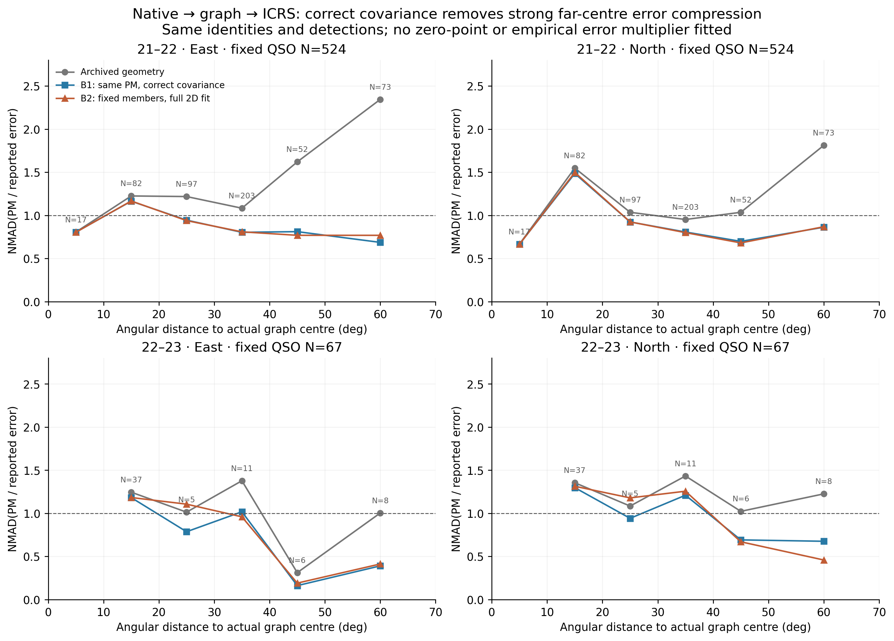
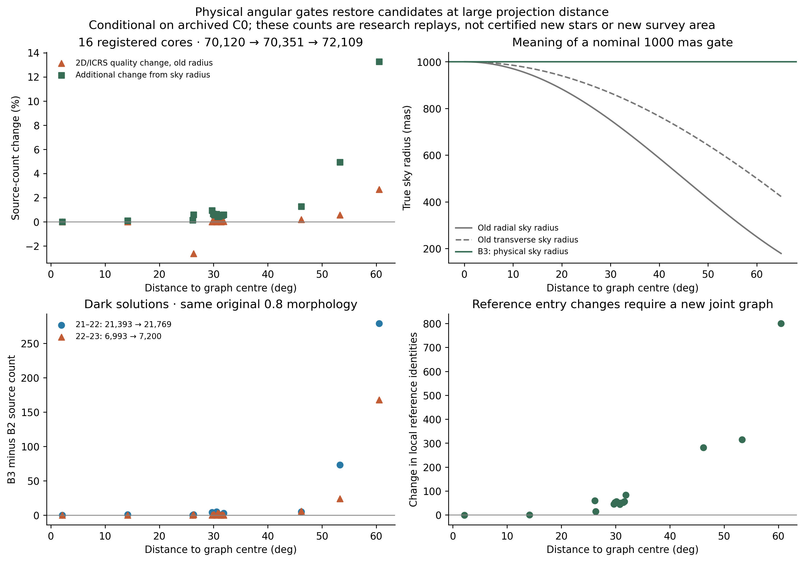
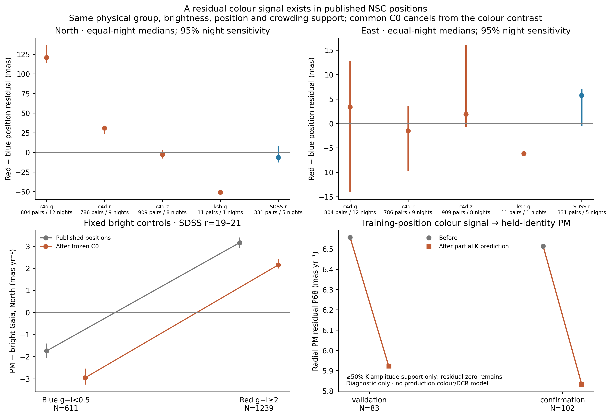
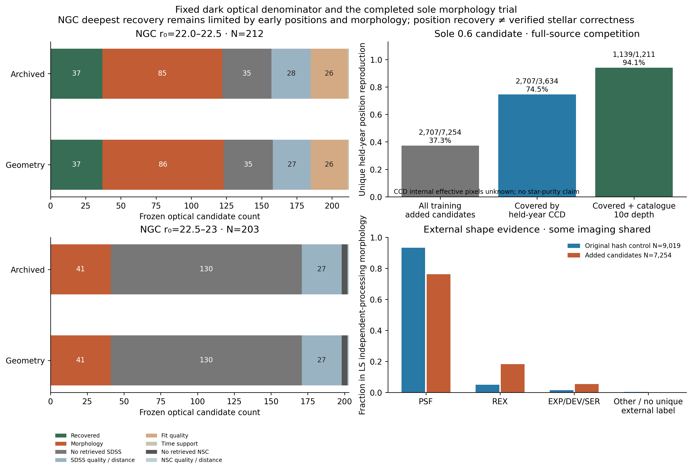

# v2.1：广域坐标一致性及其对暗源自行的影响

2026-11-26。固定科学基线 `6faabde4fe6205675d9ed2e02c631e7f2e350965`；分支 `experiment-a-v2.1-coordinate-consistency`。按最新 GPT Pro 审阅与用户任务书完成 A–F。原 2,751.446 平方度、15,625,958 个科研解及旧参考图只读保留；本轮是现有缓存上的数学、选择和恒星系统差研究，没有新增生产面积。

## 1. 本轮得到的判断

**需要修复广域坐标度量，然后对现有参考分量安排一次完整更新。** 近、中、远图心的同一物理误差必须先前向传播，旧图中的固定半径也不能等同实际天球半径。该问题可以解释相当一部分空间误差尺度变化；它没有消除恒星颜色残差，也没有恢复 NGC 最暗档缺少早期位置的对象。

- 16 个按几何/元数据选定的核心，5,020,798 条含 halo 输入，70,120 个固定源；不是新的代表性全巡天样本。固定光谱身份 1,060 个，其中 21–22 等 524、22–23 等 67。初始 owner 数代理 70,119 与实际 origin-core 文件 70,120 相差一条边界记录，不能把本轮计数直接当最终全域 owner 星表。
- 固定自行和成员，仅修协方差：21–22 等两轴 1σ 覆盖由 54.6%/60.1% 到 71.6%/70.4%；自行 P68 完全不变。修复的主要收益是误差解释，不是凭空增加位置精度。
- 固定成员二维拟合的 P68 为 6.172/6.100 mas/yr，旧值 6.283/6.397。个别分量 NMAD、异常尾仍不改善；不把小样本点值变化宣布为广域统一精度增益。
- 原 0.8 形态规则下，旧源数 70,120 → 二维权重/统一 ICRS 质量 70,351 → 实际球面半径 72,109。球面新增部分集中在远图心，数量是条件科研解，不是新认证恒星。
- NSC 同物理观测组的红蓝位置差在 C0 前后严格相同；DECam g 北向约 124 mas，r 约 31 mas，z 约 −6 mas。年周视差及 C0 常量不能解释全部恒星颜色信号。
- 唯一 0.6 候选的全集留年竞争已补齐；深度支持子集有高位置重现，但非 PSF 形态及真实身份/有效像素支持仍限制采用。本轮不采用整个放宽样本、不搜索第二阈值。

## 2. 实际图心、单位与参考系

完整调用路径、实际星系入口与门槛见[方法审计](../docs/coordinate_units_v21.md)。读取的是真实 NPZ header，不是窗口名推断。

| 参考域 | 实际图心 RA/Dec（度） | 核心 | 保留物理组 |
|---|---|---:|---:|
| v19_w130_110 | 176.0568398 / 30.7674952 | 884 | 7,366 |
| v19_w150_090 | 177.0000000 / 0.0000000 | 892 | 20,892 |
| next_w010_100 | 0.2065738 / 8.0586682 | 1,099 | 20,760 |

近/中/远先导为 2.12°、26.32°、60.51°。16 核含 9 个 NGC 缓存核心，其他核心补足第三参考域和角距；选择时未读取新自行表现。图 SHA、分量和全域角距聚合见[登记](../results/summary/v21_coordinate_registration_summary.json)。

输入 SDSS 每个物理 run 仅采用发布 r 位置，真实 TAI_r 转 TT；NSC 保留全部合格单曝光波段，UTC 转 TT。50 mas 底噪定义于原生局部东/北，与 native 协方差一起用 A C Aᵀ 前向变换，不重复加底噪或乘 cos(dec)。输出仍为 J2015.5 标准 ICRS 四参数与完整 4×4 协方差。

参考系的 gauge 不是某一序列化曝光的零点：源码先按每个连通分量减 NSC 组 point 中位数；bootstrap 每组减自身 draw 均值，再减逐 draw 的 NSC 组中位公共模式。操作在旧 12 图平面 mas 参考 SE 选择之前。单零组探针找到零个并不表示缺少 gauge，该探针被更正；[实际 gauge 审计](../results/summary/v21_gauge_definition_summary.json)记录可取得的筛选前/后组集合与限制。旧 12mas 门槛不能被描述为全天相同的 ICRS 角误差支持，本轮不暗中改变旧图支持组。三个原图均未保存unfiltered NPZ，因此当前登记的NSC集合是SE筛选后的诊断集合；原始归一化组集合须从已签名参考输入重新构建，不能把筛选后中位数强制再置零。

参考组是 SDSS run/camcol 与 NSC exposure；HEALPix NSIDE=128 为组织和诊断单位。实际参考入口、最低 10 独立星系/组与固定约 30% 留出详见方法审计；不是将 Xiao2025 的每像素 800 星系标准机械移植到每次曝光。目标恒星不会因为有 Gaia 标签而从盲样本删除。

## 3. 三组几何对照及数学验收

### B1：点估计、成员、IRLS、H 和旧 C0 draw 全部冻结

独立误差分两种声明：估计器降权时 H C Hᵀ；把稳健降权视作方差膨胀时 H(C/w)Hᵀ。主 W0 对照采用后者，同时单列 sandwich。旧 draw 已是图平面位移，直接通过旧 H/J，不再前向投影；旧公共协方差数值保持。

| 先导角距 | 总误差比（新/旧，东/北，中位） |
|---|---|
| 2.12° | 1.0014 / 1.0007 |
| 26.32° | 1.2399 / 1.1189 |
| 60.51° | 4.1157 / 2.0293 |

这不是误差模型被调到 QSO 表现上，而是相同估计器的确定性协方差传播。图心远处原误差被明显压缩；部分角距/小样本层修正后偏保守，50mas 底噪仍冻结。

### B2：成员固定，源采用完整二维 GLS/Mahalanobis

保持原 min(1,6/(4+d²)) 稳健损失及八次源迭代。只改变源权重/度量，旧 C0、物理组和 gauge 不变；参考权重另做有界试验。固定对象不因新质量失败而从这张比较表删除。P68 为相对零自行的二维模第68百分位，NMAD、偏差、自行单位均为 mas/yr。

| 光谱 r | 方法 | N | 两轴中位零点 | 两轴 NMAD | 二维 P68 | 原始 1σ覆盖（东/北） |
|---|---|---:|---|---|---:|---|
|21–22|old|524|-0.527 / -1.560|3.942 / 3.951|6.283|54.58% / 60.11%|
|21–22|B1|524|-0.527 / -1.560|3.942 / 3.951|6.283|71.56% / 70.42%|
|21–22|B1_sandwich|524|-0.527 / -1.560|3.942 / 3.951|6.283|71.37% / 69.66%|
|21–22|B2|524|-0.588 / -1.506|3.861 / 3.746|6.172|71.18% / 70.23%|
|22–23|old|67|-0.299 / -0.674|3.319 / 3.738|6.397|56.72% / 53.73%|
|22–23|B1|67|-0.299 / -0.674|3.319 / 3.738|6.397|65.67% / 61.19%|
|22–23|B1_sandwich|67|-0.299 / -0.674|3.319 / 3.738|6.397|65.67% / 61.19%|
|22–23|B2|67|-0.483 / -0.328|3.637 / 3.660|6.100|65.67% / 61.19%|

例如 21–22 等 B1 的覆盖为东 375/524、北 369/524，Wilson95% 为 67.6–75.3% / 66.4–74.2%；旧值为 286/524、315/524。22–23 等 B1 为 44/67、41/67，区间 53.7–75.9% / 49.2–72.0%，支持明显较弱。完整 1σ/2σ、原始/评价集中心化/训练中心化统计及对象条件区间均在[固定同源科学汇总](../results/summary/v21_scientific_comparison_summary.json)。中心化仅为误差诊断，没有给目录减去 QSO 零点。

负结果保留：21–22 等 >10mas/yr 径向尾比例由 11.45% 到 11.83%；22–23 等东向 NMAD 从 3.319 到 3.637。两档 SDSS run 重权的 P68 敏感区间宽且相交，不能仅凭总体 P68 下降判断每种条件都获益。69/58 个物理 SDSS run 的重权敏感度与对象 bootstrap 分开，不冒称覆盖全部 NSC 公共相关误差。共同参考误差先在同图同步合成再求均值协方差，不能按对象数当独立噪声压小。

在原盲目录固定身份上，Xiao/NSC/B2 严格共同源数为 495/65；旧/B2/Xiao/NSC 的 P68 分别为 6.269/6.161/6.769/26.735 与 6.268/6.068/7.663/26.832。Xiao 对照沿用 PM_SOURCE=DESI 地基条目。这是几何预选小样本的对照，不替代原广域 109,293/19,884 共同对象的冻结科学结果。

### B3：原形态不变，使用实际天球角距离

B2_selected 已采用相同的二维权重、Mahalanobis 残差及统一 ICRS 每轴误差≤10mas/yr。B3 再将关联、光谱身份和参考入口半径变为实际角距离：源1″、光谱0.5″/0.3″竞争余量；参考匹配500mas、隔离1200mas、Gaia/光谱排除1500mas。源权重/质量改变与球面门槛收益不合并归因。

固定成员中B1有123个、B2有117个超过10mas/yr原生ICRS每轴误差门槛，B2无Mahalanobis P68>3；这些对象仍保留在固定比较中。[质量退出分解](../results/summary/v21_quality_gate_summary.json)另存重新关联后的锚点分母。

16核科研候选 70,120→70,351→72,109；相对 B2 的球面增量为 1,758。NSC r优先定义的21–22等为21,393→21,769，22–23等6,993→7,200；无NSCr时采用SDSSr并保留来源标签。60.5°核心8,460→8,687→9,838；近图心核心2,934不变。物理成员变化与新/失去的成员集合已逐核保存。

所有16核均通过核内输出检测一对一、4×4有限/对称/正定、J2015.5及输出位置在当前核心的检查。本轮是来源核心重放，不是完整跨核心owner合并；全局冲突与跨块转移须在完整更新时再执行。实际半径会改变锚点/竞争成员，因此并非所有旧成员集合都保留；同源性能与新候选身份分开。新增/丢失检测边、原参考入口与球面入口的成员数量见[关联汇总](../results/summary/v21_association_summary.json)；halo 内参考数量相加不是全域唯一星系数。B3 仍条件于旧 C0，尚未用变化后的参考成员全局重解。

图1：相同光谱身份及检测的标准化残差尺度，两轴和两档分面；少于5个的角距层不画。N很小的暗端层不认证误差尺度。

图2：权重/质量与球面半径的源数变化分列；物理半径示意为确定性投影几何，不是模拟恢复曲线；暗端源数与参考入口变化来自真实数据。

### 数学一致性与模型曲率

232项完整测试通过（其中13项针对坐标/边界/相关误差/固定边界/CCD机会/外部文件名）。解析前向/逆向Jacobian、10mas有限差分、RA=0、高赤纬、完整相关协方差、退化回旧GLS、同步公共模式均检查。前向有限差分相对差约 0.7–4.0×10⁻⁹，低于1e-5；同一物理状态重表达达到1e-3mas/yr与协方差1e-3相对容差。

另将不同平面分别近似成直线：普通30mas/yr、约21yr采样的差异最高约9.2e-5mas/yr；2000mas/yr压力样例约0.41，10000mas/yr约10.2。这属于不同线性化模型的曲率，不是同一模型坐标重表达失败，也不构成本轮高自行认证。[数值记录](../results/summary/v21_mathematical_acceptance_summary.json)

## 4. 参考权重修复：边界试验与完整更新分开

三个先导各取固定训练/留出星系及最多6自由物理组，其余旧 C0 offset为固定外部边界。每颗训练参考须同时连接自由和固定组；身份哈希最多选1200参考。对角/完整2D使用同边界、同组、同损失、六次稳健更新加最终求解和48个配对参考对象指数draw。不是逐核另定NSC零点，也不是三个完整连通参考分量的新解。

留出星系的边界相对位置径向P68，近/中/远由66.986/74.669/57.604mas到66.983/74.692/57.877mas，未显示统一精度增益。固定二维源权重下，单独传播两个有界参考解的差，21–22等QSO运动变化径向P68约0.0017/0.0095/0.0686mas/yr（N=17/21/39）。它们是同一边界下参考权重的局部影响，不能将有界对照相对于原全图的变化都归为几何收益。

有界draw误差条件于外部边界。没有把它与旧global draw当独立项相加，没有按相同draw编号伪造两个解之间的全球联合协方差。组SE已在实际星系中位位置转回原生东/北供诊断，未在旧图中悄悄重做12mas选择。[配对有界参考与QSO响应](../results/summary/v21_bounded_reference_timed_summary.json)

## 5. 恒星剩余偏差来自哪里

原6,471亮Gaia控制全部保留，另复用冻结NGC光度对象。固定成员、二维几何稳健权重后，比较原位置斜率和C0后斜率；Δμ=−ΣKZ与直接结果最大差1.72e-7mas/yr。

实际逐检测TT历元转TCB，与Gaia ref_epoch对应；补取全部五参数误差及十相关系数，采用地球质心观测者年周视差和空间直线运动。6,471均有完整五参位置协方差；630个负测量视差按0物理近似、6,406缺RV按0显式标记。未传播RV误差和地表观测者项；没有重复加岁差、光行差或发布WCS已有的大气修正。Gaia只用于亮端验证，暗NSCr≥21自行仍不参与模型验收。NSC发布天测曾使用Gaia参考标定，因此这是目标Gaia运动未输入关联算法的检验，不是完全独立于Gaia参考系的验证。

19–21 SDSS r控制中，蓝/红北向原位置残差为−1.742/+3.157，C0后−2.954/+2.150mas/yr（N611/1239）。C0分别贡献约−1.15/−0.87mas/yr，颜色差原本已存在；年周视差斜率中位约−0.001/−0.029，无法解释数mas/yr差。这里使用SDSS原生r分档与全部固定亮控制，不与v20的NSCr/单run分母混同。

组内对照要求同SDSS run/camcol/field或同NSC exposure/CCD/band、距离≤0.05°、r差≤0.5mag、邻居≥2″且拥挤度比≤2。用同一物理组公共局部基，不让投影旋转伪造颜色差；C0前后红蓝差抵消到1.2e-13mas内。

| 仪器/波段 | 红蓝对 | UTC夜 | 北向红减蓝中位位置（mas） |
|---|---:|---:|---:|
| DECam g |804|12|+123.56|
| DECam r |786|9|+30.78|
| DECam z |909|8|−5.62|
| Bok/90Prime g |11|1|−50.70（不足迁移）|
| SDSS r |331|5|−1.26|

按UTC夜而非检测数重采样，DECam g北向等夜中位的95%敏感区间为113.9–136.5mas，r为23.4–33.5，z为−7.8–+2.9。不同波段/仪器的分母不同，这里是位置机制诊断，不按不同QSO样本给波段排名。空气质量、年份和仪器分层与所有计数见[组/夜汇总](../results/summary/v21_stellar_group_summary.json)。

原生SDSS r−i与冻结g−i在6,470/6,471亮星上合法，秩相关约0.990；相同红蓝位置对换成r−i标度后信号仍存在。它们高度相关，不能由此认定两个独立颜色项。g/i光度误差缓存不齐，此处不是含颜色测量误差的生产系数标定。[颜色坐标检查](../results/summary/v21_stellar_color_coordinates_summary.json)

训练身份独立的95个观测组有≥3匹配红蓝对。位置颜色差经真实K传播，在≥50%K幅度获得支持的验证83/确认102亮星上，P68由6.557/6.513到诊断性5.922/5.832。但两轴零点仍显著、支持只覆盖少数固定控制，不应用到生产。只有气团信息、缺真实天顶方向时，不能把残余颜色信号直接命名为DCR。[独立身份K预测](../results/summary/v21_stellar_attribution_summary.json)

NGC亮端光度候选与场星另做同色、同星等、相同SDSS校准组/相近NSC波段和时基、拥挤匹配，得到102对。减各自Gaia自行及预测视差斜率后，目标减场星东向中位−1.71（对象条件95%−2.62至−1.07），北向−0.12；其C0响应差仅约+0.01/+0.02。东向剩余不是单一C0平移能解释的；亮端配对仍不能外推到无可靠Gaia的暗候选，也不认证星团成员。

**下一物理候选只选一个：**NSC DECam g剩余颜色位置项；先取得真实气团/天顶方向和既有WCS色差定义，再检验一个几何约束的残余DCR项。用恒星训练位置、不同夜及固定QSO/留出星系共同验证，不能把星系颜色系数直接转给恒星。现有结果还不足以冻结这一修正；本轮没有调生产颜色/DCR。v1.4–v1.6经验g颜色、DCR和学习误差的负结果保留，当前诊断不等于旧模型重新通过验证。原近邻QSO平移仍关闭，主要实测依据是5,105亮星转移后P68变差与北向零点反向。

图3：同组位置颜色差的夜敏感度、原位置/C0后的固定亮控制、独立身份K预测。无CI的一夜Bok样本不作迁移证据；坐标正确不等于恒星系统差已经消除。

## 6. 唯一形态候选：完成了什么，仍缺什么

保持旧几何、旧C0/W0和唯一0.6阈值。全部90,255原训练源与7,254新增训练源共同预测末年位置，逐曝光全源一对一匹配；新源2,707重现，原/新增均未因完整竞争丢失原有重现。四位移负对照[15,9,8,13]。这补齐了v20尚未执行的竞争部分，不把此前缺验证追溯写成纯度实测失败。

| 新增训练分母 | N | 唯一末年位置重现 | 条件比例 |
|---|---:|---:|---:|
| 全部新增训练 |7,254|2,707|37.32%（36.21–38.44%）|
| 实际留出CCD多边形覆盖 |3,634|2,707|74.49%（73.05–75.88%）|
| 覆盖且同波段目录10σ深度支持 |1,211|1,139|94.05%（92.58–95.25%）|

括号为条件Wilson95%二项区间，不含共同观测/空间选择误差；完整[比例与分母](../results/summary/v21_conditional_proportions_summary.json)。

独立几何机会来自原缓冲chip元数据查询，不以目标有检测才算曝光；按实际CCD四角、时间、band、参考支持及训练同波段亮度核验。depth95是目录星等百分位，不是95%完备性；depth10sig为目录10σ深度。5σ换算仅背景受限代理。384个新增训练源至少存在波段亮度/深度不明机会，与其他机会标志可重叠。内部有效像素/坏像素掩膜仍不齐；因此94%是条件位置重现，不是恒星正确率或图像提取完备性。

LS DR9独立处理形态在新增训练中为5,524 PSF、1,327 REX、399 EXP/DEV/SER、4无唯一位置；原训练身份SHA预选的9,019对照为8,413 PSF。整体PSF比例分别76.15%（Wilson95%75.16–77.12%）与93.28%（92.75–93.78%），仅是外部处理形态比例。21–22等新增973/1,487为PSF，22–23为4,294/5,433；原对照相应2,250/2,535与965/1,125。源类构成有实测差异；LS部分与NSC共用底片，REX等也不是已校准的“误匹配恒星”真值，不把非PSF率直接当污染率。SDSS STAR用于选择，不能再当独立验证。

在新增训练中，2,076个同时有LS PSF与唯一留出重现，826个还满足目录10σ机会；仅是更有支持的科研候选，不是826颗认证新恒星。掩膜/混叠代理及原对照均按相同逻辑记录：[身份/机会联合审计](../results/summary/v21_candidate_identity_summary.json)。

全历元7,479与训练7,254不是同一分母。物理成员连接表明6,687个全历元新增连到唯一新增训练、63连到原训练、729没有共享训练检测；2,203个全历元新增通过明确连接获得留出位置证据。不能将2,707/7,254套到7,479。完整全历元共同竞争仍保留原QSO545/105并增加52/60，原标签损失0；同源点估计没有改变。[成员连续性](../results/summary/v21_candidate_continuity_summary.json)

**结论：**位置恢复潜力通过了完整竞争与目录机会检验；整批放宽为恒星目录仍缺有效像素与独立恒星身份校准，并已有明显非PSF构成及混叠代理负证据。支持有限，不采用整批、不再搜阈值；保留已知QSO及有PSF/留年/机会支持子集供后续独立验证。新增生产采用为0。

执行失败也保留：最初LS形态全未匹配是文件名p025被误当+2.5°，实际为+25°。修复与合成FITS回归后重新核查；`v21_candidate_completion_summary`的竞争/CCD部分有效，但其旧external_morphology字段无效，必须使用[修复形态](../results/summary/v21_candidate_morphology_summary.json)及身份联合审计。没有把这次实现失败解释成外部数据不存在。

## 7. NGC 415个暗端对象：几何能解决多少

沿用独立深端CMD/掩膜/深度光度分母，22–22.5的212、22.5–23的203个不按新自行重选；它们是混合光度候选，不是认证星团成员。退出互斥计数如下，括号为几何版不同值：

| 原因 | r₀22–22.5 | r₀22.5–23 |
|---|---:|---:|
| 恢复 |37（37）|0（0）|
| 形态 |85（86）|41（41）|
| 缓存中无1″内SDSS发布检测 |35|130|
| SDSS质量/距离 |28（27）|27|
| 拟合质量 |26|0|
| 时基 |1|0|
| 缓存中无NSC发布检测 |0|4|
| NSC质量/距离 |0|1|

各列精确闭合212/203；37/212的条件Wilson95%为12.94–23.13%。0/203的条件二项95%上限约1.86%，不称严格零完备性。两档都有NSC几何足迹机会，10σ目录深度支持分别43/1；缺少独立波段亮度等信息时机会保持未知。原/几何前后恢复数完全相同，说明本区深端主要不能靠这次半径修正恢复。这里“无检测”严格限于冻结已取回缓存、约1″普通运动位置范围；不是宣称扫描图像内完全不存在源，也未取得全部Stripe82专用归档。

若后续要增加这一暗端恒星群体，先核对缺失SDSS对象的真实field足迹/归档及早期信噪，再考虑有界图像位置重测；本轮没有做PSF重测。

图4：固定NGC光度分母、原/几何互斥退出；唯一候选在不同实际机会分母上的条件重现；原哈希对照和新增源的外部处理形态。所有分母与源类保持各自含义。

## 8. v20误差倍率的口径及本轮公平对照

原16层应拆为：**4层缺训练支持（N=2/4/6/22）、12层可训练、5层同时通过旧区验证与确认、新区0/12迁移通过**。不能把4层训练不足叫科学失败。旧“改善”判据把评价集自行估计中心与训练中心+尺度放在一起比较。

本轮复用冻结133,980盲QSO与原16参数，不重训；未缩放与缩放两侧都减相同训练中心，再比较覆盖和尾部。公平口径下仍为旧区5层通过、新区0/12。几何影响尚未对全域重新生成这些16层误差，不能宣布几何已经让倍率迁移成功。原协方差不乘新经验倍率，不认证暗恒星误差。[信息对称检查](../results/summary/v21_scale_symmetry_summary.json)

## 9. 资源、可重复性与下一次完整更新

本轮14个分配含1失败，实际折算 **0.02773872计费CPU节点小时**，预算5；候选含共享后处理上界0.01082，目标≤1。全部真实计算用Slurm；原生数值库单线程，核心级并行、输入一次读取、成员/矩阵缓存和签名续跑。代码/阶段/实际MaxRSS及计费用量见[资源与完整更新预算](../docs/running_v21.md)和[总账](../results/summary/v21_resource_usage_summary.json)。本地只接收代码、本文、公开聚合和四张图，逐源/逐检测/Gaia/星系/私有验证数据全部留在个人PScratch。

已核验的三个全图有39,431,136 / 106,402,352 / 119,550,955条唯一参考测量；原最大参考RSS约349GiB。小有界二维矩阵不能直接照搬到一亿行全图。完整更新要采用紧凑数值缓存/分块或矩阵自由的等价消元，保持同一数学模型、全分量gauge及48同步draw，先做真实内存和迭代预算。

实测源/关联外推与完整参考重解的规划预算必须分开。已有输入/原始下载可复用；三个参考图均受度量影响，不能把某些近中心核心的局部通过当全图可直接复用。下一完整更新规划约22–46计费CPU节点小时、建议48小时封顶预算，属于历史全图成本与本轮小试验的条件外推，不是已经实测或获分配的费用。详见公式与不确定度；本轮未擅自启动该重算。

## 10. 明确的后续决定

1. 在现有覆盖上一次性实现/验证全参考分量的坐标一致更新，再统一重关联和ICRS质量；保留旧版作为对照，不扩区。原生角单位的参考SE支持与旧图平面SE分列登记，不能悄悄更换基准。
2. 恒星剩余机制只推进已定位的DECam g颜色位置项及真实观测几何取证；新的生产DCR/颜色模型另版预登记，不复活旧QSO平移或普适误差倍率。
3. 唯一0.6形态路线停止整批恒星采用与继续阈值搜索；保存条件支持子集、外部非PSF/混叠证据和未验证全历元源。
4. NGC深端的早期位置及身份瓶颈另行登记小区资料核验。没有证据支持现在做全量图像PSF、全覆盖扩区或高自行专项。

本轮的科学增量是确定了一个可修复的度量问题，并把它与恒星特有位置偏差、暗端位置机会和源类混合分开。旧多历元精度收益保留；现有形式误差和新增源数的科学用途必须使用上述条件与质量限制。
