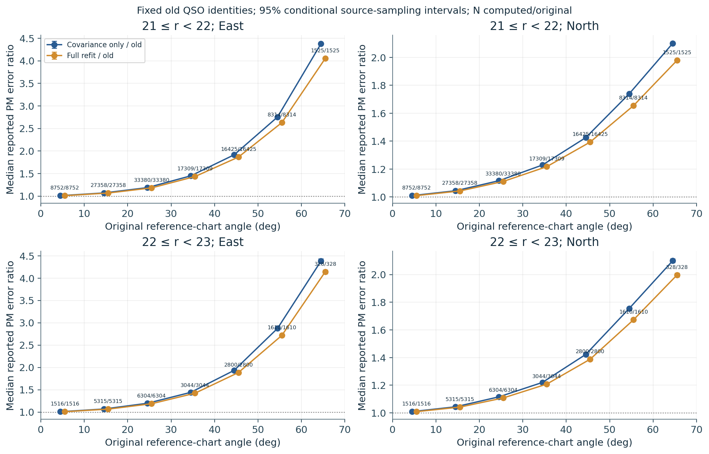
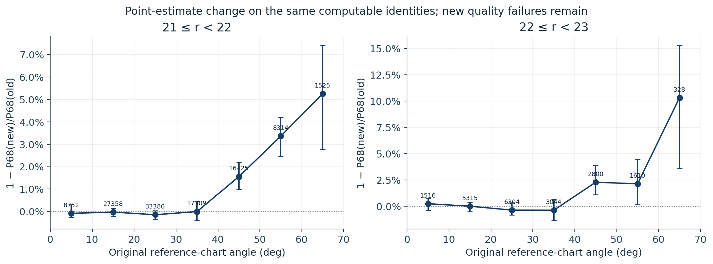
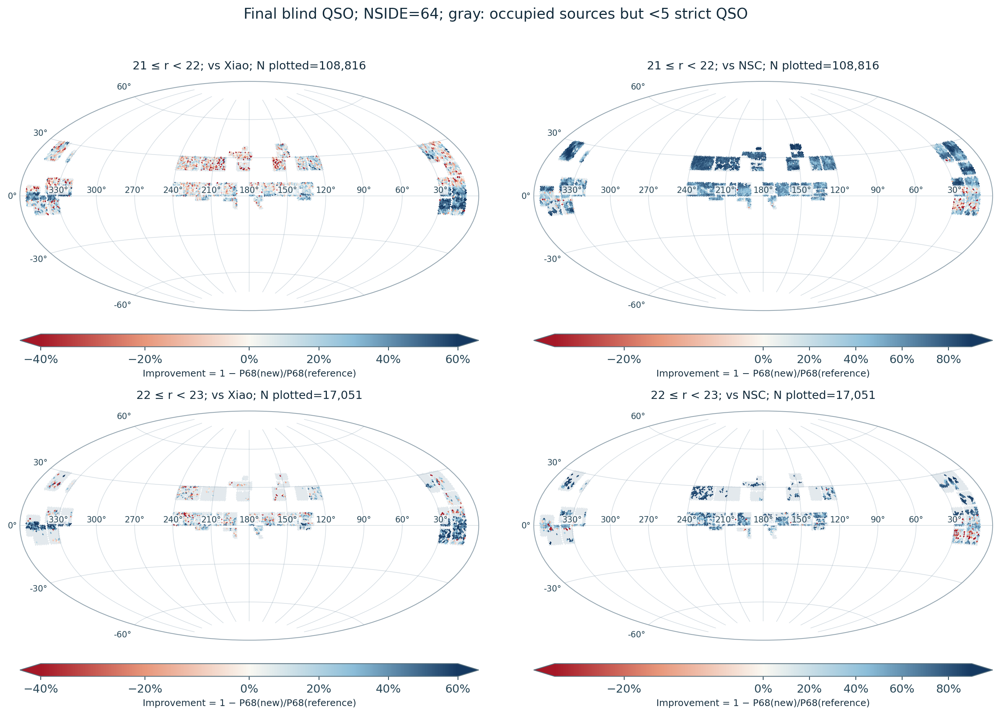
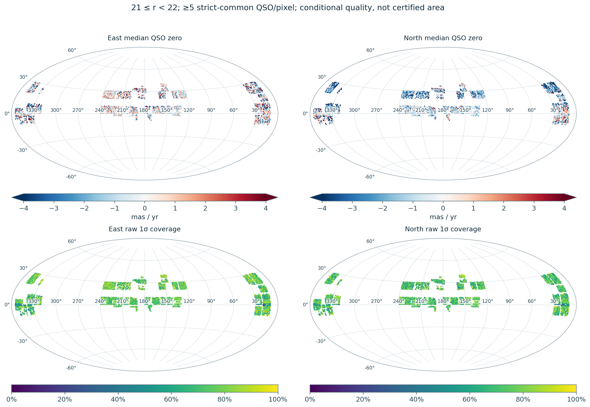
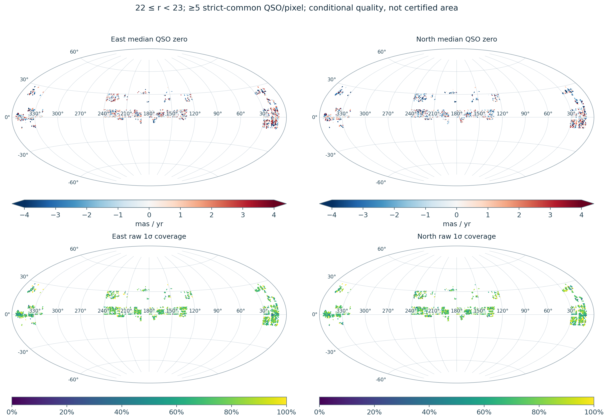
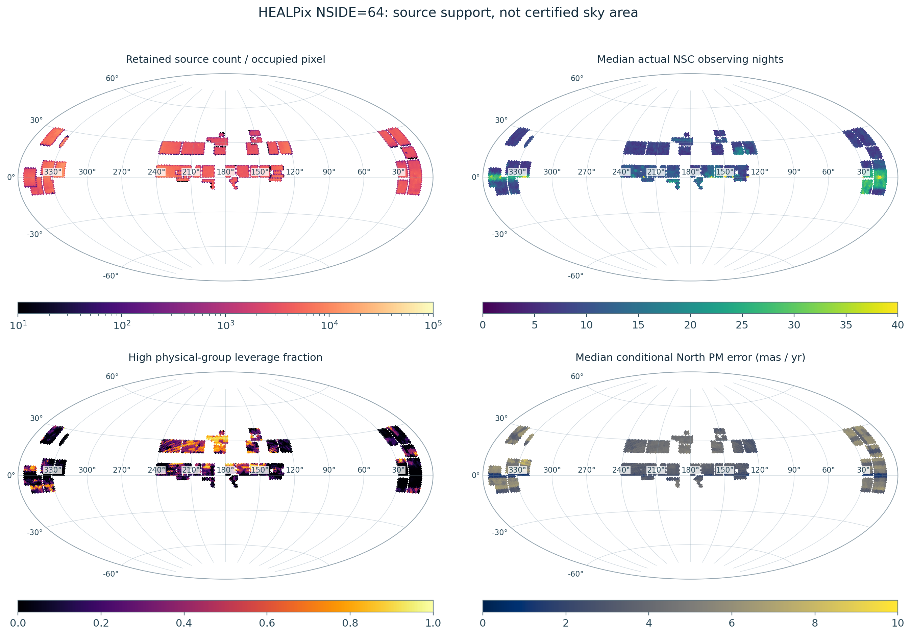

# v2.2：现有覆盖的完整坐标一致更新

本轮保留原有2,751.446平方度，完成全部2,875个核心和三个完整参考分量的坐标一致更新。最终共同历元目录保留 **15,858,226个科研自行解**，较冻结6faabde的15,625,958个解净增232,268（1.49%）。这不是新增天区，也不把新成员集数当作新增真实恒星数。本轮复用已经成功取回的发布检测，不测量图像源提取阶段的完整度。

## 本轮实际改变了什么

原生东、北位置误差与每轴50mas底噪先合成，再经前向Jacobian形成完整二维图平面协方差，包括交叉项。源与参考都用二维GLS和Mahalanobis残差；球面匹配、隔离与排除使用真实角距离。输出为J2015.5标准ICRS位置、自行及完整4×4条件协方差，包含位置—速度Jacobian项。

SDSS仍为每个独立物理run的发布r天测位置，NSC使用所有通过原有物理质量检验的实际单曝光波段。主目录保留原0.8形态规则；本轮没有采用颜色、DCR、CCD/field高阶项、经验误差倍率或夜协方差模型。异常点以冻结稳健损失降权。近距离视差与高自行专项不属于当前普通源模型的认证范围。[实际方法](../docs/method_status_v22.md)

公共参考不逐核心置零。以静止背景源连接SDSS run/camcol和NSC exposure，在每个完整物理连通分量统一求解。采用float64 Schur消去参考对象位置，6次IRLS权重更新后再解最终point；48次对象同步Bayesian bootstrap冻结最终IRLS。gauge为剪枝后、SE筛选前同一NSC组集合的中位模式。保留unfiltered图、gauge集合SHA和全部同步draw。

参考应用门槛改为每条真实检测位置处逆Jacobian传播后的局部东/北参考SE均≤12mas；有解的参考组不因图平面12mas门槛从底层图中删除。旧图平面SE与新native SE分别保存。这是已登记的方法与支持定义改变，不把恢复的组数直接算成有质量保证的面积。

## 完整参考图、面积与产出

1,750,398,729条规范输入和318,694,317条参考入口均包含halo。全域按真实检测身份去重后有263,695,627条唯一参考测量，无跨身份或物理曝光冲突；184,570,652条训练测量闭合成三个完整分量、51,706个有解物理组。原SE后49,018组全部仍可解，另有2,688个原先未保留或新增组，应用支持仍逐检测判断。

|完整分量|训练测量|参考对象|物理组|参考覆盖最大图心角|
|---|---:|---:|---:|---:|
|0|83,120,327|2,970,177|21,780|40.94°|
|1|73,871,667|2,766,912|22,433|63.50°|
|2|27,578,658|2,374,858|7,493|58.09°|

每图均完成48个同步draw。三个真实小图各49个point/draw与独立显式白化二维设计的最大差为1.17e−8、7.00e−9、7.84e−8mas，低于登记1e−3mas数学门槛。完整图求解本身分别约4,144、2,985、1,222秒；单进程RSS约9.86、8.83、15.92GiB。它们不包含全域去重、导出、所有并发内存或节点计费，不能直接当严格同输入的旧版加速倍数。[数学验收](../results/summary/v22_explicit_schur_acceptance_summary.json) · [全图闭合](../results/summary/v22_global_graph_summary.json)

预定身份hash留出、严格共同检测的星系跨巡天二维位置P68分别为142.752→142.733mas（19,876对象）、136.501→136.278mas（18,304）、133.409→133.323mas（15,743）。这是参考位置稳定性证据，不是自行精度或局部绝对零点认证。

真实SDSS扫描、NSC CCD、局部参考与时基的细网格机会面积为 **2,728.590311平方度**，physical-r为2,353.596186平方度；全波段粗细网格差0.092343平方度。该几何机会不包含暗源提取、SNR、身份纯度或空间零点认证。15,037个源占据NSIDE128像素也不能按整像素面积换算有效面积。[面积回执](../results/summary/v22_native_opportunity_area_summary.json)

全域归属保留15,858,226个解、另存21个外部边界解；共享检测、重复成员解和竞争冲突均为0。每个分量只使用一个参考图版本。原15,625,958个解的分母已逐核心复现。源类为r_existing 12,181,526、extra_r_anchor 3,574,129、non_r_anchor 102,571；这些类别相对本轮legacy-r控制，不替代与旧目录的成员连续性。[归属回执](../results/summary/v22_catalogue_ownership_summary.json)

在同一origin-core阶段，全band15,858,247对physical-r12,192,322，净增3,665,925（30.07%）。这与最终归属后的计数是两个分母，不能交叉相减。成员、权重与支持在完整更新中共同变化；参考支持、球面化与质量门槛的漏斗是描述性记账，单项因果贡献由v2.1控制和本轮固定身份对照判断。

|源r星等|全部科研解|r_existing|extra_r_anchor|non_r_anchor|单SDSS run|
|---|---:|---:|---:|---:|---:|
|r<20|6,305,490|4,900,549|1,337,482|67,459|2,999,898|
|20–21|3,252,528|2,613,899|632,193|6,436|1,580,795|
|21–22|4,470,522|3,445,677|1,014,502|10,343|2,164,672|
|22–23|1,823,219|1,218,807|587,162|17,250|880,200|
|r≥23（本轮暗档验收外）|6,467|2,594|2,790|1,083|4,665|

源r星等优先取实际NSC r中位，缺失时用SDSS r；光谱QSO另用独立光谱参考r。上表不是光度母样本的完整度。全部科研解仍保留空间零点未认证、夜相关未认证及光谱核验外身份未确认的标志。3,232,692个解的最大物理组斜率杠杆≥0.8，1,240,300个解少于三个NSC观测季；7,630,230个为单SDSS run，8,227,996个为多run。run数与独立观测年不同。[产出和条件误差](../results/summary/v22_production_selection_summary.json)

## 三种科学比较分别回答什么

### 固定旧身份：协方差修复与点值改善分开

原盲目录287,864个全部星等光谱身份均可计算，没有无法计算者。21–22和22–23等固定身份分别113,063与20,917个；新版native参考退出79/7、形式误差退出8/12、残差退出0/0仍保留在配对统计中，退出项可能相交，不能相加当唯一退出数。

|固定原身份、同一物理检测|21–22|22–23|
|---|---:|---:|
|共同可计算对象|113,063|20,917|
|旧→新二维绝对P68（mas/yr）|6.55245→6.52446|7.94817→7.89592|
|点值P68改善及条件95%区间|0.427% [0.303,0.572]|0.657% [0.201,0.973]|
|旧两轴1σ原始覆盖|59.18% / 63.13%|57.55% / 63.95%|
|B1仅改几何协方差的覆盖|73.48% / 71.42%|71.81% / 72.22%|
|完整新版两轴1σ原始覆盖|73.12% / 71.04%|71.48% / 71.87%|
|旧→新径向>20mas/yr计数|630→607|244→238|

B1冻结旧成员、point、IRLS、影响矩阵及旧公共参考项，因此其P68严格不变。归一化尾减少首先说明误差尺子改变，不能称为新增正确自行。完整新版本同时改变参考、权重及支持；与B1分开解释。固定同源标准化NMAD从1.19/1.07和1.24/1.07变为0.89/0.90和0.92/0.91，中心有一定过覆盖，不据此重新训练统一经验倍率。

远图心效应显著：原图心60–70°档（实际最大约63.5°）21–22/22–23有1,525/328个对象。B1东/北误差比中位约4.38/2.10；完整新/旧为4.05/1.98及4.14/2.00。同源点值P68改善5.26% [2.76,7.42]和10.31% [3.62,15.30]。近图心组的小幅正负结果全部保留，不宣称普遍点值改善。图上位置是10°分箱中点，标注实际计算/原分母；区间为条件对象重采样，不是独立天空误差。

### 新最终盲目录：三目录严格共同对象

以下均先冻结盲生成目录，再与光谱身份匹配，三目录严格共同。Xiao只用PM_SOURCE=DESI地基自行，NSC用合格发布值。P68是相对零自行的二维模长68分位，包含绝对偏差；NMAD是中心化散布。改善定义为 **1−P68(new)/P68(reference)**。

|光谱r|共同n|新版P68|Xiao2025 P68|NSC DR2 P68|相对Xiao改善|相对NSC改善|
|---|---:|---:|---:|---:|---:|---:|
|21–22|109,971|6.53178|7.69209|16.58918|15.08% [14.63,15.52]|60.63% [60.30,60.95]|
|22–23|20,257|7.93177|10.53298|19.09909|24.70% [23.72,25.78]|58.47% [57.71,59.28]|

P68单位mas/yr，方括号为800次配对对象bootstrap的条件95%区间；不是共享观测组独立的全空间置信区间。对SDSS物理run重权，改善敏感区间扩大为12.73–17.77%（409组）和21.73–27.93%（401组）；NSC夜重权为13.88–16.25%（1,276夜）、23.16–26.65%（1,064夜）。对象、物理组敏感度及48同步参考项分列，不能彼此替代。

同源全band对physical-r另用严格共同91,463/15,210对象：P68为6.1922对6.7960、7.1975对7.9958mas/yr，改善8.88% [8.55,9.23]和9.98% [9.23,11.01]。它们与三发布目录的共同分母不同，不混写成同一张样本表。

两暗档两轴中位为 **(−0.158,−0.979)**、**(−0.219,−0.561)mas/yr**，NMAD为(4.035,4.053)、(4.976,4.850)。新版并未消除北向绝对零点。1σ原始轴覆盖73.12/71.13%、71.53/71.97%，2σ为96.23/95.96%、95.89/96.50%；相关二维68%椭圆覆盖73.59%、73.37%，95%椭圆覆盖95.53%、95.75%。中心覆盖与尾部均非统一高斯模型，不使用QSO均值事后改目录。

>20mas/yr径向尾为585/109,971（0.532%）和235/20,257（1.160%），Xiao为2,687/109,971与1,405/20,257，NSC为27,514/109,971与6,116/20,257。实际计数、Wilson区间、原始/中心化轴覆盖和完整相关椭圆均保存在[精简科学入口](../results/summary/v22_key_science_summary.json)；比例条件于各自共同样本，不能当暗恒星纯度。

### 观测条件：普通新区负结果仍然存在

下面把预先冻结的旧2,154与新增597平方度，再按实际SDSS单/多run交叉分层。八格光谱总数与严格共同总数逐一闭合全区，没有按自行结果重选对象。

|光谱r|历史范围|实际run|严格共同n|新版/Xiao P68（mas/yr）|改善及条件95%区间|
|---|---|---|---:|---:|---:|
|21–22|原2154|单|40,502|7.892 / 8.721|9.51% [8.83,10.33]|
|21–22|原2154|多|42,334|5.736 / 7.738|25.87% [25.25,26.59]|
|21–22|新增597|单|12,737|6.612 / 6.373|-3.74% [-5.12,-2.38]|
|21–22|新增597|多|14,398|5.419 / 6.205|12.66% [11.53,14.03]|
|22–23|原2154|单|7,031|9.318 / 11.736|20.60% [19.04,22.08]|
|22–23|原2154|多|8,402|6.765 / 10.637|36.40% [34.95,37.61]|
|22–23|新增597|单|2,490|8.668 / 8.707|0.44% [-2.28,2.53]|
|22–23|新增597|多|2,334|6.871 / 8.895|22.75% [19.57,25.23]|

新增普通单run的21–22等仍比Xiao差3.74%，22–23等0.44%且区间跨零。这与累计单run改善6.80%/16.19%并不矛盾，说明区域和时间条件不能被run数单独概括。此处只是现有已见样本的描述性交叉验证，不把它重新称独立未见测试集。[八格原始读出](../results/summary/v22_historical_run_quality_summary.json)

其他冻结条件同样显示时间支持重要：NSC时基<2yr的共同QSO仅改善1.28%（7,315）/7.51%（1,412），≥2yr为16.02%（102,656）/25.99%（18,845）；至少两个SDSS独立UTC年份为26.54%（37,363）/36.68%（7,814）。多run不等于多年，band组合的不同分母不用于给滤光片排名。仪器、band、观测夜/季、独立年份和时基的完整分层在主JSON，不把这些相关条件解释成单项因果收益。

21–22的r_existing/extra_r_anchor/non_r_anchor共同QSO为88,728/21,036/207，北向零点−0.925/−1.265/+0.445；22–23为14,574/5,613/70，北向−0.491/−0.811/−1.272mas/yr。源类样本的天区、星等、颜色和采样不同，中位差不是单一band偏差。non-r暗档光谱支持仍稀少，不能以其全域科研解数认证真实暗星。

### 全域图件与公开统计口径

各面板统一NSIDE64像素。正改善为冷蓝、改善越大越深；退化为暖红。对Xiao与NSC使用独立色标，同一参照的两暗档使用同范围，避免视觉混淆。仅≥5严格共同QSO像素着色，21–22绘制108,816/109,971、22–23为17,051/20,257；灰色是有源但光谱支持不足，白色是源图外。小像素数只是探索门槛，不是每轴0.5mas/yr认证，画图分母不替代全域比较。

零点是像素内QSO中位，覆盖是原始轴1σ的实测比例，源图展示源数、夜数、高杠杆比例及北向条件SE。像素统计不能把群体公共误差按源数缩小，源占据像素更不代表该整像素已认证。源聚合从最终接受源重新计算，而非对细像素中位数求平均。

[主聚合JSON](../results/summary/v22_global_QSO_quality_summary.json)保留全部全域及条件分层，空间部分提供作图点值与中位/改善区间；[完整无损压缩聚合](../results/summary/v22_global_QSO_quality_full_summary.json.gz)保留原JSON所有空间尾部、计数及椭圆区间。它们均为去标识聚合，非逐源目录。publication_layout明确压缩与原JSON SHA，八格读出绑定同一原SHA，没有服务端TOP/LIMIT或静默样本截断。

## 源身份与独立年份位置

15,180,270个新解保持完全相同物理成员，另有354,358个改成员解获得≥60%双向唯一连续连接。91,330个旧解及323,598个新解未得到这种对应。旧/新各有128/298个改成员对象存在多重交集假设。这是检测成员记账，不是发现、漏失或错误合并恒星的真值统计。[全域连续性](../results/summary/v22_global_member_continuity_summary.json)

三个代表核心按原有元数据、每参考分量最大图心角预选，测试年全部目标band在训练关联前移除，原/新全集共同竞争。53.29°核心有5,809个共同训练身份，共同位置P68 54.87→55.03mas；347个新独有训练身份中306唯一重现，真实几何机会318个。60.51°核心有8,210个共同身份，位置P68 43.18→42.81mas；1,431个新独有中1,317重现，四个位移负对照为17/16/16/8。

26.17°控制只有4个新独有、全部重现；257个旧独有中256仍重现，明确说明新质量退出不能等同旧源不真实。区间按物理训练源整体重采样，重复检测不当独立对象；4源小组的P68区间31.86–188.87mas，统计约束很弱。位置重现受1arcsec唯一门槛、实际机会和W0条件限制，不外推为全目录恒星正确率。[冻结年份证据](../results/summary/v22_far_core_year_validation_summary.json)

## NGC：固定亮暗读出与早期位置的下一步

7,275个冻结源在新参考图可计算，完整ICRS4×4均为正定，48同步响应与参考协方差重建最大数值差5.19e−13（存储坐标单位下）。九个真实核心完成；197个原暗样本和868个光度亮样本均无新native支持/形式误差退出。验证组与光度组有身份交集，不能把各行n相加作为独立样本数。[固定读出](../results/summary/v22_fixed_ngc_bright_dark_summary.json) · [完整状态核验](../results/summary/v22_ngc_readout_integrity_summary.json)

|同物理成员的6471个亮端Gaia控制|旧|新|
|---|---:|---:|
|两轴残差中位（mas/yr）|−0.132 / −0.752|−0.213 / −0.598|
|两轴NMAD（mas/yr）|3.203 / 3.406|3.234 / 3.397|
|二维绝对P68（mas/yr）|5.0004|5.0032|

这里分别把同一份保存的五参数表观位置经过各自估计器，再与观测拟合比较，保留年度视差。新版原始轴1σ覆盖为78.52% / 74.80%，2σ为98.69% / 97.42%；这些覆盖条件于Gaia预测，不含其相关真值误差，也不用于暗端验收。亮端散布基本未变，东/北零点的变化方向不同，不能称几何修复已解决恒星系统差。

|固定光度选择（不是认证星团成员）|n|旧加权均值E/N|新加权均值E/N|
|---|---:|---:|---:|
|原暗样本|197|−8.372 / −3.100|−8.583 / −2.928|
|光度亮样本|868|−7.748 / −4.664|−7.947 / −4.561|
|两者合并|1065|−7.831 / −4.455|−8.032 / −4.343|

均值单位mas/yr，旧/新使用完全相同的原每源权重。197暗样本新版独立SEM为0.372/0.384mas/yr，公共参考SEM为0.0377/0.0409mas/yr，后者先合成同步draw，没有除sqrt(n)。相对冻结亮端参考(−5.336,−0.809)，暗光度样本均值差由(−3.036,−2.291)变为(−3.247,−2.119)mas/yr。这些光度对象含前景/背景，不能把均值差直接解释成星团暗成员的系统误差；完整更新也没有消除这一差异。

22≤r0<23的冻结415个光度对象，最终盲目录的唯一已知位置匹配仍为 **37/212（22–22.5）和0/203（22.5–23）**，与原几何试验相同。0.7arcsec已知位置门槛只是条件恢复，不是恒星身份或图像完备性认证。这个实测负结果说明，单位/权重修复并未创造原本缺少的早期位置。

另对冻结40个光度对象做真实SDSS机会核查：20个无缓存检测、10个质量/距离退出、10个早期位置正控。40/40有真实扫描足迹，读取13个完整单扫描目录、13个r frame及13个官方fpM掩膜。

无缓存20对象在完整目录1arcsec内仍无发布检测，16个有多个真实run，15个有多个条件可用run；2个至少一次有保守坏像素，2个有3arcsec邻源。掩膜后单曝光孔径SNR代理中位3.571，按独立run合并为5.447。质量/距离与正控对应5.145→5.836、8.017→11.591。三组光度分布不同，不能把差异归因于某个算法。

这些数据表明缺口并非只有缓存漏取，弱单帧信息和重复扫描联合能力都应考虑。当前代理未包含完整像素相关噪声、源泊松、测心偏差和未知运动；1arcsec目录缺失也不证明所有历元都没有真实检测。本轮没有测新质心，不能认证图像完备性或新增暗星。下一步有价值的是有限联合早期位置试验，必须用正对照、注入及留出早期曝光检验低SNR测心偏差，尚无依据启动全覆盖PSF重测。[40对象实测](../results/summary/v22_ngc_masked_pixel_opportunity_summary.json)

误差棒为16–84%分位范围，非均值置信区间。

## 恒星g残差：有相对几何预测，不采用绝对修正

独立分支[9a7d7db](https://github.com/xiaoyunao/deep-proper-motion/tree/experiment-b-v2.2-stellar-g-mechanism)完成B1–B5。复用v1.5两个冻结系数−28.32±1.61、−23.39±1.02mas/(mag tan z)，枢轴g−i=1.2，并保留原QSO/星系负结果。最多两个额外核心按实际几何、重复夜及元数据预选，没有查看自行后选区。

在DECam、实际g SNR≥20、深邻源≥3arcsec、颜色误差≤0.2的既有支持内，同星同夜位置差给出唯一的两轴天顶几何候选−36.22mas/(mag tan z)。训练58,918对、3,832星、69夜；独立星及夜验证6,303对、1,309星、17夜。192次交叉星/夜抽样与每星整条轨迹共享颜色误差，系数SE约0.665；95%敏感区间−37.22至−34.97。48同步C0扰动与曝光截距共同传播，组常量不冒充颜色项。

独立原始位置差P68 52.53→48.18mas（8.28%），但两轴中位由(4.38,2.76)变为(4.89,2.63)mas，东向没有改善，绝对截距未辨识。消去验证组截距后的改善只是相对诊断，不是绝对零点证据。因此**不将该系数加入主全域目录**，颜色误差敏感性也不包装成完整errors-in-variables后验。

深LS邻源与实际g SNR共同范围内，近邻样本沿邻源方向残余约38mas，孤立组约3mas；天顶向趋势可与混叠同时存在。冻结102个NGC簇/场匹配对东向约−1.71mas/yr，而历史g预测东向约0.02mas/yr，不能用该g项解释；同field或高exposure重叠子组仍小且条件混杂。群体参考扰动先同步合成，不按源数缩小。详见[独立支线报告](https://github.com/xiaoyunao/deep-proper-motion/blob/9a7d7db/reports/experiment_B_v2.2_stellar_g.md)。

## 形态候选收束

主目录继续0.8。唯一0.6候选按原证据封存：7,254个训练新增、7,479个全历元候选、2,707个训练重现、2,203个全历元通过明确成员连接获得留出证据，各用自己的分母。LS处理形态包含5,524 PSF、1,327 REX、399扩展及4无唯一项，但共享成像使它不能作为独立恒星真值。没有新阈值搜索或整批采用。[固定附表](../docs/morphology_annex_v22.md)

## 数值、资源与可复现性

全部28个实际Slurm父分配均已终止，按sacct父AllocTRES的billing/256×实际elapsed折算，总 **4.541417计费CPU节点小时**（含失败/取消/OOM），低于48小时总预算。独立g支线保守上界 **0.448485小时**，包含在总数内而非另加。step只作诊断不重复计费，Iris为最终账单依据。末次任务目录快照为175,542,952,960分配字节（163.49GiB）、79,866个文件，随后对同一有界工作根只读`du --inodes -s`实测93,496个inode（包含目录、不跟随符号链接目标）；二者是不同时间的元数据快照，非历史缓存总量、峰值、inode配额或长期归档证明。[最终资源账本](../results/summary/v22_resource_final_summary.json)

全2875核心源worker累计墙时342,044.68秒（不是CPU计费）；核心中位97.26秒、16–84%为67.78–150.29秒，最慢2211.95秒，24核心≥600秒、3核心≥1800秒，最大单worker RSS27.25GiB。缓存复用与派发优化的真实逐值等价已验收，不用新旧混合缓存耗时声称算法加速倍率。

最终Slurm62052901复核全部2875派发、源/索引SHA、三个参考图SHA、J2015.5归属及NGC恢复产物未变，科学阶段闭合。旧62049478主驱动的完整QSO成功后仍调用旧NGC后处理，因JSON列表乘浮点失败，父状态保留FAILED；独立62049478.6用修复的数组读取完成九核心/完整协方差核验，未改主源或QSO结果。最终闭合同时核验这份恢复文件的SHA，不掩盖原失败，也不为旧后处理错误重跑全域。[最终绑定](../results/summary/v22_final_stage_binding_summary.json)

本轮269个本地全测试通过；另有真实小图147次point/draw等价、全图最终权重/point和48draw、全2875签名、14,197源启动方式逐值等价、整年隔离、缓存协方差往返与实际NGC7275状态验收。错误度量修复、统计后处理和工程资源分别留证。

原版冻结6faabde和审阅75a7abf均保留。主科学源实现冻结于已验收的代码快照，参考、规范输入、group map、支持、配置与逐源产物SHA组成恢复键。新Linux启动路径经三完整分量、14,197个真实解的全状态、协方差、成员、权重、r控制及QSO产物解压逐字节一致验收；它不是新拟合模型。最终源派发使用2d6e6a9，主要收口8183d6d，NGC缓存数组恢复6b0301b，只读r星等汇总bd71f7d，独立g分支9a7d7db。全部科学计算使用NERSC Slurm，私有数据、参考图、原/失败产物和缓存均留个人PScratch。

全过程保留窗口去重OOM、重复驱动、导入/启动、索引OOM等失败；它们进入资源账本，不称为科学负结果。科学负结果包括g绝对转移不通过、代表核心位置预测未普遍改善、旧独有源仍能重现及局部零点/条件误差局限。公开只同步明确允许的代码、聚合和图；方法、目录状态与恢复分别见[说明](../docs/method_status_v22.md)、[私有布局](../docs/catalogue_layout_v22.md)、[运行记录](../docs/running_v22.md)。

## 科学判断与下一步

本轮完整交付现有覆盖的统一几何科研版本。全域点值精度相对旧版总体只小幅变化，最大的确定性收益是正确的距离、权重、参考支持及协方差含义；远图心子样本的点值也有更明显收益。不能因总体P68变化小而退回错误角度量。

多历元全band对Xiao/NSC及同源physical-r的精度收益仍成立，且保留更多科研解。但普通新区单run21–22仍为负结果；北向零点、颜色/源类转移、夜相关和暗恒星身份尚未得到普适认证。因此可将v2.2作为**现有覆盖后续科研分析的坐标一致基准**，不能称已完成高精度正式星表认证。

最有证据的下一步是有限的联合早期SDSS位置实验：从本轮固定40对象及正控出发，预先冻结低SNR测心、注入和留出曝光标准，检验是否弥补真正缺少的早期位置。另一独立问题是恒星源类/颜色/邻源条件下的绝对参考转移；本轮g模型只解释相对几何趋势，不能作为自动生产校正。0.6形态路线收束，不追加阈值搜索；无依据立即投入全覆盖PSF重测。

以上是下一阶段建议，不在本轮自动扩天区、调新DCR/夜误差参数或改写论文。旧目录、原失败、公共模式和负结果均保留；后续比较须继续区分同源精度、绝对零点、条件误差覆盖、检测身份和实际观测机会。
