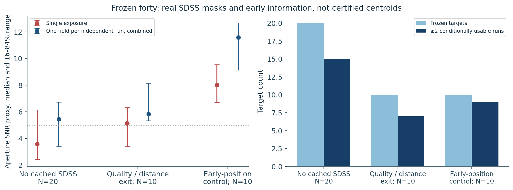

# v2.2 现有覆盖完整坐标一致更新（执行中）

2026-11-26。三个完整全域参考图已完成；新目录仍在运行，未宣称最终生产面积。旧2751.446平方度、15625958解保持冻结；本文记录已获得的阶段证据，后续按实际全分量与全域读出补齐，不将工程小图计为生产覆盖。

本轮重点是用完整二维物理误差、球面角距离和统一局部角参考支持，更新现有完整覆盖。原生50mas底噪随协方差一起投影；参考位置块解析消去后解物理观测组，48个按参考对象同步的bootstrap保持公共模式。每完整分量在剪枝后、SE前的NSC组集合定义中位gauge，逐目标位置逆投影后每轴参考SE≤12mas。原0.8源形态不变。独立g机制支线不改变这个单一方法定义。

## 已完成的数值证据

三个真实入口先导分别形成39128/36364/25710训练测量的小工程图，含3329/3791/2635参考、50/38/37组。每图同最终IRLS权重、同对象bootstrap的点解与48draw，共49次，与独立显式白化二维设计比较，最大组偏移差为1.17e−8、7.00e−9、7.84e−8mas。符合1e−3mas登记数学门槛。这些图不等于三个完整生产参考域；完整图的连通、资源、公共误差及科学零点仍须实际验收。[数学回执](../results/summary/v22_explicit_schur_acceptance_summary.json)

三核源工程回放也已完成，全部仍为origin-core待全域归属的结果。全2875核参考入口已完成：318694317含halo参考行，1750398729规范输入；新增54126、退出2106170均为含halo入口变化，不能当唯一星系数。全域去重/剪枝现已闭合三个完整连通分量；不将参考图完成等同最终科研面积。

## 首完整参考分量验收

分量2包含27578658训练测量、2374858个参考对象、7493个物理观测组。最终IRLS点解及48对象同步抽样均完成，最后正规方程相对残差6.63e−11，最小组参考数10；SE筛选前6950个NSC组的gauge集合及SHA保留。参考求解本身耗时1222秒、单进程RSS峰值15.92GiB，不含此前全域去重/导出。[完整回执](../results/summary/v22_first_complete_reference_summary.json)

1/64预定物理身份hash的15743留出星系、182801检测用于独立参考核验。严格共同检测下，旧／新跨巡天中位位置差二维P68为133.409／133.323mas，北向中位−1.041／−1.284mas；这是物理角位置残差而非自行。整体稳定，不宣称零点已达到正式认证。[留出回执](../results/summary/v22_first_complete_held_reference_summary.json)

按距图心8.58°、21.96°、46.47°和输入字节预选的三个源核心，共1904／1858／5109个origin-core解。每源J2015.5、完整ICRS4×4、成员唯一和固定旧QSO误差对照均通过。固定QSO无新质量筛除，21–22档85对象中1个新形式误差退出仍参与评价；此小先导不替代最终全域盲目录。[完整分量验收](../results/summary/v22_complete_component_admission_summary.json)

三核真实工程对照中，球面单位向量缓存优化保持全部11380个解的物理成员、自行、状态、IRLS权重和完整协方差逐值相同。优化后单核48.6–58.1秒；旧剖析含cProfile额外开销，因此不把138–152秒直接换算正式加速倍数。[逐源等价](../results/summary/v22_spherical_cache_equivalence_summary.json)

## NGC暗端早期信息的实测

按冻结光度身份和原退出类别哈希选定40对象：20无缓存SDSS、10质量/距离退出、10早期位置正控。40/40都有真实扫描足迹、完整单扫描目录和r图像；实际读取13个完整photoObj及13个frame。

无缓存的20对象，完整单扫描目录在1角秒内仍无发布检测；16/20有多个真实run机会。其r0中位22.75，单曝光2.5pixel孔径SNR代理中位3.31。质量/距离退出组9/10在完整目录有1角秒内检测，SNR代理中位4.49。正控10/10有目录检测，r0中位22.08，SNR代理中位8.01。三类星等不同，不能把SNR差异解释为单一算法偏差。[机会统计](../results/summary/v22_ngc_early_opportunity_summary.json)

因此，这20对象的缺口主要不是缓存漏取；图像中存在弱通量且多run机会较常见，支持后续有限的联合早期位置可行性核查。当前孔径SNR没有完整处理像素mask、相关噪声、邻源和测心选择偏差；未拟合新自行，不把它计为认证暗星或图像完备性。

## 三完整参考图已完成

分量0/1分别83120327/73871667训练测量、21780/22433组及2970177/2766912参考。各48同步对象draw完成，最终6轮IRLS更新后重解point。求解本身约4144/2985秒，单进程峰值约9.86/8.83GiB；不把共享缓存/导出排除后数字当全节点同时内存。

1/64预定身份hash留出，严格共同19876/18304星系的二维跨巡天位置P68分别142.752→142.733mas、136.501→136.278mas。三图均稳定；这不是自行精度，也不单凭总体P68认证局部零点。[分量0](../results/summary/v22_reference_held_component_0_summary.json) · [分量1](../results/summary/v22_reference_held_component_1_summary.json)。

## NGC有效像素与独立run补充

之前掩膜0记录实际为归档路径顺序错误，正确rerun/run路径取得13/13。官方SDK十个fpM平面已解码，mask/frame网格和物理field核验。无缓存20中2个对象至少一次有保守坏像素、2个有3arcsec邻源，仍全部有条件干净像素机会；15个有多个条件可用run。合并孔径SNR代理中位5.447，单曝光3.571。质量/距离退出组对应5.836/5.145，正控11.591/8.017。星等不同、孔径噪声尚未含全部像素相关/源泊松/测心偏差，因此只能支持有限联合早期位置试验，不作为提取完备性或新暗星认证。[实际掩膜统计](../results/summary/v22_ngc_masked_pixel_opportunity_summary.json)。

## 有限恒星g机制任务已收束

独立支线[9a7d7db](https://github.com/xiaoyunao/deep-proper-motion/tree/experiment-b-v2.2-stellar-g-mechanism)保存全部B1–B5。同星重复训练不输入Gaia真值，独立星及夜的6303对支持−36.22mas/(mag tan z)相对颜色斜率，原始位置差P68 52.53→48.18mas；东向中位未改善，绝对截距未确定，不采用主目录。原102对东向偏差不能由历史g预测解释；实际g信噪共同支持下，近邻沿邻源方向残差仍约38mas，不能全部归为DCR。主全域更新不添加颜色、DCR或经验误差参数。

## 先隔离测试年的代表核心

从原16元数据控制中按每参考分量最大实际图心角选择，26.17°、53.29°、60.51°；均先移除整个测试年所有目标band，再分别训练原/新关联。原新共同身份作为一个竞争假设，原独有和新独有均竞争，不用全历元轨迹反推训练。

53.29°核心：5809共同训练身份，共同位置P68为54.87→55.03mas；347个新独有训练对象中306唯一重现，具实际几何机会318个，其中306重现。60.51°核心：8210共同身份位置43.18→42.81mas；1431新独有中1317重现（1317/1431），位移对照为17/16/16/8。26.17°控制有257个原独有、仅4个新独有；原独有256个仍重现，因此退出新质量选择不能解释为这些原源不真实。

这提供球面化/新支持后新增及退出对象的独立年份位置证据。重现统计和大样本共同身份层约0.95–0.97的条件1σ覆盖受1arcsec唯一门槛、实际采样与W0底噪影响，不用作全目录形式误差校准或恒星纯度。新源身份、混叠和缺测仍需单独证据。[完整条件分母](../results/summary/v22_far_core_year_validation_summary.json)。

图中误差棒为16–84%分位范围，非置信区间。三组光度分布不同，SNR差异不作算法因果比较。

## 尚待完成

全部参考已完成；待源目录全部核心、全域唯一检测/共同历元归属、成员连续性、固定身份与新盲目录科学比较及HEALPix图。独立g支线已完成并保留不采用决定。形态0.6已形成[固定证据附表](../docs/morphology_annex_v22.md)，保持7254/7479/2707/2203各自分母，不再调阈值。

总规划上限48计费CPU节点小时，包含工程、失败与B≤2小时；实际账本随阶段更新。原始/逐检测/逐源/参考及验证数据全部留在NERSC个人PScratch；公开只保存代码、图和聚合。

## 大规模内存瓶颈与恢复

首全图尝试在24GB DuckDB窗口排序中OOM，原输入/回执与已完成的0跨身份冲突检查保留。新版本按检测ID哈希64桶归并，同一检测的所有halo副本必进同一桶，保留完全相同的去重/冲突规则；对象—组两阶段计数保持原剪枝定义。窗口算子需要缓冲输入，是内存密集操作，当前1.1.3实测失败不等同科学失败。[DuckDB窗口说明](https://duckdb.org/docs/stable/sql/functions/window_functions)。全部失败成本进入资源账本，不覆盖原生产解。

## 后处理内存的实际修复

4worker/16GB的旧索引步骤发生OOM，仅中断该独立step，源拟合及其签名结果继续。新索引逐条读取JSON数组，只保留需要的成员和紧凑状态，不同时装入原新完整目录。三个真实工程核心的所有science/claims/old Parquet逐字节相同，改成员内容相同，单进程峰值约266–287MiB；原索引及失败回执完整保留。当前大区使用该受验流式读取，科学方法未改。[实际等价回执](../results/summary/v22_streamed_index_equivalence_summary.json)。

留出年份的旧通用统计函数曾把逐检测重采样字段称为object interval。新的独立汇总不改原始回执、点值或成员，改为训练源整体重采样，把同一源的全部测试年检测一起保留。小组4源的P68源敏感区间约31.86–188.87mas，故不因13条重复测试检测就宣称精确。这些区间仍条件于观测组和唯一位置门槛，不是独立天区置信区间。
