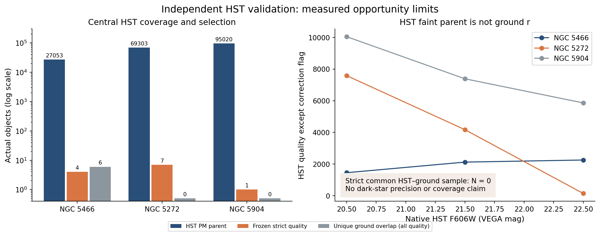
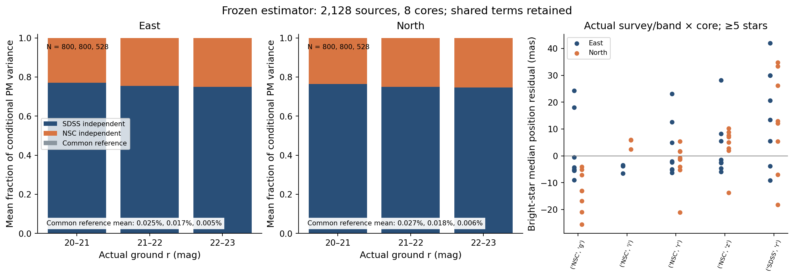
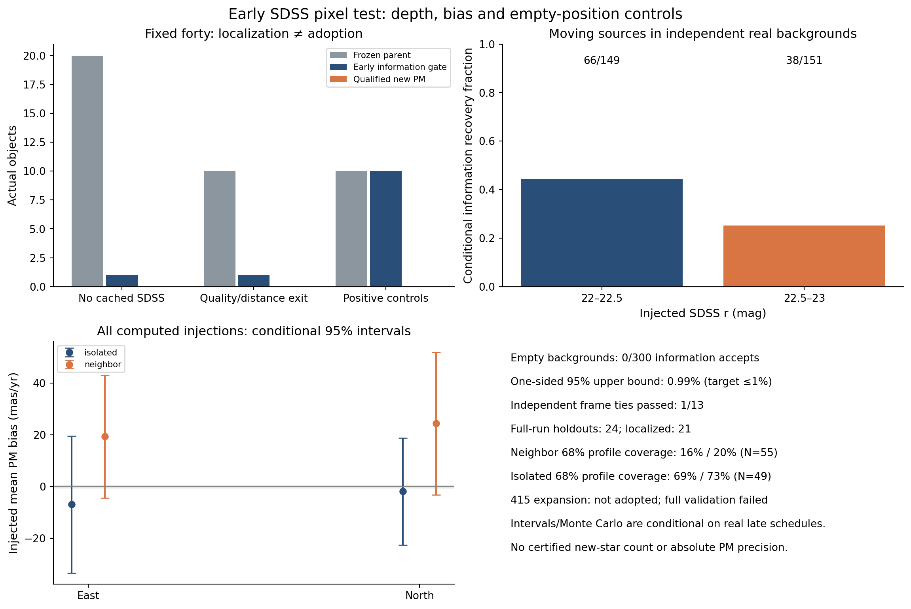
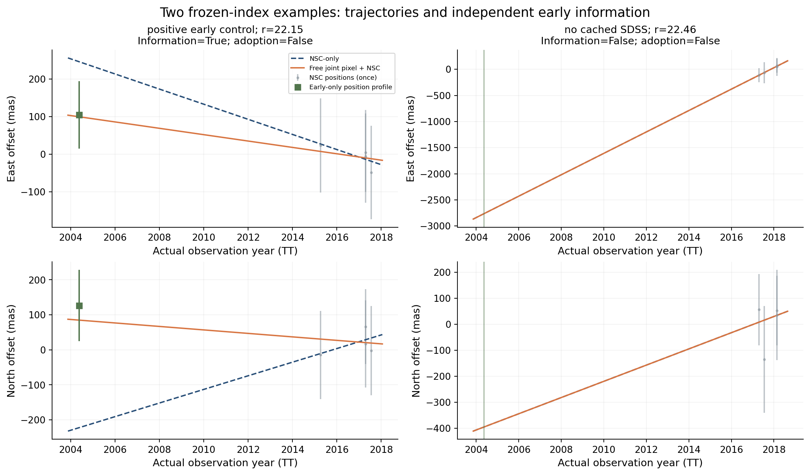

# v2.3：暗恒星独立验证与早期位置信息试验

2026-11-27。**主目录保持 `0320f59b972755454252a383ba1007c665c928e8`，g 支线保持 `9a7d7db34052219cc328d0f028216d41a2491e62`。** 2,751.446 deg²、15,858,226 个科研解未重拟合、未扩区。本轮检验两个问题：能否用 HST 独立确认暗恒星质量；早期 SDSS 像素能否提供足以采用的新定位信息。

**结论：本轮没有新增经过独立认证的暗恒星自行。** 三个 HACKS 中央场没有合格的暗端地面共同样本；误差分解表明，在八个预选核心的现有源中，SDSS 独立测量项约占条件自行方差的四分之三。真实像素正控说明早期位置有信息，但暗目标、接框架及邻源验证未共同通过，所以不扩展到 415 对象，不修改主目录。

当前三个关键缺口是：**合适的暗恒星独立真值重叠、早期位置与邻源身份、恒星绝对零点及公共系统误差。** 后续优先处理这些已定位的瓶颈；当前证据不支持直接扩大早期像素天测。既有目录只能在明确观测条件和质量限制下继续应用，不能把 QSO 改善或形式误差当成暗恒星认证。

[关键统计](../results/summary/v23_key_science_summary.json) · [八步预登记与执行说明](../docs/faint_star_protocol_v23.md) · [实际方法/恢复](../docs/running_v23.md) · [冻结 v2.2 科学结果](experiment_A_v2.2_full_coordinate.md)

## 1. HST：取得了数据，但没有取得暗端精度答案

先依据既有覆盖选择 NGC 5466，以及最多两个额外场 NGC 5272、NGC 5904；这是 HUGS 公开场中心与既有几何相交的三个候选。未依据地面自行表现选区。先取得实际文件、字段、历元和光度/质量元数据，再冻结位置唯一性及邻源规则，最后才进入地面自行读出。

|HACKS 场|PM 母表|冻结 PM+光度质量|所有 HST 中唯一地面位置对应|合格共同源|
|---|---:|---:|---:|---:|
|NGC 5466|27,053|4|6|0|
|NGC 5272|69,303|7|0|0|
|NGC 5904|95,020|1|0|0|

严格层要求发表的高频系统修正标志 `CORRFLAG=1`。该条件很稀少，但没有根据空结果翻转或放宽它。只读机会审计进一步显示：不要求该标志、保留其余质量时，三个场分别有 16,596、23,510、53,644 个 HST 源；对应地面源只有 NGC 5466 的 5 个，且均不在地面 r=20–23 档。因此，当前缺少暗端比较不能仅归因于该标志。

HST 中央场与原 NGC 5466 的 415/40 个外环光度对象是不同母样本。HST F606W 为原生 VEGA 光度，不能当作地面 r。这里未获得可用的三目录同星暗端偏差、散布或覆盖率；非空HST同源路径也未在本轮得到真实样本验收；所有空统计保留 N=0，不能写成“零误差”或“验证通过”。

HST 各自参考历元为 2010.7、2009.2、2009.4。实现区分 HST 相对运动与发表的 Gaia EDR3 定锚绝对零点；例如 NGC 5466 的零点总误差 0.030/0.031 mas/yr 与 header 的统计项 0.015/0.016 分列，不能重复相加或除以 √N。NSC 本身也使用 Gaia 参考，所以这不构成完全 Gaia 独立的绝对天测检验。实际没有共同源，故本轮没有用这些误差制造精度结论。[HACKS 产品](https://archive.stsci.edu/hlsp/hacks)、[论文附录 A/B 与标志定义](https://arxiv.org/html/2206.09924v1)

图 1：左图为三个不同分母的实际计数，零计数仅为对数坐标显示占位；右图是取消修正标志要求后的 HST 原生光度母样本，仍不代表地面 r 或地面恢复率。没有生成示意精度曲线。

## 2. 现有自行的条件误差主要来自哪里？

八核心在看残差前按 HST 几何、既有图心/时基控制和窗口元数据选定。每个地面 r 档最多 100 源/核心，按物理成员哈希确定，共 **2,128 个源**：20–21、21–22、22–23 等分别 800、800、528 个。它们不是全域的随机代表样本，也不是独立认证恒星样本。

保持最终成员、权重、影响矩阵 H 及完整两轴变换，分解 SDSS、NSC 和同步参考星系项。包含非对角协方差，按原 C/w 条件噪声约定闭合保存输出，最大二维自行协方差差为 **7.11×10⁻¹⁴ (mas/yr)²**。没有进行新权重拟合。每核心缓存仅省去重复索引/组名构造；新核心首源的 H 与原完整输入函数逐值相同，已完成核心保留原回执。

下表是**逐源方差份额再取均值**，不是平均每核中位数，也不是未建模系统误差的预算。

|地面 r|N|SDSS 东/北|NSC 东/北|共同参考东/北|
|---|---:|---:|---:|---:|
|20–21|800|77.15% / 76.48%|22.83% / 23.49%|0.0253% / 0.0275%|
|21–22|800|75.50% / 75.05%|24.49% / 24.93%|0.0166% / 0.0178%|
|22–23|528|75.02% / 74.74%|24.98% / 25.26%|0.0053% / 0.0060%|

这支持优先研究早期位置信息质量，却不证明所有绝对系统差都来自 SDSS。共同参考 bootstrap 很小，仅描述既有参考样本与模型的条件不确定度；恒星颜色转移、DCR 剩余、夜相关或未知空间零点没有因此消失。公共模式仍保留同步响应，未按源数缩小。

另外保存 800 个亮端地面源对照条目，使用严格亮 Gaia（G<20、RUWE<1.4、每轴 PM SE<0.2 mas/yr）作实际历元位置预测，包括地球位置的周年视差项。按真实 survey/band、run/camcol、exposure、CCD、field 记录残差；每个观测块先按地面源汇总，至少 5 源才给位置统计。位置对应为条件性的 0.7″/0.3″ 近邻证据，未据此认证暗源身份、绝对零点或拟合新校正。观察到的组/波段差异只用于归因；源类与共同系统项仍是实际限制。

图 2：前两面板完整保留共同项；其很小并不等于没有系统差。右图每点为实际核心×巡天/波段的亮端位置中位数，单位 mas；不能将不同样本的点差直接解释为可应用到暗星的颜色系数。

## 3. 有限像素试验实际拟合了什么？

复用原 **40 对象、13 个 SDSS r 场、官方掩膜和实际观测时间**。13 场的空间 PSF 在 26 个不对称探针位置与官方 C 重建独立对照通过。采用发布的 nanomaggies 图像、calib、ALLSKY、gain 和 dark variance；没有对已标定图像再次乘 calib。逐位置时刻由实际 r 源 TAI/ROWC 关系恢复，实测约 0.026322 秒/行，并转换到 TT 年。

目标似然为自由的四状态位置/自行、各场正通量与局部常量背景剖面，以及每独立早期物理 run 的 50 mas 潜在位置项。晚期 NSC 实际单曝光位置只进入一次；原 SDSS 目标发布质心不再是第二个目标位置似然。每物理 run 按几何预选一个 field，避免相邻 field 重复计数。32 个对象具有唯一且有时基支持的晚期条件轨迹，8 个退出并保留；不把这些位置关联当作已知恒星成员真值。

新像素位置先用不同于目标/正控的亮孤立校准对象接到发布 SDSS r，再接 C0。跨场同一物理校准星共享 bootstrap 权重，80/20 身份哈希分开训练与留出，只测试常量二维平移。**13 场中 1 场通过**：`004623-1-0324` 为 34 训练/8 留出，留出东/北中位 −1.60/−4.62 mas，二维 P68=40.85 mas；另外 12 场未达到预登记样本支持。此前进度按日志片段写成“13 场均失败”不准确，本报告以完整回执纠正。

执行中另保留了未认证场的**条件像素信息诊断**：这区别于预登记可采用目标试验，既不放宽接框架门槛，也不将其拟合计为合格新自行。所有结果保留场支持标志。早期 68% 最长轴使用局部 Fisher 椭圆近似，再检验实际每轴剖面区间闭合和多初值；不是已经认证的全局二维置信区域。

C0 同步扰动、独立校准星接框架扰动和条件像素噪声分别传播，输出标准 ICRS 完整 4×4 状态协方差。9 次真实公共扰动重拟合与线性传播的最大位置/PM 差为 0.763 mas / 0.373 mas/yr；这只是有限非线性检查，不足以认证任意暗端的精密误差。SDSS 发布 WCS 简化项、有效 PSF 与原始像素重采样的限制继续保留。[SDSS 图像与 PSF](https://www.sdss4.org/dr17/imaging/images/)、[frame 格式/噪声](https://data.sdss.org/datamodel/files/BOSS_PHOTOOBJ/frames/RERUN/RUN/CAMCOL/frame.html)

## 4. 定位信息、恢复与采用必须分开

|冻结类别|母样本|实际可计算|通过早期信息门槛|通过全部使用场的接框架+信息检查|
|---|---:|---:|---:|---:|
|无缓存 SDSS 发布检测|20|12|1|0|
|SDSS 质量/距离退出|10|10|1|0|
|原早期正控|10|10|10|0|
|合计|40|32|12|0|

因此是**退出目标 2/30 有条件定位信息，新增可采用真实自行 0**。正控普遍更亮，10/10 不能推广到更暗对象。即使斜率方差相对 NSC-only 降低约 98%，无缓存目标的条件每轴 PM SE 中位仍约 28.6/28.3 mas/yr，质量/距离组约 16.0/16.2；正控约 7.48/7.52。减少一个很弱的晚期斜率方差，不自动意味着早期定位可靠或达到科学精度。

控制位置、相位、深度、运动方向、掩膜及可测机会在控制拟合前固定；不同背景至少间隔 10″。用实际早期背景、空间 PSF、源 Poisson 和真实晚期采样作条件模拟，不生成第二份背景噪声。晚期采样是实际模板，**没有声称核验了模拟位置全部 NSC CCD 足迹或图像完备性**。PSF 的微小负翼在注入生成中作非负化和归一化，负翼总通量中位约 1.54%（16–84% 为 1.24–1.99%）；拟合仍用官方有效 PSF。该生成近似和重采样噪声限制使本试验不能单独认证 0.5 mas/yr 的绝对测心偏差，也不能把注入偏差直接归因给主目录。

|控制|母样本|信息通过|68% PM 剖面轴覆盖（东/北）|95% 轴覆盖（东/北）|
|---|---:|---:|---:|---:|
|孤立移动源|150|49|34/49，36/49|45/49，47/49|
|1.2–3″ 邻源移动源|150|55|9/55，11/55|14/55，17/55|
|空位置|300|0|不适用|单侧 95% 接受率上界 0.9936%|

孤立信息子集的均值偏差为东 **2.29 [−0.11,4.68]**、北 **−1.07 [−3.56,1.42] mas/yr**。区间不能把每轴偏差限制在 ±0.5；不能因区间包含零就声称达到目标。邻源信息子集的区间覆盖显著不足：68% 覆盖的条件 95% 区间为东 [7.8%,28.8%]、北 [10.4%,33.0%]。小形式误差与显著定位仍可能对应错误质心。全部 299 个可计算注入的宽尾和偏差也保留，不只展示选择后的 104 个；另一个数值/可识别退出仍计入 300 分母。

剖面覆盖是闭合子集的条件统计，孤立另 101 个、邻源另 95 个未被认证，不当作已覆盖。按注入 r=22–22.5、22.5–23，信息通过分别为 66/149、38/151，**不等于可信暗星恢复率**。七个模拟案例通过单例接框架+信息检查，也不等于方法通过或新增七颗真实星。

空位置走同一非平凡信息门槛，而非用“接框架未过所以全拒绝”制造零误检。其区间仅适用于当前背景、条件采样和冻结搜索自由度，未覆盖共享零点或真实目录污染。24 次完整早期 run 留出中有 21 次独立于训练的定位，来自 10 对象/4 个物理 run；位置残差 P68=213.8 mas、条件 68%/95% 椭圆覆盖 81.0%/85.7%。它们不是 21 个独立公共误差样本，不用 √21 缩小参考系误差。

图 3：左上保留全部40分母；右上为混合孤立/邻源的条件信息通过率；左下保留全部可计算注入的均值及区间，宽尾没有被删；右下给空位置与框架、覆盖的限制。

图 4：按冻结索引预选一个正控和一个无缓存对象，不按最好看的自行选择。灰点为一次性使用的 NSC 位置，蓝/橙为 NSC-only/联合拟合，绿色为早期独立位置剖面或弱约束时刻。弱对象两条线近似重合，不能作为早期恢复；其中较大的 NSC-only 外推也不构成高自行天体发现。

## 5. 八步闭合与下一步判断

|任务书步骤|实际结果|
|---|---|
|1–2 HST/规则|三场官方数据、真实历元/光度/质量/邻源及唯一身份冻结完成，外环分母单列。|
|3 同星验证|实际执行为 N=0；代码保留相对/绝对及三目录统计路径，未制造暗恒星精度答案。|
|4 误差分解|8核心/2128源闭合原二维协方差，亮端条目按实际观测组归因，不改权重/校正。|
|5 自由像素|40对象全部记账；32可算、8退出，13实际场、真实时刻/PSF/噪声与完整状态。|
|6 独立验证|13接框架、300空位置、300注入、整run留出及公共扰动/多初值完成，失败保留。|
|7 冻结标准|真实信息12/40，但全套偏差/覆盖/框架未通过，未冒称认证恢复。|
|8 条件扩展|执行停止分支：415新增拟合0；不以放宽条件凑子集。|

**优先方向是处理已定位的早期位置、邻源身份及恒星零点转移瓶颈。** HST 中央场路线不宜继续用同一几何凑暗星分母；需要首先确认确有地面 r=21–23 交集、可量化拥挤和实际独立 PM 的外部区域。早期像素若再试，应先取得足够独立同场校准、验证完整 WCS/位置变换，并处理邻源模型和注入的有效 PSF/噪声一致性；有条件时选择更深的独立早期位置。当前没有授权或证据支持全量 PSF 重测。

现有广域目录的 v2.2 QSO 收益仍保留，但不等于完成本轮暗恒星验收。本轮不新增 g/DCR/形态模型，不扩天空、不重解参考图、不写论文。原回执、失败原因、所有私有个体/像素/参考产物留在个人 PScratch。

## 6. 资源、版本与复现

全部真实科学计算用 NERSC Slurm。包含失败和取消的总计费 CPU 节点小时 **0.076324**（15 父分配，含 5 失败、1 取消），低于 4 的上限；最终精确值与父作业状态见[终态账本](../results/summary/v23_resource_final_summary.json)。用实际 AllocTRES billing/256×ElapsedRaw 估算，step 不重复计费；Iris 为最终计费依据。公共账本删除取消操作者 UID，原记录仅留 NERSC。

274 项测试通过，实际 H/协方差闭合、26 位置官方 PSF 对照和 640 个控制/真实案例另有运行回执。失败包括 header 序列化、错误历史路径、无校准占位图心、被公开检查拒绝的先导摘要、弱剖面越出 PSF 有限支持；均没有删除旧记录或修改主目录。已完成的签名输入、HST规则、核心分解和像素案例直接恢复，没有重复启动成功阶段。

源代码及数据绑定入口见[运行记录](../docs/running_v23.md)、[公开同步回执](../results/summary/v23_public_sync_summary.json)、[最终绑定](../results/summary/v23_final_binding_summary.json)。本地/GitHub 只有代码、报告、四图及具名去标识聚合；没有原始检测、逐源表、HST 个体或图像切块。
