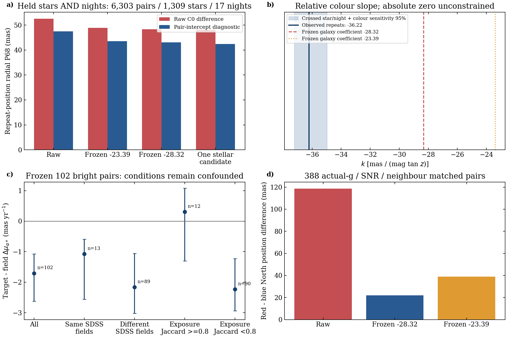

# v2.2 恒星g残差物理判别

本实验支持DECam g位置存在可被真实天顶几何预测的残余颜色信息。独立同星、独立观测夜的原始位置差P68从52.53降至48.18mas，但东向中位没有改善。**保留唯一物理候选；不改变主全域目录。**

图a的单位为位置mas，比较完全相同的6303对、1309星、17夜；红色为未经留出截距再中心化的位置差，蓝色只作相对截距诊断。图b的区间是交叉星/夜及共享颜色扰动敏感度，不含全部系统误差。图c保持原102簇/场对，单位mas/yr；条件子组相互交织，不作单项因果解释。图d保持实际g/SNR/邻源匹配的388个红蓝对。

主目录不加入颜色修正。本支线只得到一个可复现的相对颜色导数候选，绝对截距仍未确定。原星系系数−28.32/−23.39及v1.5 QSO负结果保持。

- 冻结亮端物理成员恢复20032条g测量；19733条DECam可计算Blanco几何，299条Bok不套用Blanco。原18曝光/13个UTC日历日期不能称13个独立观测夜；进一步检验采用UTC18物理夜。
- 实际g差≤0.3mag、logSNR差≤0.15、天空≤0.05deg、深邻源≥3arcsec，得到388个红蓝对、337颗物理星、12物理夜、214曝光CCD组。北向红减蓝118.734mas；冻结−28.32/−23.39后的差为21.990/38.937mas。同组常数抵消至1.42e−14mas。这里Gaia只作亮端残差验证。
- 原NGC重复几何只有1个合格夜，无法独立训练。依据已有CCD覆盖、真实气团和同夜几何，在读取新自行前冻结两个额外核心：w220_090_00_00（低气团）与w140_090_82_10（重复几何）。这两个标签是生产区域而非源身份。
- 新重复测量共121506对。逐源SDSS颜色、实际g SNR≥20、邻源≥3arcsec、光谱QSO排除。每源/夜只取一个最大几何跨度对，曝光CCD对保留二维自由截距。不读取Gaia位置、自行或视差训练。
- 最终58918训练对/3832颗星/69夜/2782截距组；完全留出身份且留出夜的6303对/1309星/17夜。二维GLS共同天顶向量系数−36.2213 mas/(mag tan z)。条件质心SE0.5692；交叉星/夜重权并按物理星共享一次颜色误差扰动，敏感度SE0.6655、95%范围[−37.2187,−34.9735]。这是条件敏感度，不是全系统误差后验；点解条件于观测颜色，不宣称完整潜变量误差模型。
- 48同步原C0组扰动与自由截距联合剖面，系数变化≤7.11e−15。公共模式被显式截距吸收，不以对象数开平方缩小。系数及截距联合重算，物理星颜色误差在重复夜间共享。
- 独立身份/夜原始C0位置差P68：52.533→48.181mas，改善8.28%。相对截距诊断47.452→42.426mas；留出截距仅诊断，不能据此认证绝对零点。原始东/北中位(4.380,2.758)→(4.890,2.626)mas，东向未改善。留出样本即使真实自行10000mas/yr，最大同夜时间位移约7.77mas，未假定所有恒星零运动。
- 固定102簇/场配对东残差−1.709mas/yr。g历史预测中位仅+0.018/+0.015mas/yr；同SDSS field13对−1.077，异field89对−2.167；高NSC曝光Jaccard12对+0.306，其余90对−2.234。样本条件交织，不能把差异当某一个仪器的因果偏移。先配对再合成48同步参考：群体均值公共SE约0.00375/0.00385mas/yr，未除sqrt(N)。

因此候选仅保留在独立支线，不推广主目录、不声称已修正NGC东向偏差、不根据QSO重调系数。真实g信噪、颜色、邻源方向和seeing的固定系数分层另外公开；稀疏邻源层按实际分母描述。深LS与部分NSC共享图像，不是外部恒星真值。

## 公开产物

中文报告、聚合JSON与四面板图；逐测量、逐源颜色/身份/几何、SAS私有映射、深邻源表均留NERSC PScratch。公开图a为同星位置差而非自行误差，图b为相对颜色斜率，图c才是mas/yr且保持原102分母。所有区间按各自对象/夜/配对敏感度说明，不能混用。
